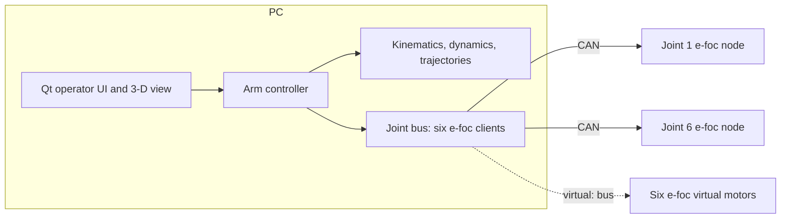
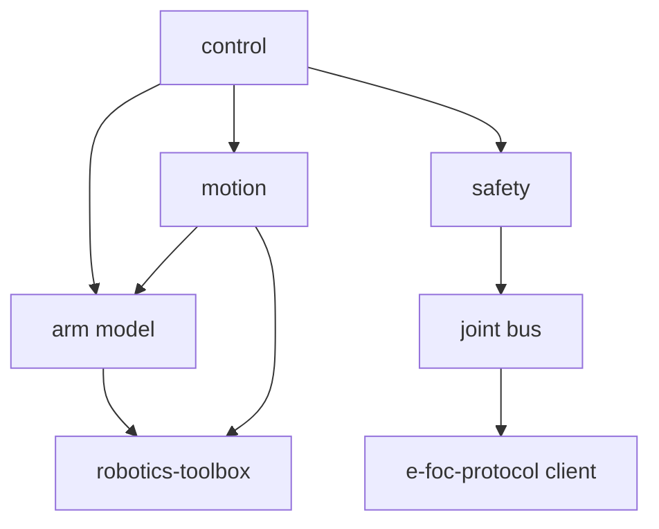
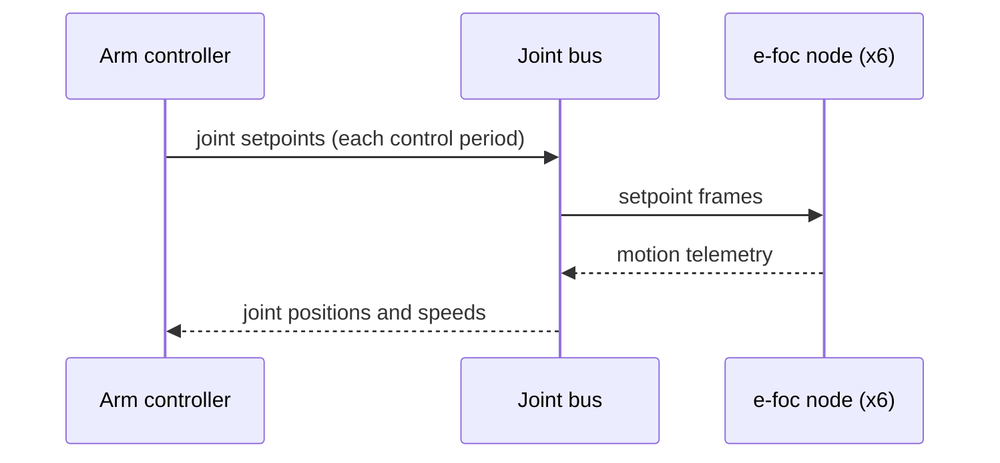

| Field     | Value               |
|-----------|---------------------|
| Title     | System Architecture |
| Type      | architecture        |
| Status    | draft               |
| Version   | 0.7.0               |
| Component | system              |
| Date      | 2026-11-12          |

> Target architecture of e-robot-arm. The repository is bootstrapped from embedded-scaffold: the joint bus
> (`core/joint_bus/`, [design](../design/joint-bus.md)), the safety supervisor (`core/safety/`,
> [design](../design/safety.md)), joint-space motion (`core/motion/`, [design](../design/joint-motion.md)) and the
> control loop (`core/control_loop/`, [design](../design/control-loop.md)) exist, put together by `core/arm/` and
> driven from a terminal by `tools/arm_console/` ([design](../design/arm-console.md)); the other components below
> are planned, and the scaffold's `example_*` components stay until they are replaced. Diagrams are Mermaid or ASCII
> art only.

---

## Assumptions & Constraints

- **Constraint**: the arm has six joints, each an e-foc motor node on one CAN bus; no gripper yet.
- **Constraint**: each node closes its own current, speed and position loops; the arm controller sends setpoints
  and reads telemetry over the FOC motor category of can-lite (e-foc-protocol).
- **Constraint**: no dynamic memory allocation in `core/`; application logic depends only on abstractions, so the
  controller can move from the PC to a microcontroller without rewriting it.
- **Assumption**: the controller runs on a PC for now; a desktop operating system adds jitter, so the arm loop
  runs at a few hundred hertz and leaves the fast loops to the nodes.
- **Assumption**: the bus runs at 1 Mbit/s. An e-foc node answers telemetry only when asked, so each period carries
  six requests, twelve answers and six setpoints, about 2.9 ms of bus time: the arm loop runs at 200 Hz (5 ms),
  about 57 % bus load ([control loop](../design/control-loop.md)).

---

## System Overview

The same controller runs against three back ends, chosen by the CAN bus it opens: a simulated arm, six virtual
e-foc motors on can-lite's virtual bus, or the real arm.

---

## Component Decomposition

| Sub-component | Responsibility                                                                           |
|---------------|------------------------------------------------------------------------------------------|
| arm model     | Kinematic and dynamic parameters of the six joints, the tool frame and the base mount    |
| joint bus     | Six e-foc nodes on one client: node map, contract check, fault fan-out, liveness         |
| motion        | Synchronised joint moves today; trajectories and time-optimal path parameterisation      |
| control loop  | The fixed control period: telemetry requests, then the setpoint step half a period later |
| control       | Joint-space and Cartesian control with dynamics feed-forward                             |
| safety        | Guards the joint bus: joint limits, contract gate, emergency stop on a fault or silence  |
| simulator     | Qt operator UI and 3-D view, running the same core against virtual motors or the arm     |

---

## Interfaces & Contracts

### Provided Interfaces

| Interface      | Direction | Purpose                                         | Invariants                                  |
|----------------|-----------|-------------------------------------------------|---------------------------------------------|
| Arm controller | provided  | Commands the arm in joint or Cartesian space    | No heap; refuses targets outside the limits |
| Joint bus      | provided  | Six joints as one set of setpoints and readings | Refuses a node whose contract differs       |

### Required Interfaces

| Interface         | Direction | Purpose                                  | Invariants                       |
|-------------------|-----------|------------------------------------------|----------------------------------|
| hal::Can          | required  | The CAN adapter or virtual bus           | Provided by the platform         |
| FocMotorCanClient | required  | Commands and telemetry of one e-foc node | From e-foc-protocol              |
| robotics-toolbox  | required  | Kinematics, dynamics, trajectories       | Float-only, heap-free algorithms |

---

## Data Flow

---

## Cross-Cutting Concerns

- **Timing**: the arm loop period is fixed and measured; a missed period is reported, never silently skipped.
- **Faults**: a fault on any node stops the arm; the joint bus reports which node and why.
- **Testing**: the core is unit-tested on the host; integration scenarios run the controller against virtual
  motors.

---

## Open Questions & Decisions

| # | Question / Decision                          | Status  | Options Considered                         | Rationale                                                          |
|---|----------------------------------------------|---------|--------------------------------------------|--------------------------------------------------------------------|
| 1 | Where the controller runs                    | decided | MCU board, Linux single-board computer, PC | PC first; the core stays portable for a later MCU target           |
| 2 | Dependencies as submodules or FetchContent   | decided | Submodules, FetchContent                   | Final projects pin their dependencies as submodules under `infra/` |
| 3 | Combined position, speed and torque setpoint | open    | Per-kind setpoints, one combined command   | Needs a minor e-foc-protocol contract version                      |
| 4 | Coupling the virtual motors to arm dynamics  | open    | Plant-port external torque, own plant      | Decides how realistic the simulated arm is                         |
