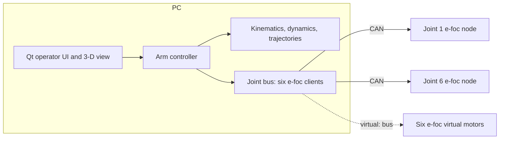
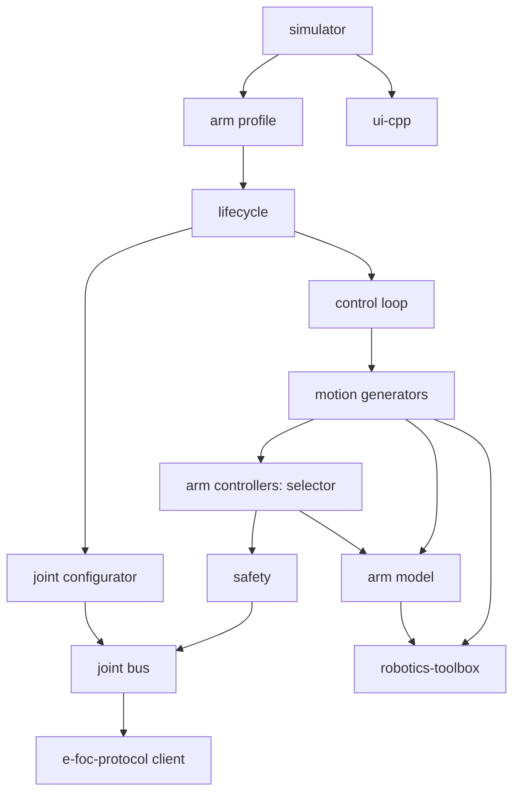
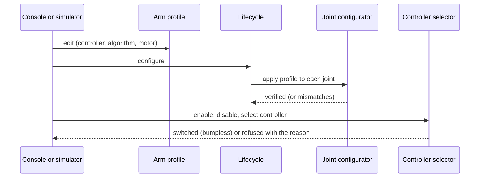
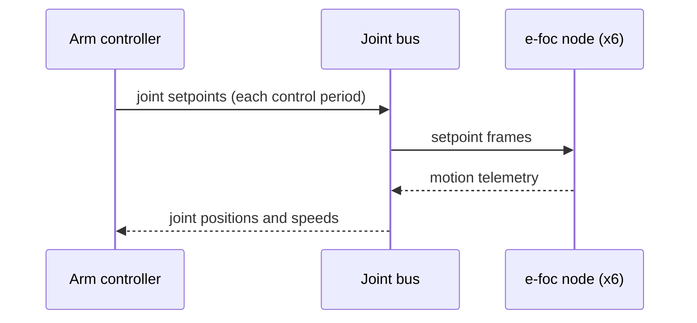

| Field     | Value               |
|-----------|---------------------|
| Title     | System Architecture |
| Type      | architecture        |
| Status    | draft               |
| Version   | 0.10.0              |
| Component | system              |
| Date      | 2026-11-12          |

> Target architecture of e-robot-arm. The repository is bootstrapped from embedded-scaffold: the joint bus
> (`core/joint_bus/`, [design](../design/joint-bus.md)), the safety supervisor (`core/safety/`,
> [design](../design/safety.md)), joint-space motion (`core/motion/`, [design](../design/joint-motion.md)) and the
> control loop (`core/control_loop/`, [design](../design/control-loop.md)) and the lifecycle (`core/lifecycle/`,
> [design](../design/arm-lifecycle.md)) exist, put together by `core/arm/` and driven by the console
> (`tools/arm_console/`, [design](../design/arm-console.md)) and the simulator (`tools/simulator/`,
> [design](../design/simulator.md)). The other components below are planned in the [roadmap](../roadmap.md), one
> GitHub issue per phase. Diagrams are Mermaid or ASCII art only.

---

## Assumptions & Constraints

- **Constraint**: the arm has six joints, each an e-foc motor node on one CAN bus; no gripper yet.
- **Constraint**: each node closes its own current, speed and position loops; the arm controller sends setpoints
  and reads telemetry over the FOC motor category of can-lite (e-foc-protocol).
- **Constraint**: no dynamic memory allocation in `core/`; application logic depends only on abstractions, so the
  controller can move from the PC to a microcontroller without rewriting it.
- **Assumption**: the controller runs on a PC for now; a desktop operating system adds jitter, so the arm loop
  runs at a few hundred hertz and leaves the fast loops to the nodes.
- **Assumption**: the bus runs at 1 Mbit/s. An e-foc node answers telemetry only when asked, so each period carries
  six requests, twelve answers and six setpoints, and the node acknowledges every request and every setpoint: 36
  frames, about 4.3 ms of bus time. The arm loop runs at 100 Hz (10 ms), about 43 % bus load
  ([control loop](../design/control-loop.md)).

---

## System Overview

The same controller runs against three back ends, chosen by the CAN bus it opens: a simulated arm, six virtual
e-foc motors on can-lite's virtual bus, or the real arm.

---

## Component Decomposition

| Sub-component      | Responsibility                                                                                                                                                                     | Status                                          |
|--------------------|------------------------------------------------------------------------------------------------------------------------------------------------------------------------------------|-------------------------------------------------|
| joint bus          | Six e-foc nodes on one client: node map, contract check, fault fan-out, liveness; joint ↔ motor transmission                                                                       | exists; phase 1                                 |
| safety             | Guards the joint bus: limits, contract gate, emergency stop on a fault or silence; later speed, torque, collision                                                                  | exists; phase 6                                 |
| motion             | Motion generators: synchronised moves today; S-curve, waypoints, Cartesian, jog                                                                                                    | exists; phase 4                                 |
| control loop       | The fixed control period: telemetry requests, then the setpoint step half a period later                                                                                           | exists; phase 1                                 |
| lifecycle          | Start-up order: contracts, calibration, configuration, homing, enable; trip and re-arm                                                                                             | exists; phase 2, homing                         |
| arm profile        | The single description of an arm: per joint node, transmission, limits, motor controller, motor; arm geometry and controllers                                                      | phase 2                                         |
| joint configurator | Applies and verifies each joint's motor controller (algorithms, gains) and motor model over CAN                                                                                    | exists (motor controller); phase 2, motor model |
| arm controllers    | Registry and selector: controllers enabled, disabled and switched at run time, bumpless                                                                                            | phase 2, catalogue in 5                         |
| arm model          | Kinematics and dynamics of the six joints, the tool frame and the base mount                                                                                                       | phase 3                                         |
| virtual arm        | Six e-foc virtual motors with selectable motor characteristics, coupled to the arm's dynamics                                                                                      | phase 7                                         |
| arm host           | The arm on its own thread with its target: simulated joints, `virtual:` bus or real adapter; commands in, snapshot, events and traces out; shared by the console and the simulator | exists (8a)                                     |
| simulator          | Qt operator station on ui-cpp with a Qt Quick 3D arm view: scopes, configuration forms; runs the same core on any back end                                                         | exists (8a, 8b motor controller); 8b–8d         |

---

## Configurability

What varies between arms, joints and experiments is data in the **arm profile**, chosen at run time by the console or
the simulator, never by a compile-time switch:

| Choice                          | Options                                                                                                                                                           | Where it acts                                               | When it may change                        |
|---------------------------------|-------------------------------------------------------------------------------------------------------------------------------------------------------------------|-------------------------------------------------------------|-------------------------------------------|
| Arm controller                  | Registered controllers, each enabled or disabled; one active                                                                                                      | Control loop's setpoint step                                | At rest, or bumpless                      |
| Motion generator                | Trapezoid, S-curve, waypoints, Cartesian, jog                                                                                                                     | Reference fed to the arm controller                         | At rest                                   |
| Motor controller per joint      | e-foc control mode; current: PID, decoupled PID, deadbeat, sliding mode; speed: PID, LQI, ADRC, two-DOF; position: PID, cascade P, LQR, LQI, two-DOF; their gains | e-foc node, through the joint configurator                  | Lifecycle `Ready`, not enabled            |
| Motor characteristics per joint | Preset (`teknic`, `anaheim`, …) or custom R, L, pole pairs, flux, inertia, friction, limits                                                                       | Real node: motor-model parameters; virtual motor: its plant | Lifecycle `Ready`; virtual motor restarts |

---

## Interfaces & Contracts

### Provided Interfaces

| Interface      | Direction | Purpose                                         | Invariants                                  |
|----------------|-----------|-------------------------------------------------|---------------------------------------------|
| Arm controller | provided  | Commands the arm in joint or Cartesian space    | No heap; refuses targets outside the limits |
| Joint bus      | provided  | Six joints as one set of setpoints and readings | Refuses a node whose contract differs       |

### Required Interfaces

| Interface         | Direction | Purpose                                                  | Invariants                       |
|-------------------|-----------|----------------------------------------------------------|----------------------------------|
| hal::Can          | required  | The CAN adapter or virtual bus                           | Provided by the platform         |
| FocMotorCanClient | required  | Commands and telemetry of one e-foc node                 | From e-foc-protocol              |
| robotics-toolbox  | required  | Kinematics, dynamics, trajectories, controllers          | Float-only, heap-free algorithms |
| ui-cpp            | required  | Simulator primitives: shell, model, scope, charts, theme | Host only; Qt backend opt-in     |
| Qt Quick 3D       | required  | The simulator's lit, shadowed 3-D arm view               | Host only; `host-qt` preset      |

---

## Data Flow

---

## Cross-Cutting Concerns

- **Timing**: the arm loop period is fixed and measured; a missed period is reported, never silently skipped.
- **Faults**: a fault on any node stops the arm; the joint bus reports which node and why.
- **Testing**: the core is unit-tested on the host; integration scenarios run the controller against six simulated
  e-foc nodes (e-foc-protocol's motor server) on an in-process CAN bus, tagged with the arm requirements; runs
  against e-foc's virtual motors come next.

---

## Open Questions & Decisions

| # | Question / Decision                          | Status  | Options Considered                                                     | Rationale                                                                                                         |
|---|----------------------------------------------|---------|------------------------------------------------------------------------|-------------------------------------------------------------------------------------------------------------------|
| 1 | Where the controller runs                    | decided | MCU board, Linux single-board computer, PC                             | PC first; the core stays portable for a later MCU target                                                          |
| 2 | Dependencies as submodules or FetchContent   | decided | Submodules, FetchContent                                               | Final projects pin their dependencies as submodules under `infra/`                                                |
| 3 | Combined position, speed and torque setpoint | open    | Per-kind setpoints, one combined command                               | Needs a minor e-foc-protocol contract version; phase 5 (#21)                                                      |
| 4 | Coupling the virtual motors to arm dynamics  | open    | Plant-port external torque, own plant                                  | Decides how realistic the simulated arm is; phase 7 (#23)                                                         |
| 5 | How a command reaches all joints or none     | open    | Pending command in the joint bus, command phase, deeper queue          | Phase 1 (#17)                                                                                                     |
| 6 | Everything that varies is profile data       | decided | Compile-time choices, run-time profile                                 | The simulator and the platform must switch controllers and motors at run time; phase 2 (#18)                      |
| 7 | Simulator widgets                            | decided | Own Qt widgets, ui-cpp                                                 | Reuse ui-cpp's shell, model, scope, charts and theme; phase 8 (#24)                                               |
| 8 | Simulator 3-D rendering                      | decided | ui-cpp `ui::stage` (flat shading, no shadows), Qt Quick 3D, own OpenGL | Qt Quick 3D: PBR materials, image-based lighting, soft shadows, SSAO; `ui::stage` stays for tests; phase 8a (#28) |
