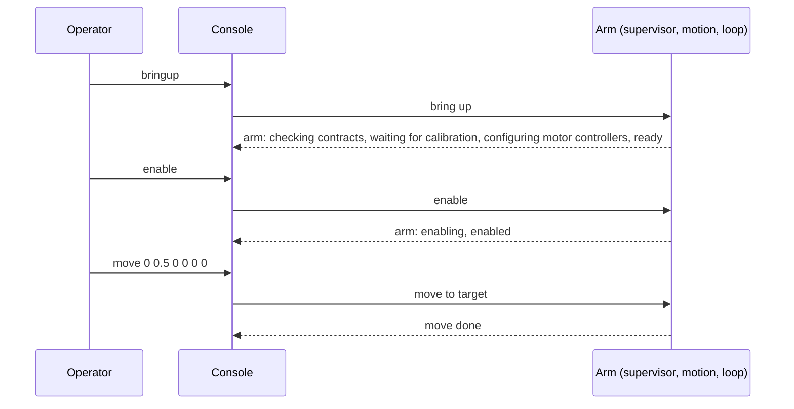

| Field     | Value                              |
|-----------|------------------------------------|
| Title     | Arm Composition and Console Design |
| Type      | design                             |
| Status    | draft                              |
| Version   | 0.4.0                              |
| Component | arm                                |
| Date      | 2026-11-12                         |

> How the arm's components are put together, and the host console that drives them over a CAN adapter. Behaviour
> only; diagrams are Mermaid.

---

## Responsibilities

**Is responsible for:**

- Building the arm from one FOC motor category client and one configuration: the joint bus, the safety supervisor
  in front of it, joint motion behind the supervisor, and the control loop that paces them.
- On the host, opening a CAN adapter by name, running the event loop, and turning typed commands into calls on
  the arm and its events into printed lines.

**Is NOT responsible for:**

- Any rule of the components themselves: limits, trips, planning and pacing stay in their own designs.
- Configuring the e-foc nodes (node ids, gains, calibration): that is the CAN Commander's job.
- A graphical interface: the Qt simulator comes later and reuses the composition.

---

## Component Details

### Part A — Composition

The arm owns, in this order of construction:

1. the joint bus, on the client, with the six node ids and the number of telemetry requests a joint may miss;
2. the safety supervisor, in front of the joint bus, with each joint's position limits;
3. joint motion, behind the supervisor, with each joint's speed and acceleration limits and the control period;
4. the control loop, at the control period, requesting telemetry through the supervisor and running joint
   motion's step in its setpoint phase.

The composition allocates nothing and runs on the host and on a microcontroller alike. Its users reach the
supervisor, joint motion and the control loop; the joint bus stays behind the supervisor.

### Part B — Console

The console is a host program. It opens the CAN adapter named on its command line (`virtual:<bus>`, a SocketCAN
interface or a serial slcan adapter) at the given bit rate, builds the FOC motor client and the arm, starts the
control loop and reads one command per line from standard input:

| Command                        | Effect                                                                                                                    |
|--------------------------------|---------------------------------------------------------------------------------------------------------------------------|
| `bringup`                      | Bring the arm up: check the contracts, then wait for calibration ([arm-lifecycle.md](arm-lifecycle.md))                   |
| `enable`, `disable`            | Select the configured control mode and start the joints, or stop them                                                     |
| `contracts`                    | Query the contract version of all six joints                                                                              |
| `mode torque\|speed\|position` | Select a control mode on all six joints                                                                                   |
| `start`, `stop`                | Start or stop all six joints                                                                                              |
| `estop`                        | Emergency stop of all six joints                                                                                          |
| `clear`                        | Clear the faults of all six joints                                                                                        |
| `rearm`                        | Re-arm the arm after a trip                                                                                               |
| `move q1 q2 q3 q4 q5 q6`       | Move the six joints to the positions, in radians; only while enabled                                                      |
| `abort`                        | Abort the running move                                                                                                    |
| `load <file>`                  | Load an arm profile file: the arm is rebuilt from it; refused while the arm is enabled ([arm-profile.md](arm-profile.md)) |
| `save <file>`                  | Write the profile in effect to a file                                                                                     |
| `pose`                         | Print the tool pose of the measured joints and the singularity the arm is near ([arm-model.md](arm-model.md))             |
| `fk q1 q2 q3 q4 q5 q6`         | Print the tool pose of the given joint positions, in radians; moves nothing                                               |
| `ik x y z roll pitch yaw`      | Print the joint positions of the given tool pose (m, rad), or why there are none; moves nothing                           |
| `status`                       | Print each joint's position, speed, state and fault, the arm's lifecycle state, the trip, the move and the overrun count  |
| `quit`                         | Stop the control loop and leave                                                                                           |

`bringup`, `enable`, `disable`, `rearm` and `move` go through the arm's lifecycle; `contracts`, `mode`, `start`,
`stop`, `clear` and `estop` reach the joints directly, for debugging, and the lifecycle follows where they leave the
arm. Every command prints whether it was accepted. Events print as they happen: each lifecycle state (`arm: ready`, or
`arm: misconfigured (joint 5 reads back different)` naming the joint),
the contract outcome, a joint that faulted or went silent, a move done or aborted. An unknown command or a malformed one prints a usage line and
sends nothing.

The console runs on the arm host shared with the simulator ([simulator.md](simulator.md) Parts B and E): the arm
lives on the host's thread, each typed command is posted to it, and the console waits up to 2 s for that command's
answer, `ok` or `refused: <reason>`. `--profile <file>` loads a profile at start; a profile the reader refuses
prints the reader's message, which names the item, and the console does not start. Events print as they come, polled every 20 ms. `--bus simulated` runs six
simulated joints in the process with no CAN at all.

For a `virtual:` bus the host runs can-lite's virtual CAN hub, or joins the one already running when another process
(an e-foc virtual motor, for instance) hosts it. The hub and the CAN adapter are polled every millisecond on the
host's event loop.

---

## Interfaces

### Provided

| Interface        | Purpose                                           | Contract                                     |
|------------------|---------------------------------------------------|----------------------------------------------|
| Arm              | The supervisor, joint motion and the control loop | Built once; nothing allocated                |
| Console commands | Operate the arm from a terminal                   | One line per command; every command answered |

### Required

| Interface                 | Purpose                  | Contract                                |
|---------------------------|--------------------------|-----------------------------------------|
| FOC motor category client | The six e-foc nodes      | Observed by the joint bus only          |
| CAN bus adapter           | The bus, real or virtual | can-lite's platform adapter on the host |

---

## Data Model

| Entity        | Field              | Type / Unit     | Default       | Notes                             |
|---------------|--------------------|-----------------|---------------|-----------------------------------|
| Configuration | node ids           | CAN node id     | 1 … 6         | `--nodes`, base joint first       |
| Configuration | missed requests    | count           | 3             | Before a joint is reported silent |
| Configuration | position limits    | radians         | −π … π        | Every joint                       |
| Configuration | speed limit        | radians/second  | 1             | Every joint                       |
| Configuration | acceleration limit | radians/second² | 2             | Every joint                       |
| Configuration | control period     | duration        | 10 ms         | 100 Hz                            |
| Console       | bus                | adapter name    | `virtual:arm` | `--bus`                           |
| Console       | bit rate           | bits/second     | 1 000 000     | `--bitrate`                       |

---

## Sequence Diagrams

---

## Constraints & Limitations

| Constraint | Value / Description                                                                |
|------------|------------------------------------------------------------------------------------|
| Limits     | The console uses the same limits for every joint until the arm model provides them |
| Threads    | Standard input is read on its own thread; everything else runs on the event loop   |
| Memory     | The composition allocates nothing; the console, a host tool, may                   |

---

## Open Questions

| # | Question                                     | Options                                 | Status |
|---|----------------------------------------------|-----------------------------------------|--------|
| 1 | Where per-joint limits and node ids are kept | Command line, a configuration file, NVM | open   |
