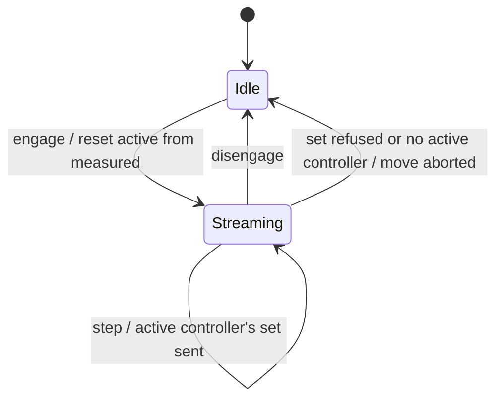
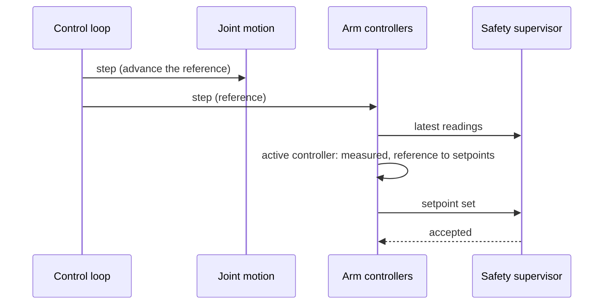
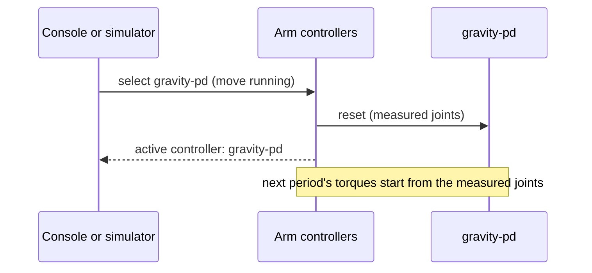

| Field     | Value                  |
|-----------|------------------------|
| Title     | Arm Controllers Design |
| Type      | design                 |
| Status    | draft                  |
| Version   | 0.8.0                  |
| Component | arm-controllers        |
| Date      | 2026-11-17             |

> Which controller turns the motion's reference into the joints' setpoints, and how one is enabled, disabled and
> switched at run time without a setpoint step (phase 2, [#18](https://github.com/embedded-pro/e-robot-arm/issues/18)
> part 3). Behaviour only; diagrams are Mermaid.

---

## Responsibilities

**Is responsible for:**

- Holding the arm controllers the arm offers, each by an id and a name, each enabled or disabled, and at most one
  of them active.
- Enabling, disabling and selecting a controller, refusing a switch that would make the setpoints jump.
- Running the active controller once per control period while the arm streams setpoints: from the measured joints
  and the motion's reference to one setpoint set, sent through the safety supervisor.
- Reporting every change of the active controller.

**Is NOT responsible for:**

- Generating the reference: joint motion plans and samples it ([joint-motion.md](joint-motion.md)).
- Guarding the setpoints: the safety supervisor checks every set it is sent ([safety.md](safety.md)).
- Deciding when setpoints stream: the arm starts and stops the streaming with the lifecycle's `Enabled` and `Moving`
  states ([arm-lifecycle.md](arm-lifecycle.md)).
- The rest of the controller catalogue from robotics-toolbox and numerical-toolbox (computed torque, a per-joint
  PID with gravity feed-forward): phase 8d step 6 ([#31](https://github.com/embedded-pro/e-robot-arm/issues/31)).
- Saving which controllers are enabled and active in the arm profile: a later item of the profile format
  ([arm-profile.md](arm-profile.md)).

---

## Component Details

### Part A — The controller

A controller takes the measured joints (positions and speeds from the latest telemetry) and the reference (the joint
positions, speeds and accelerations the motion wants now, [joint-motion.md](joint-motion.md) Part B) and returns a
setpoint set: six joint torques, with the reference positions alongside for the trace and for the safety
supervisor's tracking check.

A controller may keep state between periods. `Reset` gives it the measured joints to start from. A controller
declares whether it supports **bumpless transfer**: after a `Reset` its torques continue from the measured state,
so taking over mid-move does not make them jump.

| Name              | Output                                                                                                | Bumpless |
|-------------------|-------------------------------------------------------------------------------------------------------|----------|
| `gravity-pd`      | Joint torques: a PD law on the position error plus the gravity torque, τ = Kp·(q* − q) − Kd·q′ + G(q) | yes      |
| `computed-torque` | Joint torques: the inverse dynamics of the reference acceleration corrected by a PD on the errors     | yes      |
| `gravity-pid`     | Joint torques: gravity plus the arm's inertia times the reference acceleration and a PID per joint    | yes      |

**The arm controls torque.** The e-foc drives run in torque mode, the only mode the arm enables them in, and every
arm controller runs on the host (the PC
now, a microcontroller later), built from robotics-toolbox's manipulator controllers and numerical-toolbox's control
blocks rather than written here. `gravity-pd` is the first: robotics-toolbox's `PdGravityCompensation` over the arm
model's dynamics ([arm-model.md](arm-model.md) Part F), with q* the reference, q and q̇ the measured joints and Kp
(N·m/rad) and Kd (N·m·s/rad) six-by-six gain matrices. It has no state, and when streaming starts the reference is
the measured position, so its first set is G(q) − Kd·q̇: it takes over without a step.

**Gains from a bandwidth.** The joints differ by more than ten times in the inertia they move, and the shoulder
and elbow move each other, so no diagonal gain set suits them all: gains sized from each joint's own inertia leave
the fast coupled mode of shoulder and elbow, whose inertia is much smaller, damped beyond what a 10 ms loop can
hold, and it oscillates. The profile names a bandwidth ω (rad/s) and a damping ratio ζ instead, and the gains are
the arm's inertia matrix scaled: Kp = ω²·J, Kd = 2·ζ·ω·J, with J the arm model's mass matrix at the home position
plus, on its diagonal, each motor's rotor inertia times its gear ratio squared (Teknic's when the profile names no
motor). Near home every mode of the arm then has its poles at ω with damping ζ; away from home the mass matrix
drifts from J, and the poles with it. Each joint lags a move by about 2·ζ/ω times its speed, and the damping per
control period, 2·ζ·ω·T, does not depend on any inertia. The bandwidth is bounded by the control period and the
telemetry's age: 30 rad/s at 10 ms leaves a wide margin.

**Computed torque.** `computed-torque` is robotics-toolbox's `ComputedTorqueControl`: it asks the arm's inverse
dynamics for the torque that gives each joint the acceleration `a = q̈* + Kd·(q̇* − q̇) + Kp·(q* − q)`, so the arm's
inertia, its coupling and gravity are cancelled and every joint follows the reference as a decoupled second-order
system. The gains are in acceleration units and the same for every joint: Kp = ω²·I, Kd = 2·ζ·ω·I, from the
profile's own bandwidth and damping ratio for it. The arm model has no rotors, so the inverse dynamics it is given
adds each motor's rotor inertia times its gear ratio squared, times the joint's acceleration. Unlike `gravity-pd` it
uses the reference speed and acceleration, so it tracks a move without the lag 2·ζ/ω times the speed; like it, it
has no state and takes over without a step.

**PID with gravity feed-forward.** Neither law above has integral action, so a joint settles short of its target by
whatever torque the models leave out, the drives' Coulomb friction first: about 0.04 rad on the elbow of the
virtual arm. `gravity-pid` runs one numerical-toolbox `PidIncremental` per joint on the position error, in
acceleration units, and turns the result into torque the way `gravity-pd` does: `τ = J·(q̈* + u) + G(q)`, with J the
inertia matrix at home and the rotors (above), `q̈*` the reference acceleration and u the six PID outputs. The gains
place each joint's poles at the profile's bandwidth ω: a pair with damping ζ and a real pole for the integral, so
Kp = (2·ζ + 1)·ω², Ki = ω³ and Kd = (2·ζ + 1)·ω, discretised over the control period. The derivative acts on the
error, so it sees the reference speed. Each PID's output is clamped to ±200 rad/s², far beyond any move's need: in the
velocity form the clamp is the anti-windup, so a joint held against an obstacle does not wind its integral up.
`Reset` clears the six PIDs, and the first step after it primes each one's error history with the error at that
moment: neither the proportional nor the derivative term sees a step, only the integral starts, so it takes over a
running move without a torque kick.

The position path, where the drive closed the position loop and `pass-through` and `smoothed` shaped its setpoints,
is gone.

### Part B — Registry and selection

The arm registers its controllers once, when it is built, up to a fixed capacity of four. Ids are their
registration order. A controller is registered disabled; the arm then enables `gravity-pd`, `computed-torque` and
`gravity-pid` and selects `gravity-pd`.

| Request      | Accepted when                                                                           | Effect                                                              |
|--------------|-----------------------------------------------------------------------------------------|---------------------------------------------------------------------|
| enable *id*  | *id* is registered                                                                      | The controller may be selected                                      |
| disable *id* | *id* is registered, and it is not the active controller while the arm drives the joints | It may not be selected; if it was active, no controller is active   |
| select *id*  | *id* is enabled, and no move runs or the controller is bumpless                         | It is `Reset` from the measured joints and becomes active; reported |

Selecting the active controller again is accepted and changes nothing. In torque mode nothing but the active
controller holds the joints, so it cannot be disabled while the arm streams (`Enabled` or `Moving`): the request is
refused with "disable the arm first". Disabled once the arm is disabled, it leaves the arm unable to stream: enabling
then aborts at the first period, until a controller is selected again.

### Part C — Streaming

While the arm streams, the active controller runs once per control period, in the control loop's setpoint phase,
after joint motion has advanced its reference:

1. The reference is the motion's sample while a move runs. Otherwise it is the last reference's positions at rest
   (zero speed and acceleration): the target of the last move, where an aborted move stopped, or the measured
   positions when streaming started.
2. The measured joints are each joint's latest reading.
3. The active controller's torques go to the safety supervisor. A set the supervisor refuses, or a period with no
   active controller, stops the streaming and aborts the running move.

Streaming starts when the arm becomes `Enabled` (the active controller is `Reset` from the measured joints) and stops
when it leaves `Enabled` and `Moving`. So setpoints go out every period while the arm is enabled, not only during a
move: a controller holds the joints on the last reference against gravity between moves.

---

## Interfaces

### Provided

| Interface              | Purpose                                                     | Contract                                                                  |
|------------------------|-------------------------------------------------------------|---------------------------------------------------------------------------|
| Arm controller         | Reset from the measured joints; one setpoint set per period | No heap; a bumpless controller continues from the measured state          |
| Arm controllers        | List, find by name, enable, disable, select; the active one | Refuses as Part B says; changes nothing when it refuses                   |
| Arm controllers events | The active controller changed (to one, or to none)          | Exactly one per change                                                    |
| Streaming              | Engage, disengage, one step per period; the last set sent   | A step reports when the streaming stopped                                 |
| Reference              | The joint reference the active controller tracks            | Only while streaming; checked by the safety supervisor (safety.md Part F) |

### Required

| Interface         | Purpose                                        | Contract                                 |
|-------------------|------------------------------------------------|------------------------------------------|
| Safety supervisor | Latest readings; setpoint sets                 | Refuses sets while tripped or off limits |
| Joint motion      | Whether a move runs; the reference each period | Advanced before the controllers' step    |

---

## Data Model

| Entity            | Field                 | Type / Unit     | Range        | Notes                                          |
|-------------------|-----------------------|-----------------|--------------|------------------------------------------------|
| Measured joints   | positions             | radians         | finite       | Latest reading per joint                       |
| Measured joints   | speeds                | radians/second  | finite       | Latest reading per joint                       |
| Setpoint set      | positions             | radians         | joint limits | The reference, for the trace and the check     |
| Setpoint set      | torques               | N·m, joint side | finite       | Sent to the joints                             |
| `gravity-pd`      | bandwidth             | rad/s           | above 0      | 30 by default; Kp = ω²·J                       |
| `gravity-pd`      | damping ratio         | 1               | above 0      | 0.7 by default; Kd = 2·ζ·ω·J                   |
| `computed-torque` | bandwidth             | rad/s           | above 0      | 30 by default; Kp = ω²·I                       |
| `computed-torque` | damping ratio         | 1               | above 0      | 0.7 by default; Kd = 2·ζ·ω·I                   |
| `gravity-pid`     | bandwidth             | rad/s           | above 0      | 20 by default; Kp = (2ζ + 1)·ω², Ki = ω³       |
| `gravity-pid`     | damping ratio         | 1               | above 0      | 0.7 by default; Kd = (2ζ + 1)·ω                |
| `gravity-pid`     | output limit          | rad/s²          | ±200         | Per joint; the integral's anti-windup          |
| Reference         | speeds, accelerations | rad/s, rad/s²   | finite       | Zero while holding                             |
| Registry entry    | id                    | integer         | 0–3          | Registration order                             |
| Registry entry    | name                  | text            | unique       | `gravity-pd`, `computed-torque`, `gravity-pid` |
| Registry entry    | enabled               | flag            |              | Registered disabled                            |

---

## State Machine

---

## Sequence Diagrams

---

## Constraints & Limitations

| Constraint | Value / Description                                                                      |
|------------|------------------------------------------------------------------------------------------|
| Capacity   | Four controllers                                                                         |
| Bumpless   | From the measured joints: the setpoints move by at most the tracking error at the switch |
| Traffic    | One setpoint set per control period while the arm is enabled                             |
| Memory     | No heap; every controller's state is fixed-size                                          |

---

## Open Questions

| # | Question                                                | Options                                            | Status                       |
|---|---------------------------------------------------------|----------------------------------------------------|------------------------------|
| 1 | Whether the profile stores the enabled and active ones  | Profile section; console and simulator choice only | open: with phase 5           |
| 2 | Whether a switch to a non-bumpless controller may blend | Refuse while moving; ramp from the old set         | decided: refuse while moving |
