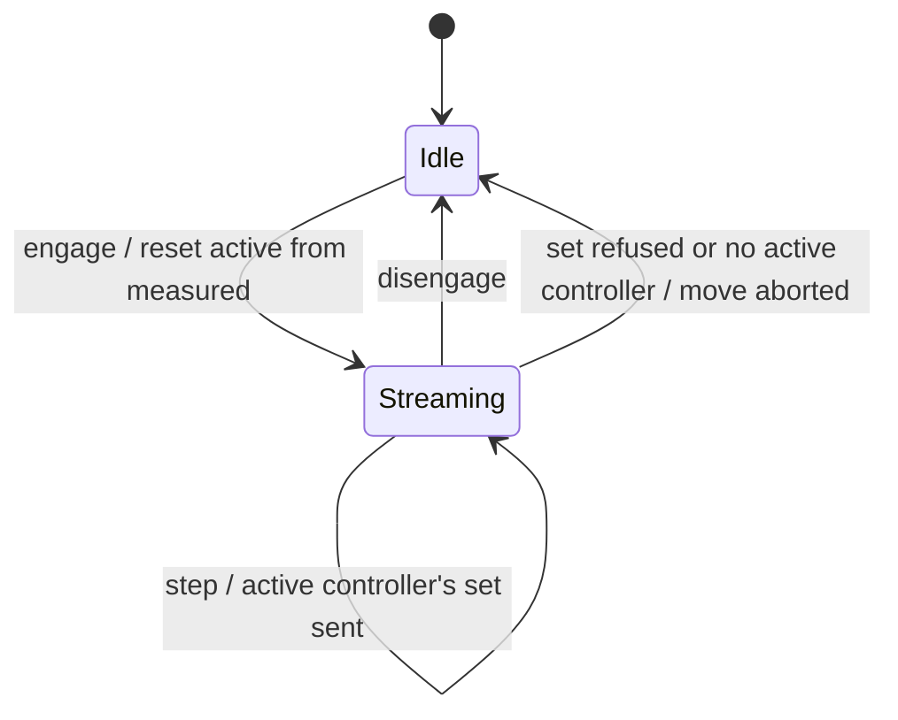
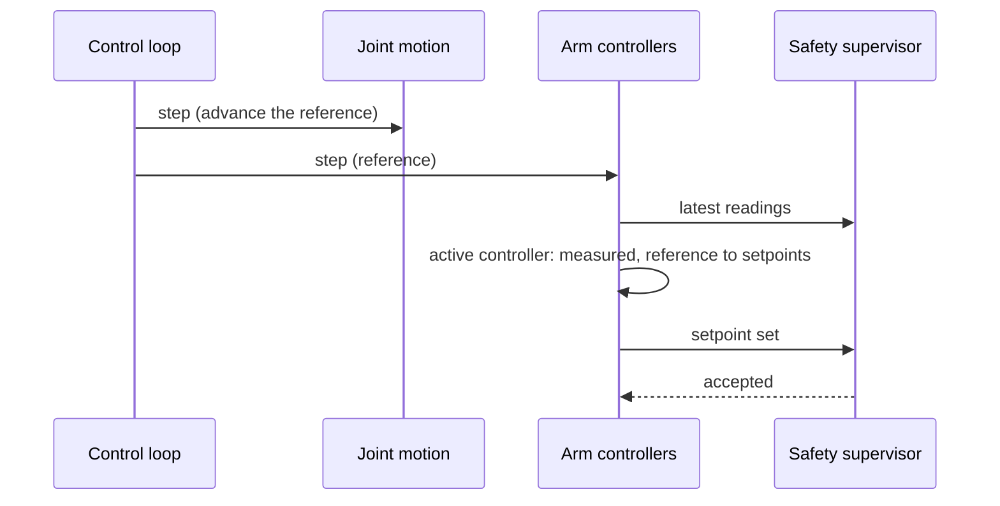
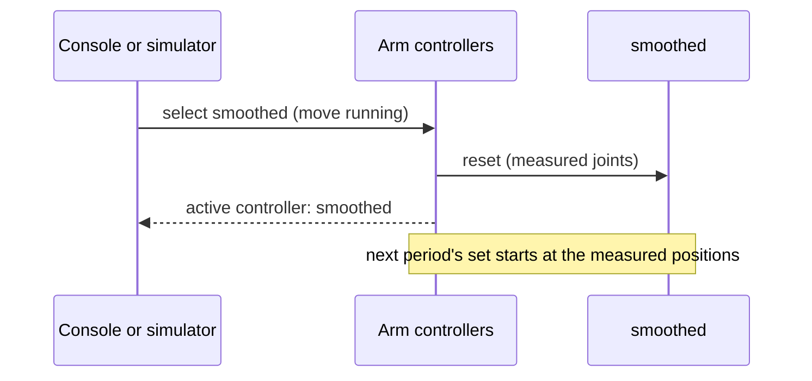

| Field     | Value                  |
|-----------|------------------------|
| Title     | Arm Controllers Design |
| Type      | design                 |
| Status    | draft                  |
| Version   | 0.2.0                  |
| Component | arm-controllers        |
| Date      | 2026-11-14             |

> Which controller turns the motion's reference into the joints' setpoints, and how one is enabled, disabled and
> switched at run time without a setpoint step (phase 2, [#18](https://github.com/embedded-pro/e-robot-arm/issues/18)
> part 3). Behaviour only; diagrams are Mermaid.

---

## Responsibilities

**Is responsible for:**

- Holding the arm controllers the arm offers, each by an id and a name, each enabled or disabled, and at most one
  of them active.
- Enabling, disabling and selecting a controller, refusing a switch that would make the setpoints jump.
- Running the active controller once per control period while the arm streams setpoints: from the measured joints
  and the motion's reference to one setpoint set, sent through the safety supervisor.
- Reporting every change of the active controller.

**Is NOT responsible for:**

- Generating the reference: joint motion plans and samples it ([joint-motion.md](joint-motion.md)).
- Guarding the setpoints: the safety supervisor checks every set it is sent ([safety.md](safety.md)).
- Deciding when setpoints stream: the arm starts and stops the streaming with the lifecycle's `Enabled` and `Moving`
  states ([arm-lifecycle.md](arm-lifecycle.md)).
- Speed and torque feed-forward, and the controller catalogue from robotics-toolbox: phase 5
  ([#21](https://github.com/embedded-pro/e-robot-arm/issues/21)) widens the setpoint set and adds controllers.
- Saving which controllers are enabled and active in the arm profile: a later item of the profile format
  ([arm-profile.md](arm-profile.md)).

---

## Component Details

### Part A — The controller

A controller takes the measured joints (positions and speeds from the latest telemetry) and the reference (the
joint positions the motion wants now) and returns a setpoint set. Today a set is the six joint positions; phase 5
adds speed and torque feed-forward to it.

A controller may keep state between periods. `Reset` gives it the measured joints to start from. A controller
declares whether it supports **bumpless transfer**: after a `Reset` its sets continue from the measured positions,
so taking over mid-move does not make the setpoints jump. A stateless controller that outputs the reference as it is
does not: the reference can be ahead of where the joints are.

Two controllers come first:

| Name           | Output                                                                                      | Bumpless |
|----------------|---------------------------------------------------------------------------------------------|----------|
| `pass-through` | The reference, unchanged: today's behaviour                                                 | no       |
| `smoothed`     | Each joint's reference through a first-order low-pass of time constant τ, reset to measured | yes      |

`smoothed` filters each joint with an exponential moving average whose weight per period T is T / (τ + T)
(numerical-toolbox `ExponentialMovingAverage`). It trades tracking lag for gentler setpoints; τ is 50 ms in the
reference arm.

### Part B — Registry and selection

The arm registers its controllers once, when it is built, up to a fixed capacity of four. Ids are their
registration order. A controller is registered disabled; the arm then enables and selects its default
(`pass-through`).

| Request      | Accepted when                                                   | Effect                                                              |
|--------------|-----------------------------------------------------------------|---------------------------------------------------------------------|
| enable *id*  | *id* is registered                                              | The controller may be selected                                      |
| disable *id* | *id* is registered                                              | It may not be selected; if it was active, no controller is active   |
| select *id*  | *id* is enabled, and no move runs or the controller is bumpless | It is `Reset` from the measured joints and becomes active; reported |

Selecting the active controller again is accepted and changes nothing. With no controller active the arm cannot
stream setpoints: a running move is aborted at its next period and the joints hold their last setpoint. That is how
disabling the active controller stops the arm; it is not an emergency stop, and the arm stays enabled.

### Part C — Streaming

While the arm streams, the active controller runs once per control period, in the control loop's setpoint phase,
after joint motion has advanced its reference:

1. The reference is the motion's sample while a move runs. Otherwise it is the last reference given: the target of
   the last move, where an aborted move stopped, or the measured positions when streaming started.
2. The measured joints are each joint's latest reading.
3. The active controller's set goes to the safety supervisor. A set the supervisor refuses, or a period with no
   active controller, stops the streaming and aborts the running move.

Streaming starts when the arm becomes `Enabled` (the active controller is `Reset` from the measured joints) and stops
when it leaves `Enabled` and `Moving`. So setpoints go out every period while the arm is enabled, not only during a
move: a controller with state, `smoothed` or phase 5's, keeps converging after the reference stops.

---

## Interfaces

### Provided

| Interface              | Purpose                                                     | Contract                                                         |
|------------------------|-------------------------------------------------------------|------------------------------------------------------------------|
| Arm controller         | Reset from the measured joints; one setpoint set per period | No heap; a bumpless controller continues from the measured state |
| Arm controllers        | List, find by name, enable, disable, select; the active one | Refuses as Part B says; changes nothing when it refuses          |
| Arm controllers events | The active controller changed (to one, or to none)          | Exactly one per change                                           |
| Streaming              | Engage, disengage, one step per period; the last set sent   | A step reports when the streaming stopped                        |

### Required

| Interface         | Purpose                                        | Contract                                 |
|-------------------|------------------------------------------------|------------------------------------------|
| Safety supervisor | Latest readings; setpoint sets                 | Refuses sets while tripped or off limits |
| Joint motion      | Whether a move runs; the reference each period | Advanced before the controllers' step    |

---

## Data Model

| Entity          | Field         | Type / Unit    | Range        | Notes                                      |
|-----------------|---------------|----------------|--------------|--------------------------------------------|
| Measured joints | positions     | radians        | finite       | Latest reading per joint                   |
| Measured joints | speeds        | radians/second | finite       | Latest reading per joint                   |
| Setpoint set    | positions     | radians        | joint limits | Phase 5 adds speed and torque feed-forward |
| Registry entry  | id            | integer        | 0–3          | Registration order                         |
| Registry entry  | name          | text           | unique       | `pass-through`, `smoothed`                 |
| Registry entry  | enabled       | flag           |              | Registered disabled                        |
| `smoothed`      | time constant | seconds        | > 0          | 50 ms in the reference arm                 |

---

## State Machine

---

## Sequence Diagrams

---

## Constraints & Limitations

| Constraint | Value / Description                                                                      |
|------------|------------------------------------------------------------------------------------------|
| Capacity   | Four controllers                                                                         |
| Bumpless   | From the measured joints: the setpoints move by at most the tracking error at the switch |
| Traffic    | One setpoint set per control period while the arm is enabled                             |
| Memory     | No heap; every controller's state is fixed-size                                          |

---

## Open Questions

| # | Question                                                | Options                                            | Status                       |
|---|---------------------------------------------------------|----------------------------------------------------|------------------------------|
| 1 | Whether the profile stores the enabled and active ones  | Profile section; console and simulator choice only | open: with phase 5           |
| 2 | Whether a switch to a non-bumpless controller may blend | Refuse while moving; ramp from the old set         | decided: refuse while moving |
