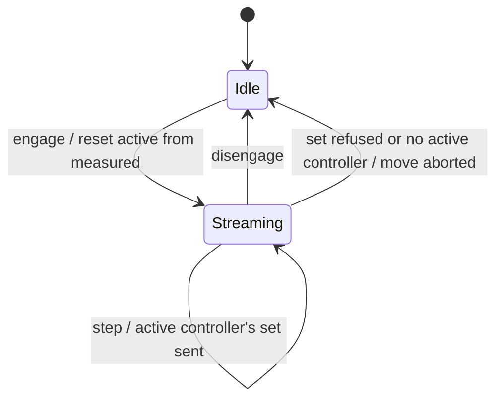
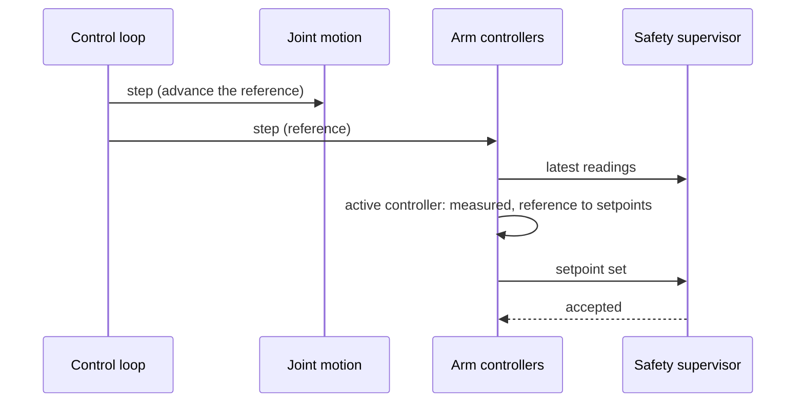
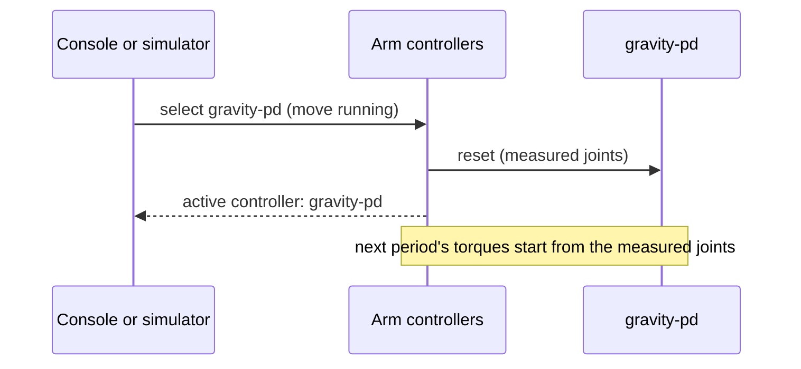

| Field     | Value                  |
|-----------|------------------------|
| Title     | Arm Controllers Design |
| Type      | design                 |
| Status    | draft                  |
| Version   | 0.21.1                 |
| Component | arm-controllers        |
| Date      | 2026-11-26             |

> Which controller turns the motion's reference into the joints' setpoints, and how one is enabled, disabled and
> switched at run time without a setpoint step (phase 2, [#18](https://github.com/embedded-pro/e-robot-arm/issues/18)
> part 3). Behaviour only; diagrams are Mermaid.

---

## Responsibilities

- Holding the arm controllers the arm offers, each by an id and a name, each enabled or disabled, and at most one
  of them active.
- Enabling, disabling and selecting a controller, refusing a switch that would make the setpoints jump.
- Running the active controller once per control period while the arm streams setpoints.
- Turning the measured joints and the motion's reference into one setpoint set, sent through the safety supervisor.
- Reporting every change of the active controller.

---

## Component Details

### Part A — The controller

A controller takes two inputs and returns a setpoint set. The first input is the measured joints: positions and
speeds from the latest telemetry. A reading can come from an earlier period, answered too late for this step's
setpoints. The controller then advances it by its speed for each period it missed, at most two. So a late answer does
not add a period of delay to the loop. The second input is the reference: the joint positions, speeds and
accelerations that the motion wants now ([joint-motion.md](joint-motion.md) Part B).

The setpoint set holds six joint torques. The reference positions go alongside, for the trace and for the safety
supervisor's tracking check.

A controller can keep state between periods. A reset gives it the measured joints to start from and the reference
held at that moment. That reference is the last one the old controller followed, or the measured pose at rest when
streaming starts. A controller declares whether it supports **bumpless transfer**. After a reset, the torques of such
a controller continue from the measured state. So a take-over mid-move does not make them jump.

| Name              | Output                                                                                                | Bumpless |
|-------------------|-------------------------------------------------------------------------------------------------------|----------|
| `gravity-pd`      | Joint torques: a PD law on the position error plus the gravity torque, τ = Kp·(q* − q) − Kd·q′ + G(q) | yes      |
| `computed-torque` | Joint torques: the inverse dynamics of the reference acceleration corrected by a PD on the errors     | yes      |
| `gravity-pid`     | Joint torques: gravity plus the arm's inertia times the reference acceleration and a PI-D per joint   | yes      |

**The arm controls torque.** The e-foc drives run in torque mode, the only mode that the arm enables them in. Every
arm controller runs on the host: the PC now, a microcontroller later. The arm builds every controller from
robotics-toolbox's manipulator controllers and numerical-toolbox's control blocks. The `gravity-pd` controller is the
first. It is the robotics-toolbox PD controller with gravity compensation, over the arm model's dynamics
([arm-model.md](arm-model.md) Part F). In it, q* is the reference, q and q̇ are the measured joints, and Kp (N·m/rad)
and Kd (N·m·s/rad) are six-by-six gain matrices. It has no state. When streaming starts, the reference is the
measured position, so its first set is G(q) − Kd·q̇. Thus it takes over without a step.

**Gains from a bandwidth.** The joints differ by more than ten times in the inertia they move. The shoulder and elbow
also move each other. So no diagonal gain set suits them all. Gains sized from each joint's own inertia damp the fast
coupled mode of shoulder and elbow beyond what a 10 ms loop can hold. That mode has a much smaller inertia, and it
oscillates. The profile names a bandwidth ω (rad/s) and a damping ratio ζ instead.

The gains are the arm's inertia matrix scaled: Kp = ω²·J, Kd = 2·ζ·ω·J. J is the arm model's mass matrix at the
measured pose, recomputed every period. On its diagonal, J also holds each motor's rotor inertia times its gear ratio
squared. When the profile names no motor, the reference motor's rotor inertia applies. Every mode of the arm then has
its poles near ω with damping ζ wherever the arm is (Gains away from home, Part D).

Each joint lags a move by about 2·ζ/ω times its speed. The damping per control period, 2·ζ·ω·T, does not depend on
any inertia. The loop's delay bounds the bandwidth. The delay has three parts. Two are the telemetry's age and half a
control period for the held torque. The third is a reading that arrives a period late under host load. With ζ = 0.7,
`gravity-pd` at 30 rad/s and `gravity-pid` at 20 rad/s cross over near 47 rad/s. They lose stability at about 24 ms
of delay. The `gravity-pid` controller at 15 rad/s crosses over at 37 rad/s and holds to 32 ms.

**Computed torque.** The `computed-torque` controller is the robotics-toolbox computed-torque controller. It asks the
arm's inverse dynamics for the torque that gives each joint the acceleration `a = q̈* + Kd·(q̇* − q̇) + Kp·(q* − q)`.
This cancels the arm's inertia, its coupling and gravity. So every joint follows the reference as a decoupled
second-order system. The gains are in acceleration units and the same for every joint: Kp = ω²·I, Kd = 2·ζ·ω·I. The
profile's own bandwidth and damping ratio for this controller set them.

The arm model has no rotors. So the controller gets the driven arm's inverse dynamics ([arm-model.md](arm-model.md)
Part G). It adds each motor's rotor inertia times its gear ratio squared, times the joint's acceleration. Unlike
`gravity-pd`, it uses the reference speed and acceleration. So it tracks a move without the lag of 2·ζ/ω times the
speed. Like `gravity-pd`, it has no state and takes over without a step.

**PID with gravity feed-forward.** Neither law above has integral action. So a joint settles short of its target by
the torque that the models leave out, the drives' Coulomb friction first. On the elbow of the virtual arm, that is
about 0.04 rad. The `gravity-pid` controller runs one numerical-toolbox incremental PID per joint as a PI on the
position error. It adds a derivative on the speed error, in acceleration units. Then it turns the sum into torque the
way `gravity-pd` does: `τ = J·(q̈* + u) + G(q)`. Here J is the inertia matrix at the measured pose with the rotors
(above), `q̈*` is the reference acceleration and u holds the six corrections.

The gains place each joint's poles at the profile's bandwidth ω: a pair with damping ζ and a real pole for the
integral. So Kp = (2·ζ + 1)·ω², Ki = ω³ (times the control period in the velocity form) and Kd = (2·ζ + 1)·ω.

The derivative takes the drives' measured speed against the reference speed. It does not difference measured
positions. A reading that arrives a period late repeats one position and then jumps. A differenced derivative turns
that into a kick of Kd over the period. On a loaded host, that kick tripped the virtual arm on its tracking error.

The controller clamps each joint's correction to ±200 rad/s², far beyond any move's need. It clamps the PI to the
same range. In the velocity form, that clamp is the anti-windup. So a joint held against an obstacle does not wind
its integral up.

A reset clears the six PIDs. It primes each one's error history with the error at the switch, between the reference
held then and the measured joints. So the proportional term sees no step, and only the integral starts. Thus the
controller takes over a running move without a torque kick. A reference step that arrives in the first period after
the switch still gets its proportional kick. Priming against the first step's own reference instead swallowed such a
step. Then a step test that started in the period that selected `gravity-pid` rose in twice the time, on the integral
alone.

The position path is gone. In it, the drive closed the position loop, and `pass-through` and `smoothed` shaped its
setpoints.

### Part B — Registry and selection

The arm registers its controllers once, at construction, up to a fixed capacity of ten. Ids are their registration
order. Each controller starts disabled. The arm then enables every controller that it registered. The `slotine-li`
controller needs the profile's experimental flag (Part D). The `free` and `gravity-float` controllers need a
simulation (Part E). The arm then selects the profile's active arm controller,
or `gravity-pd` when the profile names none.

The profile keeps the active controller and nothing else about the registry. The arm host writes a run-time selection
back into its copy of the profile, so saving it keeps the choice. Enabling and disabling stay run-time choices that a
reload undoes (decision 1).

| Request      | Accepted when                                                                           | Effect                                                            |
|--------------|-----------------------------------------------------------------------------------------|-------------------------------------------------------------------|
| enable *id*  | *id* is registered                                                                      | The controller may be selected                                    |
| disable *id* | *id* is registered, and it is not the active controller while the arm drives the joints | It may not be selected; if it was active, no controller is active |
| select *id*  | *id* is enabled, and no move runs or the controller is bumpless                         | Reset from the measured joints, it becomes active; reported       |

Selecting the active controller again is accepted and changes nothing. In torque mode, only the active controller
holds the joints. So it cannot be disabled while the arm streams (Enabling, Enabled, Moving or Holding). The arm
refuses that request with "disable the arm first". A controller disabled after the arm is disabled leaves the arm
unable to stream. Enabling then aborts at the first period, until a controller is selected again.

The simulator's Arm Controllers dock offers these requests and shows each refusal
([tool-simulator.md](tool-simulator.md) Part Q). The console's `controller` command does the same
([arm-console.md](arm-console.md)).

### Part C — Streaming

While the arm streams, the active controller runs once per control period, in the control loop's setpoint phase,
after joint motion has advanced its reference:

1. The reference is the motion's sample while a move runs. Otherwise it is the last reference's positions at rest
   (zero speed and acceleration). These are the target of the last move, where an aborted move stopped, or the
   measured positions when streaming started.
2. The measured joints are each joint's latest reading.
3. The active controller's torques go to the safety supervisor. A set the supervisor refuses, or a period with no
   active controller, stops the streaming and aborts the running move. A set the transmit queue could not take in
   full is a missed period, not a refusal ([safety.md](safety.md) Part B): streaming goes on.

Streaming starts when the arm starts Enabling: the arm resets the active controller from the measured joints.
Streaming stops when the arm leaves Enabling, Enabled, Moving and Holding. So setpoints go out every period while the
arm is enabled, not only during a move. Between moves, a controller holds the joints on the last reference against
gravity. Setpoints already go out while the joints enable. Each drive enables on its own, after its rotor has come to
rest. Without setpoints, a joint that runs before the others would wait and stop on its command timeout. A drive that
is not running yet keeps the setpoint without acting on it.

### Part D — Impedance, operational space and adaptive control

The mathematics behind these laws and the gains of Parts A and C is in
[arm-control-laws.md](../theory/arm-control-laws.md). The arm controller catalogue scenarios verify every controller.
They select it before the arm is enabled (REQ-CTL-002) and switch to it while the arm holds a pose (REQ-CTL-001).

Phase 5 ([#21](https://github.com/embedded-pro/e-robot-arm/issues/21)) adds four controllers from robotics-toolbox's
manipulator controllers over the arm model. Each has its parameters in the arm profile. The arm registers and enables
each beside the others (Part B). It enables `slotine-li` only when the profile allows it:

| Name                  | Law                                                                                                                                                               | Bumpless |
|-----------------------|-------------------------------------------------------------------------------------------------------------------------------------------------------------------|----------|
| `joint-impedance`     | `τ = ID(q, q̇*, q̈*) + K·(q* − q) + D·(q̇* − q̇)`: the reference's inverse dynamics, a spring per joint and a coupled damper                                      | yes      |
| `cartesian-impedance` | `τ = ID(q, q̇*, q̈*) + Jᵀ·K·e + D·(q̇* − q̇)`: the reference's inverse dynamics, a spring on the tool's pose error e in the base frame and a coupled joint damper | yes      |
| `operational-space`   | `τ = Jᵀ·Λ·(ẍ* + Kd·ė + Kp·e − J̇·q̇) + C + G`: the tool follows the reference as a decoupled system; joint-space computed torque near a singularity               | yes      |
| `slotine-li`          | `τ = Y·â − Kd·s, with s = q̇ − q̇r and â adapted as â̇ = −Γ·Yᵀ·s`: learns the arm's inertial parameters                                                           | yes      |

**Joint impedance.** The arm yields to a push as a spring of stiffness K per joint and a damper D, centred on the
reference. The law feeds the reference's own dynamics forward: `M(q)·q̈* + C(q, q̇*)·q̇* + G(q)`. That is the model's
inverse dynamics at the measured pose with the reference's speeds and accelerations. With an exact model, the arm
follows the reference. The spring and damper then only answer a push or the model's error. The stiffness to a push is
the same as without the feed-forward.

The profile names each joint's stiffness K (N·m/rad, above 0) and one damping ratio ζ. Without stiffnesses, each
joint gets (10 rad/s)² times its inertia at home with the other joints free. That inertia is 1 / (M₀⁻¹)ᵢᵢ, with M₀
the mass matrix at home with the rotors. The damping is coupled: D = 2·ζ·W·M(q)·W, with W = diag(√ωᵢ) and
ωᵢ = √(Kᵢ / Mᵢᵢ). M(q) is the mass matrix at the measured pose with the rotors. The diagonal of D is 2·ζ·√(Kᵢ·Mᵢᵢ).
With every ωᵢ equal, D is the 2·ζ·ω·M of `gravity-pd`.

An operator can change the stiffness at run time, between a tenth of the profile's value and the profile's value. So
an operator can soften the arm, but cannot make it stiffer than the profile allows. The law has no state. At a
switch, the reference is the measured pose at rest, so its first set is `G(q) − D·q̇`.

The reasons for this form come from the simulated reference arm at a 10 ms period. Its wrist is direct drive and
light: joint 5 about 5·10⁻⁴ kg·m², joint 6 about 3·10⁻⁵ kg·m². With gravity alone fed forward, a 1 rad/s move from
home pushed joint 5 0.3 rad off its reference. The coupling with joints 2 and 3 caused this, beyond the 0.2 rad
tracking window. A second variant used a diagonal damper sized on each joint's own inertia, and stiffness on (Mᵢᵢ)
rather than the free inertia. With it, the coupled wrist's fastest mode sat near 40 rad/s with ζ about 0.2. A
0.05 rad step on joint 5 at (0, 0.3, 0.3, 0, 0.5, 0) never settled. A larger ζ made it diverge sooner.

**Cartesian impedance.** This is the same law with the spring on the tool:
τ = `M(q)·q̈* + C(q, q̇*)·q̇* + G(q)` + Jᵀ·K·e + D·(q̇* − q̇). Here e is the pose error between the reference's tool pose
(its forward kinematics) and the measured one. The robotics-toolbox task error gives it. J is the tool Jacobian at
the measured pose. Jᵀ turns the spring's wrench into torques, so the law needs no inverse. It stays well-behaved near
a singularity, where it cannot push the tool along the lost direction. The profile names a translational stiffness
(N/m) and a rotational one (N·m/rad), each the same on the three axes, and one damping ratio.

The damper acts on the joints: D = 2·ζ·W·M(q)·W as above, with Kᵢ = (Jᵀ·K·J)ᵢᵢ. That Kᵢ is the stiffness that the
tool's spring puts on joint i at the measured pose. Two other dampers fail. A damper on the tool sized from its
apparent mass Λ = (J·M⁻¹·Jᵀ)⁻¹ does not exist at the singular home. That home is the arm stretched upright, with the
wrist aligned. A damper sized per base axis from the effective mass 1 / (J·M⁻¹·Jᵀ)ᵢᵢ passes the heavy joints' mass
to the light wrist joints. Those joints then diverged at 10 ms.

One stiffness share, set at run time between 0.1 and 1, scales the stiffnesses of both impedance controllers. The
law needs the arm model to provide the toolbox's Jacobian provider in the dynamics' coordinates. That provider gives
the tool Jacobian, the tool pose and J̇·q̇ ([arm-model.md](arm-model.md) Part B).

Its defaults are sized for the reference arm at 10 ms. Every rotational stiffness lands on joint 6 alone, so
ω₆ ≈ √(K / 3·10⁻⁵ kg·m²). With 50 N/m and 0.07 N·m/rad, the simulated arm finished moves through four poses and back
home, with a 0.05 rad reference step at each. With 0.2 N·m/rad, joints 4 and 6 diverged near home. With 100 N/m, a
reference step drove the wrist past its speed rule. A profile for an arm with geared wrists can be far stiffer.

**Operational space.** The `operational-space` controller is the robotics-toolbox operational-space controller with
the full six-dimensional tool task. The task inertia Λ and the Coriolis and gravity terms cancel the arm's dynamics as
seen at the tool. So the tool follows the reference's pose, twist and acceleration with gains Kp = ω²·I and
Kd = 2·ζ·ω·I in task units. The profile's bandwidth and damping ratio set them: 30 rad/s and 0.7 by default, as for
`computed-torque`.

The reference's task quantities come from its joints. The pose comes by forward kinematics, the twist is J(q*)·q̇*,
and the acceleration is J(q*)·q̈* + J̇(q*)·q̇*. The mass matrix carries the rotors. The controller inverts the task
inertia with a damping σ (the profile's, 0.01 by default), so it stays bounded at a singularity. A six-joint arm with
a six-dimensional task has no redundancy. So the null-space posture term is zero, and posture control waits for an
arm with a seventh joint.

The damping σ alone does not carry the arm through a singularity. J·M⁻¹·Jᵀ has translational eigenvalues near 1
and, on the reference arm's light wrist, rotational ones near 10⁴. So one σ either acts only within 10⁻⁴ rad of the
wrist singularity or spoils the translation. On the simulated arm, joints 4 and 6 spun past their speed rule when
they left the stretched home, where the wrist is singular.

So the law hands over to joint-space computed torque on the same reference, at the same bandwidth:
`M(q)·(q̈* + Kd·(q̇* − q̇) + Kp·(q* − q)) + C + G`. The hand-over starts as the manipulability falls below the
profile's manipulability threshold. That is the pose where tool lines are refused (joint-motion.md Part H). The share
of the joint-space law grows linearly from 0 at the threshold to 1 at a quarter of it. With the defaults, the
simulated arm finished twice: moves through four poses, a 0.05 rad reference step at each, and back to the singular
home.

**Slotine–Li adaptive.** The `slotine-li` controller is the robotics-toolbox Slotine–Li adaptive controller over its
chain inertial regressor. It holds ten inertial parameters per link, sixty in all. They start at the arm model's mass
properties and adapt while the arm moves. So the controller learns a payload that the profile does not know, rather
than tracking it with an error. The sliding variable is `s = q̇ − q̇r` with `q̇r = q̇* − Λ·(q − q*)`, Λ = λ·I.

The regressor holds no rotors. The controller feeds their known inertia times `q̈r` forward beside it. Kd = ω·M₀: the
mass matrix at home with the rotors times the profile's bandwidth. So with the right parameters, s decays at about ω.

The controller scales the adaptation gain per parameter: Γₖₖ = γ·(θ⁰ₖ² + (10⁻³)²), with θ⁰ the model's value. So each
parameter moves in proportion to its own size. With one Γ for all sixty, the wrist's inertias (about 10⁻⁴) moved as
fast as the links' masses (about 1). Then a simulation of the reference arm with a 0.4 kg payload that the model
lacks diverged above Γ = 0.01. That is three times the gain that learnt the payload. Scaled, γ from 3 to 1000 learnt
it without diverging. The tracking error fell from 1.9 rad without adaptation to 0.06–0.19 rad. The default is 10.

The arm offers the controller only when the profile's experimental flag is on. The reason: adaptation under the
drives' unmodelled friction can still drift. A reset keeps the adapted parameters, so a switch away and back does not
lose what was learnt. The console sets them back to the model's values (`adaptation reset`). With the flag on and the
model exact, the simulated arm finished twice. Each run moved through four poses, a 0.05 rad step at each, and back
home.

**Gains away from home.** Before, `gravity-pd` and `gravity-pid` sized their gains from the inertia at home, the
stretched upright pose. There joint 1 moves about 0.004 kg·m²; bent out, it moves seventeen times as much. On the
simulated arm at 0.1, 0.5, 0.6, 0.2, 1.0, 0 rad, this had two effects. Under `gravity-pd`, the base and wrist joints
1, 4 and 6 swung together by about ±6 mrad. Under `gravity-pid`, whose integral is tuned for the bandwidth, joint 1
drifted past its 0.2 rad tracking window. That happened after a move there or to 0.2, 0.5, 0.6, 0.3, 0.9, −0.2 rad.

Both now take J at the measured pose every period (decision 3). That is one mass matrix per period, which
`computed-torque`, `operational-space` and the impedance dampers already pay. The swing is gone. Moves through four
poses, a 0.05 rad step at each and back home finish under either.

**A softened arm and the tracking window.** Take the stiffness share at 0.1 and a full-speed move (1 rad/s,
2 rad/s²) on the simulated reference arm. Both impedance laws then leave a wrist joint 0.2 to 0.37 rad behind its
reference. That is beyond the 0.2 rad tracking window, and the supervisor holds the arm (safety.md Part F). A soft
arm is for slow moves and for being guided. Decision 4 tracks whether the window widens with the share.

### Part E — Passive controllers (simulation only)

Two controllers let the arm move with its own dynamics. So an operator can watch it fall, swing and settle, or push
it by hand (phase 8e, [roadmap](../roadmap.md)).

| Name            | Law             | Use                                                      |
|-----------------|-----------------|----------------------------------------------------------|
| `free`          | `τ = τw`        | No controller: gravity, friction and pushes move the arm |
| `gravity-float` | `τ = G(q) + τw` | The arm floats where it is left and yields to every push |

**Offered on a simulation only.** A zero torque drops a real arm. The arm registers and enables the two only when
its configuration's simulation flag is on. The flag is in the arm's configuration, not in the profile file. The arm
host sets it for the simulated joints and the virtual arm. It never sets it for a virtual bus or the real arm
([simulator.md](simulator.md) Part C).

Without the flag, the two controllers do not exist, and a select by name finds nothing. A profile whose active arm
controller names one selects `gravity-pd`, as for `slotine-li` without the experimental flag (Part B). The arm host
logs that fallback.

**Joint-limit walls.** The wall torque τw keeps a passive arm off its position limits. Inside a band of 0.1 rad
before a limit, a joint gets a spring and a damper that push it back: `τw = −ω²·Mᵢᵢ·d − 2·ω·Mᵢᵢ·q̇ᵢ`. Here d is the
depth into the band and ω = 20 rad/s. Mᵢᵢ is the diagonal of the mass matrix at the measured pose with the rotors.
Outside the band, τw is zero.

A push or gravity stronger than the wall still reaches the limit. The safety supervisor then stops the arm
([safety.md](safety.md) Parts F and G). The reference arm's joints are direct drive. So a free fall passes the speed
rule within about 0.15 s and stops the arm the same way. A geared arm falls slower.

What a passive controller changes:

- **Reference.** It tracks no reference. Every period, it reports the measured pose at rest as its reference. So the
  trace shows commanded equal to measured, and the ghost arm stays hidden. During a protective stop, it keeps the
  held pose instead.
- **Moves.** The arm refuses a move, path, line, jog or step with "free mode: select a tracking controller"
  ([arm-lifecycle.md](arm-lifecycle.md) Part B). The free-dynamics scenarios verify it (REQ-CTL-003, REQ-CTL-004).
- **Selection.** Each declares no bumpless transfer. So the arm refuses to select one while a move runs (Part B).
- **Leaving.** While a passive controller is active, the arm accepts a tracking controller at any time. The arm
  resets it from the measured joints, and it holds where the arm is. So it catches a falling arm. Its first torque
  set steps by G(q) from `free`.
- **Supervision.** The supervisor checks only the measured pose. A protective stop ends in an emergency stop, since
  a passive controller holds nothing ([safety.md](safety.md) Parts F and G).

The `free` and `gravity-float` controllers have no parameters in the profile. The wall's band and ω are fixed.

---

## Interfaces

### Provided

| Interface              | Purpose                                                     | Contract                                                                  |
|------------------------|-------------------------------------------------------------|---------------------------------------------------------------------------|
| Arm controller         | Reset from the measured joints; one setpoint set per period | No heap; a bumpless controller continues from the measured state          |
| Arm controllers        | List, find by name, enable, disable, select; the active one | Refuses as Part B says; changes nothing when it refuses                   |
| Arm controllers events | The active controller changed (to one, or to none)          | Exactly one per change                                                    |
| Streaming              | Engage, disengage, one step per period; the last set sent   | A step reports when the streaming stopped                                 |
| Reference              | The joint reference the active controller tracks            | Only while streaming; checked by the safety supervisor (safety.md Part F) |

### Required

| Interface         | Purpose                                        | Contract                                                                                                                            |
|-------------------|------------------------------------------------|-------------------------------------------------------------------------------------------------------------------------------------|
| Safety supervisor | Latest readings; setpoint sets                 | Refuses sets while tripped or off limits                                                                                            |
| Joint motion      | Whether a move runs; the reference each period | Advanced before the controllers' step                                                                                               |
| Joint motion      | Generating the reference                       | Plans and samples it ([joint-motion.md](joint-motion.md))                                                                           |
| Safety supervisor | Guarding the setpoints                         | Checks every set it is sent ([safety.md](safety.md))                                                                                |
| Lifecycle         | When setpoints stream                          | The arm starts and stops the streaming with the Enabling, Enabled, Moving and Holding states ([arm-lifecycle.md](arm-lifecycle.md)) |

---

## Data Model

| Entity                | Field                   | Type / Unit     | Range                  | Notes                                                |
|-----------------------|-------------------------|-----------------|------------------------|------------------------------------------------------|
| Measured joints       | positions               | radians         | finite                 | Latest reading per joint                             |
| Measured joints       | speeds                  | radians/second  | finite                 | Latest reading per joint                             |
| Setpoint set          | positions               | radians         | joint limits           | The reference, for the trace and the check           |
| Setpoint set          | torques                 | N·m, joint side | finite                 | Sent to the joints                                   |
| `gravity-pd`          | bandwidth               | rad/s           | above 0                | 30 by default; Kp = ω²·J(q)                          |
| `gravity-pd`          | damping ratio           | 1               | above 0                | 0.7 by default; Kd = 2·ζ·ω·J(q)                      |
| `computed-torque`     | bandwidth               | rad/s           | above 0                | 30 by default; Kp = ω²·I                             |
| `computed-torque`     | damping ratio           | 1               | above 0                | 0.7 by default; Kd = 2·ζ·ω·I                         |
| `gravity-pid`         | bandwidth               | rad/s           | above 0                | 20 by default; Kp = (2ζ + 1)·ω², Ki = ω³             |
| `gravity-pid`         | damping ratio           | 1               | above 0                | 0.7 by default; Kd = (2ζ + 1)·ω, on the speed        |
| `gravity-pid`         | output limit            | rad/s²          | ±200                   | Per joint; the integral's anti-windup                |
| `joint-impedance`     | stiffness               | N·m/rad         | above 0                | Per joint; (10 rad/s)² over (M₀⁻¹)ᵢᵢ by default      |
| `joint-impedance`     | damping ratio           | 1               | above 0                | 0.7 by default; D = 2·ζ·W·M(q)·W                     |
| `cartesian-impedance` | translational stiffness | N/m             | above 0                | 50 by default, on each axis                          |
| `cartesian-impedance` | rotational stiffness    | N·m/rad         | above 0                | 0.07 by default, about each axis                     |
| `cartesian-impedance` | damping ratio           | 1               | above 0                | 0.7 by default; D = 2·ζ·W·M(q)·W on Jᵀ·K·J           |
| `operational-space`   | bandwidth               | rad/s           | above 0                | 30 by default; Kp = ω²·I, Kd = 2·ζ·ω·I in task units |
| `operational-space`   | damping ratio           | 1               | above 0                | 0.7 by default                                       |
| `operational-space`   | singularity damping     | 1               | above 0, at most 1     | 0.01 by default; σ in (J·M⁻¹·Jᵀ + σ²·I)⁻¹            |
| `slotine-li`          | λ                       | 1/s             | above 0, at most 100   | 10 by default; Λ = λ·I                               |
| `slotine-li`          | bandwidth               | rad/s           | above 0, at most 500   | 20 by default; Kd = ω·M₀                             |
| `slotine-li`          | adaptation gain         | 1               | above 0, at most 10000 | 10 by default; Γₖₖ = γ·(θ⁰ₖ² + 10⁻⁶)                 |
| Joint-limit wall      | band                    | rad             | 0.1                    | `free`, `gravity-float`; before each position limit  |
| Joint-limit wall      | ω                       | rad/s           | 20                     | Spring ω²·Mᵢᵢ, damper 2·ω·Mᵢᵢ                        |
| Impedance             | stiffness share         | 1               | 0.1–1                  | Scales both impedance controllers' stiffnesses       |
| Reference             | speeds, accelerations   | rad/s, rad/s²   | finite                 | Zero while holding                                   |
| Registry entry        | id                      | integer         | 0–9                    | Registration order                                   |
| Registry entry        | name                    | text            | unique                 | The names of Parts A, D and E                        |
| Registry entry        | enabled                 | flag            |                        | Registered disabled                                  |

---

## State Machine

---

## Sequence Diagrams

---

## Constraints & Limitations

| Constraint | Value / Description                                                                                                                                |
|------------|----------------------------------------------------------------------------------------------------------------------------------------------------|
| Capacity   | Ten controllers                                                                                                                                    |
| Bumpless   | From the measured joints: the setpoints move by at most the tracking error at the switch                                                           |
| Traffic    | One setpoint set per control period while the arm is enabled                                                                                       |
| Memory     | No heap; every controller's state is fixed-size                                                                                                    |
| Catalogue  | The rest of the robotics-toolbox and numerical-toolbox controllers: phase 8d step 6 ([#31](https://github.com/embedded-pro/e-robot-arm/issues/31)) |
| Profile    | The arm profile keeps the active controller only (decision 1, [arm-profile.md](arm-profile.md))                                                    |

---

## Decisions

| # | Decision                                                | Options                                            | Status                        |
|---|---------------------------------------------------------|----------------------------------------------------|-------------------------------|
| 1 | Whether the profile stores the enabled and active ones  | Profile section; console and simulator choice only | decided: the active one only  |
| 2 | Whether a switch to a non-bumpless controller may blend | Refuse while moving; ramp from the old set         | decided: refuse while moving  |
| 3 | Gains of the joint-space laws away from home            | Inertia at home; mass matrix at the measured pose  | decided: at the measured pose |
| 4 | Whether the tracking window follows the stiffness share | Fixed window; window over the share                | open (Part D)                 |
| 5 | Passive controllers on the real arm                     | Never; `gravity-float` under commissioning limits  | decided: never (Part E)       |
