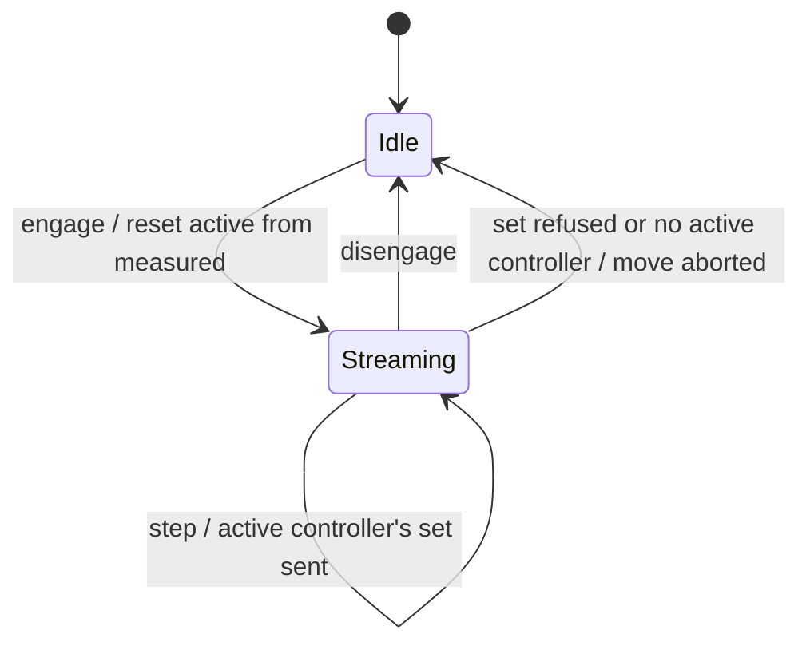
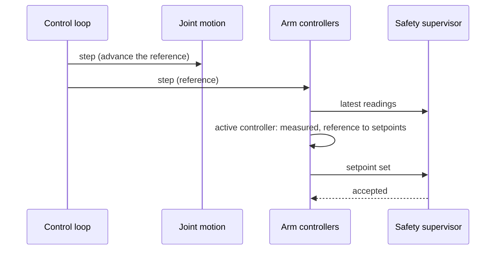
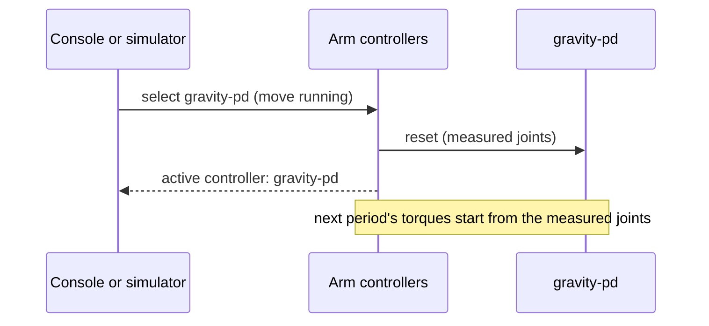

| Field     | Value                  |
|-----------|------------------------|
| Title     | Arm Controllers Design |
| Type      | design                 |
| Status    | draft                  |
| Version   | 0.20.0                 |
| Component | arm-controllers        |
| Date      | 2026-11-20             |

> Which controller turns the motion's reference into the joints' setpoints, and how one is enabled, disabled and
> switched at run time without a setpoint step (phase 2, [#18](https://github.com/embedded-pro/e-robot-arm/issues/18)
> part 3). Behaviour only; diagrams are Mermaid.

---

## Responsibilities

**Is responsible for:**

- Holding the arm controllers the arm offers, each by an id and a name, each enabled or disabled, and at most one
  of them active.
- Enabling, disabling and selecting a controller, refusing a switch that would make the setpoints jump.
- Running the active controller once per control period while the arm streams setpoints: from the measured joints
  and the motion's reference to one setpoint set, sent through the safety supervisor.
- Reporting every change of the active controller.

**Is NOT responsible for:**

- Generating the reference: joint motion plans and samples it ([joint-motion.md](joint-motion.md)).
- Guarding the setpoints: the safety supervisor checks every set it is sent ([safety.md](safety.md)).
- Deciding when setpoints stream: the arm starts and stops the streaming with the lifecycle's `Enabling`, `Enabled`,
  `Moving` and `Holding` states ([arm-lifecycle.md](arm-lifecycle.md)).
- The rest of the controller catalogue from robotics-toolbox and numerical-toolbox (computed torque, a per-joint
  PID with gravity feed-forward): phase 8d step 6 ([#31](https://github.com/embedded-pro/e-robot-arm/issues/31)).
- Saving which controllers are enabled and active in the arm profile: a later item of the profile format
  ([arm-profile.md](arm-profile.md)).

---

## Component Details

### Part A — The controller

A controller takes the measured joints (positions and speeds from the latest telemetry; a reading from an earlier
period, answered too late for this step's setpoints, is advanced by its speed for each period it missed, at most two,
so a late answer does not add a period of delay to the loop) and the reference (the joint
positions, speeds and accelerations the motion wants now, [joint-motion.md](joint-motion.md) Part B) and returns a
setpoint set: six joint torques, with the reference positions alongside for the trace and for the safety
supervisor's tracking check.

A controller may keep state between periods. `Reset` gives it the measured joints to start from and the reference
held at that moment: the last one the old controller followed, or the measured pose at rest when streaming starts. A controller
declares whether it supports **bumpless transfer**: after a `Reset` its torques continue from the measured state,
so taking over mid-move does not make them jump.

| Name              | Output                                                                                                | Bumpless |
|-------------------|-------------------------------------------------------------------------------------------------------|----------|
| `gravity-pd`      | Joint torques: a PD law on the position error plus the gravity torque, τ = Kp·(q* − q) − Kd·q′ + G(q) | yes      |
| `computed-torque` | Joint torques: the inverse dynamics of the reference acceleration corrected by a PD on the errors     | yes      |
| `gravity-pid`     | Joint torques: gravity plus the arm's inertia times the reference acceleration and a PI-D per joint   | yes      |

**The arm controls torque.** The e-foc drives run in torque mode, the only mode the arm enables them in, and every
arm controller runs on the host (the PC
now, a microcontroller later), built from robotics-toolbox's manipulator controllers and numerical-toolbox's control
blocks rather than written here. `gravity-pd` is the first: robotics-toolbox's `PdGravityCompensation` over the arm
model's dynamics ([arm-model.md](arm-model.md) Part F), with q* the reference, q and q̇ the measured joints and Kp
(N·m/rad) and Kd (N·m·s/rad) six-by-six gain matrices. It has no state, and when streaming starts the reference is
the measured position, so its first set is G(q) − Kd·q̇: it takes over without a step.

**Gains from a bandwidth.** The joints differ by more than ten times in the inertia they move, and the shoulder
and elbow move each other, so no diagonal gain set suits them all: gains sized from each joint's own inertia leave
the fast coupled mode of shoulder and elbow, whose inertia is much smaller, damped beyond what a 10 ms loop can
hold, and it oscillates. The profile names a bandwidth ω (rad/s) and a damping ratio ζ instead, and the gains are
the arm's inertia matrix scaled: Kp = ω²·J, Kd = 2·ζ·ω·J, with J the arm model's mass matrix at the measured pose,
recomputed every period, plus, on its diagonal, each motor's rotor inertia times its gear ratio squared (Teknic's
when the profile names no motor). Every mode of the arm then has its poles near ω with damping ζ wherever the arm
is (Gains away from home, Part D). Each joint lags a move by about 2·ζ/ω times its speed, and the damping per
control period, 2·ζ·ω·T, does not depend on any inertia. The bandwidth is bounded by the loop's delay: the
telemetry's age, half a control period for the held torque, and a reading that arrives a period late under host load.
`gravity-pd` at 30 rad/s and `gravity-pid` at 20 rad/s, both at ζ = 0.7, cross over near 47 rad/s and lose stability
at about 24 ms of delay; `gravity-pid` at 15 rad/s crosses over at 37 rad/s and holds to 32 ms.

**Computed torque.** `computed-torque` is robotics-toolbox's `ComputedTorqueControl`: it asks the arm's inverse
dynamics for the torque that gives each joint the acceleration `a = q̈* + Kd·(q̇* − q̇) + Kp·(q* − q)`, so the arm's
inertia, its coupling and gravity are cancelled and every joint follows the reference as a decoupled second-order
system. The gains are in acceleration units and the same for every joint: Kp = ω²·I, Kd = 2·ζ·ω·I, from the
profile's own bandwidth and damping ratio for it. The arm model has no rotors, so the inverse dynamics it is given
adds each motor's rotor inertia times its gear ratio squared, times the joint's acceleration. Unlike `gravity-pd` it
uses the reference speed and acceleration, so it tracks a move without the lag 2·ζ/ω times the speed; like it, it
has no state and takes over without a step.

**PID with gravity feed-forward.** Neither law above has integral action, so a joint settles short of its target by
whatever torque the models leave out, the drives' Coulomb friction first: about 0.04 rad on the elbow of the
virtual arm. `gravity-pid` runs one numerical-toolbox `PidIncremental` per joint as a PI on the position error and
adds a derivative on the speed error, in acceleration units, then turns the sum into torque the way `gravity-pd` does:
`τ = J·(q̈* + u) + G(q)`, with J the inertia matrix at the measured pose and the rotors (above), `q̈*` the reference acceleration and
u the six corrections. The gains place each joint's poles at the profile's bandwidth ω: a pair with damping ζ and a
real pole for the integral, so Kp = (2·ζ + 1)·ω², Ki = ω³ (times the control period in the velocity form) and
Kd = (2·ζ + 1)·ω. The derivative takes the drives' measured speed against the reference speed rather than differencing
measured positions: a reading that arrives a period late repeats one position and then jumps, and a differenced
derivative turns that into a kick of Kd over the period; on a loaded host it tripped the virtual arm on its tracking
error. Each joint's correction is clamped to ±200 rad/s², far beyond any move's need, and the PI is clamped to the same
range: in the velocity form that clamp is the anti-windup, so a joint held against an obstacle does not wind its
integral up. `Reset` clears the six PIDs and primes each one's error history with the error at the switch, between the
reference held then and the measured joints: the proportional term sees no step, only the integral starts, so it takes
over a running move without a torque kick, and a reference step that arrives in the first period after the switch still
gets its proportional kick. Priming against the first step's own reference instead swallowed such a step: a step test
started in the period that selected `gravity-pid` rose in twice the time, on the integral alone.

The position path, where the drive closed the position loop and `pass-through` and `smoothed` shaped its setpoints,
is gone.

### Part B — Registry and selection

The arm registers its controllers once, when it is built, up to a fixed capacity of eight. Ids are their
registration order. A controller is registered disabled; the arm then enables every one it registered (`slotine-li`
only with the profile's `experimental` flag, Part D) and selects the profile's `armController`, `gravity-pd` when the
profile names none. The profile keeps the active controller and nothing else about the registry: a selection made
at run time is written back into the arm host's copy of the profile, so saving it keeps the choice, while enabling
and disabling stay run-time choices that a reload undoes (open question 1).

| Request      | Accepted when                                                                           | Effect                                                              |
|--------------|-----------------------------------------------------------------------------------------|---------------------------------------------------------------------|
| enable *id*  | *id* is registered                                                                      | The controller may be selected                                      |
| disable *id* | *id* is registered, and it is not the active controller while the arm drives the joints | It may not be selected; if it was active, no controller is active   |
| select *id*  | *id* is enabled, and no move runs or the controller is bumpless                         | It is `Reset` from the measured joints and becomes active; reported |

Selecting the active controller again is accepted and changes nothing. In torque mode nothing but the active
controller holds the joints, so it cannot be disabled while the arm streams (`Enabling`, `Enabled`, `Moving` or `Holding`): the request is
refused with "disable the arm first". Disabled once the arm is disabled, it leaves the arm unable to stream: enabling
then aborts at the first period, until a controller is selected again. The simulator's Arm Controllers dock offers
these requests and shows each refusal ([tool-simulator.md](tool-simulator.md) Part Q), as the console's `controller`
command does ([arm-console.md](arm-console.md)).

### Part C — Streaming

While the arm streams, the active controller runs once per control period, in the control loop's setpoint phase,
after joint motion has advanced its reference:

1. The reference is the motion's sample while a move runs. Otherwise it is the last reference's positions at rest
   (zero speed and acceleration): the target of the last move, where an aborted move stopped, or the measured
   positions when streaming started.
2. The measured joints are each joint's latest reading.
3. The active controller's torques go to the safety supervisor. A set the supervisor refuses, or a period with no
   active controller, stops the streaming and aborts the running move. A set the transmit queue could not take in
   full is a missed period, not a refusal ([safety.md](safety.md) Part B): streaming goes on.

Streaming starts when the arm starts `Enabling` (the active controller is `Reset` from the measured joints) and stops
when it leaves `Enabling`, `Enabled`, `Moving` and `Holding`. So setpoints go out every period while the arm is enabled,
not only during a move: a controller holds the joints on the last reference against gravity between moves. They
already go out while the joints enable: each drive enables on its own, after its rotor has come to rest, and a joint
that runs before the others would otherwise wait without setpoints and stop on its command timeout. A drive that is
not running yet keeps the setpoint without acting on it.

### Part D — Impedance, operational space and adaptive control

The mathematics behind these laws and the gains of Parts A and C is in
[arm-control-laws.md](../theory/arm-control-laws.md). Every controller is verified by `arm_controller_catalogue.feature`:
selected before the arm is enabled (REQ-CTL-002) and switched while it holds a pose (REQ-CTL-001).

Phase 5 ([#21](https://github.com/embedded-pro/e-robot-arm/issues/21)) adds four controllers, each from
robotics-toolbox's manipulator controllers over the arm model, each with its parameters in the arm profile and each
registered and enabled beside the others (Part B), `slotine-li` only when the profile allows it:

| Name                  | Law                                                                                                                                                           | Bumpless |
|-----------------------|---------------------------------------------------------------------------------------------------------------------------------------------------------------|----------|
| `joint-impedance`     | `τ = ID(q, q̇*, q̈*) + K·(q* − q) + D·(q̇* − q̇)`: the reference's inverse dynamics, a spring per joint and a coupled damper                                      | yes      |
| `cartesian-impedance` | `τ = ID(q, q̇*, q̈*) + Jᵀ·K·e + D·(q̇* − q̇)`: the reference's inverse dynamics, a spring on the tool's pose error e in the base frame and a coupled joint damper | yes      |
| `operational-space`   | `τ = Jᵀ·Λ·(ẍ* + Kd·ė + Kp·e − J̇·q̇) + C + G`: the tool follows the reference as a decoupled system; joint-space computed torque near a singularity             | yes      |
| `slotine-li`          | `τ = Y·â − Kd·s, with s = q̇ − q̇r and â adapted as â̇ = −Γ·Yᵀ·s`: learns the arm's inertial parameters                                                          | yes      |

**Joint impedance.** The arm yields to a push as a spring of stiffness K per joint and a damper D, centred on the
reference. The reference's own dynamics are fed forward, `M(q)·q̈* + C(q, q̇*)·q̇* + G(q)`, the model's inverse
dynamics at the measured pose with the reference's speeds and accelerations, so with an exact model the arm follows
the reference and the spring and damper only answer a push or the model's error; the stiffness to a push is the
same as without it. The profile names each joint's stiffness K (N·m/rad, above 0) and one damping ratio ζ. Without
stiffnesses each joint gets (10 rad/s)² times its inertia at home with the other joints free, 1 / (M₀⁻¹)ᵢᵢ with M₀ the
mass matrix at home with the rotors. The damping is coupled, D = 2·ζ·W·M(q)·W with W = diag(√ωᵢ), ωᵢ = √(Kᵢ / Mᵢᵢ) and
M(q) the mass matrix at the measured pose with the rotors: its diagonal is 2·ζ·√(Kᵢ·Mᵢᵢ), and with every ωᵢ equal it
is `gravity-pd`'s 2·ζ·ω·M. The stiffness can be changed at run time, between a tenth of the profile's value and the
profile's value, so an operator can soften the arm without a stiffer arm than the profile allows. It has no state:
at a switch the reference is the measured pose at rest, so its first set is `G(q) − D·q̇`.

Why this form, measured on the simulated reference arm, whose wrist is direct drive and light (joint 5 about
5·10⁻⁴ kg·m², joint 6 about 3·10⁻⁵ kg·m²) at a 10 ms period: with gravity alone fed forward, a 1 rad/s move from home
pushed joint 5 0.3 rad off its reference through the coupling with joints 2 and 3, beyond the 0.2 rad tracking
window; with a diagonal damper sized on each joint's own inertia, and stiffness on (Mᵢᵢ) rather than the free inertia,
the coupled wrist's fastest mode sat near 40 rad/s with ζ about 0.2, and a 0.05 rad step on joint 5 at
(0, 0.3, 0.3, 0, 0.5, 0) never settled; a larger ζ made it diverge sooner.

**Cartesian impedance.** The same law with the spring on the tool: τ = `M(q)·q̈* + C(q, q̇*)·q̇* + G(q)` + Jᵀ·K·e +
D·(q̇* − q̇), with e the pose error between the reference's tool pose (its forward kinematics) and the measured one
(robotics-toolbox's `TaskError`) and J the tool Jacobian at the measured pose. Jᵀ turns the spring's wrench into
torques, so it needs no inverse and stays well-behaved near a singularity, where it simply cannot push the tool
along the lost direction. The profile names a translational stiffness (N/m) and a rotational one (N·m/rad), each the
same on the three axes, and one damping ratio. The damper acts on the joints, D = 2·ζ·W·M(q)·W as above with
Kᵢ = (Jᵀ·K·J)ᵢᵢ, the stiffness the tool's spring puts on joint i at the measured pose: a damper on the tool sized
from its apparent mass Λ = (J·M⁻¹·Jᵀ)⁻¹ does not exist at the singular home (stretched upright, the wrist aligned),
and one sized per base axis from the effective mass 1 / (J·M⁻¹·Jᵀ)ᵢᵢ passes the heavy joints' mass to the light wrist
joints, which then diverged at 10 ms. One stiffness share, set at run time between 0.1 and 1, scales both impedance
controllers' stiffnesses. It needs the arm model to provide the toolbox's `JacobianProvider` in the dynamics'
coordinates: the tool Jacobian, the tool pose and J̇·q̇ ([arm-model.md](arm-model.md) Part B).

Its defaults are sized for the reference arm at 10 ms: every rotational stiffness lands on joint 6 alone, so
ω₆ ≈ √(K / 3·10⁻⁵ kg·m²). 50 N/m and 0.07 N·m/rad finished moves through four poses and back home, with a 0.05 rad
reference step at each, on the simulated arm; 0.2 N·m/rad diverged on joints 4 and 6 near home, and 100 N/m let a
reference step drive the wrist past its speed rule. A profile for an arm with geared wrists can be far stiffer.

**Operational space.** robotics-toolbox's `OperationalSpaceControl` with the full six-dimensional tool task: the task
inertia Λ, the Coriolis and gravity terms cancel the arm's dynamics as seen at the tool, so the tool follows the
reference's pose, twist and acceleration with gains Kp = ω²·I and Kd = 2·ζ·ω·I in task units, from the profile's
bandwidth and damping ratio (30 rad/s and 0.7 by default, as `computed-torque`'s). The reference's task quantities
come from its joints: the pose by forward kinematics, the twist J(q*)·q̇*, the acceleration J(q*)·q̈* + J̇(q*)·q̇*.
The mass matrix carries the rotors. The task inertia is inverted with a damping σ (the profile's, 0.01 by default)
so it stays bounded at a singularity. A six-joint arm with a six-dimensional task has no redundancy: the null-space
posture term is zero, and posture control waits for an arm with a seventh joint.

σ alone does not carry the arm through a singularity: J·M⁻¹·Jᵀ has translational eigenvalues near 1 and, on the
reference arm's light wrist, rotational ones near 10⁴, so one σ either acts only within 10⁻⁴ rad of the wrist
singularity or spoils the translation. Leaving the stretched home, where the wrist is singular, joints 4 and 6 spun
past their speed rule on the simulated arm. So the law hands over to joint-space computed torque on the same
reference, at the same bandwidth (`M(q)·(q̈* + Kd·(q̇* − q̇) + Kp·(q* − q)) + C + G`), as the manipulability falls below
the profile's `toolLimits.manipulabilityMin` (the pose where tool lines are refused, joint-motion.md Part H): the
share of the joint-space law grows linearly from 0 at the minimum to 1 at a quarter of it. With the defaults, moves
through four poses, a 0.05 rad reference step at each and back to the singular home finished twice on the simulated
arm.

**Slotine–Li adaptive.** robotics-toolbox's `SlotineLiAdaptiveControl` over its `ChainInertialRegressor`: ten inertial
parameters per link, sixty in all, start at the arm model's mass properties and adapt while the arm moves, so a
payload the profile does not know is learnt rather than tracked with an error. The sliding variable is
`s = q̇ − q̇r` with `q̇r = q̇* − Λ·(q − q*)`, Λ = λ·I. The rotors are not in the regressor: their known inertia times
`q̈r` is fed forward beside it. Kd = ω·M₀, the mass matrix at home with the rotors times the profile's bandwidth,
so with the right parameters s decays at about ω. The adaptation gain is scaled per parameter,
Γₖₖ = γ·(θ⁰ₖ² + (10⁻³)²) with θ⁰ the model's value, so each parameter moves in proportion to its own size: with one
Γ for all sixty, the wrist's inertias (about 10⁻⁴) moved as fast as the links' masses (about 1), and a simulation
of the reference arm with a 0.4 kg payload the model lacks diverged above Γ = 0.01, three times the gain that
learnt it. Scaled, γ from 3 to 1000 learnt it without diverging, the tracking error falling from 1.9 rad without
adaptation to 0.06–0.19 rad; the default is 10. The controller is offered only when the profile's `experimental`
flag is on: adaptation under the drives' unmodelled friction can still drift. `Reset` keeps the adapted parameters,
so a switch away and back does not lose what was learnt; the console sets them back to the model's
(`adaptation reset`). With the flag on and the model exact, moves through four poses, a 0.05 rad step at each and
back home finished twice on the simulated arm.

**Gains away from home.** `gravity-pd` and `gravity-pid` sized their gains from the inertia at home, the stretched
upright pose, where joint 1 moves about 0.004 kg·m²; bent out it moves seventeen times as much. On the simulated arm
at 0.1, 0.5, 0.6, 0.2, 1.0, 0 rad the base and wrist joints 1, 4 and 6 then swung together by about ±6 mrad under
`gravity-pd`, and `gravity-pid` (whose integral is tuned for the bandwidth) drifted joint 1 past its 0.2 rad tracking
window after a move there or to 0.2, 0.5, 0.6, 0.3, 0.9, −0.2 rad. Both now take J at the measured pose every
period (open question 3), a mass matrix per period as `computed-torque`, `operational-space` and the impedance
dampers already pay: the swing is gone, and moves through four poses, a 0.05 rad step at each and back home finish
under either.

**A softened arm and the tracking window.** With the stiffness share at 0.1, both impedance laws let a full-speed move
(1 rad/s, 2 rad/s²) on the simulated reference arm leave a wrist joint 0.2 to 0.37 rad behind its reference, beyond the
0.2 rad tracking window, and the supervisor holds the arm (safety.md Part F). A soft arm is for slow moves and for
being guided; whether the window widens with the share is open question 4.

---

## Interfaces

### Provided

| Interface              | Purpose                                                     | Contract                                                                  |
|------------------------|-------------------------------------------------------------|---------------------------------------------------------------------------|
| Arm controller         | Reset from the measured joints; one setpoint set per period | No heap; a bumpless controller continues from the measured state          |
| Arm controllers        | List, find by name, enable, disable, select; the active one | Refuses as Part B says; changes nothing when it refuses                   |
| Arm controllers events | The active controller changed (to one, or to none)          | Exactly one per change                                                    |
| Streaming              | Engage, disengage, one step per period; the last set sent   | A step reports when the streaming stopped                                 |
| Reference              | The joint reference the active controller tracks            | Only while streaming; checked by the safety supervisor (safety.md Part F) |

### Required

| Interface         | Purpose                                        | Contract                                 |
|-------------------|------------------------------------------------|------------------------------------------|
| Safety supervisor | Latest readings; setpoint sets                 | Refuses sets while tripped or off limits |
| Joint motion      | Whether a move runs; the reference each period | Advanced before the controllers' step    |

---

## Data Model

| Entity                | Field                   | Type / Unit     | Range                  | Notes                                                |
|-----------------------|-------------------------|-----------------|------------------------|------------------------------------------------------|
| Measured joints       | positions               | radians         | finite                 | Latest reading per joint                             |
| Measured joints       | speeds                  | radians/second  | finite                 | Latest reading per joint                             |
| Setpoint set          | positions               | radians         | joint limits           | The reference, for the trace and the check           |
| Setpoint set          | torques                 | N·m, joint side | finite                 | Sent to the joints                                   |
| `gravity-pd`          | bandwidth               | rad/s           | above 0                | 30 by default; Kp = ω²·J(q)                          |
| `gravity-pd`          | damping ratio           | 1               | above 0                | 0.7 by default; Kd = 2·ζ·ω·J(q)                      |
| `computed-torque`     | bandwidth               | rad/s           | above 0                | 30 by default; Kp = ω²·I                             |
| `computed-torque`     | damping ratio           | 1               | above 0                | 0.7 by default; Kd = 2·ζ·ω·I                         |
| `gravity-pid`         | bandwidth               | rad/s           | above 0                | 20 by default; Kp = (2ζ + 1)·ω², Ki = ω³             |
| `gravity-pid`         | damping ratio           | 1               | above 0                | 0.7 by default; Kd = (2ζ + 1)·ω, on the speed        |
| `gravity-pid`         | output limit            | rad/s²          | ±200                   | Per joint; the integral's anti-windup                |
| `joint-impedance`     | stiffness               | N·m/rad         | above 0                | Per joint; (10 rad/s)² over (M₀⁻¹)ᵢᵢ by default      |
| `joint-impedance`     | damping ratio           | 1               | above 0                | 0.7 by default; D = 2·ζ·W·M(q)·W                     |
| `cartesian-impedance` | translational stiffness | N/m             | above 0                | 50 by default, on each axis                          |
| `cartesian-impedance` | rotational stiffness    | N·m/rad         | above 0                | 0.07 by default, about each axis                     |
| `cartesian-impedance` | damping ratio           | 1               | above 0                | 0.7 by default; D = 2·ζ·W·M(q)·W on Jᵀ·K·J           |
| `operational-space`   | bandwidth               | rad/s           | above 0                | 30 by default; Kp = ω²·I, Kd = 2·ζ·ω·I in task units |
| `operational-space`   | damping ratio           | 1               | above 0                | 0.7 by default                                       |
| `operational-space`   | singularity damping     | 1               | above 0, at most 1     | 0.01 by default; σ in (J·M⁻¹·Jᵀ + σ²·I)⁻¹            |
| `slotine-li`          | λ                       | 1/s             | above 0, at most 100   | 10 by default; Λ = λ·I                               |
| `slotine-li`          | bandwidth               | rad/s           | above 0, at most 500   | 20 by default; Kd = ω·M₀                             |
| `slotine-li`          | adaptation gain         | 1               | above 0, at most 10000 | 10 by default; Γₖₖ = γ·(θ⁰ₖ² + 10⁻⁶)                 |
| Impedance             | stiffness share         | 1               | 0.1–1                  | Scales both impedance controllers' stiffnesses       |
| Reference             | speeds, accelerations   | rad/s, rad/s²   | finite                 | Zero while holding                                   |
| Registry entry        | id                      | integer         | 0–7                    | Registration order                                   |
| Registry entry        | name                    | text            | unique                 | The names of Parts A and D                           |
| Registry entry        | enabled                 | flag            |                        | Registered disabled                                  |

---

## State Machine

---

## Sequence Diagrams

---

## Constraints & Limitations

| Constraint | Value / Description                                                                      |
|------------|------------------------------------------------------------------------------------------|
| Capacity   | Eight controllers                                                                        |
| Bumpless   | From the measured joints: the setpoints move by at most the tracking error at the switch |
| Traffic    | One setpoint set per control period while the arm is enabled                             |
| Memory     | No heap; every controller's state is fixed-size                                          |

---

## Open Questions

| # | Question                                                | Options                                            | Status                        |
|---|---------------------------------------------------------|----------------------------------------------------|-------------------------------|
| 1 | Whether the profile stores the enabled and active ones  | Profile section; console and simulator choice only | decided: the active one only  |
| 2 | Whether a switch to a non-bumpless controller may blend | Refuse while moving; ramp from the old set         | decided: refuse while moving  |
| 3 | Gains of the joint-space laws away from home            | Inertia at home; mass matrix at the measured pose  | decided: at the measured pose |
| 4 | Whether the tracking window follows the stiffness share | Fixed window; window over the share                | open (Part D)                 |
