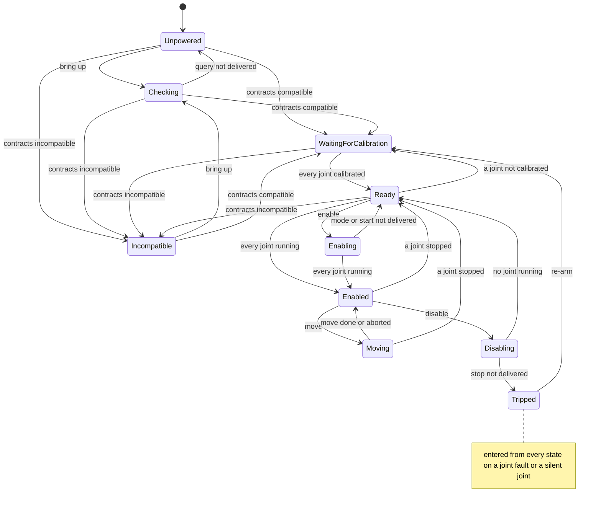
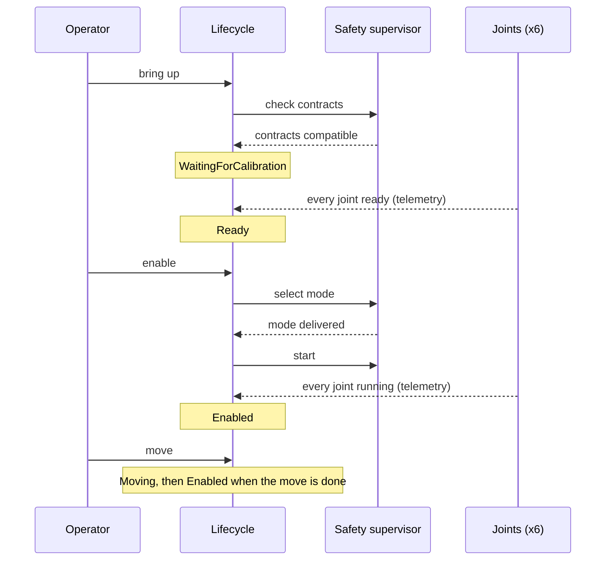

| Field     | Value                |
|-----------|----------------------|
| Title     | Arm Lifecycle Design |
| Type      | design               |
| Status    | draft                |
| Version   | 0.1.0                |
| Component | lifecycle            |
| Date      | 2026-11-12           |

> The arm's start-up sequence: from an arm that has not been checked to one that moves, and back after a fault.
> Behaviour only; diagrams are Mermaid.

---

## Responsibilities

**Is responsible for:**

- Walking the arm through a fixed order: check the contracts, wait until every joint is calibrated, select the
  control mode and start the joints, move.
- Allowing a move only while the arm is enabled, and one move at a time.
- Following the arm's real state from telemetry and command outcomes, so that a joint that stops running, a
  contract that turns out incompatible or a fault moves the lifecycle as well.
- Holding the arm tripped after a fault or a silent joint until it is re-armed.

**Is NOT responsible for:**

- Calibrating a joint: calibration moves the motor and stays an e-foc operation, started on the node by the
  operator. The lifecycle only waits for it.
- Detecting faults and silent joints, or stopping the joints when one occurs: the safety supervisor does both.
- Trajectories: joint motion plans and steps a move; the lifecycle only decides whether one may start.

---

## Component Details

### Part A — States

| State                 | Meaning                                                                          |
|-----------------------|----------------------------------------------------------------------------------|
| Unpowered             | Nothing is known about the joints; the initial state                             |
| Checking              | The contract query is out; waiting for the outcome                               |
| Incompatible          | A joint speaks an incompatible contract; bring-up may be tried again             |
| WaitingForCalibration | Every contract is compatible; waiting until every joint reports ready or running |
| Ready                 | Every joint is calibrated and not all of them are running                        |
| Enabling              | The configured control mode, then start, is being delivered to the joints        |
| Enabled               | Every joint is running in the configured mode; a move may start                  |
| Moving                | A move is in progress                                                            |
| Disabling             | Stop is being delivered to the joints                                            |
| Tripped               | A joint faulted or went silent; the safety supervisor has stopped every joint    |

A joint counts as calibrated when it reports ready or running, and as running when it reports running. Idle,
calibrating and partial calibration all keep the arm waiting, with no time limit: the operator calibrates the node
and the arm moves on when the node reports ready.

### Part B — Commands

| Command  | Allowed in              | Does                                                                         |
|----------|-------------------------|------------------------------------------------------------------------------|
| Bring up | Unpowered, Incompatible | Queries the contracts of every joint                                         |
| Enable   | Ready                   | Selects the configured control mode; once delivered, starts every joint      |
| Disable  | Enabled                 | Stops every joint                                                            |
| Move     | Enabled                 | Starts a move through joint motion                                           |
| Re-arm   | Tripped                 | Re-arms the safety supervisor, which refuses while a joint is still in fault |

A command in any other state is refused and changes nothing. The control mode enable selects is part of the
arm's configuration; position is the default and the only mode joint motion drives.

### Part C — Following the arm

Once per control period, after the setpoint step, the lifecycle looks at the six readings:

- **WaitingForCalibration** moves to Ready once every joint is calibrated.
- **Ready** moves to Enabled once every joint is running, and back to WaitingForCalibration if one is no longer
  calibrated.
- **Enabling** and **Disabling** finish when every joint is running, or when none is, respectively.
- **Enabled** and **Moving** fall back to Ready when a joint stops running; a move in progress is aborted.

The safety supervisor's events move it too: a compatible contract outcome reaches WaitingForCalibration from
Unpowered, Checking or Incompatible, so a contract query issued directly also brings the arm up; an incompatible
outcome leads to Incompatible from Unpowered, Checking, WaitingForCalibration or Ready; a joint fault or a silent joint leads to Tripped from every state. A command the
lifecycle issued that fails to be delivered ends Checking in Unpowered and Enabling in Ready; a stop that cannot be
delivered while disabling emergency-stops the arm and trips it.

Because the lifecycle follows the readings, the single-step commands of the tools (check contracts, select mode,
start, stop) still work for debugging, and the lifecycle shows where they leave the arm.

---

## Interfaces

### Provided

| Interface       | Purpose                                  | Contract                                                          |
|-----------------|------------------------------------------|-------------------------------------------------------------------|
| Arm lifecycle   | Bring up, enable, disable, move, re-arm  | Each command returns whether it was accepted in the current state |
| Lifecycle state | The current state, and each change of it | Every change is reported once, after it has happened              |

### Required

| Interface         | Purpose                                                         | Contract                              |
|-------------------|-----------------------------------------------------------------|---------------------------------------|
| Safety supervisor | Commands, readings, contract outcome, faults, delivery outcomes | The lifecycle is one of its observers |
| Joint motion      | Moves, and their end                                            | The lifecycle is one of its observers |
| Control loop      | One step per control period, after the setpoint step            | Drives Part C                         |

---

## Data Model

| Entity        | Field       | Type / Unit      | Range                   | Notes               |
|---------------|-------------|------------------|-------------------------|---------------------|
| Configuration | enable mode | FOC control mode | torque, speed, position | Position by default |
| Lifecycle     | state       | lifecycle state  | Unpowered … Tripped     | Unpowered at start  |

---

## Sequence Diagrams

### States and transitions

### Bring-up

---

## Constraints & Limitations

| Constraint    | Value / Description                                                                                               |
|---------------|-------------------------------------------------------------------------------------------------------------------|
| State machine | EMIL's table state machine; its table is validated when the arm is built                                          |
| Pace          | Readings are inspected once per control period, so a transition that follows telemetry lags by one period at most |
| Memory        | No heap; the machine holds the current state and a small event queue                                              |

---

## Open Questions

| # | Question                                                          | Options                                                | Status                          |
|---|-------------------------------------------------------------------|--------------------------------------------------------|---------------------------------|
| 1 | Whether the arm should start calibration of an uncalibrated joint | Operator calibrates on the node, the arm commands it   | closed: the operator calibrates |
| 2 | Whether the simulator drives the lifecycle                        | Lifecycle state and bring-up controls in the simulator | open: follow-up to phase 1c     |
