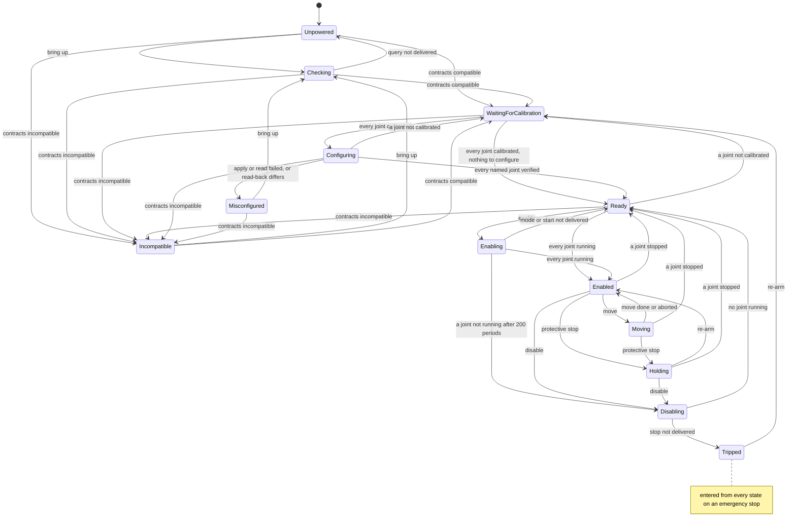
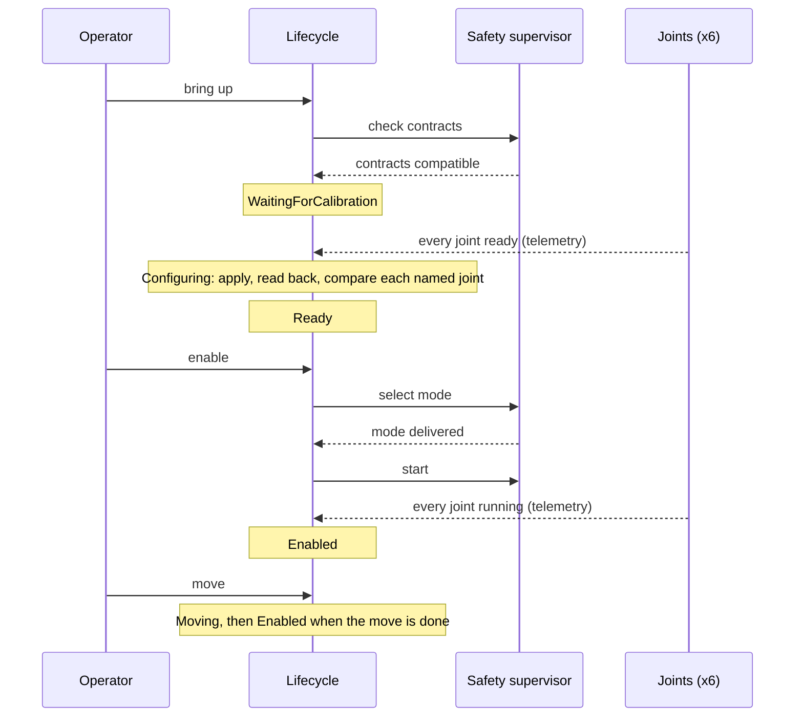

| Field     | Value                |
|-----------|----------------------|
| Title     | Arm Lifecycle Design |
| Type      | design               |
| Status    | draft                |
| Version   | 0.8.0                |
| Component | lifecycle            |
| Date      | 2026-11-19           |

> The arm's start-up sequence: from an arm that has not been checked to one that moves, and back after a fault.
> Behaviour only; diagrams are Mermaid.

---

## Responsibilities

**Is responsible for:**

- Walking the arm through a fixed order: check the contracts, wait until every joint is calibrated, apply and
  verify each joint's motor controller from the configuration, select torque mode and start the joints, move.
- Allowing a move only while the arm is enabled, and one move at a time.
- Following the arm's real state from telemetry and command outcomes, so that a joint that stops running, a
  contract that turns out incompatible or a fault moves the lifecycle as well.
- Holding the arm tripped after an emergency stop, or holding its pose after a protective stop, until it is re-armed.

**Is NOT responsible for:**

- Calibrating a joint: calibration moves the motor and stays an e-foc operation, started on the node by the
  operator. The lifecycle only waits for it.
- Detecting faults and silent joints, or stopping the joints when one occurs: the safety supervisor does both.
- Trajectories: joint motion plans and steps a move; the lifecycle only decides whether one may start.

---

## Component Details

### Part A — States

| State                 | Meaning                                                                                         |
|-----------------------|-------------------------------------------------------------------------------------------------|
| Unpowered             | Nothing is known about the joints; the initial state                                            |
| Checking              | The contract query is out; waiting for the outcome                                              |
| Incompatible          | A joint speaks an incompatible contract; bring-up may be tried again                            |
| WaitingForCalibration | Every contract is compatible; waiting until every joint reports ready or running                |
| Configuring           | Every joint is calibrated; each configured motor controller is applied and verified             |
| Misconfigured         | A motor controller could not be applied, or reads back different; the joint is named            |
| Ready                 | Every joint is calibrated and configured, and not all of them are running                       |
| Enabling              | Torque mode, then start, is being delivered to the joints                                       |
| Enabled               | Every joint is running in the configured mode; a move may start                                 |
| Moving                | A move is in progress                                                                           |
| Disabling             | Stop is being delivered to the joints                                                           |
| Holding               | A protective stop: the joints run and hold the pose the arm stopped at; the rule is named       |
| Tripped               | An emergency stop: a joint faulted or went silent, the hardware stop opened, or a hold was lost |

A joint counts as calibrated when it reports ready or running, and as running when it reports running. Idle,
calibrating and partial calibration all keep the arm waiting, with no time limit: the operator calibrates the node
and the arm moves on when the node reports ready. A node that kept its calibration but lost its rotor alignment (an
e-foc node after a reset, or a virtual motor started calibrated) reports idle until it is aligned; the tools' align
command aligns every joint, and it moves each motor.

### Part B — Commands

| Command  | Allowed in                             | Does                                                                                                                           |
|----------|----------------------------------------|--------------------------------------------------------------------------------------------------------------------------------|
| Bring up | Unpowered, Incompatible, Misconfigured | Queries the contracts of every joint                                                                                           |
| Enable   | Ready                                  | Selects torque mode; once delivered, starts every joint                                                                        |
| Disable  | Enabled, Holding                       | Stops every joint; from Holding the arm is no longer held                                                                      |
| Move     | Enabled                                | Starts a move through joint motion                                                                                             |
| Step     | Enabled                                | Starts a reference step through joint motion ([joint-motion.md](joint-motion.md) Part C); Moving until it is done, like a move |
| Re-arm   | Tripped, Holding                       | Re-arms the safety supervisor, which refuses while a joint is still in fault; from Holding the arm is Enabled again            |

A command in any other state is refused and changes nothing. Enable always selects torque mode: the arm closes
position on the host through its arm controllers ([arm-controllers.md](arm-controllers.md) Part A).

### Part C — Following the arm

Once per control period, after the setpoint step, the lifecycle looks at the six readings:

- **WaitingForCalibration** moves to Configuring once every joint is calibrated, or straight to Ready when the
  configuration names no motor controller.
- **Configuring** goes back to WaitingForCalibration if a joint is no longer calibrated.
- **Ready** moves to Enabled once every joint is running, and back to WaitingForCalibration if one is no longer
  calibrated.
- **Enabling** and **Disabling** finish when every joint is running, or when none is, respectively. A drive can
  refuse to enable after the start reached it, for instance when its current offsets cannot be measured because its
  rotor was moved; it then stays ready and says nothing on the bus. So while a joint is not running, Enabling sends the
  start again every 20 control periods (200 ms at the 10 ms period); after 200 periods (2 s) it gives up: it names the
  first joint that is not running, stops the joints, and goes to Disabling, which ends in Ready.
- **Enabled** and **Moving** fall back to Ready when a joint stops running; a move in progress is aborted.
- **Holding** falls back to Ready when a joint stops running.

The safety supervisor's events move it too: a compatible contract outcome reaches WaitingForCalibration from
Unpowered, Checking or Incompatible, so a contract query issued directly also brings the arm up; an incompatible
outcome leads to Incompatible from Unpowered, Checking, WaitingForCalibration, Configuring, Misconfigured or Ready; a protective stop leads to Holding from Enabled and Moving, aborting the move ([safety.md](safety.md) Part G); a
joint fault, a silent joint, the hardware stop or a lost hold leads to Tripped from every state. A command the
lifecycle issued that fails to be delivered ends Checking in Unpowered and Enabling in Ready; a stop that cannot be
delivered while disabling emergency-stops the arm and trips it.

### Part D — Configuring

The configuration may name a motor and a motor controller for each joint ([arm-profile.md](arm-profile.md)). In
Configuring the lifecycle first applies and verifies every joint's drive watchdog ([joint-configurator.md](joint-configurator.md)
Part E), then takes the named joints in order, and for each its motor first, then its motor controller,
since the node designs its loops from the motor: it applies the settings through the joint configurator, reads them
back and compares them ([joint-configurator.md](joint-configurator.md) Parts C and D). When every named joint matches,
the arm is Ready. An apply or read that fails, or a read-back that differs, ends in Misconfigured with that joint,
the part (motor or motor controller) and the reason; bring up starts the whole sequence again. A joint the
configuration does not name keeps what its node holds.

Configuring is entered each time the arm reaches calibration again, after a re-arm included, so a node that was
power-cycled gets its settings back before the arm can be enabled. A configurator outcome that arrives after the arm
has left Configuring is ignored.

Because the lifecycle follows the readings, the single-step commands of the tools (check contracts, select mode,
start, stop, align) still work for debugging, and the lifecycle shows where they leave the arm.

---

## Interfaces

### Provided

| Interface       | Purpose                                       | Contract                                                          |
|-----------------|-----------------------------------------------|-------------------------------------------------------------------|
| Arm lifecycle   | Bring up, enable, disable, move, step, re-arm | Each command returns whether it was accepted in the current state |
| Lifecycle state | The current state, and each change of it      | Every change is reported once, after it has happened              |

### Required

| Interface          | Purpose                                                         | Contract                              |
|--------------------|-----------------------------------------------------------------|---------------------------------------|
| Safety supervisor  | Commands, readings, contract outcome, faults, delivery outcomes | The lifecycle is one of its observers |
| Joint motion       | Moves, and their end                                            | The lifecycle is one of its observers |
| Joint configurator | Applies and reads a joint's motor controller                    | The lifecycle is one of its observers |
| Control loop       | One step per control period, after the setpoint step            | Drives Part C                         |

---

## Data Model

| Entity        | Field            | Type / Unit                          | Range               | Notes                                                  |
|---------------|------------------|--------------------------------------|---------------------|--------------------------------------------------------|
| Configuration | controllers      | per joint, motor-controller settings | present or absent   | Absent: not configured                                 |
| Lifecycle     | misconfiguration | joint and reason                     | failed, differs     | Set in Misconfigured                                   |
| Lifecycle     | unstarted joint  | joint                                | 0–5                 | Set when Enabling gives up; cleared by the next enable |
| Lifecycle     | state            | lifecycle state                      | Unpowered … Tripped | Unpowered at start                                     |
| Lifecycle     | stop             | rule, joint or links, value          | Part F of safety.md | Set in Holding and Tripped                             |

---

## Sequence Diagrams

### States and transitions

### Bring-up

---

## Constraints & Limitations

| Constraint    | Value / Description                                                                                               |
|---------------|-------------------------------------------------------------------------------------------------------------------|
| State machine | EMIL's table state machine; its table is validated when the arm is built                                          |
| Pace          | Readings are inspected once per control period, so a transition that follows telemetry lags by one period at most |
| Memory        | No heap; the machine holds the current state and a small event queue                                              |

---

## Open Questions

| # | Question                                                          | Options                                                | Status                                                                                        |
|---|-------------------------------------------------------------------|--------------------------------------------------------|-----------------------------------------------------------------------------------------------|
| 1 | Whether the arm should start calibration of an uncalibrated joint | Operator calibrates on the node, the arm commands it   | closed: the operator calibrates                                                               |
| 2 | Whether the simulator drives the lifecycle                        | Lifecycle state and bring-up controls in the simulator | closed: the Operate group and status strip follow it ([tool-simulator.md](tool-simulator.md)) |
