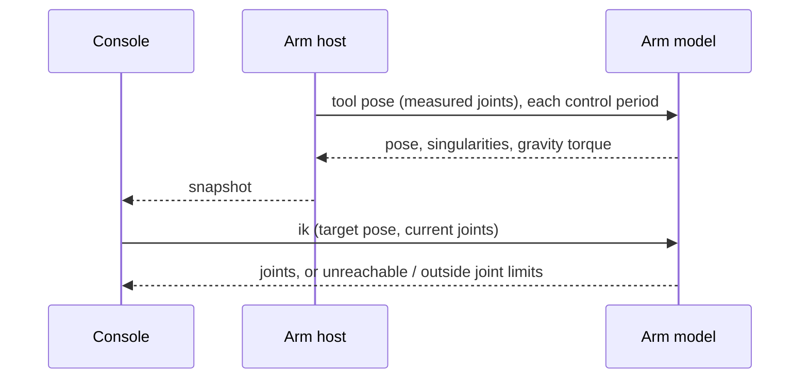

| Field     | Value            |
|-----------|------------------|
| Title     | Arm Model Design |
| Type      | design           |
| Status    | draft            |
| Version   | 0.2.0            |
| Component | arm_model        |
| Date      | 2026-11-13       |

> The arm's geometry and mass, and what follows from them: the tool pose of a set of joint positions, the joint
> positions of a tool pose, the Jacobian and the singularities, the gravity torque, the joint torques of a motion and
> the mass matrix. The mathematics is in [arm-kinematics.md](../theory/arm-kinematics.md) and
> [arm-dynamics.md](../theory/arm-dynamics.md). Behaviour only; diagrams are Mermaid.

---

## Responsibilities

**Is responsible for:**

- Holding the arm's geometry: the seven OPW lengths, a sign and an offset per joint, the tool transform and the base
  mount.
- Forward kinematics: the tool pose of six joint positions, in the base frame.
- Inverse kinematics: the joint positions of a tool pose, within the joint limits and closest to the current joints,
  or the reason there are none.
- The geometric Jacobian, the manipulability and the singularity the arm is near.
- Holding each link's mass properties and the payload's.
- Dynamics: the gravity torque, the inverse dynamics (joint torques of positions, speeds and accelerations) and the
  mass matrix, in joint space.
- Staying heap-free, with a fixed cost per call, so it can run in the control loop.

**Is NOT responsible for:**

- Moving the arm: Cartesian moves are joint motion's (phase 4); the model only converts.
- Feeding torques to the joints: gravity compensation and torque feed-forward are the arm controllers' (phase 5).
- Friction and rotor inertia: they belong to each joint's drive ([arm-dynamics.md](../theory/arm-dynamics.md)).
- Arms of another shape: only the OPW family (see the theory's limitations).

---

## Component Details

### Part A — Geometry

| Item                      | Unit   | Meaning                                                                  |
|---------------------------|--------|--------------------------------------------------------------------------|
| a1, a2, b, c1, c2, c3, c4 | m      | The OPW lengths ([arm-kinematics.md](../theory/arm-kinematics.md))       |
| Joint signs               | ±1     | Direction of each joint in the model                                     |
| Joint offsets             | rad    | The model angle at the joint's zero                                      |
| Tool                      | m, rad | The tool centre point relative to the flange: position, roll, pitch, yaw |
| Base                      | m, rad | The arm's base relative to the world: position, roll, pitch, yaw         |

Orientations are roll, pitch and yaw about fixed x, y and z: $R = R_z(\text{yaw})\,R_y(\text{pitch})\,R_x(\text{roll})$.
The joint positions are joint space, after the transmission ([joint-bus.md](joint-bus.md)), so a gear ratio never
reaches the model. Without a geometry in the profile the arm uses the reference desktop arm:

| c1   | a1   | b | c2   | a2 | c3   | c4   | Signs  | Offsets | Tool, base |
|------|------|---|------|----|------|------|--------|---------|------------|
| 0.15 | 0.02 | 0 | 0.25 | 0  | 0.25 | 0.06 | all +1 | all 0   | identity   |

It is invented: about 0.56 m of reach from the shoulder, standing for a desktop arm until the real one is measured.

### Part B — Forward kinematics, Jacobian and singularities

- **Tool pose** of six joint positions: base · flange · tool.
- **Jacobian**: 6 × 6, linear rows first, in the base frame, at the tool centre point.
- **Manipulability**: |det J|.
- **Singularities**: wrist, elbow and shoulder, each flagged on its own by the thresholds of the theory.

### Part C — Inverse kinematics

Given a tool pose and the current joints, the model returns the solution within the joint limits that is closest to
the current joints, or one of two failures:

| Failure              | When                                                      |
|----------------------|-----------------------------------------------------------|
| Unreachable          | No solution: the target is out of reach                   |
| Outside joint limits | Solutions exist, none with all six joints in their limits |

A solution at a wrist singularity is returned with θ4 = 0, the joint pair 4 and 6 being free; the singularity flag
says so.

### Part D — Where the tools use it

- The arm host publishes the measured tool pose and the singularity flags in each snapshot.
- The console prints them (`pose`), and converts on request without moving the arm: `fk q1 … q6` prints a tool pose,
  `ik x y z roll pitch yaw` prints the joints or the failure ([arm-console.md](arm-console.md)).

### Part F — Mass properties and dynamics

Each link has a mass, a centre of mass and an inertia tensor about it, in the link's frame
([arm-dynamics.md](../theory/arm-dynamics.md)); the payload has the same, relative to the flange, and is merged into
the last link. Without mass properties in the profile the arm uses the reference desktop arm's, invented like its
geometry (aluminium tubes and small geared motors, about 3.7 kg moving), and no payload:

| Link | Mass kg | Centre m (x, y, z) | Ixx, Iyy, Izz kg·m²       | Body                      |
|------|---------|--------------------|---------------------------|---------------------------|
| 1    | 1.2     | 0.01, 0, 0.08      | 0.003, 0.003, 0.0015      | Turret and shoulder motor |
| 2    | 1.0     | 0, 0, 0.11         | 0.0052, 0.0052, 0.00045   | Upper arm, elbow motor    |
| 3    | 0.8     | 0, 0, 0.10         | 0.0042, 0.0042, 0.00036   | Forearm, wrist motors     |
| 4    | 0.3     | 0, 0, −0.03        | 0.0002, 0.0002, 0.0001    | Wrist roll                |
| 5    | 0.25    | 0, 0, 0.02         | 0.0001, 0.0001, 0.00005   | Wrist pitch               |
| 6    | 0.1     | 0, 0, 0.05         | 0.00003, 0.00003, 0.00002 | Flange                    |

Products of inertia are zero. From them the model gives, in joint space and newton-metres:

- **Gravity torque** at a set of joint positions: what each joint holds at rest. Gravity points down in the world, so
  the base mount's orientation counts.
- **Inverse dynamics**: the joint torques of joint positions, speeds and accelerations, gravity included.
- **Mass matrix**: 6 × 6, symmetric and positive definite.

The arm host publishes the gravity torque at the measured joints in each snapshot, and the console prints it
(`gravity`).

### Part E — Measured cost

The arm model test times each call over 20 000 calls at varying joints (Debug build, float, one core of the
development container's x86-64 CPU) and prints a `[METRIC]` line:

| Call               | Time per call | Share of the 10 ms period |
|--------------------|---------------|---------------------------|
| Tool pose          | 0.4 µs        | 0.004 %                   |
| Jacobian           | 1.1 µs        | 0.01 %                    |
| Singularities      | 0.1 µs        | 0.001 %                   |
| Inverse kinematics | 0.9 µs        | 0.01 %                    |
| Gravity torque     | 2.3 µs        | 0.02 %                    |
| Inverse dynamics   | 2.4 µs        | 0.02 %                    |
| Mass matrix        | 4.0 µs        | 0.04 %                    |

The test fails if any call exceeds 2 ms, a fifth of the period.

---

## Interfaces

### Provided

| Interface          | Purpose                           | Contract                                                            |
|--------------------|-----------------------------------|---------------------------------------------------------------------|
| Tool pose          | Joint positions to tool pose      | Any joint positions                                                 |
| Inverse kinematics | Tool pose to joint positions      | Within the limits and closest to the current joints, or the failure |
| Jacobian           | Joint velocities to tool twist    | 6 × 6, base frame, at the tool centre point                         |
| Singularities      | Which singularity the arm is near | Wrist, elbow, shoulder, independently                               |
| Gravity torque     | Joint positions to holding torque | N·m per joint, joint space                                          |
| Inverse dynamics   | Motion to joint torques           | Positions, speeds, accelerations; gravity included                  |
| Mass matrix        | Joint positions to inertia        | 6 × 6, joint space, symmetric positive definite                     |

### Required

| Interface         | Purpose                           | Contract                                            |
|-------------------|-----------------------------------|-----------------------------------------------------|
| robotics-toolbox  | OPW forward and inverse, Jacobian | `AnalyticalIkOpw`, `GeometricJacobian`, float       |
| robotics-toolbox  | Dynamics                          | `ChainDynamicsModel` (RNEA, CRBA), float            |
| Arm configuration | Geometry, mass, joint limits      | From the profile ([arm-profile.md](arm-profile.md)) |

---

## Data Model

| Entity   | Field          | Type / Unit                    | Range          | Notes                       |
|----------|----------------|--------------------------------|----------------|-----------------------------|
| Geometry | lengths        | 7 × m                          | c2, c3 above 0 | The OPW lengths             |
| Geometry | signs, offsets | 6 × ±1, 6 × rad                | —              | Joint space to model angles |
| Geometry | tool, base     | position m, roll pitch yaw rad | —              | Identity by default         |
| Mass     | links          | 6 × (kg, m, kg·m²)             | Part F         | Mass, centre, inertia       |
| Mass     | payload        | kg, m, kg·m²                   | Part F         | Relative to the flange      |
| Snapshot | tool pose      | position m, roll pitch yaw rad | —              | From the measured joints    |
| Snapshot | singularities  | wrist, elbow, shoulder         | —              | From the measured joints    |
| Snapshot | gravity torque | 6 × N·m                        | —              | From the measured joints    |

---

## Sequence Diagrams

---

## Constraints & Limitations

| Constraint | Value / Description                                                 |
|------------|---------------------------------------------------------------------|
| Memory     | No heap; the model holds the geometry and the limits                |
| Time       | Each call well under a fifth of the 10 ms period on the PC (Part E) |
| Shape      | OPW family only                                                     |

---

## Open Questions

| # | Question                    | Options                                     | Status                         |
|---|-----------------------------|---------------------------------------------|--------------------------------|
| 1 | Geometry description        | OPW, DH, both                               | decided: OPW                   |
| 2 | The real arm's dimensions   | Measured, from the CAD                      | open: the reference arm stands |
| 3 | Arms outside the OPW family | DH or product of exponentials, numerical IK | open: when such an arm appears |
| 4 | The real arm's masses       | Weighed, from the CAD                       | open: the reference arm stands |
