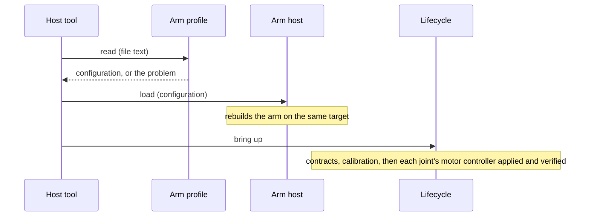

| Field     | Value              |
|-----------|--------------------|
| Title     | Arm Profile Design |
| Type      | design             |
| Status    | draft              |
| Version   | 0.25.0             |
| Component | arm_profile        |
| Date      | 2026-11-23         |

> The single description of an arm, as a JSON file: its control timing, and per joint the node, transmission,
> limits and motor controller. Behaviour only; diagrams are Mermaid.

---

## Responsibilities

**Is responsible for:**

- Reading a profile from JSON text into the arm's configuration, and refusing a profile that is malformed, out of
  range or incomplete with one message that names the offending item.
- Writing an arm's configuration back as JSON text that reads back to the same configuration.
- Staying heap-free, so the same code can read a profile on a microcontroller later.

**Is NOT responsible for:**

- Files: the host tools read and write them and hand the text over.
- Applying the profile: the arm is built from its configuration, and the lifecycle applies the motor controllers
  while bringing the arm up ([arm-lifecycle.md](arm-lifecycle.md)).
- Arm controllers: a later item of the format, as phase 5 adds them.

---

## Component Details

### Part A — Content

A profile holds what `ArmConfig` holds:

| Item                                          | JSON key                                         | Unit, range                                          | Default when absent        |
|-----------------------------------------------|--------------------------------------------------|------------------------------------------------------|----------------------------|
| Format marker                                 | `format`                                         | `"e-robot-arm profile"`                              | required                   |
| Format version                                | `version`                                        | `11` (`1` to `10` are read)                          | required                   |
| Name                                          | `name`                                           | text, at most 48 characters                          | required                   |
| Control period                                | `controlPeriodMs`                                | ms, 1 to 1000                                        | required                   |
| Missed telemetry allowed                      | `missedRequestsBeforeSilent`                     | periods, 1 to 255                                    | required                   |
| Command timeout                               | `commandTimeoutPeriods`                          | periods, 1 to 255                                    | 3                          |
| Drive watchdog                                | `driveWatchdogPeriods`                           | periods, 2 to 255                                    | 10                         |
| Enable mode                                   | `enableMode`                                     | `torque` only                                        | `torque`                   |
| `gravity-pd` bandwidth                        | `gravityPd.bandwidthRadPerS`                     | rad/s, above 0, at most 500                          | 30                         |
| `gravity-pd` damping                          | `gravityPd.dampingRatio`                         | above 0, at most 5                                   | 0.7                        |
| `computed-torque` bandwidth                   | `computedTorque.bandwidthRadPerS`                | rad/s, above 0, at most 500                          | 30                         |
| `computed-torque` damping                     | `computedTorque.dampingRatio`                    | above 0, at most 5                                   | 0.7                        |
| `gravity-pid` bandwidth                       | `gravityPid.bandwidthRadPerS`                    | rad/s, above 0, at most 500                          | 20                         |
| `gravity-pid` damping                         | `gravityPid.dampingRatio`                        | above 0, at most 5                                   | 0.7                        |
| `joint-impedance` stiffness                   | `jointImpedance.stiffnessNmPerRad`               | six, N·m/rad, above 0                                | (10 rad/s)² × free inertia |
| `joint-impedance` damping                     | `jointImpedance.dampingRatio`                    | above 0, at most 5                                   | 0.7                        |
| `cartesian-impedance` translational stiffness | `cartesianImpedance.translationalStiffnessNPerM` | N/m, above 0                                         | 50                         |
| `cartesian-impedance` rotational stiffness    | `cartesianImpedance.rotationalStiffnessNmPerRad` | N·m/rad, above 0                                     | 0.07                       |
| `cartesian-impedance` damping                 | `cartesianImpedance.dampingRatio`                | above 0, at most 5                                   | 0.7                        |
| `operational-space` bandwidth                 | `operationalSpace.bandwidthRadPerS`              | rad/s, above 0, at most 500                          | 30                         |
| `operational-space` damping                   | `operationalSpace.dampingRatio`                  | above 0, at most 5                                   | 0.7                        |
| `operational-space` singularity damping       | `operationalSpace.singularityDamping`            | above 0, at most 1                                   | 0.01                       |
| `slotine-li` λ                                | `slotineLi.lambdaPerS`                           | 1/s, above 0, at most 100                            | 10                         |
| `slotine-li` bandwidth                        | `slotineLi.bandwidthRadPerS`                     | rad/s, above 0, at most 500                          | 20                         |
| `slotine-li` adaptation gain                  | `slotineLi.adaptationGain`                       | above 0, at most 10000                               | 10                         |
| Experimental controllers                      | `experimental`                                   | `true`, `false`                                      | `false`                    |
| Active arm controller                         | `armController`                                  | a registered name; `slotine-li` needs `experimental` | `gravity-pd`               |
| Collision observer gain                       | `collisionObserverGainPerS`                      | 1/s, above 0, at most 1000                           | 25                         |
| Motion profile                                | `motionProfile`                                  | `trapezoid`, `s-curve`                               | `trapezoid`                |
| Tool limits                                   | `toolLimits`                                     | see below                                            | see below                  |
| Teach points                                  | `teachPoints`                                    | see below                                            | none                       |
| Joints                                        | `joints`                                         | exactly six, in order                                | required                   |
| Geometry                                      | `geometry`                                       | see below                                            | the reference arm          |
| Mass properties                               | `massProperties`                                 | see below                                            | the reference arm          |
| Link meshes                                   | `meshes`                                         | see below                                            | none                       |
| Workspace, self-collision                     | `safety`                                         | see below                                            | see below                  |

The arm runs its joints in torque mode only ([arm-controllers.md](arm-controllers.md) Part A). `enableMode` is
read for older profiles and must be `torque`; a profile that names another mode is refused, and a written profile
leaves it out.

The motion profile shapes every point-to-point move ([joint-motion.md](joint-motion.md) Part F): trapezoidal at each
joint's speed and acceleration limits, or S-curve, also within its jerk limit. A profile that chooses `s-curve`
without a jerk limit on every joint is refused. The profile can be changed at rest without reloading the file, and the
profile in effect is the one written.

The tool limits bound the tool lines and tool jogs ([joint-motion.md](joint-motion.md) Parts H and I), in the base
frame; the joint limits still hold for every joint on the way:

| Item                     | JSON key                                 | Unit, range           | Default when absent |
|--------------------------|------------------------------------------|-----------------------|---------------------|
| Linear speed             | `toolLimits.speedMPerS`                  | m/s, above 0          | 0.25                |
| Linear acceleration      | `toolLimits.accelerationMPerS2`          | m/s², above 0         | 1                   |
| Linear jerk              | `toolLimits.jerkMPerS3`                  | m/s³, above 0         | 10                  |
| Angular speed            | `toolLimits.angularSpeedRadPerS`         | rad/s, above 0        | 1                   |
| Angular acceleration     | `toolLimits.angularAccelerationRadPerS2` | rad/s², above 0       | 4                   |
| Angular jerk             | `toolLimits.angularJerkRadPerS3`         | rad/s³, above 0       | 40                  |
| Manipulability threshold | `toolLimits.manipulabilityMin`           | 0 or above, at most 1 | 0.001               |

The teach points are named joint poses to go to ([joint-motion.md](joint-motion.md) Part J): at most 16, each
`{ "name": "<1 to 16 characters>", "jointsRad": [six angles, rad, joint space] }`, the names unique. The tools teach
them at run time; saving the profile writes them back.

`jointImpedance` sets the `joint-impedance` arm controller ([arm-controllers.md](arm-controllers.md) Part D): each
joint's stiffness, all six or none, and the damping ratio from which each joint's damping follows. A profile without
the stiffnesses gives each joint (10 rad/s)² times its inertia at home with its rotor and the other joints free. `cartesianImpedance` sets the
`cartesian-impedance` arm controller the same way: one stiffness along the three axes of the tool's position, one
about the three axes of its orientation, and the damping ratio. `operationalSpace` sets the `operational-space` arm
controller: its bandwidth and damping ratio in task units and the damping σ of its task-inertia inverse; it hands
over to joint-space control below `toolLimits.manipulabilityMin`. `slotineLi` sets the `slotine-li` arm controller,
which the arm offers only when `experimental` is `true`. `armController` names the controller the arm selects when it
is built ([arm-controllers.md](arm-controllers.md) Part B); the arm host writes a run-time selection back, so a saved
profile keeps it.

The two `gravityPd` items set the gains of the `gravity-pd` arm controller, the two `computedTorque` items those of
`computed-torque` and the two `gravityPid` items those of `gravity-pid`, for every joint at once ([arm-controllers.md](arm-controllers.md) Part A).

The geometry is the arm model's ([arm-model.md](arm-model.md) Part A):

| Item          | JSON key                                                    | Unit, range          | Default when absent |
|---------------|-------------------------------------------------------------|----------------------|---------------------|
| OPW lengths   | `opwMetres.a1`, `.a2`, `.b`, `.c1`, `.c2`, `.c3`, `.c4`     | m; c2 and c3 above 0 | required            |
| Joint signs   | `jointSigns`                                                | six of 1 or −1       | all 1               |
| Joint offsets | `jointOffsetsRad`                                           | six, rad             | all 0               |
| Tool          | `tool.xM`, `.yM`, `.zM`, `.rollRad`, `.pitchRad`, `.yawRad` | m, rad               | identity            |
| Base          | `base`, as `tool`                                           | m, rad               | identity            |

The mass properties are the arm model's ([arm-model.md](arm-model.md) Part F): `links`, a list of six, one per link
in joint order, and an optional `payload`, relative to the flange. Each of them:

| Item           | JSON key                       | Unit, range                                                 | Default when absent |
|----------------|--------------------------------|-------------------------------------------------------------|---------------------|
| Mass           | `massKg`                       | kg, 0 or above                                              | required            |
| Centre of mass | `centreM.x`, `.y`, `.z`        | m, in the link's frame                                      | 0                   |
| Moments        | `inertiaKgM2.xx`, `.yy`, `.zz` | kg·m², about the centre; each sum of two at least the third | 0                   |
| Products       | `inertiaKgM2.xy`, `.xz`, `.yz` | kg·m², tensor elements                                      | 0                   |

Without `payload` the arm carries none.

The link meshes are what the simulator draws instead of its generated shapes ([tool-simulator.md](tool-simulator.md)
Part E): `meshes` names a glTF file for any of `base`, `link1` … `link6`, as a path relative to the profile file, at
most 96 characters, ending in `.gltf` or `.glb`. A link without a mesh keeps the generated shapes. The arm itself
never reads them.

Each joint:

| Item               | JSON key                            | Unit, range                                 | Default when absent         |
|--------------------|-------------------------------------|---------------------------------------------|-----------------------------|
| Node               | `node`                              | CAN node id, 1 to 255, unique among the six | required                    |
| Gear ratio         | `transmission.ratio`                | motor turns per joint turn, above 0         | 1                           |
| Direction          | `transmission.direction`            | `positive`, `negative`                      | `positive`                  |
| Zero offset        | `transmission.offsetRad`            | rad, joint space                            | 0                           |
| Position limits    | `positionLimitsRad.lower`, `.upper` | rad, joint space, lower below upper         | required                    |
| Speed limit        | `motionLimits.speedRadPerS`         | rad/s, joint space, above 0                 | required                    |
| Acceleration limit | `motionLimits.accelerationRadPerS2` | rad/s², joint space, above 0                | required                    |
| Jerk limit         | `motionLimits.jerkRadPerS3`         | rad/s³, joint space, above 0                | none; required by `s-curve` |
| Tracking window    | `trackingError.windowRad`           | rad, joint space, above 0                   | 0.2                         |
| Tracking time      | `trackingError.timeS`               | s, above 0, at most 10                      | 0.2                         |
| Collision limit    | `collisionTorqueNm`                 | N·m, joint side, above 0, at most 1000      | 20                          |
| Speed trip         | `speedLimitRadPerS`                 | rad/s, joint space, above 0                 | 4 × speed limit             |
| Torque limit       | `torqueLimitNm`                     | N·m, joint side, above 0, at most 1000      | from the motor              |
| Motor controller   | `motorController`                   | see below                                   | not configured              |
| Motor              | `motor`                             | see below                                   | not configured              |

The tracking window and time are the safety supervisor's ([safety.md](safety.md) Part F): a joint whose tracking
error stays above its window for its time trips the arm. So is the collision limit: an external torque on the joint,
as the collision observer estimates it ([collision.md](collision.md)), above the limit trips the arm. The observer's
gain, the bandwidth of its estimate, is the arm's `collisionObserverGainPerS`. The speed trip stops the arm when
the joint's measured speed exceeds it, and every torque the arm sends is clamped to the torque limit; a joint with
neither a torque limit nor a motor is limited by its drive alone (safety.md Parts B and F). All have defaults, so
every check is on in every profile, and every one of them ends in a protective stop: the joints keep holding.

The drive watchdog is the e-foc command timeout the joint configurator writes to every node, in control periods: a
drive that hears no setpoint for that long stops and faults ([safety.md](safety.md) Part I).

`safety` holds the workspace and self-collision check ([safety.md](safety.md) Part H), in the base frame:

| Item                  | JSON key                 | Unit, range                                | Default when absent                                    |
|-----------------------|--------------------------|--------------------------------------------|--------------------------------------------------------|
| Workspace             | `workspaceM.min`, `.max` | m, each `{ "x", "y", "z" }`, min below max | the reach plus the largest radius, from the base plane |
| Forbidden zones       | `forbiddenZonesM`        | at most eight boxes, as `workspaceM`       | none                                                   |
| Link radii            | `linkRadiiM`             | seven, m, above 0: links 1 to 6, then tool | all 0.04                                               |
| Self-collision margin | `selfCollisionMarginM`   | m, 0 or above, at most 0.5                 | 0.01                                                   |
| Allowed link pairs    | `allowedLinkPairs`       | pairs of 1 to 7, not adjacent, at most 16  | none                                                   |

An allowed pair is never checked against each other. Adjacent links and the pairs that touch with every joint at zero,
the spherical wrist's, are allowed without being listed ([safety.md](safety.md) Part H); a profile lists any other pair
whose capsules touch by construction. The workspace's default follows the geometry, so a profile that names no workspace keeps following its
geometry when that changes.

A joint's motor controller names one algorithm per loop and any of its fourteen gains:

| Item               | JSON key       | Values                                                                           |
|--------------------|----------------|----------------------------------------------------------------------------------|
| Current algorithm  | `current`      | `pid`, `decoupledPid`, `deadbeat`, `slidingMode`                                 |
| Speed algorithm    | `speed`        | `pid`, `lqi`, `adrc`, `twoDof`                                                   |
| Position algorithm | `position`     | `pid`, `cascadeP`, `lqr`, `lqi`, `twoDof`                                        |
| Gains              | `gains.<name>` | the gain names of [joint-configurator.md](joint-configurator.md), contract units |

The three algorithms are required once `motorController` is present; a gain left out takes the contract's
default, and each gain must lie in the e-foc contract's range. A joint without `motorController` keeps whatever its
node holds: the lifecycle does not configure it.

A joint's motor holds the thirteen parameters of [joint-configurator.md](joint-configurator.md) Part D, in its
display units:

| Item             | JSON key                        | Item                   | JSON key                  |
|------------------|---------------------------------|------------------------|---------------------------|
| Preset           | `preset`                        | Coulomb friction       | `coulombFrictionMilliNm`  |
| Resistance       | `resistanceOhm`                 | Continuous current     | `continuousCurrentA`      |
| Inductance       | `inductanceMilliHenry`          | Peak current           | `peakCurrentA`            |
| Pole pairs       | `polePairs`                     | Peak-current time      | `peakCurrentTimeS`        |
| Flux linkage     | `fluxLinkageMilliWeber`         | Overspeed limit        | `overspeedLimitRadPerS`   |
| Rotor inertia    | `inertiaGramCm2`                | Following-error window | `followingErrorWindowRad` |
| Viscous friction | `viscousFrictionMicroNmSPerRad` | Following-error time   | `followingErrorTimeS`     |

`preset` names a preset (`teknic-m2310p-ln-04k`, `anaheim-bly172s-24v-4000`) whose values fill every parameter the
motor leaves out; without a preset the eleven others are required. The two following-error items are optional with or
without a preset: left out, they keep e-foc's default, supervision off (a window of 0 and a time of 0.1 s). They came
with format version 2; a version 1 file reads as before. The speed trip, the torque limit, the drive watchdog and
`safety` came with version 3; the motion profile and the jerk limit with version 4; the tool limits with version 5; the teach points with version 6; `jointImpedance` with version 7; `cartesianImpedance` with version 8; `operationalSpace` with version 9; `slotineLi` and `experimental` with version 10; `armController` with version 11.
An older file takes their defaults. Each value must lie in the e-foc contract's range, and
pole pairs must be a whole number. A joint without `motor` keeps whatever its node holds.

### Part B — Reading

Reading is strict, so a typing mistake never passes silently: an unknown key, a value of the wrong type, a value
out of range, a missing required item, a joint count other than six or a repeated node is refused. The message
names the first problem by its path, for example `joints[2].transmission.ratio: must be above 0`. Numbers may be
written as integers or with up to nine decimals; exponents are not accepted.

### Part C — Writing

Writing produces every item, defaults included, in the order of Part A (a motor with its preset, if it has one, and
all eleven values); the three items whose default follows another one, the speed trip, the torque limit and the
workspace, are written only when the profile names them. Real numbers have up to nine decimals for real numbers
and trailing zeros dropped. Read back, every item is the same; a gain comes back within the joint configurator's
comparison tolerance ([joint-configurator.md](joint-configurator.md) Part C), since nine decimals hold fewer
significant digits than a float below 0.1.

### Part D — Profile files on the host

The host tools (simulator, console, virtual arm) read and write profile files through one pair of functions in
`tools/arm_host` (`ReadProfileFile`, `WriteProfileFile`), so the rules below hold for every tool:

- **Reading is bounded.** A file is read up to 64 KiB and one byte more; a longer file is refused with
  `<path> is larger than 64 KiB` without the rest of it ever being read, so a wrong path (a log, an image, a device)
  cannot make a tool read without limit.
- **Saving never loses the last good file.** The profile is written in full to a temporary file next to the
  destination (`<file>.saving`, in the same directory, so the replacement stays on the same file system), closed, and
  only then renamed over the destination. Until that rename, the destination is untouched: if writing or closing
  the temporary file fails (no space, no permission, a directory in the way), or the rename fails, the old profile is
  still there, byte for byte, the temporary file is removed, and the message names the step: `cannot write <path>`
  or `cannot replace <path>: <reason>`. A crash between the steps leaves at most a stray `<file>.saving` beside an
  intact profile.

### Example

```json
{
  "format": "e-robot-arm profile",
  "version": 11,
  "name": "generic six-joint",
  "controlPeriodMs": 10,
  "missedRequestsBeforeSilent": 3,
  "commandTimeoutPeriods": 3,
  "driveWatchdogPeriods": 10,
  "joints": [
    {
      "node": 1,
      "transmission": { "ratio": 50, "direction": "positive", "offsetRad": 0 },
      "positionLimitsRad": { "lower": -3.14, "upper": 3.14 },
      "motionLimits": { "speedRadPerS": 1, "accelerationRadPerS2": 2 },
      "motorController": {
        "current": "pid",
        "speed": "pid",
        "position": "lqr",
        "gains": { "positionBandwidth": 25, "positionErrorWeight": 1.5 }
      }
    }
  ]
}
```

The example shows one joint; a profile lists six.

---

## Interfaces

### Provided

| Interface     | Purpose                           | Contract                                                                 |
|---------------|-----------------------------------|--------------------------------------------------------------------------|
| Read profile  | JSON text to an arm configuration | Either a complete, valid configuration or one message naming the problem |
| Write profile | An arm configuration to JSON text | Reads back to the same configuration                                     |

### Required

| Interface   | Purpose                                    | Contract                       |
|-------------|--------------------------------------------|--------------------------------|
| EMIL JSON   | Tokenising, navigating and formatting JSON | Heap-free, over a bounded text |
| e-foc range | Each gain's accepted range                 | The contract's parameter table |

---

## Data Model

| Entity  | Field       | Type / Unit                             | Range              | Notes                                        |
|---------|-------------|-----------------------------------------|--------------------|----------------------------------------------|
| Profile | name        | bounded text                            | 1 to 48 characters | Shown by the tools                           |
| Profile | config      | arm configuration                       | Part A             | What the arm is built from                   |
| Config  | controllers | per joint, motor-controller settings    | present or absent  | Absent: the lifecycle leaves the joint alone |
| Config  | motors      | per joint, preset and motor settings    | present or absent  | Absent: the lifecycle leaves the joint alone |
| Config  | geometry    | OPW lengths, signs, offsets, tool, base | —                  | The reference arm when absent                |
| Config  | mass        | six links and a payload                 | Part A             | The reference arm when absent                |
| Profile | meshes      | seven relative paths                    | Part A             | Drawn by the simulator only                  |

---

## Sequence Diagrams



---

## Constraints & Limitations

| Constraint | Value / Description                                                          |
|------------|------------------------------------------------------------------------------|
| Memory     | No heap; the text is read in place and the result is one configuration       |
| Precision  | Nine decimals for real numbers, no exponents                                 |
| Versioning | A reader refuses a version it does not know; a later version only adds items |

---

## Open Questions

| # | Question                                | Options                                       | Status                                  |
|---|-----------------------------------------|-----------------------------------------------|-----------------------------------------|
| 1 | File format                             | JSON, binary image                            | decided: JSON                           |
| 2 | How a loaded profile reaches the joints | Lifecycle step, operator button               | decided: lifecycle step                 |
| 3 | How a loaded profile changes the arm    | Rebuild the arm, profile at start only        | decided: rebuild while not enabled      |
| 4 | Motor characteristics and limits        | Added to `motorController`, a `motor` section | decided: a `motor` section with presets |
