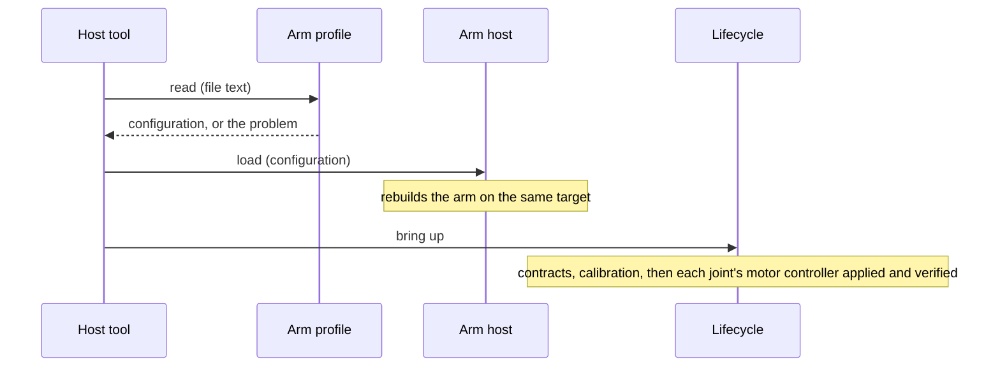

| Field     | Value              |
|-----------|--------------------|
| Title     | Arm Profile Design |
| Type      | design             |
| Status    | draft              |
| Version   | 0.25.2             |
| Component | arm_profile        |
| Date      | 2026-11-26         |

> The single description of an arm, as a JSON file: its control timing, and per joint the node, transmission,
> limits and motor controller. Behaviour only; diagrams are Mermaid.

---

## Responsibilities

- Reading a profile from JSON text into the arm's configuration.
- Refusing a profile that is malformed, out of range or incomplete, with one message that names the offending item.
- Writing an arm's configuration back as JSON text that reads back to the same configuration.
- Staying heap-free, so the same code can read a profile on a microcontroller later.

---

## Component Details

### Part A — Content

A profile holds the arm's configuration:

| Item                                          | JSON key                                         | Unit, range                                          | Default when absent        |
|-----------------------------------------------|--------------------------------------------------|------------------------------------------------------|----------------------------|
| Format marker                                 | `format`                                         | `"e-robot-arm profile"`                              | required                   |
| Format version                                | `version`                                        | `11` (`1` to `10` are read)                          | required                   |
| Name                                          | `name`                                           | text, at most 48 characters                          | required                   |
| Control period                                | `controlPeriodMs`                                | ms, 1 to 1000                                        | required                   |
| Missed telemetry allowed                      | `missedRequestsBeforeSilent`                     | periods, 1 to 255                                    | required                   |
| Command timeout                               | `commandTimeoutPeriods`                          | periods, 1 to 255                                    | 3                          |
| Drive watchdog                                | `driveWatchdogPeriods`                           | periods, 2 to 255                                    | 10                         |
| Enable mode                                   | `enableMode`                                     | `torque` only                                        | `torque`                   |
| `gravity-pd` bandwidth                        | `gravityPd.bandwidthRadPerS`                     | rad/s, above 0, at most 500                          | 30                         |
| `gravity-pd` damping                          | `gravityPd.dampingRatio`                         | above 0, at most 5                                   | 0.7                        |
| `computed-torque` bandwidth                   | `computedTorque.bandwidthRadPerS`                | rad/s, above 0, at most 500                          | 30                         |
| `computed-torque` damping                     | `computedTorque.dampingRatio`                    | above 0, at most 5                                   | 0.7                        |
| `gravity-pid` bandwidth                       | `gravityPid.bandwidthRadPerS`                    | rad/s, above 0, at most 500                          | 20                         |
| `gravity-pid` damping                         | `gravityPid.dampingRatio`                        | above 0, at most 5                                   | 0.7                        |
| `joint-impedance` stiffness                   | `jointImpedance.stiffnessNmPerRad`               | six, N·m/rad, above 0                                | (10 rad/s)² × free inertia |
| `joint-impedance` damping                     | `jointImpedance.dampingRatio`                    | above 0, at most 5                                   | 0.7                        |
| `cartesian-impedance` translational stiffness | `cartesianImpedance.translationalStiffnessNPerM` | N/m, above 0                                         | 50                         |
| `cartesian-impedance` rotational stiffness    | `cartesianImpedance.rotationalStiffnessNmPerRad` | N·m/rad, above 0                                     | 0.07                       |
| `cartesian-impedance` damping                 | `cartesianImpedance.dampingRatio`                | above 0, at most 5                                   | 0.7                        |
| `operational-space` bandwidth                 | `operationalSpace.bandwidthRadPerS`              | rad/s, above 0, at most 500                          | 30                         |
| `operational-space` damping                   | `operationalSpace.dampingRatio`                  | above 0, at most 5                                   | 0.7                        |
| `operational-space` singularity damping       | `operationalSpace.singularityDamping`            | above 0, at most 1                                   | 0.01                       |
| `slotine-li` λ                                | `slotineLi.lambdaPerS`                           | 1/s, above 0, at most 100                            | 10                         |
| `slotine-li` bandwidth                        | `slotineLi.bandwidthRadPerS`                     | rad/s, above 0, at most 500                          | 20                         |
| `slotine-li` adaptation gain                  | `slotineLi.adaptationGain`                       | above 0, at most 10000                               | 10                         |
| Experimental controllers                      | `experimental`                                   | `true`, `false`                                      | `false`                    |
| Active arm controller                         | `armController`                                  | a registered name; `slotine-li` needs `experimental` | `gravity-pd`               |
| Collision observer gain                       | `collisionObserverGainPerS`                      | 1/s, above 0, at most 1000                           | 25                         |
| Motion profile                                | `motionProfile`                                  | `trapezoid`, `s-curve`                               | `trapezoid`                |
| Tool limits                                   | `toolLimits`                                     | see below                                            | see below                  |
| Teach points                                  | `teachPoints`                                    | see below                                            | none                       |
| Joints                                        | `joints`                                         | exactly six, in order                                | required                   |
| Geometry                                      | `geometry`                                       | see below                                            | the reference arm          |
| Mass properties                               | `massProperties`                                 | see below                                            | the reference arm          |
| Link meshes                                   | `meshes`                                         | see below                                            | none                       |
| Workspace, self-collision                     | `safety`                                         | see below                                            | see below                  |

The arm runs its joints in torque mode only ([arm-controllers.md](arm-controllers.md) Part A). The reader reads the
enable mode for older profiles, and the mode must be `torque`. The reader refuses a profile that names another mode.
A written profile leaves the enable mode out.

The motion profile shapes every point-to-point move ([joint-motion.md](joint-motion.md) Part F): trapezoidal at each
joint's speed and acceleration limits, or S-curve, also within its jerk limit. A profile that chooses `s-curve`
without a jerk limit on every joint is refused. The profile can be changed at rest without reloading the file, and the
profile in effect is the one written.

The tool limits bound the tool lines and tool jogs ([joint-motion.md](joint-motion.md) Parts H and I), in the base
frame. The joint limits still hold for every joint on the way:

| Item                     | JSON key                                 | Unit, range           | Default when absent |
|--------------------------|------------------------------------------|-----------------------|---------------------|
| Linear speed             | `toolLimits.speedMPerS`                  | m/s, above 0          | 0.25                |
| Linear acceleration      | `toolLimits.accelerationMPerS2`          | m/s², above 0         | 1                   |
| Linear jerk              | `toolLimits.jerkMPerS3`                  | m/s³, above 0         | 10                  |
| Angular speed            | `toolLimits.angularSpeedRadPerS`         | rad/s, above 0        | 1                   |
| Angular acceleration     | `toolLimits.angularAccelerationRadPerS2` | rad/s², above 0       | 4                   |
| Angular jerk             | `toolLimits.angularJerkRadPerS3`         | rad/s³, above 0       | 40                  |
| Manipulability threshold | `toolLimits.manipulabilityMin`           | 0 or above, at most 1 | 0.001               |

The teach points are named joint poses to go to ([joint-motion.md](joint-motion.md) Part J): at most 16, each
`{ "name": "<1 to 16 characters>", "jointsRad": [six angles, rad, joint space] }`, the names unique. The tools teach
them at run time; saving the profile writes them back.

The joint-impedance items set the `joint-impedance` arm controller ([arm-controllers.md](arm-controllers.md) Part D).
They hold each joint's stiffness, all six or none, and the damping ratio from which each joint's damping follows.
Without the stiffnesses, each joint gets (10 rad/s)² times its inertia at home, with its rotor and the other joints
free. The Cartesian-impedance items set the `cartesian-impedance` arm controller the same way. They hold one
stiffness along the three axes of the tool's position, one about the three axes of its orientation, and the damping
ratio.

The operational-space items set the `operational-space` arm controller. They hold its bandwidth and damping ratio in
task units and the damping σ of its task-inertia inverse. The controller hands over to joint-space control below
`toolLimits.manipulabilityMin`. The Slotine–Li items set the `slotine-li` arm controller. The arm offers it only when
`experimental` is `true`.

The active arm controller item names the controller that the arm selects at construction
([arm-controllers.md](arm-controllers.md) Part B). The arm host writes a run-time selection back, so a saved profile
keeps it. The item can name `free` or `gravity-float` on any target, but only a simulation offers them. Elsewhere the
arm selects `gravity-pd` (the same document, Part E).

The two gravity-PD items set the gains of the `gravity-pd` arm controller for every joint at once
([arm-controllers.md](arm-controllers.md) Part A). The two computed-torque items do the same for `computed-torque`.
The two gravity-PID items do the same for `gravity-pid`.

The geometry is the arm model's ([arm-model.md](arm-model.md) Part A):

| Item          | JSON key                                                    | Unit, range          | Default when absent |
|---------------|-------------------------------------------------------------|----------------------|---------------------|
| OPW lengths   | `opwMetres.a1`, `.a2`, `.b`, `.c1`, `.c2`, `.c3`, `.c4`     | m; c2 and c3 above 0 | required            |
| Joint signs   | `jointSigns`                                                | six of 1 or −1       | all 1               |
| Joint offsets | `jointOffsetsRad`                                           | six, rad             | all 0               |
| Tool          | `tool.xM`, `.yM`, `.zM`, `.rollRad`, `.pitchRad`, `.yawRad` | m, rad               | identity            |
| Base          | `base`, as `tool`                                           | m, rad               | identity            |

The mass properties are the arm model's ([arm-model.md](arm-model.md) Part F). `links` is a list of six, one per link
in joint order. An optional `payload` is relative to the flange. Each of them:

| Item           | JSON key                       | Unit, range                                                 | Default when absent |
|----------------|--------------------------------|-------------------------------------------------------------|---------------------|
| Mass           | `massKg`                       | kg, 0 or above                                              | required            |
| Centre of mass | `centreM.x`, `.y`, `.z`        | m, in the link's frame                                      | 0                   |
| Moments        | `inertiaKgM2.xx`, `.yy`, `.zz` | kg·m², about the centre; each sum of two at least the third | 0                   |
| Products       | `inertiaKgM2.xy`, `.xz`, `.yz` | kg·m², tensor elements                                      | 0                   |

Without `payload` the arm carries none.

The simulator draws the link meshes instead of its generated shapes ([tool-simulator.md](tool-simulator.md) Part E).
The key `meshes` names a glTF file for any of `base`, `link1` … `link6`. Each is a path relative to the profile file, at most
96 characters, ending in `.gltf` or `.glb`. A link without a mesh keeps the generated shapes. The arm itself
never reads them.

Each joint:

| Item               | JSON key                            | Unit, range                                 | Default when absent         |
|--------------------|-------------------------------------|---------------------------------------------|-----------------------------|
| Node               | `node`                              | CAN node id, 1 to 255, unique among the six | required                    |
| Gear ratio         | `transmission.ratio`                | motor turns per joint turn, above 0         | 1                           |
| Direction          | `transmission.direction`            | `positive`, `negative`                      | `positive`                  |
| Zero offset        | `transmission.offsetRad`            | rad, joint space                            | 0                           |
| Position limits    | `positionLimitsRad.lower`, `.upper` | rad, joint space, lower below upper         | required                    |
| Speed limit        | `motionLimits.speedRadPerS`         | rad/s, joint space, above 0                 | required                    |
| Acceleration limit | `motionLimits.accelerationRadPerS2` | rad/s², joint space, above 0                | required                    |
| Jerk limit         | `motionLimits.jerkRadPerS3`         | rad/s³, joint space, above 0                | none; required by `s-curve` |
| Tracking window    | `trackingError.windowRad`           | rad, joint space, above 0                   | 0.2                         |
| Tracking time      | `trackingError.timeS`               | s, above 0, at most 10                      | 0.2                         |
| Collision limit    | `collisionTorqueNm`                 | N·m, joint side, above 0, at most 1000      | 20                          |
| Speed trip         | `speedLimitRadPerS`                 | rad/s, joint space, above 0                 | 4 × speed limit             |
| Torque limit       | `torqueLimitNm`                     | N·m, joint side, above 0, at most 1000      | from the motor              |
| Motor controller   | `motorController`                   | see below                                   | not configured              |
| Motor              | `motor`                             | see below                                   | not configured              |

The tracking window and time are the safety supervisor's ([safety.md](safety.md) Part F). A joint whose tracking
error stays above its window for its time trips the arm. The collision limit is also the safety supervisor's. An
external torque on the joint above the limit trips the arm. The collision observer estimates that torque
([collision.md](collision.md)). The observer's gain, the bandwidth of its estimate, is the arm's collision observer
gain.

The speed trip stops the arm when the joint's measured speed exceeds it. The arm clamps every torque it sends to the
torque limit. A joint with neither a torque limit nor a motor has only the limit of its drive (safety.md Parts B and
F). All have defaults, so every check is on in every profile. Each check ends in a protective stop: the joints keep
holding.

The drive watchdog is the e-foc command timeout, in control periods. The joint configurator writes it to every node.
A drive that hears no setpoint for that long stops and faults ([safety.md](safety.md) Part I).

`safety` holds the workspace and self-collision check ([safety.md](safety.md) Part H), in the base frame:

| Item                  | JSON key                 | Unit, range                                | Default when absent                                    |
|-----------------------|--------------------------|--------------------------------------------|--------------------------------------------------------|
| Workspace             | `workspaceM.min`, `.max` | m, each `{ "x", "y", "z" }`, min below max | the reach plus the largest radius, from the base plane |
| Forbidden zones       | `forbiddenZonesM`        | at most eight boxes, as `workspaceM`       | none                                                   |
| Link radii            | `linkRadiiM`             | seven, m, above 0: links 1 to 6, then tool | all 0.04                                               |
| Self-collision margin | `selfCollisionMarginM`   | m, 0 or above, at most 0.5                 | 0.01                                                   |
| Allowed link pairs    | `allowedLinkPairs`       | pairs of 1 to 7, not adjacent, at most 16  | none                                                   |

The check never tests the two links of an allowed pair against each other. Adjacent links are allowed without a
listing ([safety.md](safety.md) Part H). So are the pairs that touch with every joint at zero, the spherical wrist's. A
profile lists any other pair whose capsules touch by construction. The workspace's default follows the geometry. So a
profile that names no workspace keeps following its geometry when that changes.

A joint's motor controller names one algorithm per loop and any of its fourteen gains:

| Item               | JSON key       | Values                                                                           |
|--------------------|----------------|----------------------------------------------------------------------------------|
| Current algorithm  | `current`      | `pid`, `decoupledPid`, `deadbeat`, `slidingMode`                                 |
| Speed algorithm    | `speed`        | `pid`, `lqi`, `adrc`, `twoDof`                                                   |
| Position algorithm | `position`     | `pid`, `cascadeP`, `lqr`, `lqi`, `twoDof`                                        |
| Gains              | `gains.<name>` | the gain names of [joint-configurator.md](joint-configurator.md), contract units |

The three algorithms are required once the motor controller is present. A gain left out takes the contract's
default. Each gain must lie in the e-foc contract's range. A joint without a motor controller keeps whatever its node
holds: the lifecycle does not configure it.

A joint's motor holds the thirteen parameters of [joint-configurator.md](joint-configurator.md) Part D, in its
display units:

| Item             | JSON key                        | Item                   | JSON key                  |
|------------------|---------------------------------|------------------------|---------------------------|
| Preset           | `preset`                        | Coulomb friction       | `coulombFrictionMilliNm`  |
| Resistance       | `resistanceOhm`                 | Continuous current     | `continuousCurrentA`      |
| Inductance       | `inductanceMilliHenry`          | Peak current           | `peakCurrentA`            |
| Pole pairs       | `polePairs`                     | Peak-current time      | `peakCurrentTimeS`        |
| Flux linkage     | `fluxLinkageMilliWeber`         | Overspeed limit        | `overspeedLimitRadPerS`   |
| Rotor inertia    | `inertiaGramCm2`                | Following-error window | `followingErrorWindowRad` |
| Viscous friction | `viscousFrictionMicroNmSPerRad` | Following-error time   | `followingErrorTimeS`     |

`preset` names a preset (`teknic-m2310p-ln-04k`, `anaheim-bly172s-24v-4000`). Its values fill every parameter that
the motor leaves out. Without a preset, the eleven others are required. The two following-error items are optional
with or without a preset. Left out, they keep e-foc's default, supervision off (a window of 0 and a time of 0.1 s).
They came with format version 2; a version 1 file reads as before. Later format versions added these items:

- Version 3: the speed trip, the torque limit, the drive watchdog and `safety`.
- Version 4: the motion profile and the jerk limit.
- Version 5: the tool limits.
- Version 6: the teach points.
- Version 7: the joint-impedance items.
- Version 8: the Cartesian-impedance items.
- Version 9: the operational-space items.
- Version 10: the Slotine–Li items and `experimental`.
- Version 11: the active arm controller.

An older file takes their defaults. Each value must lie in the e-foc contract's range. Pole pairs must be a whole
number. A joint without `motor` keeps whatever its node holds.

### Part B — Reading

Reading is strict, so a typing mistake never passes silently. The reader refuses each of these:

- An unknown key.
- A value of the wrong type.
- A value out of range.
- A missing required item.
- A joint count other than six.
- A repeated node.

The message names the first problem by its path, for example `joints[2].transmission.ratio: must be above 0`. A
number is an integer or has up to nine decimals. The reader does not accept exponents.

### Part C — Writing

Writing produces every item, defaults included, in the order of Part A. A motor gets its preset, if it has one, and
all eleven values. Three items have a default that follows another item: the speed trip, the torque limit and the
workspace. Writing produces them only when the profile names them. Real numbers have up to nine decimals, with
trailing zeros dropped. Read back, every item is the same. A gain comes back within the joint configurator's
comparison tolerance ([joint-configurator.md](joint-configurator.md) Part C). The reason: nine decimals hold fewer
significant digits than a float below 0.1.

### Part D — Profile files on the host

The host tools (simulator, console, virtual arm) read and write profile files through one shared file reader and
writer. So the rules below hold for every tool:

- **Reading is bounded.** The reader reads a file up to 64 KiB and one byte more. It refuses a longer file with
  `<path> is larger than 64 KiB` and never reads the rest. So a wrong path (a log, an image, a device) cannot make a
  tool read without limit.
- **Saving never loses the last good file.** The writer writes the full profile to a temporary file next to the
  destination, closes it, and only then renames it over the destination. The temporary file is `<file>.saving`, in
  the same directory, so the replacement stays on the same file system. Until that rename, the destination stays
  untouched. Writing or closing the temporary file can fail (no space, no permission, a directory in the way), or the
  rename can fail. Then the old profile is still there, byte for byte, and the writer removes the temporary file. The
  message names the step: `cannot write <path>` or `cannot replace <path>: <reason>`. A crash between the steps
  leaves at most a stray `<file>.saving` beside an intact profile.

### Example

```json
{
  "format": "e-robot-arm profile",
  "version": 11,
  "name": "generic six-joint",
  "controlPeriodMs": 10,
  "missedRequestsBeforeSilent": 3,
  "commandTimeoutPeriods": 3,
  "driveWatchdogPeriods": 10,
  "joints": [
    {
      "node": 1,
      "transmission": { "ratio": 50, "direction": "positive", "offsetRad": 0 },
      "positionLimitsRad": { "lower": -3.14, "upper": 3.14 },
      "motionLimits": { "speedRadPerS": 1, "accelerationRadPerS2": 2 },
      "motorController": {
        "current": "pid",
        "speed": "pid",
        "position": "lqr",
        "gains": { "positionBandwidth": 25, "positionErrorWeight": 1.5 }
      }
    }
  ]
}
```

The example shows one joint; a profile lists six.

---

## Interfaces

### Provided

| Interface     | Purpose                           | Contract                                                                 |
|---------------|-----------------------------------|--------------------------------------------------------------------------|
| Read profile  | JSON text to an arm configuration | Either a complete, valid configuration or one message naming the problem |
| Write profile | An arm configuration to JSON text | Reads back to the same configuration                                     |

### Required

| Interface   | Purpose                                    | Contract                                                                                        |
|-------------|--------------------------------------------|-------------------------------------------------------------------------------------------------|
| EMIL JSON   | Tokenising, navigating and formatting JSON | Heap-free, over a bounded text                                                                  |
| e-foc range | Each gain's accepted range                 | The contract's parameter table                                                                  |
| Host tools  | Profile files                              | They read and write the files and hand over the text                                            |
| Lifecycle   | Applying the profile                       | Applies the motor controllers while it brings the arm up ([arm-lifecycle.md](arm-lifecycle.md)) |

---

## Data Model

| Entity  | Field       | Type / Unit                             | Range              | Notes                                        |
|---------|-------------|-----------------------------------------|--------------------|----------------------------------------------|
| Profile | name        | bounded text                            | 1 to 48 characters | Shown by the tools                           |
| Profile | config      | arm configuration                       | Part A             | What the arm is built from                   |
| Config  | controllers | per joint, motor-controller settings    | present or absent  | Absent: the lifecycle leaves the joint alone |
| Config  | motors      | per joint, preset and motor settings    | present or absent  | Absent: the lifecycle leaves the joint alone |
| Config  | geometry    | OPW lengths, signs, offsets, tool, base | —                  | The reference arm when absent                |
| Config  | mass        | six links and a payload                 | Part A             | The reference arm when absent                |
| Profile | meshes      | seven relative paths                    | Part A             | Drawn by the simulator only                  |

---

## Sequence Diagrams



---

## Constraints & Limitations

| Constraint | Value / Description                                                          |
|------------|------------------------------------------------------------------------------|
| Memory     | No heap; the text is read in place and the result is one configuration       |
| Precision  | Nine decimals for real numbers, no exponents                                 |
| Versioning | A reader refuses a version it does not know; a later version only adds items |
| Scope      | The arm is built from its configuration; the profile does not apply itself   |


---

## Decisions

| # | Decision                                | Options                                       | Status                                  |
|---|-----------------------------------------|-----------------------------------------------|-----------------------------------------|
| 1 | File format                             | JSON, binary image                            | decided: JSON                           |
| 2 | How a loaded profile reaches the joints | Lifecycle step, operator button               | decided: lifecycle step                 |
| 3 | How a loaded profile changes the arm    | Rebuild the arm, profile at start only        | decided: rebuild while not enabled      |
| 4 | Motor characteristics and limits        | Added to `motorController`, a `motor` section | decided: a `motor` section with presets |
