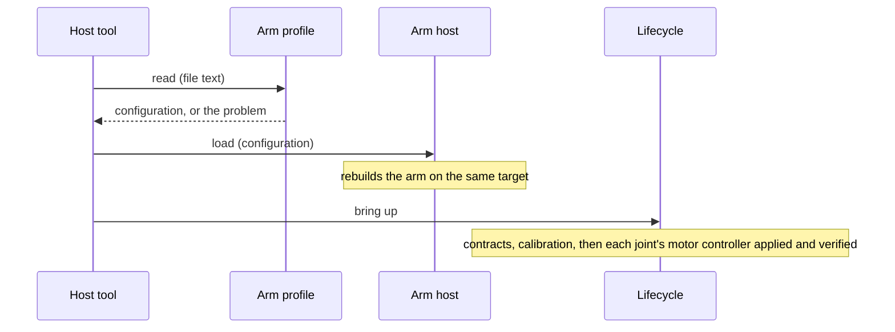

| Field     | Value              |
|-----------|--------------------|
| Title     | Arm Profile Design |
| Type      | design             |
| Status    | draft              |
| Version   | 0.2.0              |
| Component | arm_profile        |
| Date      | 2026-11-13         |

> The single description of an arm, as a JSON file: its control timing, and per joint the node, transmission,
> limits and motor controller. Behaviour only; diagrams are Mermaid.

---

## Responsibilities

**Is responsible for:**

- Reading a profile from JSON text into the arm's configuration, and refusing a profile that is malformed, out of
  range or incomplete with one message that names the offending item.
- Writing an arm's configuration back as JSON text that reads back to the same configuration.
- Staying heap-free, so the same code can read a profile on a microcontroller later.

**Is NOT responsible for:**

- Files: the host tools read and write them and hand the text over.
- Applying the profile: the arm is built from its configuration, and the lifecycle applies the motor controllers
  while bringing the arm up ([arm-lifecycle.md](arm-lifecycle.md)).
- Arm geometry and arm controllers: later items of the format, as phases 3 to 5 add them.

---

## Component Details

### Part A — Content

A profile holds what `ArmConfig` holds:

| Item                     | JSON key                     | Unit, range                   | Default when absent |
|--------------------------|------------------------------|-------------------------------|---------------------|
| Format marker            | `format`                     | `"e-robot-arm profile"`       | required            |
| Format version           | `version`                    | `1`                           | required            |
| Name                     | `name`                       | text, at most 48 characters   | required            |
| Control period           | `controlPeriodMs`            | ms, 1 to 1000                 | required            |
| Missed telemetry allowed | `missedRequestsBeforeSilent` | periods, 1 to 255             | required            |
| Command timeout          | `commandTimeoutPeriods`      | periods, 1 to 255             | 3                   |
| Enable mode              | `enableMode`                 | `torque`, `speed`, `position` | `position`          |
| Joints                   | `joints`                     | exactly six, in order         | required            |

Each joint:

| Item               | JSON key                            | Unit, range                                 | Default when absent |
|--------------------|-------------------------------------|---------------------------------------------|---------------------|
| Node               | `node`                              | CAN node id, 1 to 255, unique among the six | required            |
| Gear ratio         | `transmission.ratio`                | motor turns per joint turn, above 0         | 1                   |
| Direction          | `transmission.direction`            | `positive`, `negative`                      | `positive`          |
| Zero offset        | `transmission.offsetRad`            | rad, joint space                            | 0                   |
| Position limits    | `positionLimitsRad.lower`, `.upper` | rad, joint space, lower below upper         | required            |
| Speed limit        | `motionLimits.speedRadPerS`         | rad/s, joint space, above 0                 | required            |
| Acceleration limit | `motionLimits.accelerationRadPerS2` | rad/s², joint space, above 0                | required            |
| Motor controller   | `motorController`                   | see below                                   | not configured      |
| Motor              | `motor`                             | see below                                   | not configured      |

A joint's motor controller names one algorithm per loop and any of its fourteen gains:

| Item               | JSON key       | Values                                                                           |
|--------------------|----------------|----------------------------------------------------------------------------------|
| Current algorithm  | `current`      | `pid`, `decoupledPid`, `deadbeat`, `slidingMode`                                 |
| Speed algorithm    | `speed`        | `pid`, `lqi`, `adrc`, `twoDof`                                                   |
| Position algorithm | `position`     | `pid`, `cascadeP`, `lqr`, `lqi`, `twoDof`                                        |
| Gains              | `gains.<name>` | the gain names of [joint-configurator.md](joint-configurator.md), contract units |

The three algorithms are required once `motorController` is present; a gain left out takes the contract's
default, and each gain must lie in the e-foc contract's range. A joint without `motorController` keeps whatever its
node holds: the lifecycle does not configure it.

A joint's motor holds the eleven parameters of [joint-configurator.md](joint-configurator.md) Part D, in its
display units:

| Item             | JSON key                        | Item               | JSON key                 |
|------------------|---------------------------------|--------------------|--------------------------|
| Preset           | `preset`                        | Coulomb friction   | `coulombFrictionMilliNm` |
| Resistance       | `resistanceOhm`                 | Continuous current | `continuousCurrentA`     |
| Inductance       | `inductanceMilliHenry`          | Peak current       | `peakCurrentA`           |
| Pole pairs       | `polePairs`                     | Peak-current time  | `peakCurrentTimeS`       |
| Flux linkage     | `fluxLinkageMilliWeber`         | Overspeed limit    | `overspeedLimitRadPerS`  |
| Rotor inertia    | `inertiaGramCm2`                |                    |                          |
| Viscous friction | `viscousFrictionMicroNmSPerRad` |                    |                          |

`preset` names a preset (`teknic-m2310p-ln-04k`, `anaheim-bly172s-24v-4000`) whose values fill every parameter the
motor leaves out; without a preset all eleven are required. Each value must lie in the e-foc contract's range, and
pole pairs must be a whole number. A joint without `motor` keeps whatever its node holds.

### Part B — Reading

Reading is strict, so a typing mistake never passes silently: an unknown key, a value of the wrong type, a value
out of range, a missing required item, a joint count other than six or a repeated node is refused. The message
names the first problem by its path, for example `joints[2].transmission.ratio: must be above 0`. Numbers may be
written as integers or with up to nine decimals; exponents are not accepted.

### Part C — Writing

Writing produces every item, defaults included, in the order of Part A (a motor with its preset, if it has one, and
all eleven values), with up to nine decimals for real numbers
and trailing zeros dropped. Read back, every item is the same; a gain comes back within the joint configurator's
comparison tolerance ([joint-configurator.md](joint-configurator.md) Part C), since nine decimals hold fewer
significant digits than a float below 0.1.

### Example

```json
{
  "format": "e-robot-arm profile",
  "version": 1,
  "name": "generic six-joint",
  "controlPeriodMs": 10,
  "missedRequestsBeforeSilent": 3,
  "commandTimeoutPeriods": 3,
  "enableMode": "position",
  "joints": [
    {
      "node": 1,
      "transmission": { "ratio": 50, "direction": "positive", "offsetRad": 0 },
      "positionLimitsRad": { "lower": -3.14, "upper": 3.14 },
      "motionLimits": { "speedRadPerS": 1, "accelerationRadPerS2": 2 },
      "motorController": {
        "current": "pid",
        "speed": "pid",
        "position": "lqr",
        "gains": { "positionBandwidth": 25, "positionErrorWeight": 1.5 }
      }
    }
  ]
}
```

The example shows one joint; a profile lists six.

---

## Interfaces

### Provided

| Interface     | Purpose                           | Contract                                                                 |
|---------------|-----------------------------------|--------------------------------------------------------------------------|
| Read profile  | JSON text to an arm configuration | Either a complete, valid configuration or one message naming the problem |
| Write profile | An arm configuration to JSON text | Reads back to the same configuration                                     |

### Required

| Interface   | Purpose                                    | Contract                       |
|-------------|--------------------------------------------|--------------------------------|
| EMIL JSON   | Tokenising, navigating and formatting JSON | Heap-free, over a bounded text |
| e-foc range | Each gain's accepted range                 | The contract's parameter table |

---

## Data Model

| Entity  | Field       | Type / Unit                          | Range              | Notes                                        |
|---------|-------------|--------------------------------------|--------------------|----------------------------------------------|
| Profile | name        | bounded text                         | 1 to 48 characters | Shown by the tools                           |
| Profile | config      | arm configuration                    | Part A             | What the arm is built from                   |
| Config  | controllers | per joint, motor-controller settings | present or absent  | Absent: the lifecycle leaves the joint alone |
| Config  | motors      | per joint, preset and motor settings | present or absent  | Absent: the lifecycle leaves the joint alone |

---

## Sequence Diagrams



---

## Constraints & Limitations

| Constraint | Value / Description                                                          |
|------------|------------------------------------------------------------------------------|
| Memory     | No heap; the text is read in place and the result is one configuration       |
| Precision  | Nine decimals for real numbers, no exponents                                 |
| Versioning | A reader refuses a version it does not know; a later version only adds items |

---

## Open Questions

| # | Question                                | Options                                       | Status                                  |
|---|-----------------------------------------|-----------------------------------------------|-----------------------------------------|
| 1 | File format                             | JSON, binary image                            | decided: JSON                           |
| 2 | How a loaded profile reaches the joints | Lifecycle step, operator button               | decided: lifecycle step                 |
| 3 | How a loaded profile changes the arm    | Rebuild the arm, profile at start only        | decided: rebuild while not enabled      |
| 4 | Motor characteristics and limits        | Added to `motorController`, a `motor` section | decided: a `motor` section with presets |
