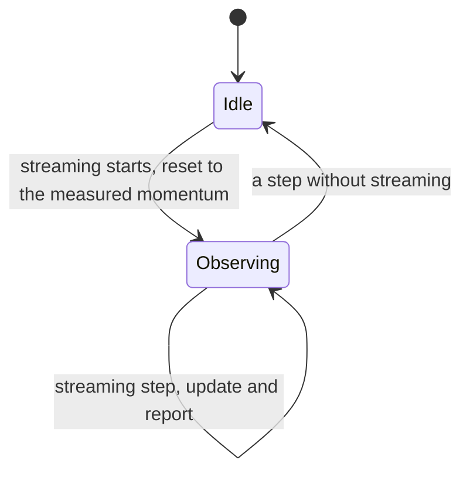

| Field     | Value                     |
|-----------|---------------------------|
| Title     | Collision Observer Design |
| Type      | design                    |
| Status    | draft                     |
| Version   | 0.1.0                     |
| Component | collision                 |
| Date      | 2026-11-17                |

> Estimates the external torque on each joint from the arm's dynamics, the measured joints and the torques the arm
> commanded, so the safety supervisor can stop the arm on a collision. Behaviour only; diagrams are Mermaid.

---

## Responsibilities

**Is responsible for:**

- Estimating, once per control step while the arm drives its joints, the torque on each joint that the arm's
  dynamics do not explain: an obstacle, a person, a payload the profile does not name.
- Starting from no external torque whenever the arm starts driving its joints again.

**Is NOT responsible for:**

- Deciding whether an estimate is a collision, or stopping the arm: the safety supervisor compares each joint's
  estimate with its collision limit ([safety.md](safety.md) Part F).
- Telling where on a link the arm was hit, or reacting with compliance: a collision trips the arm.
- Modelling friction: the drives' friction shows in the estimate, and the collision limit sits above it.

---

## Component Details

### Part A — The momentum observer

The arm's generalised momentum is its inertia matrix times the joint speeds. Without an external torque it changes
only by the commanded torque, gravity and the Coriolis terms the dynamics give. The observer is robotics-toolbox's
momentum observer: it integrates that expected change, compares the integral with the momentum measured now, and
the difference, scaled by a gain, is the external torque. The estimate follows the true external torque as a
first-order lag with the gain as its bandwidth: 50 /s by default. Over a 10 ms period each step closes half the
gap, so a step of external torque shows at 50 % after one period and at 94 % after four. It needs no joint accelerations, so measured speeds are enough, and no
differentiation, so it does not amplify noise.

The dynamics are the arm model's ([arm-model.md](arm-model.md)): its links' mass, centre of mass and inertia,
gravity, and each joint's reflected rotor inertia, the motor's inertia times the gear ratio squared, as the link's
armature. The rotor inertia matters: on a 50:1 gear it is of the order of the links' own inertia, and an observer
without it reads every acceleration as an external torque.

### Part B — When it runs

The arm steps the observer after the arm controllers, once per control step:

- While the controllers stream setpoints, it updates with the latest measured positions and speeds and the torques
  commanded the step before: those are the torques that moved the joints to where they are now measured.
- The first streaming step after any step without streaming resets it to the momentum measured then, and reports no
  estimate for that step.
- A step without streaming reports no estimate.

The estimate is reported in joint space, in N·m, with the sign of the joint's torque; the arm host shows it in its
snapshot and trace.

---

## Interfaces

### Provided

| Interface | Purpose                                                    | Contract                                        |
|-----------|------------------------------------------------------------|-------------------------------------------------|
| Reset     | Start from no external torque at the measured joints       | Called when streaming starts                    |
| Update    | The external torque on each joint after one control period | Measured joints, the previous commanded torques |

### Required

| Interface | Purpose                                        | Contract                                   |
|-----------|------------------------------------------------|--------------------------------------------|
| Arm model | Links, gravity, joint-space conversions        | Built from the profile's geometry and mass |
| Rotors    | Each joint's reflected rotor inertia, in kg·m² | From the profile's motors and gear ratios  |

---

## Data Model

| Entity   | Field | Type / Unit | Range   | Notes                                      |
|----------|-------|-------------|---------|--------------------------------------------|
| Observer | gain  | 1/s         | above 0 | The estimate's bandwidth; 50 /s by default |
| Estimate | joint | N·m         | finite  | One per joint, joint space                 |

---

## Constraints & Limitations

- The estimate carries every torque the model misses: Coulomb friction while a joint moves, an unmodelled payload,
  wrong link masses. On the virtual arm it stays below 4.6 N·m through the reference move, on the shoulder; the
  collision limit sits above that.
- A reading that arrives a period late shows the joints where they were, so that step's estimate is off by about
  the gain times one period's momentum change; the next fresh reading corrects it.
- The observer is heap-free and runs once per control step; a mass matrix, a Coriolis matrix and a gravity vector
  per step.

---

## Open Questions

| # | Question                                                                      | Options                                          | Status |
|---|-------------------------------------------------------------------------------|--------------------------------------------------|--------|
| 1 | Whether the observer models the drives' friction, so the limits can come down | No friction model, Coulomb and viscous per joint | open   |
