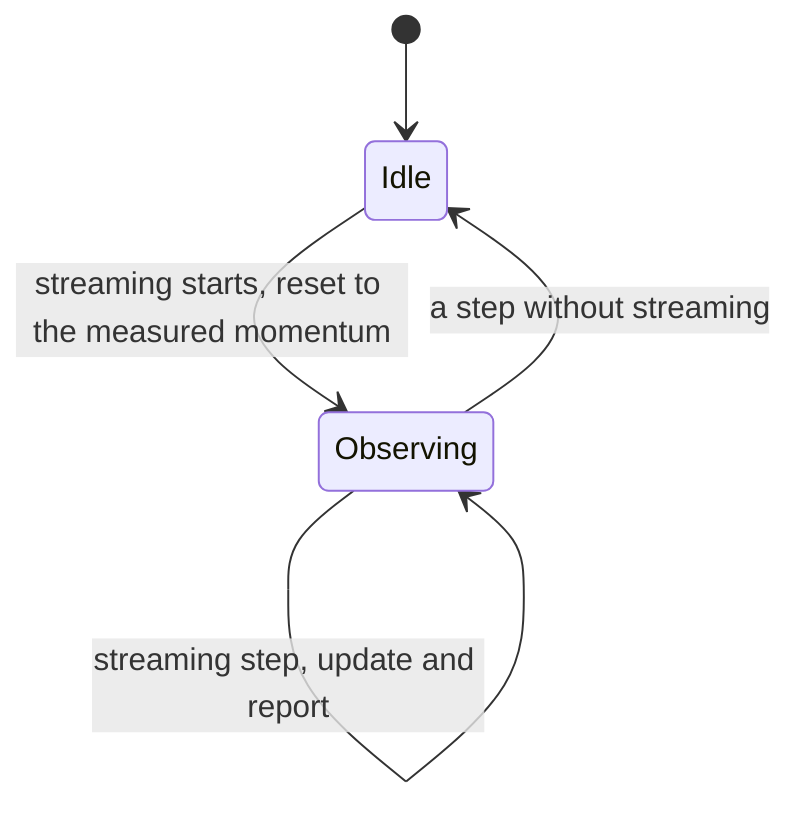

| Field     | Value                     |
|-----------|---------------------------|
| Title     | Collision Observer Design |
| Type      | design                    |
| Status    | draft                     |
| Version   | 0.5.1                     |
| Component | collision                 |
| Date      | 2026-11-26                |

> Estimates the external torque on each joint from the arm's dynamics, the measured joints and the torques the arm
> commanded, so the safety supervisor can stop the arm on a collision. Behaviour only; diagrams are Mermaid.

---

## Responsibilities

- Estimating the torque on each joint that the arm's dynamics do not explain, once per control step while the arm
  drives its joints. Examples are an obstacle, a person, or a payload the profile does not name.
- Starting from no external torque whenever the arm starts driving its joints again.

---

## Component Details

### Part A — The momentum observer

The arm's generalised momentum is its inertia matrix times the joint speeds. Without an external torque it changes
only by the commanded torque, gravity and the Coriolis terms the dynamics give. The observer is robotics-toolbox's
momentum observer. It integrates that expected change and compares the integral with the momentum measured now.
The difference, scaled by a gain, is the external torque. The estimate follows the true external torque as a
first-order lag with the gain as its bandwidth: 25 /s by default. Over a 10 ms period each step closes a quarter of
the gap. Thus a step of external torque shows at 25 % after one period and at 68 % after four. A 30 N·m collision
crosses a 10 N·m limit in two periods. It needs no joint accelerations, so measured speeds are enough. It needs no
differentiation, so it does not amplify noise. The gain also scales every timing error in the torque that the
observer integrates. Take a reading that arrives a few milliseconds off.
At 50 /s, it made the reference step of a tuning run read 10 N·m on the virtual arm's shoulder. At 25 /s it reads below 2 N·m.

The dynamics are the driven arm's ([arm-model.md](arm-model.md) Part G). They hold the mass, centre of mass and
inertia of the arm model's links, and gravity. They also hold each joint's reflected rotor inertia as the link's
armature: the motor's inertia times the gear ratio squared. The rotor inertia matters. On a 50:1 gear it is of the
order of the links' own inertia. An observer without it reads every acceleration as an external torque.

### Part B — When it runs

The arm steps the observer after the arm controllers, once per control step:

- While the controllers stream setpoints, it updates with the latest measured positions and speeds and the torque
  that acted since the previous reading. The control loop requests telemetry half a period before it sends the
  setpoints ([control-loop.md](control-loop.md)). Between two readings, the set commanded two steps before acts for
  the first half. The set commanded the step before acts for the second half. The observer integrates their mean.
- It updates only once every joint has reported since its previous update. A step in which a joint's reading has not
  arrived keeps the previous estimate. The next update integrates over the time between the telemetry requests that
  the two readings answered. It uses the mean of the torque that acted in the periods between. A host that runs late
  sends its requests further apart than the period. Integration over the nominal period then misses the torque of
  the extra time: about 5 N·m on the virtual arm's accelerating shoulder for 5 ms. A held-over reading taken as new
  integrates a period's torque against a momentum that did not move. On a busy host, one missed reading of a
  shoulder that accelerates read 11 N·m.
- The first streaming step after any step without streaming resets it to the momentum measured then, and reports no
  estimate for that step.
- A step without streaming reports no estimate.

The observer reports the estimate in joint space, in N·m, with the sign of the joint's torque. The arm host shows it
in its snapshot and trace.

---

## Interfaces

### Provided

| Interface | Purpose                                                    | Contract                                        |
|-----------|------------------------------------------------------------|-------------------------------------------------|
| Reset     | Start from no external torque at the measured joints       | Called when streaming starts                    |
| Update    | The external torque on each joint after one control period | Measured joints, the previous commanded torques |

### Required

| Interface | Purpose                                        | Contract                                                                                       |
|-----------|------------------------------------------------|------------------------------------------------------------------------------------------------|
| Arm model | Links, gravity, joint-space conversions        | Built from the profile's geometry and mass                                                     |
| Rotors    | Each joint's reflected rotor inertia, in kg·m² | From the profile's motors and gear ratios                                                      |
| Safety    | Collision decision and stop                    | The supervisor compares each estimate with its collision limit ([safety.md](safety.md) Part F) |

---

## Data Model

| Entity   | Field | Type / Unit | Range   | Notes                                      |
|----------|-------|-------------|---------|--------------------------------------------|
| Observer | gain  | 1/s         | above 0 | The estimate's bandwidth; 25 /s by default |
| Estimate | joint | N·m         | finite  | One per joint, joint space                 |

---

## Constraints & Limitations

- The estimate carries every torque the model misses: Coulomb friction while a joint moves, an unmodelled payload,
  wrong link masses. On the virtual arm it stays below 4.6 N·m through the reference move, on the shoulder; the
  collision limit sits above that.
- A reading that arrives within the period but late in it still shows the joints a little earlier than the torque
  assumes. The error is a fraction of the gain times one period's momentum change, and the next reading corrects it.
- The observer takes the commanded torque as applied, after the safety supervisor's torque limit ([safety.md](safety.md)
  Part B). A clamped torque is what the drive was asked for. A drive that cannot deliver it, at its current limit or
  behind its current loop, leaves the difference in the estimate. A 0.1 rad reference step on the virtual arm's
  elbow reads up to 5.6 N·m on the shoulder. The scenarios step 0.05 rad, below 2 N·m. This keeps a margin to the
  limit until the observer knows the drives' limits (decision 2).
- The observer is heap-free and runs once per control step; a mass matrix, a Coriolis matrix and a gravity vector
  per step.
- The observer does not tell where on a link the arm was hit, and does not react with compliance. A collision trips
  the arm.
- The observer does not model friction. The drives' friction shows in the estimate, and the collision limit sits
  above it.

---

## Decisions

| # | Decision                                                                       | Options                                                                                                | Status |
|---|--------------------------------------------------------------------------------|--------------------------------------------------------------------------------------------------------|--------|
| 1 | Whether the observer models the drives' friction, so the limits can come down  | No friction model, Coulomb and viscous per joint                                                       | open   |
| 2 | Whether the observer clamps the commanded torque to what the drive can deliver | Decided: the torque as clamped to the joint's torque limit, from the motor when the profile names none | closed |
