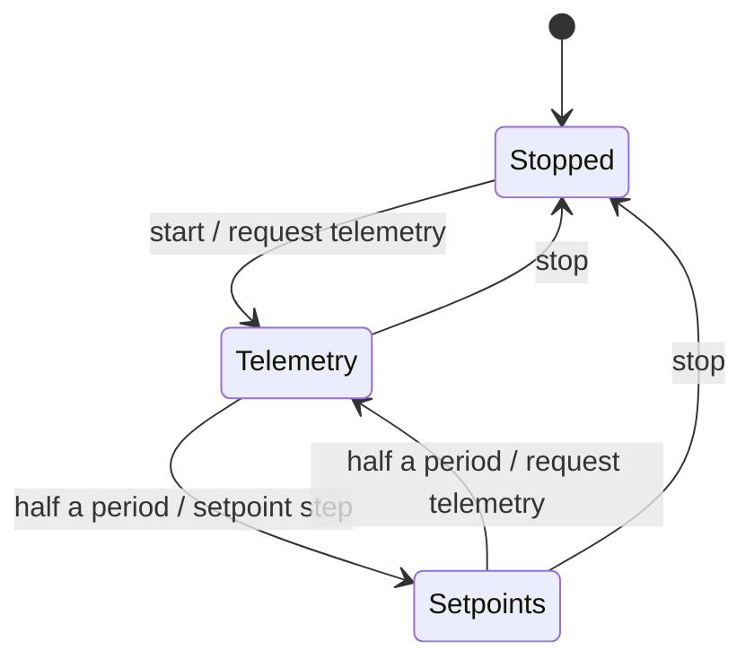
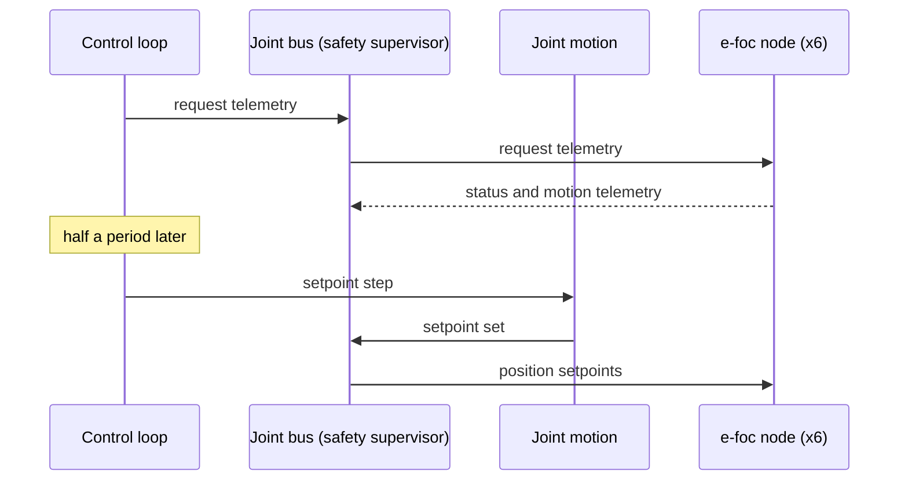

| Field     | Value               |
|-----------|---------------------|
| Title     | Control Loop Design |
| Type      | design              |
| Status    | draft               |
| Version   | 0.2.0               |
| Component | control_loop        |
| Date      | 2026-11-12          |

> The arm's fixed-period cycle: when telemetry is requested and when setpoints go out. Behaviour only; diagrams
> are Mermaid.

---

## Responsibilities

**Is responsible for:**

- Running the arm at a fixed control period once started, until stopped.
- Requesting telemetry from all six joints at the start of every period.
- Running the setpoint step (joint motion today) half a period later, once the telemetry has had time to arrive.

**Is NOT responsible for:**

- What the setpoint step sends: joint motion plans and samples the positions.
- Detecting silent or faulted joints: the joint bus counts missed requests and the safety supervisor reacts.
- Starting, stopping or homing the joints themselves.

---

## Component Details

### Part A — Two phases per period

Each period has two phases, half a period apart:

1. **Telemetry**: one telemetry request to all six joints. The joints answer with their status and motion
   telemetry, which updates the readings the next phase plans from.
2. **Setpoints**: the setpoint step runs once. Joint motion samples its move and sends one setpoint set, or does
   nothing when no move is running.

Starting the loop requests telemetry at once; the first setpoint step follows half a period later. Stopping the
loop ends both phases; a phase that has not run yet does not run.

### Part B — Why the phases are apart

A telemetry request and a setpoint set are six frames each, and can-lite's transmit queue holds eight, so the two
bursts must not be queued together. Half a period also gives the joints time to answer before positions are
sampled: the request, its six acknowledgements and its twelve answers take about 2.8 ms of a 1 Mbit/s bus, and the
setpoints with their six acknowledgements about 1.5 ms, so each half period is at least 3 ms. The arm runs at
10 ms (100 Hz), which leaves the bus about 57 % idle.

### Part C — Overruns

Each phase is due half a period after the previous one, on a fixed grid from the start. When a phase runs, the loop
compares the time with its due time. A phase that starts more than a quarter period late is an **overrun**: the
event loop was busy elsewhere, so telemetry or setpoints went out late. A phase so late that a whole half period
passed is counted once per due time it missed, because those phases never ran. The next due time is the next
grid point after the late phase, so one stall is counted once and does not make every later phase look late.

The overrun count only grows while the loop runs; restarting the loop keeps it. Due times follow the clock the
timer service reads, so a step of that clock (a host's wall clock being set) also counts as an overrun. The arm host reads it once per
period, and the console and the simulator show it.

---

## Interfaces

### Provided

| Interface    | Purpose                                 | Contract                                                                                  |
|--------------|-----------------------------------------|-------------------------------------------------------------------------------------------|
| Control loop | Start and stop the cycle; overrun count | Starting a running loop or stopping a stopped one does nothing; the count never decreases |

### Required

| Interface     | Purpose                                    | Contract                                        |
|---------------|--------------------------------------------|-------------------------------------------------|
| Joint bus     | Telemetry requests                         | The safety supervisor, in front of the real bus |
| Setpoint step | Runs once per period in the setpoint phase | Joint motion's step                             |
| Timer         | Half the control period                    | The event loop's timer service                  |

---

## Data Model

| Entity       | Field          | Type / Unit | Range                    | Notes                                                     |
|--------------|----------------|-------------|--------------------------|-----------------------------------------------------------|
| Control loop | control period | duration    | ≥ 6 ms, 10 ms by default | Telemetry and setpoint phases each half                   |
| Control loop | overruns       | count       | 0 …                      | Phases started more than a quarter period late, or missed |

---

## State Machine

---

## Sequence Diagrams

---

## Constraints & Limitations

| Constraint | Value / Description                                                                                                                        |
|------------|--------------------------------------------------------------------------------------------------------------------------------------------|
| Bus load   | 36 frames per period (6 requests and 6 acknowledgements, 12 answers, 6 setpoints and 6 acknowledgements): about 43 % of 1 Mbit/s at 100 Hz |
| Timing     | Event-loop timers: on a PC the phases jitter with the operating system's scheduling                                                        |
| Memory     | No heap; all state is fixed-size                                                                                                           |

---

## Open Questions

| # | Question                                                    | Options                                                                                 | Status                                                           |
|---|-------------------------------------------------------------|-----------------------------------------------------------------------------------------|------------------------------------------------------------------|
| 1 | Whether to measure and report period overruns               | Report a late phase, count overruns                                                     | closed: counted (Part C), shown by the console and the simulator |
| 2 | Whether setpoints and telemetry requests need acknowledging | Keep the acknowledgements, an unacknowledged form in a new e-foc-protocol minor version | open                                                             |
