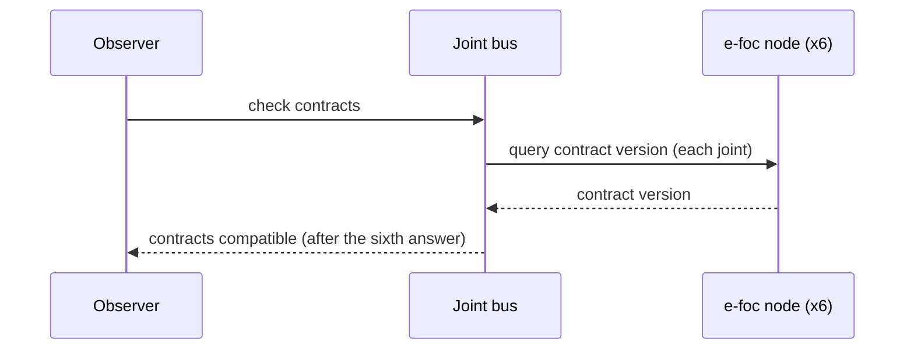
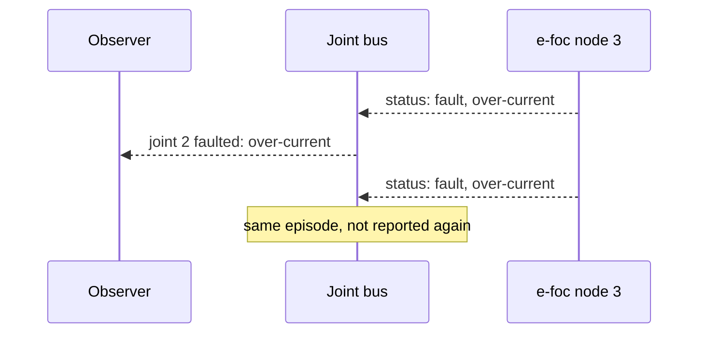
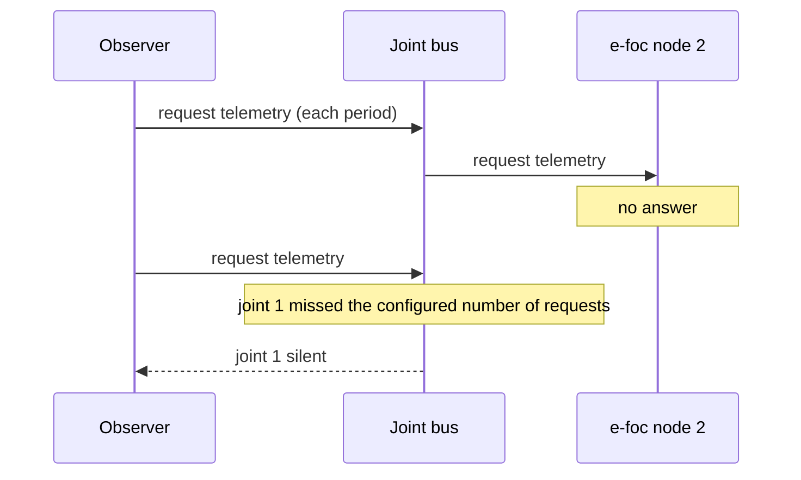
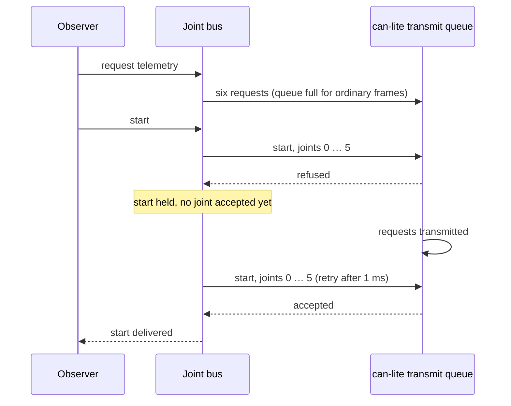
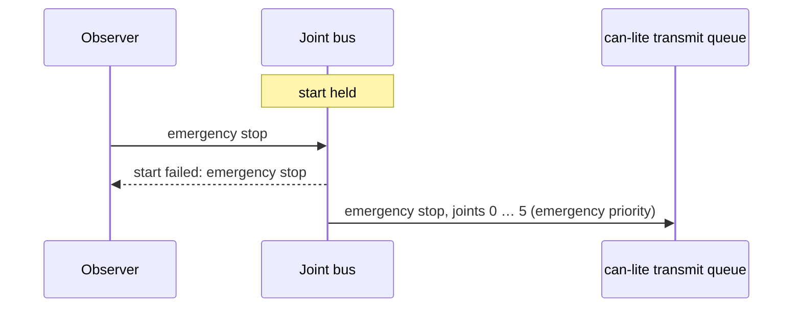

| Field     | Value            |
|-----------|------------------|
| Title     | Joint Bus Design |
| Type      | design           |
| Status    | draft            |
| Version   | 0.6.0            |
| Component | joint_bus        |
| Date      | 2026-11-12       |

> The six joints of the arm as one set of commands and readings. Behaviour only; diagrams are Mermaid.

---

## Responsibilities

**Is responsible for:**

- Mapping the six joints, in kinematic order from the base, to the CAN node of each e-foc motor node.
- Sending one command to every joint at once: select a control mode, start, stop, clear a fault, emergency
  stop.
- Sending one position setpoint per joint each control period.
- Checking that every node speaks a compatible FOC motor contract and reporting the outcome once.
- Keeping the latest position, speed, state and fault reported by each joint.
- Reporting a joint that enters a fault, naming the joint.
- Requesting telemetry from every joint and reporting a joint that stops answering.
- Converting between joint space and each motor's shaft through the joint's transmission, so that everything
  above the bus speaks joint angles.

**Is NOT responsible for:**

- Deciding what to do about a fault: stopping the other joints is the safety component's decision.
- Opening the CAN adapter or choosing between the real arm and virtual motors: the platform provides the bus.
- Trajectories, kinematics or control laws.
- Pacing: the caller decides when to request telemetry and when to send setpoints.

---

## Component Details

### Part A — Node map

The bus is configured with six node identifiers, one per joint, distinct and non-zero. Joint 0 is the base
joint. Every frame from a node outside the map is ignored, so other nodes may share the bus.

### Part B — Commands

Every command goes to all six joints, in joint order. An emergency stop is sent at once at emergency priority:
the bus attempts every joint after a refused one, so it reaches every node it can, and it reports success only
when all six frames were accepted.

The other commands (check contracts, select a control mode, start, stop, clear a fault) are delivered: the bus
holds one command and remembers which joints have accepted its frame. A joint whose frame is refused because
can-lite's transmit queue is full is retried every millisecond until it is accepted. The command is reported
delivered once all six joints have accepted it, or failed when one of these comes first:

| Event                       | Reported as                   |
|-----------------------------|-------------------------------|
| The command timeout passes  | failed: not delivered in time |
| A newer command is issued   | failed: replaced              |
| An emergency stop is issued | failed: emergency stop        |

A command accepted by all six joints at once is reported delivered before the call returns. A command to an
arm with a joint whose contract is known to be incompatible is refused before any frame is sent; the contract
check itself is never refused. A command that has failed is not
retracted from the joints that already accepted it: the caller decides what to do, and the safety component
stops the arm on any fault.

Setpoints are joint positions, converted to motor positions (Part F) and sent as position setpoints in radians,
once per control period and never held: the next period
sends newer ones. A non-finite value is refused by the client and makes the whole call report failure.

### Part C — Contract check

A contract check queries the contract version of all six nodes. It resolves once:

- **compatible**: all six nodes answered with a compatible version;
- **incompatible**: the first node that answers with an incompatible version resolves it at once.

The outcome is reported to the observer, and the aggregate is also available on demand: incompatible if any
node is incompatible, compatible if all six are, unknown otherwise.

### Part D — Readings and faults

Motion telemetry updates the joint's position and speed, converted to joint space (Part F); status telemetry updates its state and fault code. A
joint that moves into the fault state is reported once, with its fault code; it is reported again only after it
has left the fault state.

### Part E — Telemetry requests and liveness

An e-foc node sends its status and motion telemetry when asked, not on its own. A telemetry request asks all six
joints at once; the caller makes one each control period.

Before it sends a request, the bus counts, per joint, whether motion telemetry arrived since the previous request.
A joint that has not answered the configured number of requests in a row is silent: it is reported once, naming
the joint, and reported again only after it has answered once more. The first request starts the count, so
nothing is missed before the caller starts asking. Motion telemetry from the joint resets its count.

### Part F — Transmission

Each joint has a transmission between its motor's shaft and the joint: a gear ratio, a direction and a zero offset.

| Quantity | Joint to motor                                                 | Motor to joint                                               |
|----------|----------------------------------------------------------------|--------------------------------------------------------------|
| Position | motor = direction · ratio · (joint − offset)                   | joint = motor / (direction · ratio) + offset                 |
| Speed    | motor speed = direction · ratio · joint speed                  | joint speed = motor speed / (direction · ratio)              |
| Torque   | motor torque = joint torque / (direction · ratio · efficiency) | joint torque = direction · ratio · efficiency · motor torque |

The ratio is positive (motor turns per joint turn), the direction is +1 or −1 and the offset is the joint angle
at the motor's zero, in radians. Torque is not sent or read yet; its row fixes the convention for when it is. The
bus converts every setpoint on the way out and every motion reading on the way in, so position limits, motion
limits and trajectories stay in joint space. The e-foc node's own position limits are in motor space: whoever
brings a joint up sets them from the joint limits through the same transformation. An identity transmission
(ratio 1, direction +1, offset 0) sends joint angles unchanged.

---

## Interfaces

### Provided

| Interface        | Purpose                                                                    | Contract                                                                                                             |
|------------------|----------------------------------------------------------------------------|----------------------------------------------------------------------------------------------------------------------|
| Joint bus        | Six joints as one set of commands and readings                             | A command returns success when it is sent or held; setpoints and emergency stop only if all six frames were accepted |
| Joint bus events | Contract outcome, joint faulted, joint silent, command delivered or failed | Contract outcome once per check; fault and silence once each; one delivery outcome per command                       |

### Required

| Interface                 | Purpose                                    | Contract                                    |
|---------------------------|--------------------------------------------|---------------------------------------------|
| FOC motor category client | Commands to and telemetry from e-foc nodes | The joint bus is the client's only observer |

---

## Data Model

| Entity        | Field     | Type / Unit                | Range                         | Notes                                                                                  |
|---------------|-----------|----------------------------|-------------------------------|----------------------------------------------------------------------------------------|
| Node map      | node      | CAN node id                | 1 … 4095, distinct            | One per joint, base joint first                                                        |
| Joint reading | position  | radians                    | finite                        | From motion telemetry, in joint space                                                  |
| Joint reading | speed     | radians/second             | finite                        | From motion telemetry, in joint space                                                  |
| Joint reading | state     | FOC motor state            | idle … ready                  | From status telemetry; idle at start                                                   |
| Joint reading | fault     | FOC fault code             | none … other                  | From status telemetry; none at start                                                   |
| Joint reading | silent    | flag                       | —                             | Set when the joint is reported silent, cleared when its motion telemetry arrives again |
| Liveness      | missed    | count                      | 1 … 255                       | Requests in a row a joint may miss                                                     |
| Transmission  | ratio     | motor turns per joint turn | > 0, finite                   | One per joint; 1 sends joint angles unchanged                                          |
| Transmission  | direction | sign                       | +1 or −1                      | −1 when the motor turns opposite to the joint                                          |
| Transmission  | offset    | radians                    | finite                        | Joint angle at the motor's zero                                                        |
| Held command  | command   | kind                       | check contracts … clear fault | At most one; select mode keeps its mode                                                |
| Held command  | accepted  | flag per joint             | —                             | Set when the joint's frame is accepted for transmission                                |
| Held command  | timeout   | duration                   | > 0                           | Configured; the arm uses a number of control periods                                   |

---

## Sequence Diagrams

### Contract check

### Fault

### Silent joint

### Command during a telemetry burst

### Emergency stop overtakes a held command

---

## Constraints & Limitations

| Constraint        | Value / Description                                                                                                                                                                       |
|-------------------|-------------------------------------------------------------------------------------------------------------------------------------------------------------------------------------------|
| Joints            | Exactly six                                                                                                                                                                               |
| Burst size        | Six frames per command; can-lite's transmit queue holds eight, two of them kept for emergency frames, so a telemetry request and a setpoint burst go out at different times in the period |
| Contract tracking | The e-foc-protocol client remembers eight nodes, enough for the six joints                                                                                                                |
| Single observer   | The bus observes the category client; nothing else may observe the same client                                                                                                            |
| Retry interval    | One millisecond while a command is held; the bus owns one timer for retries and one for the timeout                                                                                       |
| Delivery spread   | A held command reaches the joints that had room first and the others on a later retry, a few milliseconds apart at most                                                                   |
| Memory            | No heap; all state is fixed-size                                                                                                                                                          |

---

## Open Questions

| # | Question                                                                                                                                                                                                                                                                         | Options                                                                                                                                 | Status                                                                                  |
|---|----------------------------------------------------------------------------------------------------------------------------------------------------------------------------------------------------------------------------------------------------------------------------------|-----------------------------------------------------------------------------------------------------------------------------------------|-----------------------------------------------------------------------------------------|
| 1 | How the bus detects a silent node                                                                                                                                                                                                                                                | Requests missed in a row, counted per joint                                                                                             | closed                                                                                  |
| 2 | Whether setpoints carry speed and torque as well                                                                                                                                                                                                                                 | Position only, combined command (contract 3.x)                                                                                          | open                                                                                    |
| 3 | A command issued while a control-loop burst is queued reaches only some joints: can-lite gives ordinary frames six of its eight queue slots, so a second six-frame burst is refused until the first drains (an emergency stop displaces ordinary frames and always gets through) | Queue commands in the joint bus until the burst drains, send commands only in a control-loop phase, a deeper transmit queue in can-lite | closed: the joint bus holds one command and retries the joints that refused it (Part B) |
