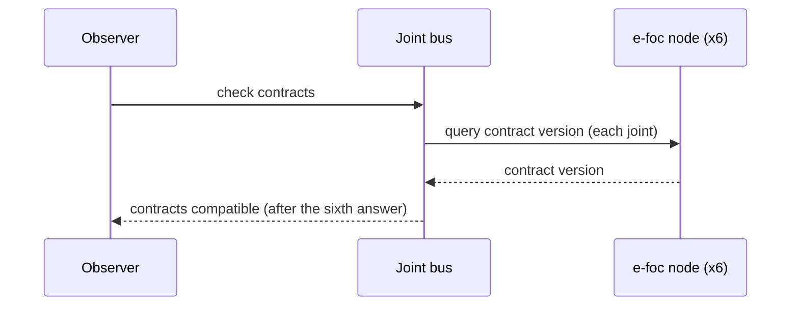
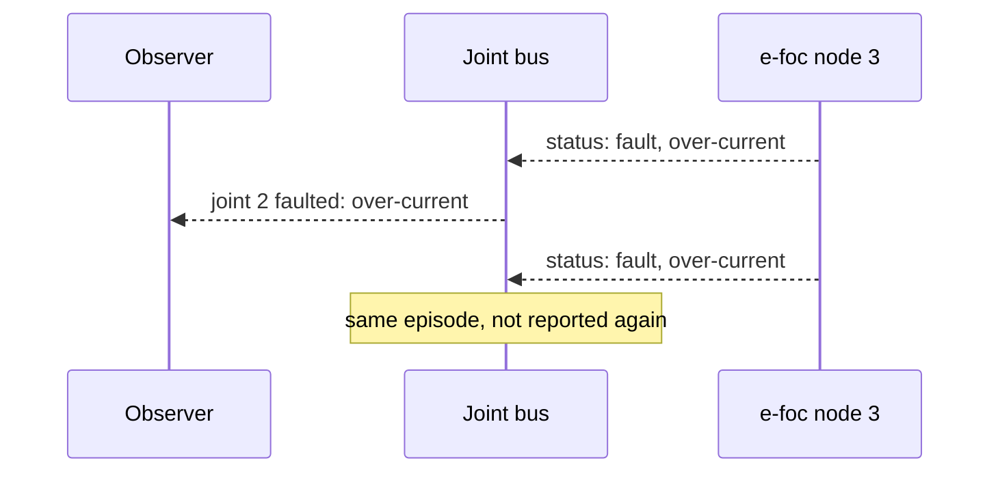
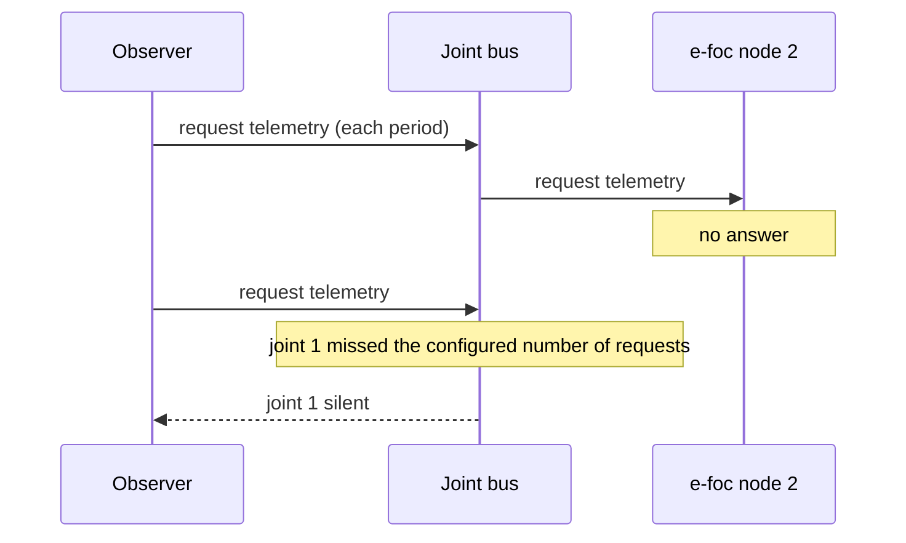

| Field     | Value            |
|-----------|------------------|
| Title     | Joint Bus Design |
| Type      | design           |
| Status    | draft            |
| Version   | 0.2.0            |
| Component | joint_bus        |
| Date      | 2026-11-12       |

> The six joints of the arm as one set of commands and readings. Behaviour only; diagrams are Mermaid.

---

## Responsibilities

**Is responsible for:**

- Mapping the six joints, in kinematic order from the base, to the CAN node of each e-foc motor node.
- Sending one command to every joint at once: select a control mode, start, stop, clear a fault, emergency
  stop.
- Sending one position setpoint per joint each control period.
- Checking that every node speaks a compatible FOC motor contract and reporting the outcome once.
- Keeping the latest position, speed, state and fault reported by each joint.
- Reporting a joint that enters a fault, naming the joint.
- Requesting telemetry from every joint and reporting a joint that stops answering.

**Is NOT responsible for:**

- Deciding what to do about a fault: stopping the other joints is the safety component's decision.
- Opening the CAN adapter or choosing between the real arm and virtual motors: the platform provides the bus.
- Trajectories, kinematics or control laws.
- Pacing: the caller decides when to request telemetry and when to send setpoints.

---

## Component Details

### Part A — Node map

The bus is configured with six node identifiers, one per joint, distinct and non-zero. Joint 0 is the base
joint. Every frame from a node outside the map is ignored, so other nodes may share the bus.

### Part B — Commands

Every command goes to all six joints, in joint order. A command reports success only when all six frames were
accepted for transmission; the bus still attempts every joint after a refused one, so an emergency stop reaches
every node it can. A node whose contract is known to be incompatible refuses every command but the contract
query, as the e-foc-protocol client does.

Setpoints are sent as position setpoints in radians. A non-finite value is refused by the client and makes the
whole call report failure.

### Part C — Contract check

A contract check queries the contract version of all six nodes. It resolves once:

- **compatible**: all six nodes answered with a compatible version;
- **incompatible**: the first node that answers with an incompatible version resolves it at once.

The outcome is reported to the observer, and the aggregate is also available on demand: incompatible if any
node is incompatible, compatible if all six are, unknown otherwise.

### Part D — Readings and faults

Motion telemetry updates the joint's position and speed; status telemetry updates its state and fault code. A
joint that moves into the fault state is reported once, with its fault code; it is reported again only after it
has left the fault state.

### Part E — Telemetry requests and liveness

An e-foc node sends its status and motion telemetry when asked, not on its own. A telemetry request asks all six
joints at once; the caller makes one each control period.

Before it sends a request, the bus counts, per joint, whether motion telemetry arrived since the previous request.
A joint that has not answered the configured number of requests in a row is silent: it is reported once, naming
the joint, and reported again only after it has answered once more. The first request starts the count, so
nothing is missed before the caller starts asking. Motion telemetry from the joint resets its count.

---

## Interfaces

### Provided

| Interface        | Purpose                                        | Contract                                                     |
|------------------|------------------------------------------------|--------------------------------------------------------------|
| Joint bus        | Six joints as one set of commands and readings | Commands return success only if all six frames were accepted |
| Joint bus events | Contract outcome, joint faulted, joint silent  | Contract outcome once per check; fault and silence once each |

### Required

| Interface                 | Purpose                                    | Contract                                    |
|---------------------------|--------------------------------------------|---------------------------------------------|
| FOC motor category client | Commands to and telemetry from e-foc nodes | The joint bus is the client's only observer |

---

## Data Model

| Entity        | Field    | Type / Unit     | Range              | Notes                                |
|---------------|----------|-----------------|--------------------|--------------------------------------|
| Node map      | node     | CAN node id     | 1 … 4095, distinct | One per joint, base joint first      |
| Joint reading | position | radians         | finite             | From motion telemetry                |
| Joint reading | speed    | radians/second  | finite             | From motion telemetry                |
| Joint reading | state    | FOC motor state | idle … ready       | From status telemetry; idle at start |
| Joint reading | fault    | FOC fault code  | none … other       | From status telemetry; none at start |
| Liveness      | missed   | count           | 1 … 255            | Requests in a row a joint may miss   |

---

## Sequence Diagrams

### Contract check

### Fault

### Silent joint

---

## Constraints & Limitations

| Constraint        | Value / Description                                                                                                                                |
|-------------------|----------------------------------------------------------------------------------------------------------------------------------------------------|
| Joints            | Exactly six                                                                                                                                        |
| Burst size        | Six frames per command; can-lite's transmit queue holds eight, so a telemetry request and a setpoint burst go out at different times in the period |
| Contract tracking | The e-foc-protocol client remembers eight nodes, enough for the six joints                                                                         |
| Single observer   | The bus observes the category client; nothing else may observe the same client                                                                     |
| Memory            | No heap; all state is fixed-size                                                                                                                   |

---

## Open Questions

| # | Question                                         | Options                                        | Status |
|---|--------------------------------------------------|------------------------------------------------|--------|
| 1 | How the bus detects a silent node                | Requests missed in a row, counted per joint    | closed |
| 2 | Whether setpoints carry speed and torque as well | Position only, combined command (contract 3.x) | open   |
