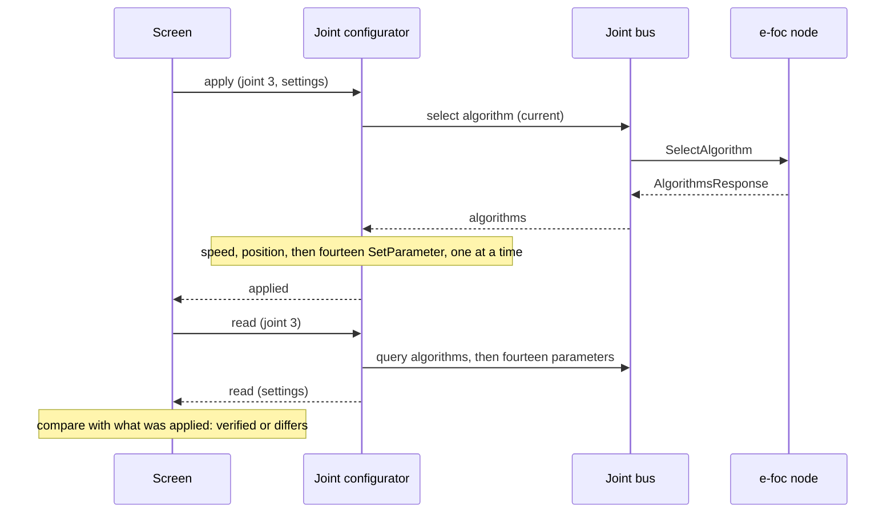

| Field     | Value                     |
|-----------|---------------------------|
| Title     | Joint Configurator Design |
| Type      | design                    |
| Status    | draft                     |
| Version   | 0.7.0                     |
| Component | joint_configurator        |
| Date      | 2026-11-19                |

> Applies a joint's e-foc motor controller (the algorithm of each loop and its gains) over CAN, reads it back and
> compares it. Behaviour only; diagrams are Mermaid.

---

## Responsibilities

**Is responsible for:**

- Applying one joint's motor-controller settings: the current, speed and position algorithms and the fourteen
  loop gains of the e-foc contract.
- Applying one joint's motor: the seven motor-model parameters and four drive limits of the e-foc contract (Part D).
- Reading one joint's settings back, and comparing them with the settings applied, item by item.
- Sending one request at a time and waiting for its answer, so a configuration never competes with the control
  loop's bursts for the transmit queue.
- Refusing to configure unless the arm is Ready (contracts compatible, every joint calibrated, no joint running) or
  Configuring, where the lifecycle applies the configured settings ([arm-lifecycle.md](arm-lifecycle.md) Part D).

**Is NOT responsible for:**

- The control mode: enabling the arm selects one mode for all six joints ([arm-lifecycle.md](arm-lifecycle.md)).
- The other e-foc parameters (supervision, temperatures, encoder, homing): phase 6 and phase 9.
- Storing settings: the arm profile owns them ([arm-profile.md](arm-profile.md)); the configurator only applies and
  reads.

---

## Component Details

### Part A — Settings

A joint's motor-controller settings are its three algorithms and fourteen gains:

| Loop     | Algorithms                                 | Gains                                                                                          |
|----------|--------------------------------------------|------------------------------------------------------------------------------------------------|
| Current  | PID, decoupled PID, deadbeat, sliding mode | bandwidth, switching gain, boundary layer, two-step deadbeat                                   |
| Speed    | PID, LQI, ADRC, two-DOF                    | bandwidth, error weight, integral weight, observer bandwidth ratio, reference time constant    |
| Position | PID, cascade P, LQR, LQI, two-DOF          | bandwidth, position error weight, speed error weight, integral weight, reference time constant |

Units and ranges are the e-foc contract's parameter table. Each algorithm uses only some of its loop's gains:

| Algorithm                  | Gains it uses                                        |
|----------------------------|------------------------------------------------------|
| Current PID, decoupled PID | bandwidth                                            |
| Current deadbeat           | bandwidth, two-step deadbeat                         |
| Current sliding mode       | bandwidth, switching gain, boundary layer            |
| Speed PID                  | bandwidth                                            |
| Speed LQI                  | bandwidth, error weight, integral weight             |
| Speed ADRC                 | bandwidth, observer bandwidth ratio                  |
| Speed two-DOF              | bandwidth, reference time constant                   |
| Position PID, cascade P    | bandwidth                                            |
| Position LQR               | bandwidth, position error weight, speed error weight |
| Position LQI               | as LQR, and integral weight                          |
| Position two-DOF           | bandwidth, reference time constant                   |

The node stores every gain whatever algorithm runs, so the configurator always applies and reads all fourteen; the
table above only decides which ones a screen shows.

### Part B — Apply and read

**Apply** selects the three algorithms, then sets the fourteen gains: seventeen requests, each sent only after
the previous one was answered. **Read** queries the algorithms (the answer also carries the active mode) and the
fourteen gains. Each operation works on one joint and is reported once: applied, read with the settings, or
failed with its reason.

A request the transmit queue refuses is sent again a millisecond later. A parameter request not answered within a
fifth of the answer timeout is sent again, every fifth until it is answered: a frame lost on a congested bus costs
a retry, not the configuration. Each answer names its parameter, so a late answer to an earlier send is not taken for
the next request's. An algorithm request is not sent again: its answer names no loop. A request not answered within
the arm's silence window (the missed telemetry periods the profile allows, times the control period: 100 ms for the
reference arm), or a refusal by the node, fails the whole operation; the requests already answered are not undone. A node
that answers telemetry within that window is not silent, so it is not given up on while configuring either. While one
operation runs, another is refused.

### Part C — Comparison

Two settings are compared item by item: each algorithm must be equal, and each gain equal within a relative
tolerance of 10⁻⁴, which covers the float round trip. The result names every item that differs, so a screen can
show what was applied next to what the joint reports. Motor settings compare the same way, each parameter within
10⁻⁴.

### Part D — Motor

A joint's motor is eleven e-foc parameters, applied with eleven set-parameter requests and read with eleven
queries, one at a time as in Part B:

| Parameter              | Contract unit | Shown and stored as | Kind        |
|------------------------|---------------|---------------------|-------------|
| Resistance (per phase) | Ω             | Ω                   | Motor model |
| Inductance (per phase) | mH            | mH                  | Motor model |
| Pole pairs             | —             | —                   | Motor model |
| Flux linkage           | Wb            | mWb                 | Motor model |
| Rotor inertia          | kg·m²         | g·cm²               | Motor model |
| Viscous friction       | N·m·s/rad     | µN·m·s/rad          | Motor model |
| Coulomb friction       | N·m           | mN·m                | Motor model |
| Continuous current     | A             | A                   | Drive limit |
| Peak current           | A             | A                   | Drive limit |
| Peak-current time      | s             | s                   | Drive limit |
| Overspeed limit        | rad/s         | rad/s               | Drive limit |
| Following-error window | rad           | rad                 | Drive limit |
| Following-error time   | s             | s                   | Drive limit |

The following-error window is the drive's position supervision: a joint whose motor shaft lags its position setpoint
by more than the window for longer than the time faults with a following error, and the arm trips on it. It is on
the motor's side of the gear, at most 3.2 rad, and 0 switches it off, which is e-foc's default.

Small motors have inertias of a few 10⁻⁶ kg·m², so the profile and the screens use units that keep the numbers
readable and within the profile's nine decimals; the configurator converts to the contract's units on the wire.
Every value applied replaces what the node held, an identification of its own included.

**Presets** are e-foc's reference motors (e-foc `documentation/theory/foc-plant-models.md`, "Reference motors"):

| Preset                   | R Ω   | L mH | Pole pairs | Flux mWb | Inertia g·cm² | Viscous µN·m·s/rad | Coulomb mN·m | Continuous A | Peak A | Peak s | Overspeed rad/s | Following-error window rad | Following-error time s |
|--------------------------|-------|------|------------|----------|---------------|--------------------|--------------|--------------|--------|--------|-----------------|----------------------------|------------------------|
| Teknic M-2310P-LN-04K    | 0.36  | 0.2  | 4          | 6.4      | 70.6          | 15                 | 3.7          | 7.1          | 20     | 1      | 754             | 0                          | 0.1                    |
| Anaheim BLY172S-24V-4000 | 0.405 | 0.64 | 4          | 5.44     | 48            | 10                 | 3.7          | 3.9          | 10     | 1      | 503             | 0                          | 0.1                    |

The model parameters and the peak currents are e-foc's. The continuous current is the rated torque over the torque
constant 1.5·p·ψ (0.274 N·m and 0.127 N·m); the overspeed limit is 1.2 times the rated speed (6000 rpm and 4000 rpm);
the peak-current time, and the Anaheim's Coulomb friction (taken as the Teknic bench value), are assumed. The
following-error supervision is e-foc's default, off: a window depends on the gear and the load, so a profile sets it.

### Part E — Drive watchdog

The drive watchdog is one e-foc parameter, `commandTimeout` (s, 0 to 60, 0 off): a running drive that receives no
start and no setpoint for that long cuts its power stage and faults ([safety.md](safety.md) Part I). It is applied
with one set-parameter request and read back with one query, as in Part B, and compared within 10⁻⁴. Unlike the
motor and the motor controller it is applied to every joint, whether the profile names its motor or not: the value is
the profile's `driveWatchdogPeriods` times the control period, 0.1 s for the reference arm.

---

## Interfaces

### Provided

| Interface          | Purpose                                | Contract                                                                                        |
|--------------------|----------------------------------------|-------------------------------------------------------------------------------------------------|
| Joint configurator | Apply and read one joint's settings    | Refused unless the arm is Ready or Configuring and no operation runs; one outcome per operation |
| Comparison         | The items in which two settings differ | Algorithms equal, gains within a relative 10⁻⁴                                                  |

### Required

| Interface     | Purpose                                                      | Contract                        |
|---------------|--------------------------------------------------------------|---------------------------------|
| Joint bus     | Per-joint algorithm and parameter requests and their answers | Through the safety supervisor   |
| Arm lifecycle | Whether the arm is Ready or Configuring                      | Read before an operation starts |
| Timer         | Retry after a millisecond, give up after the silence window  | The event loop's timer service  |

---

## Data Model

| Entity   | Field      | Type / Unit                     | Range                   | Notes                                |
|----------|------------|---------------------------------|-------------------------|--------------------------------------|
| Settings | algorithms | one per loop                    | the contract's enums    | Current, speed, position             |
| Settings | gains      | fourteen values, contract units | the contract's ranges   | Every gain, whichever algorithm runs |
| Read     | mode       | FOC control mode                | torque, speed, position | Reported by the node, never applied  |

---

## Sequence Diagrams

---

## Constraints & Limitations

| Constraint | Value / Description                                                                     |
|------------|-----------------------------------------------------------------------------------------|
| Pace       | One request in flight; an apply takes seventeen round trips, about 20 ms on an idle bus |
| Lifecycle  | Ready or Configuring only: a running joint is never reconfigured                        |
| Memory     | No heap; one operation's state at a time                                                |

---

## Open Questions

| # | Question                                           | Options                                             | Status                        |
|---|----------------------------------------------------|-----------------------------------------------------|-------------------------------|
| 1 | Whether to apply only the gains the algorithms use | All fourteen (simple, always verifiable), only used | decided: all fourteen         |
| 2 | Motor characteristics and limits                   | The same configurator, a second one                 | decided: the same one, Part D |
