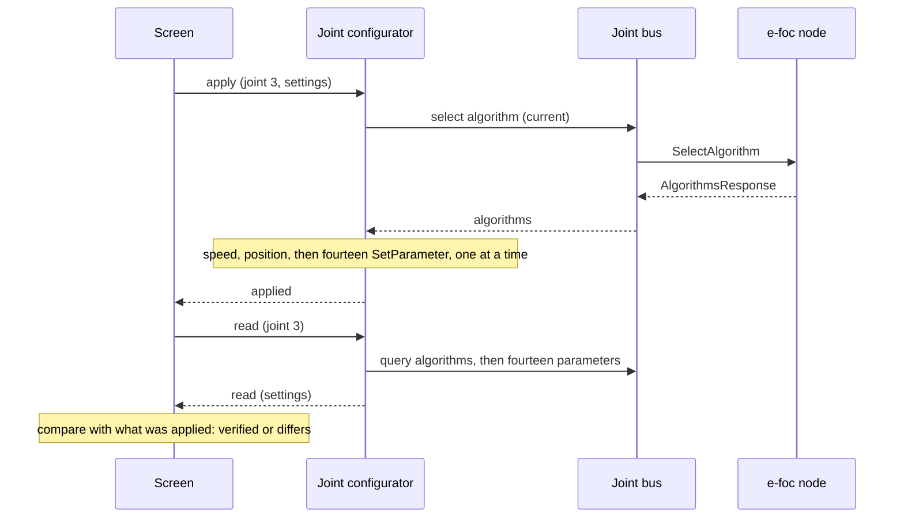

| Field     | Value                     |
|-----------|---------------------------|
| Title     | Joint Configurator Design |
| Type      | design                    |
| Status    | draft                     |
| Version   | 0.1.0                     |
| Component | joint_configurator        |
| Date      | 2026-11-13                |

> Applies a joint's e-foc motor controller (the algorithm of each loop and its gains) over CAN, reads it back and
> compares it. Behaviour only; diagrams are Mermaid.

---

## Responsibilities

**Is responsible for:**

- Applying one joint's motor-controller settings: the current, speed and position algorithms and the fourteen
  loop gains of the e-foc contract.
- Reading one joint's settings back, and comparing them with the settings applied, item by item.
- Sending one request at a time and waiting for its answer, so a configuration never competes with the control
  loop's bursts for the transmit queue.
- Refusing to configure unless the arm is Ready: contracts compatible, every joint calibrated, no joint running.

**Is NOT responsible for:**

- The control mode: enabling the arm selects one mode for all six joints ([arm-lifecycle.md](arm-lifecycle.md)).
- Motor characteristics, limits and the other e-foc parameters: later parts of phase 2.
- Storing settings: the arm profile (phase 2) owns them; the configurator only applies and reads.

---

## Component Details

### Part A — Settings

A joint's motor-controller settings are its three algorithms and fourteen gains:

| Loop     | Algorithms                                 | Gains                                                                                          |
|----------|--------------------------------------------|------------------------------------------------------------------------------------------------|
| Current  | PID, decoupled PID, deadbeat, sliding mode | bandwidth, switching gain, boundary layer, two-step deadbeat                                   |
| Speed    | PID, LQI, ADRC, two-DOF                    | bandwidth, error weight, integral weight, observer bandwidth ratio, reference time constant    |
| Position | PID, cascade P, LQR, LQI, two-DOF          | bandwidth, position error weight, speed error weight, integral weight, reference time constant |

Units and ranges are the e-foc contract's parameter table. Each algorithm uses only some of its loop's gains:

| Algorithm                  | Gains it uses                                        |
|----------------------------|------------------------------------------------------|
| Current PID, decoupled PID | bandwidth                                            |
| Current deadbeat           | bandwidth, two-step deadbeat                         |
| Current sliding mode       | bandwidth, switching gain, boundary layer            |
| Speed PID                  | bandwidth                                            |
| Speed LQI                  | bandwidth, error weight, integral weight             |
| Speed ADRC                 | bandwidth, observer bandwidth ratio                  |
| Speed two-DOF              | bandwidth, reference time constant                   |
| Position PID, cascade P    | bandwidth                                            |
| Position LQR               | bandwidth, position error weight, speed error weight |
| Position LQI               | as LQR, and integral weight                          |
| Position two-DOF           | bandwidth, reference time constant                   |

The node stores every gain whatever algorithm runs, so the configurator always applies and reads all fourteen; the
table above only decides which ones a screen shows.

### Part B — Apply and read

**Apply** selects the three algorithms, then sets the fourteen gains: seventeen requests, each sent only after
the previous one was answered. **Read** queries the algorithms (the answer also carries the active mode) and the
fourteen gains. Each operation works on one joint and is reported once: applied, read with the settings, or
failed with its reason.

A request the transmit queue refuses is sent again a millisecond later. A request not answered within 100 ms, or
a refusal by the node, fails the whole operation; the requests already answered are not undone. While one
operation runs, another is refused.

### Part C — Comparison

Two settings are compared item by item: each algorithm must be equal, and each gain equal within a relative
tolerance of 10⁻⁴, which covers the float round trip. The result names every item that differs, so a screen can
show what was applied next to what the joint reports.

---

## Interfaces

### Provided

| Interface          | Purpose                                | Contract                                                                         |
|--------------------|----------------------------------------|----------------------------------------------------------------------------------|
| Joint configurator | Apply and read one joint's settings    | Refused unless the arm is Ready and no operation runs; one outcome per operation |
| Comparison         | The items in which two settings differ | Algorithms equal, gains within a relative 10⁻⁴                                   |

### Required

| Interface     | Purpose                                                      | Contract                        |
|---------------|--------------------------------------------------------------|---------------------------------|
| Joint bus     | Per-joint algorithm and parameter requests and their answers | Through the safety supervisor   |
| Arm lifecycle | Whether the arm is Ready                                     | Read before an operation starts |
| Timer         | Retry after a millisecond, give up after 100 ms              | The event loop's timer service  |

---

## Data Model

| Entity   | Field      | Type / Unit                     | Range                   | Notes                                |
|----------|------------|---------------------------------|-------------------------|--------------------------------------|
| Settings | algorithms | one per loop                    | the contract's enums    | Current, speed, position             |
| Settings | gains      | fourteen values, contract units | the contract's ranges   | Every gain, whichever algorithm runs |
| Read     | mode       | FOC control mode                | torque, speed, position | Reported by the node, never applied  |

---

## Sequence Diagrams

---

## Constraints & Limitations

| Constraint | Value / Description                                                                     |
|------------|-----------------------------------------------------------------------------------------|
| Pace       | One request in flight; an apply takes seventeen round trips, about 20 ms on an idle bus |
| Lifecycle  | Ready only: a running joint is never reconfigured                                       |
| Memory     | No heap; one operation's state at a time                                                |

---

## Open Questions

| # | Question                                           | Options                                             | Status                     |
|---|----------------------------------------------------|-----------------------------------------------------|----------------------------|
| 1 | Whether to apply only the gains the algorithms use | All fourteen (simple, always verifiable), only used | decided: all fourteen      |
| 2 | Motor characteristics and limits                   | The same configurator, a second one                 | open: next part of phase 2 |
