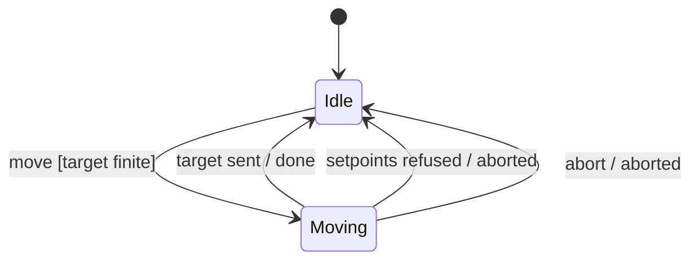
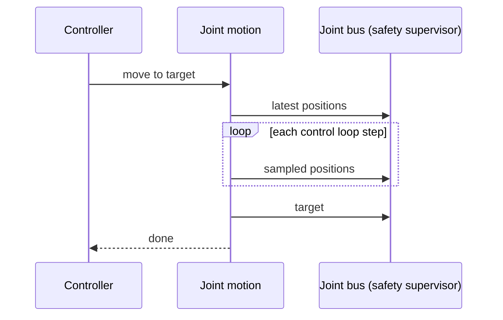

| Field     | Value               |
|-----------|---------------------|
| Title     | Joint Motion Design |
| Type      | design              |
| Status    | draft               |
| Version   | 0.3.0               |
| Component | motion              |
| Date      | 2026-11-12          |

> Moving the six joints together from where they are to a target, in joint space. Behaviour only; diagrams are
> Mermaid.

---

## Responsibilities

**Is responsible for:**

- Planning a point-to-point move of all six joints that starts and ends at rest, within each joint's speed and
  acceleration limits.
- Synchronising the joints so that they start together and arrive together.
- Streaming the planned positions to the joint bus once per control period, and the target last.
- Reporting when the move is done, or when it was aborted.

**Is NOT responsible for:**

- Guarding setpoints, faults and silence: the safety supervisor in front of the joint bus does, and a setpoint
  set it refuses aborts the move. Joint motion only refuses a target outside the position limits up front.
- Requesting telemetry: the arm's control loop paces the requests.
- Paths through waypoints, Cartesian moves, jerk limits and dynamics: planned with the arm model.

---

## Component Details

### Part A — Planning

A move starts from each joint's latest reported position and ends at the requested target. Each joint is first
planned on its own as a trapezoidal velocity profile: accelerate at its acceleration limit, cruise at its speed
limit if the distance allows it, decelerate at the same limit. The slowest joint sets the move's duration.

Every other joint is then re-planned to take exactly that duration, at its own acceleration limit, which lowers
its cruise speed. A joint that does not move stays where it is. All joints therefore start and stop at the same
instants, and no joint exceeds its limits.

A move is refused if a target is not finite, lies outside its joint's position limits, or another move is still
running. Each joint moves monotonically from its start to its target, so a target within the limits keeps the
whole move within them; the safety supervisor still checks every setpoint set.

### Part B — Streaming

Joint motion has no clock of its own: the control loop runs its step once per control period, in the setpoint
phase. While a move is running, each step advances the move by one period, samples the joint positions at that
time, measured from the start of the move, and sends them to the joint bus as one setpoint set; with no move
running a step does nothing. The first set goes out at the first step after the start. The set sampled at or after the move's end is the target itself; it is sent once and the move is done.

If the joint bus refuses a set, the move is aborted: nothing more is sent and the abort is reported. Aborting a
move by request stops the streaming the same way; the joints hold the last position they were sent.

---

## Interfaces

### Provided

| Interface           | Purpose                                 | Contract                                         |
|---------------------|-----------------------------------------|--------------------------------------------------|
| Joint motion        | Move to a target, abort, whether moving | One move at a time; refused targets send nothing |
| Joint motion events | Move done, move aborted                 | Exactly one of the two per accepted move         |

### Required

| Interface | Purpose                                     | Contract                                       |
|-----------|---------------------------------------------|------------------------------------------------|
| Joint bus | Latest positions; setpoint sets each period | The safety supervisor, so refusals abort moves |
| Step      | One step per control period                 | Run by the control loop's setpoint phase       |

---

## Data Model

| Entity       | Field            | Type / Unit     | Range         | Notes                                    |
|--------------|------------------|-----------------|---------------|------------------------------------------|
| Joint limits | position         | radians         | lower < upper | One range per joint, as the supervisor's |
| Joint limits | maximum speed    | radians/second  | > 0           | One per joint                            |
| Joint limits | max acceleration | radians/second² | > 0           | One per joint                            |
| Motion       | control period   | duration        | > 0           | Time between two setpoint sets           |

---

## State Machine

---

## Sequence Diagrams

---

## Constraints & Limitations

| Constraint  | Value / Description                                                                 |
|-------------|-------------------------------------------------------------------------------------|
| Profile     | Trapezoidal velocity: acceleration steps at the start and end of each phase         |
| Start state | At rest, at the latest reported positions; a move does not blend into a running one |
| Memory      | No heap; all state is fixed-size                                                    |

---

## Open Questions

| # | Question                                        | Options                                            | Status |
|---|-------------------------------------------------|----------------------------------------------------|--------|
| 1 | Whether to limit jerk                           | Trapezoidal, S-curve per joint (numerical-toolbox) | open   |
| 2 | Whether a new target may replace a running move | Refuse, re-plan from the current state             | open   |
