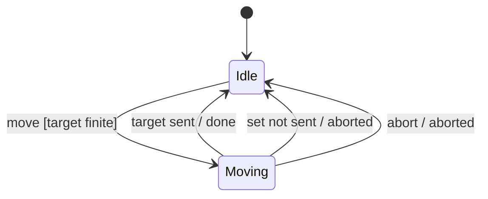
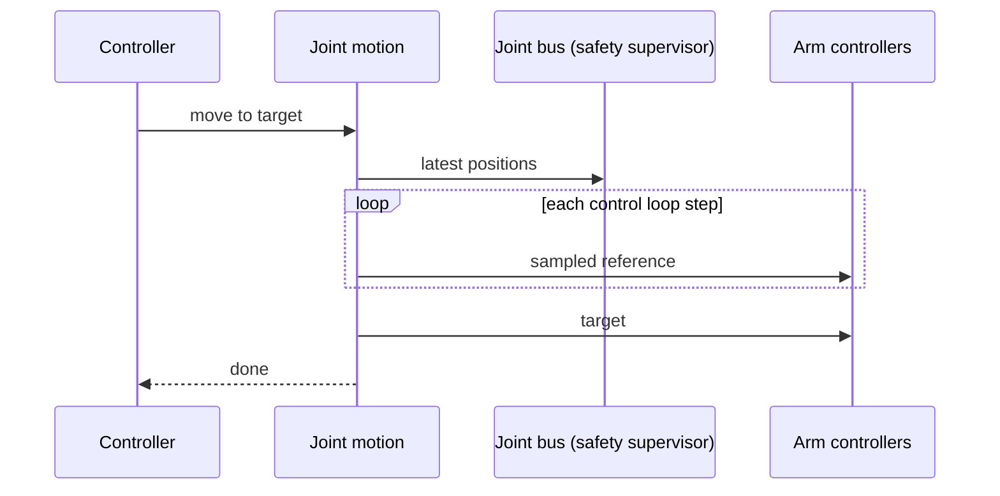

| Field     | Value               |
|-----------|---------------------|
| Title     | Joint Motion Design |
| Type      | design              |
| Status    | draft               |
| Version   | 0.6.0               |
| Component | motion              |
| Date      | 2026-11-14          |

> Moving the six joints together from where they are to a target, in joint space. Behaviour only; diagrams are
> Mermaid.

---

## Responsibilities

**Is responsible for:**

- Planning a point-to-point move of all six joints that starts and ends at rest, within each joint's speed and
  acceleration limits.
- Synchronising the joints so that they start together and arrive together.
- Sampling the planned positions once per control period, and the target last, as the reference the arm
  controllers follow ([arm-controllers.md](arm-controllers.md)).
- Reporting when the move is done, or when it was aborted.

**Is NOT responsible for:**

- Sending setpoints: the active arm controller turns the reference into setpoint sets, and the safety supervisor
  guards them; a set it refuses aborts the move. Joint motion only refuses a target outside the position limits up
  front.
- Requesting telemetry: the arm's control loop paces the requests.
- Paths through waypoints, Cartesian moves, jerk limits and dynamics: planned with the arm model.

---

## Component Details

### Part A — Planning

A move starts from each joint's latest reported position and ends at the requested target. Each joint is first
planned on its own as a trapezoidal velocity profile: accelerate at its acceleration limit, cruise at its speed
limit if the distance allows it, decelerate at the same limit. The slowest joint sets the move's duration.

Every other joint is then re-planned to take exactly that duration, at its own acceleration limit, which lowers
its cruise speed. A joint that does not move stays where it is. All joints therefore start and stop at the same
instants, and no joint exceeds its limits.

A move is refused if a target is not finite, lies outside its joint's position limits, another move is still
running, or a joint's latest position is stale: it answered neither the latest telemetry request nor the one before
it ([joint-bus.md](joint-bus.md) Part E), so the move would start from where the joint no longer is. Each joint moves monotonically from its start to its target, so a target within the limits keeps the
whole move within them; the safety supervisor still checks every setpoint set.

### Part B — Sampling

Joint motion has no clock of its own: the control loop runs its step once per control period, in the setpoint
phase. While a move is running, each step advances the move by one period and samples the joint positions at that
time, measured from the start of the move: that is the period's reference, which the arm controllers turn into a
setpoint set right after. With no move running a step has no reference. The first sample is taken at the first
step after the start. The sample at or after the move's end is the target itself; it is given once and the move
is done.

If the arm cannot send the period's set (the safety supervisor refuses it, or no arm controller is active), the
arm aborts the move. Aborting a move, by request or so, stops the sampling; the arm controllers hold the last
reference, so the joints stay where the move left them.

---

## Interfaces

### Provided

| Interface           | Purpose                                 | Contract                                           |
|---------------------|-----------------------------------------|----------------------------------------------------|
| Joint motion        | Move to a target, abort, whether moving | One move at a time; refused targets send nothing   |
| Joint motion events | Move done, move aborted                 | Exactly one of the two per accepted move           |
| Reference           | One sample per step while a move runs   | None without a move; the target is the last sample |

### Required

| Interface | Purpose                     | Contract                                 |
|-----------|-----------------------------|------------------------------------------|
| Joint bus | Latest positions            | The safety supervisor                    |
| Step      | One step per control period | Run by the control loop's setpoint phase |

---

## Data Model

| Entity       | Field            | Type / Unit     | Range         | Notes                                    |
|--------------|------------------|-----------------|---------------|------------------------------------------|
| Joint limits | position         | radians         | lower < upper | One range per joint, as the supervisor's |
| Joint limits | maximum speed    | radians/second  | > 0           | One per joint                            |
| Joint limits | max acceleration | radians/second² | > 0           | One per joint                            |
| Motion       | control period   | duration        | > 0           | Time between two setpoint sets           |

---

## State Machine

---

## Sequence Diagrams

---

## Constraints & Limitations

| Constraint  | Value / Description                                                                 |
|-------------|-------------------------------------------------------------------------------------|
| Profile     | Trapezoidal velocity: acceleration steps at the start and end of each phase         |
| Start state | At rest, at the latest reported positions; a move does not blend into a running one |
| Memory      | No heap; all state is fixed-size                                                    |

---

## Open Questions

| # | Question                                        | Options                                            | Status |
|---|-------------------------------------------------|----------------------------------------------------|--------|
| 1 | Whether to limit jerk                           | Trapezoidal, S-curve per joint (numerical-toolbox) | open   |
| 2 | Whether a new target may replace a running move | Refuse, re-plan from the current state             | open   |
