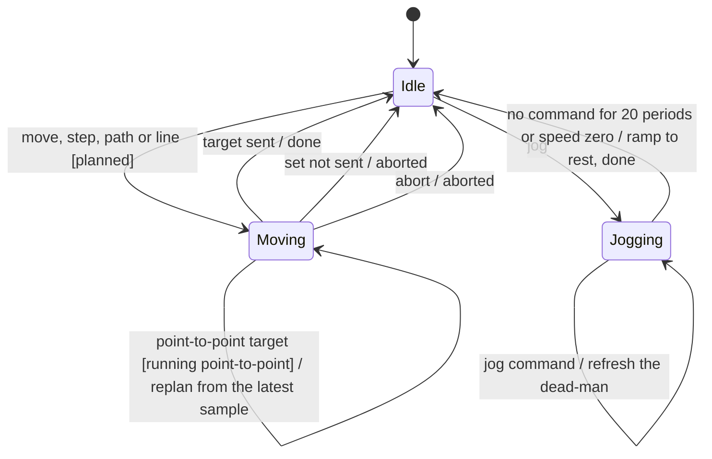
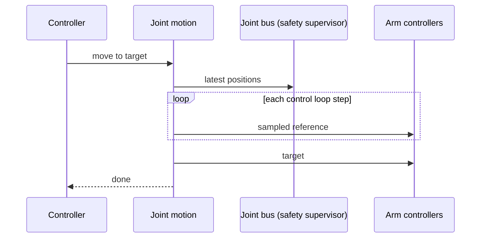

| Field     | Value               |
|-----------|---------------------|
| Title     | Joint Motion Design |
| Type      | design              |
| Status    | draft               |
| Version   | 0.13.1              |
| Component | motion              |
| Date      | 2026-11-26          |

> Moving the six joints: point-to-point in joint space, through joint waypoints, along a straight tool line, and by
> jogging, plus named teach points to move to. Behaviour only; diagrams are Mermaid.

---

## Responsibilities

- Planning a point-to-point move of all six joints that starts and ends at rest, within each joint's speed and
  acceleration limits.
- Synchronising the joints so that they start together and arrive together.
- Sampling the planned positions, speeds and accelerations once per control period, and the target at rest last.
  This is the reference the arm controllers follow ([arm-controllers.md](arm-controllers.md)).
- A reference step: the reference jumps to a target close to the joints at once, for tuning the arm controllers.
- Jerk-limited point-to-point moves, and a new target replacing a running point-to-point move (Parts E, F).
- Paths through joint waypoints (Part G), straight tool lines (Part H) and jogging (Part I).
- Teach points: named joint poses saved in the profile, and moving to one (Part J).
- Reporting when the move is done, or when it was aborted.

---

## Component Details

### Part A — Planning

A move starts from each joint's latest reported position and ends at the requested target. Each joint is first
planned on its own as a trapezoidal velocity profile. It accelerates at its acceleration limit, cruises at its speed
limit if the distance allows it, and decelerates at the same limit. The slowest joint sets the move's duration.

Every other joint is then re-planned to take exactly that duration, at its own acceleration limit, which lowers
its cruise speed. A joint that does not move stays where it is. All joints therefore start and stop at the same
instants, and no joint exceeds its limits.

A move is refused when one of these is true:

- a target is not finite;
- a target lies outside its joint's position limits;
- another move is still running;
- a joint's latest position is stale.

A position is stale when the joint answered neither the latest telemetry request nor the one before it
([joint-bus.md](joint-bus.md) Part E). The move would then start from where the joint no longer is. Each joint moves
monotonically from its start to its target. Thus a target within the limits keeps the whole move within them. The
safety supervisor still checks every setpoint set.

### Part B — Sampling

Joint motion has no clock of its own. The control loop runs its step once per control period, in the setpoint
phase. While a move is running, each step advances the move by one period. It samples each joint's position, speed
and acceleration at that time, measured from the start of the move. The samples come from the same trapezoid the
move was planned with. That is the period's reference, which the arm controllers turn into a setpoint set right after. With no move
running a step has no reference. The first sample is taken at the first step after the start. The sample at or
after the move's end is the target itself, at rest (zero speed and acceleration). It is given once and the move is
done.

### Part C — Reference step

A step is a move without a trajectory. The reference jumps from where the joints are to the target, at rest. Thus
the arm controllers see a true step, and its response shows their bandwidth and damping (the tuning views of
[tool-simulator.md](tool-simulator.md)). The first sample after a step is the target at rest, and the step is done
at once. The arm controllers then hold the target. A step is refused for every reason a move is (Part A). It is also
refused when any joint's target lies more than 0.2 rad from its latest position. A larger jump asks the controllers
for more torque than a test needs, and a joint that should travel further is moved, not stepped.

### Part D — Aborting

If the arm cannot send the period's set (the safety supervisor refuses it, or no arm controller is active), the
arm aborts the move. Aborting a move, by request or so, stops the sampling. The arm controllers hold the last
reference, so the joints stay where the move left them.

### Part E — Motion generators

Every way of moving is a **motion generator**. The generators are point-to-point (Part F), waypoint path (Part G),
tool line (Part H), jog (Part I) and the reference step (Part C). A generator is planned once, when its command is accepted, and then
sampled once per control period. Each sample is a joint reference: position, speed and acceleration for every joint.
The active arm controller tracks this reference ([arm-controllers.md](arm-controllers.md) Part C). A generator ends
with the joints at rest at its last sample; joint motion then reports the move done.

One generator runs at a time. A command while another one runs is refused, with two exceptions:

- a point-to-point target replaces a running point-to-point move (Part F);
- a jog command refreshes a running jog of the same kind (Part I).

Planning reads where the joints are from the latest reference when one runs, or from the latest positions at rest.
Thus a move never starts from a stale or jumping position.

The point-to-point **profile** is a setting, trapezoidal or S-curve, chosen in the profile and changed only at rest.
A running move keeps the profile it was planned with.

### Part F — Point-to-point: trapezoid, S-curve, and replacing a move

**Trapezoid.** As Parts A and B: each joint at its speed and acceleration limits. The others are then re-planned to
the slowest joint's duration at their own acceleration limit.

**S-curve.** Each joint is planned on its own with numerical-toolbox's jerk-limited S-curve profile at its speed,
acceleration and jerk limits. The slowest sets the duration T. Every other joint, planned alone in Tᵢ, is planned
again with its limits scaled by s, s² and s³, s = Tᵢ / T. This is the same profile stretched in time to last exactly
T. All joints start and stop together, and no joint exceeds a limit. The acceleration rises and falls at most at the
jerk limit, so no acceleration step reaches the joints.

**Replacing a running move.** A new target can arrive while a point-to-point move runs. Joint motion plans it from
the running move's latest sample: its position, speed and acceleration per joint. It uses numerical-toolbox's
profiles from a state (trapezoidal or S-curve, as the running move). Speed is continuous across the switch, and with
the S-curve the acceleration too. Each joint reaches the new target in its own time. A profile from a state cannot be
stretched to a common duration, so the joints of a replaced move are not synchronised. The move is done when the
last joint arrives. The first move's done event is never sent; the replacing one sends it.

### Part G — Waypoint paths

A path runs through up to **8 joint waypoints** after the start, all within the position limits. Robotics-toolbox's
cubic spline through the start and the waypoints gives the path's shape. The knots are spaced by the joint-space
distance between waypoints, with natural ends. Robotics-toolbox's time-optimal path parameterisation then times it as
fast as each joint's speed and acceleration limits allow. It uses a grid of 64 points, from rest to rest. The
dynamics' torque limits join those constraints once the arm model's torque limits are in the profile.

The parameterisation holds the limits at its grid points only. A path can turn back on itself, so that every moving
joint stops at once. There the acceleration between two grid points can exceed the limits. Joint motion therefore
samples the timed path at every control period. It slows the path uniformly by the least factor k that brings every
sample within the limits (speed divided by k, acceleration by k²). It checks again at the slowed samples. A path that
still exceeds them after 8 rounds is refused. Thus the reference never breaks the safety supervisor's reference rule
([safety.md](safety.md) Part F).

Before the path starts, joint motion checks its samples against the position limits at every control period. It
also checks them against the workspace guard at up to 64 of them, evenly spread in time. A path is refused when one
of these is true:

- it leaves a joint's position limits between two waypoints;
- it fails the guard;
- it repeats a waypoint;
- the parameterisation cannot time it.

A path runs alone: a new target or path is refused until it is done or aborted. It is done at its last waypoint, at
rest.

### Part H — Tool lines

A line moves the tool from its current pose to a target pose. The position moves along a straight line, and the
orientation by spherical interpolation (robotics-toolbox's Cartesian slerp interpolation). A path parameter from 0
to 1 runs along an S-curve, and the line starts and ends at rest. The S-curve's length and limits are the larger of:

- the line's linear distance under the profile's tool speed, acceleration and jerk;
- its rotation angle under the tool's angular limits.

Every control period the sampled pose goes through the arm model's inverse kinematics, the solution nearest the
previous sample. The joint reference is that solution, with speeds and accelerations by differences. The last sample
is the target's solution at rest. The tool limits are the profile's tool limits ([arm-profile.md](arm-profile.md)).
A line to the pose the tool already has is done at once.

Before the line starts, joint motion plans it in full. Every period's sample must have:

- an inverse-kinematics solution within the joint limits;
- a manipulability above the profile's threshold;
- joint speeds and accelerations within the joint limits;
- a pose that the workspace check accepts.

A line that fails any of them is refused, and nothing is sent. The refusal names the first failing sample's time and
the reason. The reasons are: unreachable, outside the joint limits, near a singularity, too fast for a joint, or
outside the workspace. The run computes the same samples again, so what runs is what was checked. A line runs alone, as a path
does: a new target, path or line is refused until it is done or aborted.

### Part I — Jogging

A jog moves at a commanded speed while the operator keeps commanding it:

- **Joint jog**: one joint at a signed speed.
- **Tool jog**: the tool along or about one axis, of the base frame or the tool frame, at a signed linear or angular
  speed. Each period the arm model's inverse kinematics turns the tool step into the next joint reference.

The speed ramps up and down at the acceleration limits (the joint's, or the tool's). Each jog command sets the speed
and refreshes the **dead-man**. When no jog command arrives for 20 control periods (200 ms at the 10 ms period), the
jog ramps to rest and ends. A jog command of speed zero ends it the same way. A jog also ramps to rest before a joint
reaches its position limit. A tool jog holds instead of stepping into a sample a line would refuse (Part H). A jog
while another generator runs is refused; a different jog kind ends the running jog first.

A joint jog's commanded speed is clamped to the joint's speed limit. Each period the speed moves toward the commanded
one by at most the acceleration limit times the period. It never goes above the speed from which the joint can still
stop at its position limit at that acceleration. The other joints hold where they were when the jog started. The jog
ends, with a done event, when it is at rest with nothing commanded. This occurs after the dead-man, after a jog of
speed zero, or at a limit. A jog of another joint while one runs ramps the running joint to rest. It then starts the new one, if the
dead-man has not expired meanwhile. A first jog of speed zero is refused.

A tool jog moves along x, y or z of its frame in m/s. It can also turn about one of them through the tool point, in
rad/s.
Its speed is clamped to the tool's linear or angular speed limit and ramps at the tool's acceleration limit (the
profile's tool limits, [arm-profile.md](arm-profile.md)). The commanded pose is integrated from the pose at the
start, never from the solutions, so it does not drift. Each period the step:

- goes through the arm model's inverse kinematics, the solution nearest the previous sample;
- is sized, between the tool's acceleration limit and rest, so that every joint stays within its speed and
  acceleration limits. The tool may brake harder than its own limit when a joint needs it;
- is taken only if its solution stays above the manipulability threshold and passes the workspace check. The jog must
  also still come to rest from it within every limit, which is checked by running the braking ahead. Otherwise the
  jog brakes now.

So a jog toward a singularity, the reach or an obstacle slows and holds short of it while the operator keeps
commanding it. It ends at rest when the operator stops. A step that cannot even brake within the limits is not taken.
The jog then holds at the last accepted sample and ends.

A jog of the other kind, or of another axis or frame, ramps the running jog to rest first. A jog of another joint
does the same.

### Part J — Teach points

A teach point is a named joint pose: up to 16 points, each name up to 16 characters, kept in the arm profile
([arm-profile.md](arm-profile.md)). Teaching saves the current latest positions under a name, replacing a point of the
same name. It is refused while a generator runs. Going to a point is a point-to-point move to its pose, with the
current profile (Part F). Saving the profile keeps the points.

---

## Interfaces

### Provided

| Interface           | Purpose                                                     | Contract                                                 |
|---------------------|-------------------------------------------------------------|----------------------------------------------------------|
| Joint motion        | Move or step to a target, abort, whether moving             | One move or step at a time; refused targets send nothing |
| Motion generators   | Waypoint path, tool line, joint jog, tool jog, teach, go to | One generator at a time (Part E); a refusal names why    |
| Joint motion events | Move done, move aborted                                     | Exactly one of the two per accepted move                 |
| Reference           | Position, speed and acceleration per step while a move runs | None without a move; the target at rest is the last      |

### Required

| Interface | Purpose                                       | Contract                                 |
|-----------|-----------------------------------------------|------------------------------------------|
| Joint bus | Latest positions                              | The safety supervisor                    |
| Arm model | Tool pose, inverse kinematics, manipulability | [arm-model.md](arm-model.md)             |
| Workspace | Whether a pose is allowed                     | [safety.md](safety.md) Part H            |
| Step      | One step per control period                   | Run by the control loop's setpoint phase |
| Arm controllers | Setpoint sets from the reference        | The supervisor guards them; a refused set aborts the move |
| Control loop | Telemetry requests                         | The loop paces the requests              |

Joint motion only refuses a target outside the position limits up front. The arm model computes poses, inverse
kinematics and manipulability; joint motion only asks it. The workspace check judges a pose; joint motion asks it
before a line starts.

---

## Data Model

| Entity       | Field                             | Type / Unit           | Range                    | Notes                                    |
|--------------|-----------------------------------|-----------------------|--------------------------|------------------------------------------|
| Joint limits | position                          | radians               | lower < upper            | One range per joint, as the supervisor's |
| Joint limits | maximum speed                     | radians/second        | > 0                      | One per joint                            |
| Joint limits | max acceleration                  | radians/second²       | > 0                      | One per joint                            |
| Motion       | control period                    | duration              | > 0                      | Time between two setpoint sets           |
| Reference    | position                          | radians               | joint limits             | Per joint, from the move's trapezoid     |
| Reference    | speed                             | radians/second        | finite                   | Per joint; zero at rest                  |
| Reference    | acceleration                      | radians/second²       | finite                   | Per joint; zero at rest                  |
| Step         | size                              | radians               | at most 0.2              | Per joint, from its latest position      |
| Joint limits | max jerk                          | radians/second³       | > 0                      | One per joint; used by the S-curve       |
| Motion       | profile                           | choice                | trapezoid, S-curve       | Changed only at rest                     |
| Tool limits  | linear speed, acceleration, jerk  | m/s, m/s², m/s³       | > 0                      | Lines and tool jogs                      |
| Tool limits  | angular speed, acceleration, jerk | rad/s, rad/s², rad/s³ | > 0                      | Lines and tool jogs                      |
| Tool limits  | manipulability threshold          | 1                     | ≥ 0                      | A line or tool jog stays above it        |
| Path         | waypoints                         | joint positions       | 1 to 8                   | After the start; within the limits       |
| Jog          | dead-man                          | control periods       | 20                       | No command for that long ends the jog    |
| Teach point  | name, pose                        | text, radians         | 16 points, 16 characters | Kept in the profile                      |

---

## State Machine

---

## Sequence Diagrams

---

## Constraints & Limitations

| Constraint  | Value / Description                                                                                                   |
|-------------|-----------------------------------------------------------------------------------------------------------------------|
| Profile     | Trapezoidal (acceleration steps) or S-curve (jerk-limited), per the profile                                           |
| Start state | At rest at the latest positions, or the running point-to-point move's latest sample                                   |
| Replacing   | A replaced point-to-point move's joints are not synchronised (Part F)                                                 |
| Waypoints   | At most 8 after the start; the time-optimal grid has 64 points, then a uniform slowdown to the limits at every sample |
| Lines       | Checked in full before they start; refused with the first failing sample's reason                                     |
| Memory      | No heap; all state is fixed-size                                                                                      |

---

## Decisions

| # | Decision                                        | Options                                            | Status                                            |
|---|-------------------------------------------------|----------------------------------------------------|---------------------------------------------------|
| 1 | Whether to limit jerk                           | Trapezoidal, S-curve per joint (numerical-toolbox) | decided: either, chosen in the profile (Part F)   |
| 2 | Whether a new target may replace a running move | Refuse, re-plan from the current state             | decided: re-plan from the latest sample (Part F)  |
| 3 | Torque limits in the waypoint timing            | Joint speed and acceleration only; with dynamics   | open: dynamics once the profile has torque limits |
