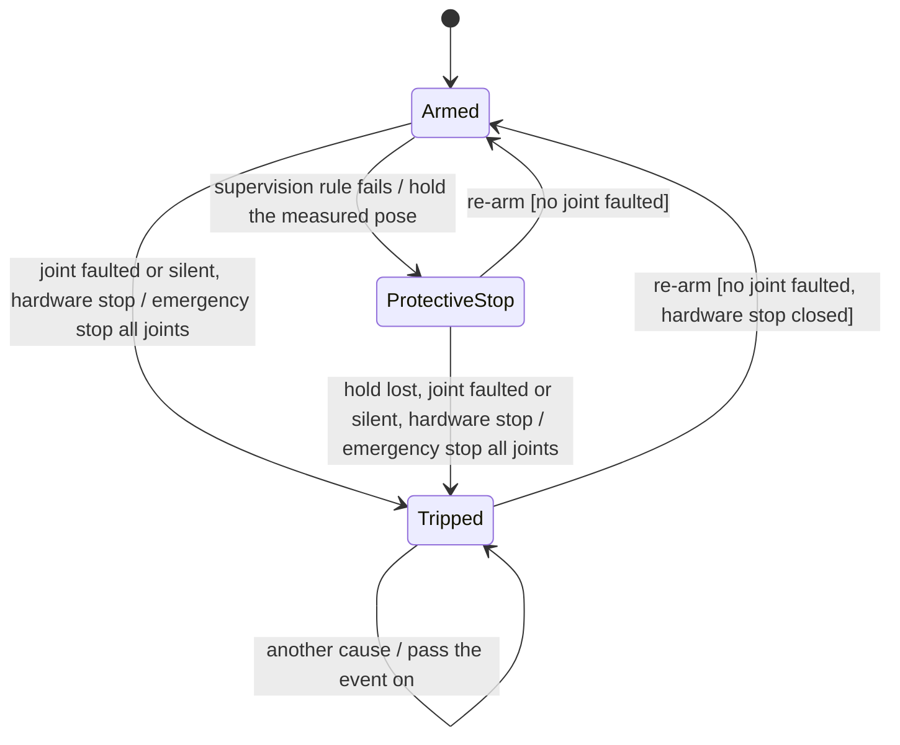
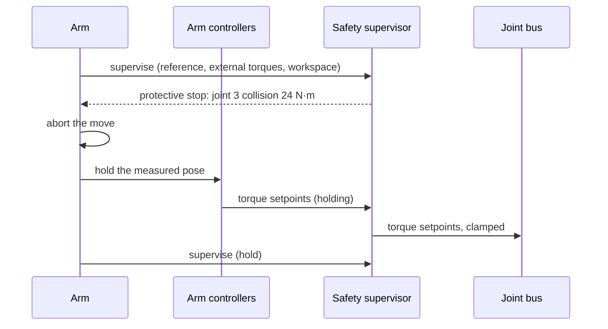
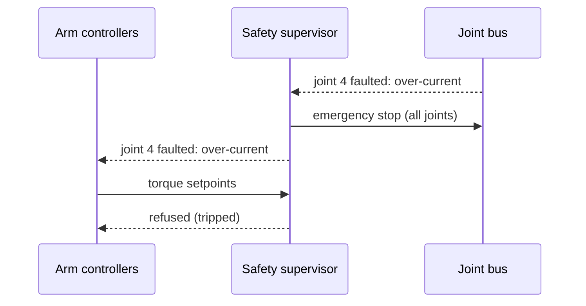
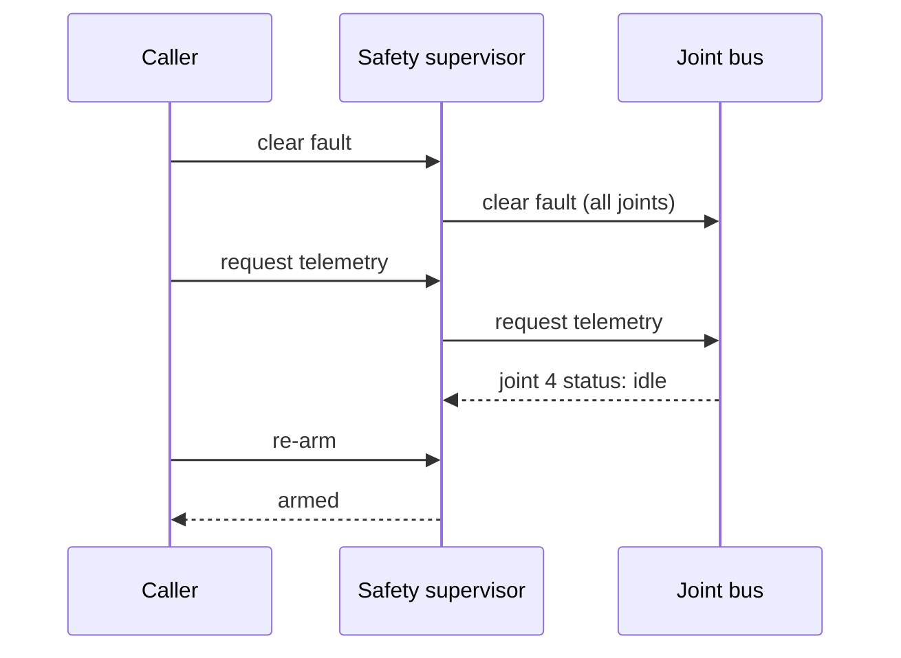

| Field     | Value                    |
|-----------|--------------------------|
| Title     | Safety Supervisor Design |
| Type      | design                   |
| Status    | draft                    |
| Version   | 0.10.1                   |
| Component | safety                   |
| Date      | 2026-11-26               |

> The guard between the arm controllers and the joint bus. Behaviour only; diagrams are Mermaid.

---

## Responsibilities

- Refusing a torque setpoint that is not finite, and holding every torque within its joint's torque limit.
- Refusing to start or move the joints before every node has a compatible contract.
- Choosing the stop for each rule:
  - an **emergency stop** (stop category 0: every drive's power stage off) when a joint faults or goes silent. Also
    when the hardware stop opens, or a protective stop cannot hold the arm;
  - a **protective stop** (stop category 2) on every supervision rule of Part F. The joints stay powered and hold the
    pose the arm had when it stopped.
- Supervising the arm while it drives the joints. The supervisor checks the measured positions and speeds, the
  tracking error and the estimated external torques. It also checks the reference the controllers track, and the
  arm's pose against its workspace and itself.
- Holding the arm stopped after either stop until it is re-armed, and re-arming only when no joint is faulted.
- Having each drive stop on its own when the arm stops sending setpoints (Part I).

---

## Component Details

### Part A — A joint bus that guards the real one

The supervisor offers the same joint bus interface the controllers use. It passes every call to the real joint bus
behind it, unless a rule below refuses or changes it. A refused call sends nothing and reports failure. The supervisor
is the real joint bus's only observer and passes its events on to its own observer.

### Part B — Torque setpoints

A torque setpoint set is sent only if its six torques are finite; otherwise none of it is sent. Each torque is then
clamped to its joint's torque limit, either sign, and the set is sent clamped. A clamp is not a refusal. The
controllers keep streaming, and the supervisor reports for each joint whether its last torque was clamped. The trace
shows the torque the controller asked for beside the one that was sent. A torque set carries no position; the
measured position is supervised instead (Part F).

Each joint's torque limit comes from the arm profile. A profile that names none takes it from the joint's motor.
The limit is the motor's peak current through its torque constant (1.5 · pole pairs · flux linkage) and the gear
ratio. Thus the arm never asks for more than the drive could give, and knows when it does. A joint with neither a limit nor a motor is clamped
by its drive's own current limit only.

Sometimes the joint bus cannot queue in full a finite set that the supervisor lets through. The cause is that
can-lite's transmit queue still holds the period's telemetry requests. This is a missed period and not a refusal:

- the drives hold the last torque;
- the next period sends a fresh set;
- a drive left without setpoints for its command timeout stops and faults (Part I), which trips the arm (Part D).

Only the supervisor's own refusals, a stop, an incompatible contract or a
torque that is not finite, stop the controllers' streaming.

### Part C — Contract gate

Selecting a control mode, starting or aligning the joints and sending setpoints are refused unless the contract check
of all six nodes is compatible. Stopping, emergency stop, clearing faults, the contract check, telemetry requests and
parameter writes are always passed on.

### Part D — Emergency stop

These events trip the supervisor:

- a joint that faults or goes silent;
- the hardware stop opening (Part J);
- a protective stop that loses its hold (Part G).

The trip has these effects:

- an emergency stop is sent to all six joints at once: each drive cuts its power stage and the arm coasts or falls;
- the event that caused it is passed on to the observer, naming the joint, or the hardware stop;
- while tripped, selecting a mode, starting, aligning and sending setpoints are refused.

A second cause while tripped is passed on but sends no second emergency stop. A joint fault or silence during a
protective stop ends the protective stop in an emergency stop.

### Part E — Re-arming

Re-arming ends either stop. It is refused while any joint's latest reading is in the fault state.

- **After an emergency stop**, the caller clears the faults, requests telemetry until the joints report they have
  left the fault state, and then re-arms. Re-arming does not start the joints.
- **After a protective stop**, the joints are still running and holding. Re-arming returns the arm to driving the
  joints from the held pose, so a move may start again. A rule that still fails at the held pose, a speed or a
  workspace rule for example, stops the arm again at the next step.

### Part F — Supervision while the arm drives the joints

In every control step in which the arm controllers stream setpoints, the supervisor receives:

- from the arm controllers, the reference they track (positions, speeds and accelerations);
- from the arm, the external torque that its collision observer estimates on each joint, when it has one;
- from the arm, the workspace check's verdict on the reference and the measured pose (Part H).

The supervisor checks, in this order, and stops at the first rule that fails:

| Rule            | Checked against                                                                                                                                                          | Value reported                         |
|-----------------|--------------------------------------------------------------------------------------------------------------------------------------------------------------------------|----------------------------------------|
| Collision       | An estimated external torque, either sign, above the joint's collision limit, at once: the observer already filters its estimate                                         | Torque, N·m                            |
| Reference       | A reference speed or acceleration above the joint's motion limits, or a reference position further than its speed allows in one period and further than a step (0.2 rad) | Speed rad/s, acceleration, or distance |
| Workspace       | The reference or the measured pose outside the workspace or inside a forbidden zone (Part H)                                                                             | Distance outside, m                    |
| Self-collision  | Two links of the reference or the measured pose closer than the margin (Part H)                                                                                          | Distance, m                            |
| Position limits | A joint's measured position outside its limits, ends included as inside, at once                                                                                         | Position, rad                          |
| Speed           | A joint's measured speed, either sign, above its speed limit, at once                                                                                                    | Speed, rad/s                           |
| Tracking error  | The difference between the reference and the measured position above the joint's window for consecutive steps that cover its time; a step within the window starts again | Error, rad                             |

Every rule ends in a protective stop (Part G). The reference rule lets the reference step of the tuning views
through ([joint-motion.md](joint-motion.md) Part C). A step is at most 0.2 rad and declares no speed. The workspace and
self-collision rules name the link, or the pair of links, instead of a joint.

A step without streaming starts every count again and checks nothing: a joint the arm does not drive is not held to
a reference. A joint's reading is stale when it was not refreshed in the last control period. The supervisor
skips a joint with a stale reading for that step:

- its count neither grows nor starts again;
- a measured pose with a stale joint is not checked against the workspace;
- the joint bus reports a joint that stays unheard as silent.

 The event passed on names the
joint or links, the rule, the value and the stop.

Every limit has a default, so no rule is off by omission:

| Limit           | Default when the profile names none                      |
|-----------------|----------------------------------------------------------|
| Tracking window | 0.2 rad, for 0.2 s                                       |
| Collision       | 20 N·m                                                   |
| Speed           | 4 × the joint's motion speed limit                       |
| Torque          | From the joint's motor (Part B)                          |
| Workspace       | From the arm's geometry and a floor at the base (Part H) |
| Self-collision  | Every link 0.04 m in radius, a 0.01 m margin (Part H)    |

The speed default is four times the motion speed limit, not just above it. A reference step of the tuning views
(at most 0.2 rad) answers faster than any planned move. A 0.1 rad step already peaks near twice the reference arm's
1 rad/s. At four times, the rule still catches a joint running away. A profile sets it tighter where a joint
needs it. The commissioning limits scale a speed limit the profile names with the motion limits.

Torque control relies on these rules. In torque mode the drive has no position reference of its own. Thus the
supervisor, not the drive's following-error supervision, catches a joint held back by an obstacle or driven away by
a wrong gain. The collision rule is the fastest. A torque that holds a joint back shows in its estimate within a few
periods, long before the tracking error has lasted its time.

### Part G — Protective stop

A protective stop keeps the drives powered. On the step a rule fails:

- the supervisor enters the protective stop and tells its observer, naming the rule as in Part F;
- the arm aborts any move. The active arm controller holds the pose measured at that step, at rest (no speed, no
  acceleration). The torque limits of Part B still apply;
- while stopped, selecting a mode, starting and aligning are refused. Torque setpoints are sent, so the hold goes on.
  The lifecycle refuses moves and steps ([arm-lifecycle.md](arm-lifecycle.md)).

The hold is supervised on its own terms:

- the tracking error between the held pose and the measured position, with each joint's window and time. A hold that
  drifts out ends in an emergency stop (Part D), with the rule "hold lost";
- a joint fault, a silent joint or the hardware stop end it in an emergency stop as well.

The other rules are not checked while holding. This applies to the collision rule in particular. After a collision, the
held pose is where the arm met the obstacle. Thus the hold presses no harder than the obstacle pushes, and an
emergency stop would drop the arm onto it. Disabling the arm while it holds stops the joints: the arm then falls, which the operator
confirms in the tools.

### Part H — Workspace and self-collision

The workspace check is a component over the arm model ([arm-model.md](arm-model.md)). For a joint-space pose it
takes the joint frames and expresses them in the base frame. It then places seven capsules, each with its radius
from the profile:

| Capsule | From             | To                        |
|---------|------------------|---------------------------|
| Link 1  | the base         | the shoulder (joint 2)    |
| Link 2  | the shoulder     | the elbow (joint 3)       |
| Link 3  | the elbow        | the wrist centre          |
| Link 4  | the wrist centre | the wrist centre (a ball) |
| Link 5  | the wrist centre | the wrist centre (a ball) |
| Link 6  | the wrist centre | the flange                |
| Tool    | the flange       | the tool centre point     |

It checks them, in this order, against:

- **the workspace**, a box in the base frame: every capsule but link 1 must lie inside it, its radius included. Link 1
  turns about its own axis on the base plane and is not checked. In x and y, the default box spans the arm's reach plus
  its largest link radius. In z, it spans from the base plane (z = 0) up by the same distance. The default therefore
  forbids the floor;
- **forbidden zones**, at most eight boxes in the base frame: no capsule may touch one. Robotics-toolbox's convex
  collision check measures the capsule against the box;
- **itself**: every pair of links farther apart than the margin, with robotics-toolbox's self-collision check. The
  check skips adjacent links, and a pair that already touches with every joint at zero. Those touch by construction:
  the forearm, the two wrist balls and link 6 all meet at the wrist centre. The profile can allow more pairs.

A violation names the rule, the link (or the two links, or the link and the zone) and the distance. The distance is
how far outside the workspace, how deep into the zone, or how close the two links are.

The check is used twice:

- **Before a move**, by joint motion. Joint motion refuses a target when its pose fails. It also refuses a move whose
  path fails at any of its samples. It takes a sample every 0.05 rad of the largest joint travel, at most 64 of them. A move never starts
  toward a stop.
- **Every step**, on the reference and on the measured pose, for the supervisor (Part F).

### Part I — Drive watchdog

Each drive stops on its own when the arm stops talking to it. The e-foc command timeout parameter cuts the drive's
power stage and faults it when no setpoint has arrived for the timeout while the drive runs. It is off in e-foc by
default, so the arm sets it. The joint configurator writes each node's command timeout from the profile while it
configures the joints. It reads it back like every other parameter ([joint-configurator.md](joint-configurator.md)).
A node whose timeout reads back differently leaves the arm misconfigured. Thus the arm never enables a drive that
would keep its last torque if the PC stalled.

The timeout is a number of control periods, 10 by default. Thus a few lost periods are not a fault. A stalled PC
stops the joints within a tenth of a second at a 10 ms period. A drive that times out faults, and the arm, if it is
still running, trips on that fault (Part D).

### Part J — Hardware stop

A hardware stop input, one of the safety interfaces, reports whether the arm's stop circuit is open and
tells its observers each time that changes. The supervisor observes it:

- an opening trips the supervisor with an emergency stop (Part D), and the event passed on names the hardware stop,
  with no joint;
- while it is open, selecting a mode, starting, aligning and sending setpoints are refused, even before any trip.
  Thus an arm built with the circuit already open never enables;
- re-arming is refused while it stays open; its closing is passed on and changes nothing else, so the caller re-arms.

The input is an interface in the core; the platform implements it, and an arm built without one has a circuit that
never opens. The bring-up hardware decides on a relay or a safe-torque-off input, and on how it is read (decision 1).
Until then, the simulated joints carry a hardware stop that the tests open and close. Every other target has none.

### Part K — Verification

Each rule has a scenario at the arm's boundary, besides the supervisor's unit tests. The scenario runs on the
simulated joints, or on the e-foc virtual motors where the table says virtual:

| Rule                                      | Stop                       | Scenario (feature)                                                                                | Requirement              |
|-------------------------------------------|----------------------------|---------------------------------------------------------------------------------------------------|--------------------------|
| Joint fault, silent joint                 | Emergency                  | A faulted joint stops every joint; a silent joint stops every joint (arm)                         | REQ-ARM-004, 005         |
| Hardware stop                             | Emergency                  | The hardware stop stops every joint (arm)                                                         | REQ-SAF-010              |
| Drive watchdog                            | Drive                      | Every drive stops on its own (lifecycle)                                                          | REQ-SAF-009              |
| Speed; the hold and the re-arm            | Protective                 | A joint faster than its speed limit stops the arm, holds and moves again (supervision)            | REQ-SAF-005, 001, 003    |
| Torque limit                              | Clamp                      | A torque above a joint's limit is clamped and reported (supervision)                              | REQ-SAF-004              |
| Reference beyond the motion limits        | Protective                 | A reference faster than the motion limits allow stops the arm (supervision)                       | REQ-SAF-006              |
| Workspace, forbidden zone, self-collision | Refusal                    | A move into a zone or onto the arm itself moves nothing (workspace)                               | REQ-SAF-007, 008         |
| Tracking error                            | Protective                 | A collision that holds a joint back stops the arm (tracking supervision, virtual)                 | REQ-ARM-014              |
| Collision; a lost hold                    | Protective, then emergency | A collision stops the arm protectively, and a push it cannot hold trips it (virtual arm, virtual) | REQ-ARM-016, REQ-SAF-002 |

The reference scenario hands the supervisor a reference the arm's own joint motion never produces, as a faulty arm
controller would. Only the supervisor's unit tests cover the workspace rules while the arm drives. Joint motion refuses
every path that would break them, so no scenario can drive the arm into one.

---

## Interfaces

### Provided

| Interface          | Purpose                                                                         | Contract                                                               |
|--------------------|---------------------------------------------------------------------------------|------------------------------------------------------------------------|
| Joint bus          | The joint bus, guarded                                                          | A refused call sends nothing and reports failure; torques sent clamped |
| Joint bus events   | Contract outcome, joint faulted or silent                                       | Passed on unchanged; a fault or silence also trips the supervisor      |
| Supervise          | The reference, the estimated external torques and the workspace verdicts        | Once per streaming step; nothing while not streaming                   |
| Stop events        | Protective stop or emergency stop, with the rule, the joint or links, the value | Sent once, as the stop begins                                          |
| Stop state, re-arm | Armed, protective stop or tripped; re-arm                                       | Re-arm refused while any joint is faulted or the hardware stop is open |
| Torque clamped     | Whether each joint's last torque was clamped                                    | Updated with every torque set sent                                     |

### Required

| Interface          | Purpose                          | Contract                                                                          |
|--------------------|----------------------------------|-----------------------------------------------------------------------------------|
| Joint bus          | The six joints behind the guard  | The supervisor is the joint bus's only observer                                   |
| Hardware stop      | Whether the stop circuit is open | Reports each change; the platform reads the input (Part J)                        |
| Joint bus          | Fault and silence detection      | Reports them; the supervisor reacts                                               |
| Collision observer | Estimated external torque        | [collision.md](collision.md)                                                      |
| Workspace check    | Poses and distances              | Over the arm model (Part H)                                                       |
| Arm controllers    | The reference and the hold       | They choose the reference and hold the pose; the supervisor tells the arm to hold |
| Caller             | Clearing a node's fault          | Through the supervisor, which passes the command on                               |

---

## Data Model

| Entity         | Field         | Type / Unit     | Range                           | Notes                                               |
|----------------|---------------|-----------------|---------------------------------|-----------------------------------------------------|
| Joint limit    | lower, upper  | radians         | finite, lower < upper           | One per joint                                       |
| Supervisor     | stop          | state           | armed, protective stop, tripped | Armed at start                                      |
| Tracking       | window        | radians         | above 0                         | One per joint; 0.2 rad when the profile names none  |
| Tracking       | time          | duration        | above 0                         | One per joint; 0.2 s when the profile names none    |
| Collision      | limit         | N·m             | above 0                         | One per joint; 20 N·m when the profile names none   |
| Speed          | limit         | rad/s           | above 0                         | One per joint; 4 × the motion speed limit when none |
| Torque         | limit         | N·m             | above 0                         | One per joint; from the motor when none (Part B)    |
| Workspace      | box           | m, base frame   | min below max on each axis      | From the geometry when none (Part H)                |
| Forbidden zone | box           | m, base frame   | min below max on each axis      | At most eight; none by default                      |
| Self-collision | link radii    | m               | above 0                         | Six links and the tool; 0.04 m when none            |
| Self-collision | margin        | m               | 0 or above                      | 0.01 m when none                                    |
| Self-collision | allowed pairs | pairs of links  | not adjacent                    | Adjacent links are always allowed                   |
| Drive watchdog | timeout       | control periods | 2 to 255                        | 10 when the profile names none                      |

---

## State Machine

---

## Sequence Diagrams

### Protective stop on a collision

### Trip on a fault

### Re-arming after an emergency stop

---

## Constraints & Limitations

| Constraint      | Value / Description                                                                                                                  |
|-----------------|--------------------------------------------------------------------------------------------------------------------------------------|
| Single observer | The supervisor observes the joint bus; the arm observes the supervisor                                                               |
| Stop categories | Emergency stop: category 0; protective stop: category 2 (IEC 60204-1 terms), both software only for now                              |
| Commissioning   | The commissioning limits halve the trips and quarter the motion and speed limits; torque limits stay                                 |
| Memory          | No heap; all state is fixed-size                                                                                                     |
| Hardware stop   | The relay or safe-torque-off circuit comes with the bring-up hardware ([#25](https://github.com/embedded-pro/e-robot-arm/issues/25)) |

---

## Decisions

| # | Decision                                            | Options                                                                                  | Status                                            |
|---|-----------------------------------------------------|------------------------------------------------------------------------------------------|---------------------------------------------------|
| 1 | How the hardware stop cuts power and how it is read | Relay or safe-torque-off; platform input or an e-foc node input over CAN                 | open: decided with the bring-up hardware (Part J) |
| 2 | Keeping a torque-controlled joint within its limits | Decided: a measured position outside the limits stops the arm (Part F)                   | closed                                            |
| 3 | Which stop each rule takes                          | Decided: faults, silence, hardware stop and a lost hold emergency-stop; the rest protect | closed                                            |
