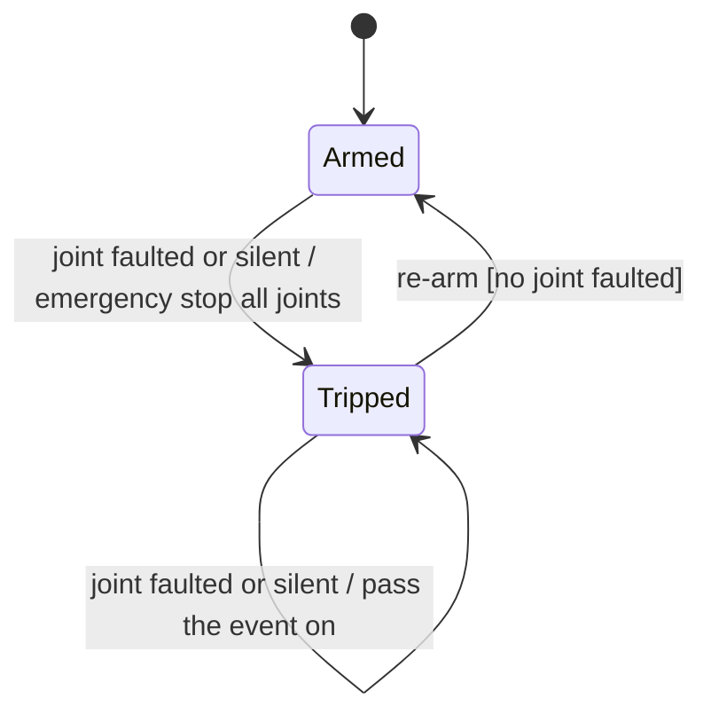
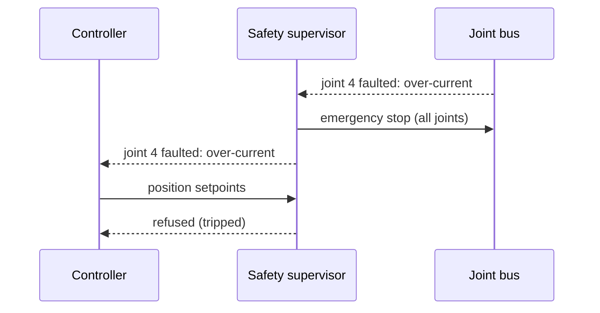
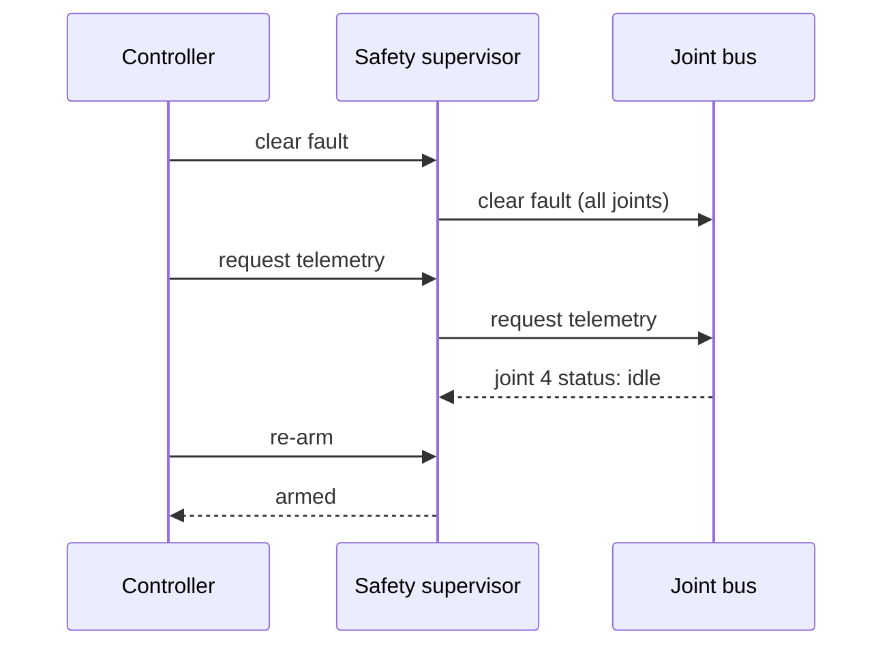

| Field     | Value                    |
|-----------|--------------------------|
| Title     | Safety Supervisor Design |
| Type      | design                   |
| Status    | draft                    |
| Version   | 0.1.0                    |
| Component | safety                   |
| Date      | 2026-11-12               |

> The guard between the arm controller and the joint bus. Behaviour only; diagrams are Mermaid.

---

## Responsibilities

**Is responsible for:**

- Refusing a position setpoint that lies outside a joint's limits or is not finite.
- Refusing to start or move the joints before every node has a compatible contract.
- Stopping all six joints at once, with an emergency stop, when any joint faults or goes silent.
- Holding the arm stopped after such a trip until it is re-armed, and re-arming only when no joint is faulted.

**Is NOT responsible for:**

- Detecting faults and silence: the joint bus reports them.
- Clearing a node's fault: the caller clears faults through the supervisor, which passes the command on.
- Limits on speed, acceleration or torque, collisions and workspace limits: planned with the motion and arm
  model components.

---

## Component Details

### Part A — A joint bus that guards the real one

The supervisor offers the same joint bus interface the controller would use, and passes every call to the real
joint bus behind it unless a rule below refuses it. A refused call sends nothing and reports failure. The
supervisor is the real joint bus's only observer and passes its events on to its own observer.

### Part B — Joint limits

Each joint has a lower and an upper position limit in radians, finite, with the lower below the upper. A
setpoint set is sent only if every one of its six positions is finite and within its joint's limits, ends
included; otherwise none of it is sent.

### Part C — Contract gate

Selecting a control mode, starting the joints and sending setpoints are refused unless the contract check of
all six nodes is compatible. Stopping, emergency stop, clearing faults, the contract check and telemetry requests
are always passed on.

### Part D — Trip

A joint that faults or goes silent trips the supervisor:

- an emergency stop is sent to all six joints at once;
- the event that caused it is passed on to the observer, naming the joint;
- while tripped, selecting a mode, starting and sending setpoints are refused.

A second fault or silence while tripped is passed on but sends no second emergency stop.

### Part E — Re-arming

Re-arming ends a trip. It is refused while any joint's latest reading is in the fault state, so the caller
clears the faults, requests telemetry until the joints report they have left the fault state, and then re-arms.
Re-arming does not start the joints.

---

## Interfaces

### Provided

| Interface          | Purpose                                   | Contract                                                          |
|--------------------|-------------------------------------------|-------------------------------------------------------------------|
| Joint bus          | The joint bus, guarded                    | A refused call sends nothing and reports failure                  |
| Joint bus events   | Contract outcome, joint faulted or silent | Passed on unchanged; a fault or silence also trips the supervisor |
| Trip state, re-arm | Whether the supervisor is tripped; re-arm | Re-arm refused while any joint is faulted                         |

### Required

| Interface | Purpose                         | Contract                                        |
|-----------|---------------------------------|-------------------------------------------------|
| Joint bus | The six joints behind the guard | The supervisor is the joint bus's only observer |

---

## Data Model

| Entity      | Field | Type / Unit | Range            | Notes          |
|-------------|-------|-------------|------------------|----------------|
| Joint limit | lower | radians     | finite, < upper  | One per joint  |
| Joint limit | upper | radians     | finite, > lower  | One per joint  |
| Supervisor  | trip  | flag        | armed or tripped | Armed at start |

---

## State Machine

---

## Sequence Diagrams

### Trip on a fault

### Re-arming

---

## Constraints & Limitations

| Constraint      | Value / Description                                                            |
|-----------------|--------------------------------------------------------------------------------|
| Single observer | The supervisor observes the joint bus; the controller observes the supervisor  |
| Limits          | Position only; speed, acceleration and torque limits come with motion planning |
| Memory          | No heap; all state is fixed-size                                               |

---

## Open Questions

| # | Question                                            | Options                                      | Status |
|---|-----------------------------------------------------|----------------------------------------------|--------|
| 1 | Whether a trip also cuts power through a safe relay | Software emergency stop only, hardware relay | open   |
