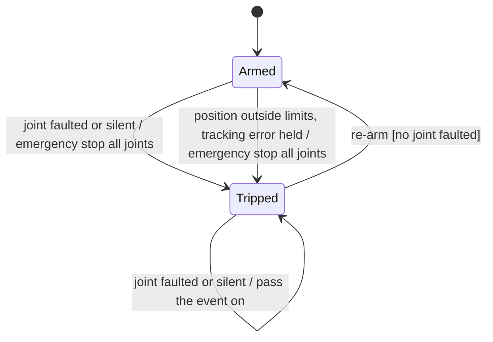
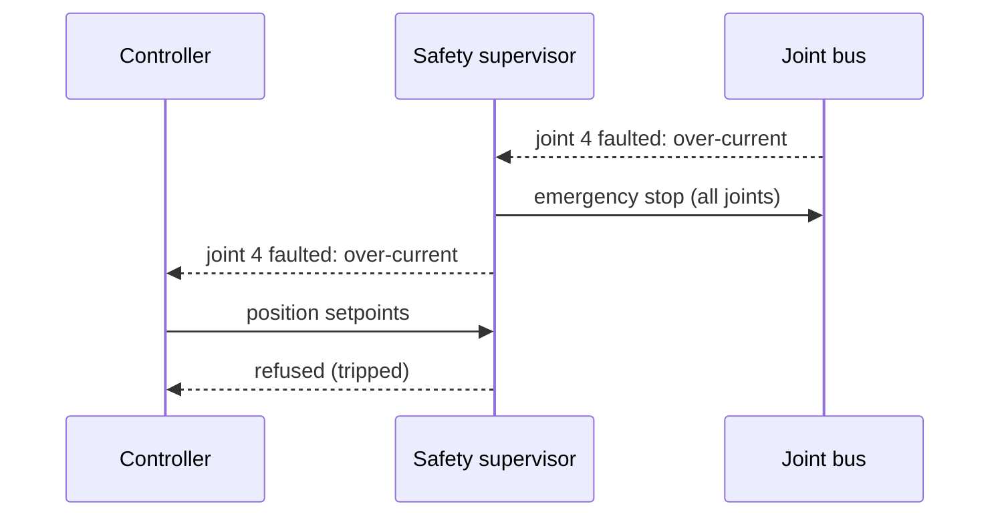
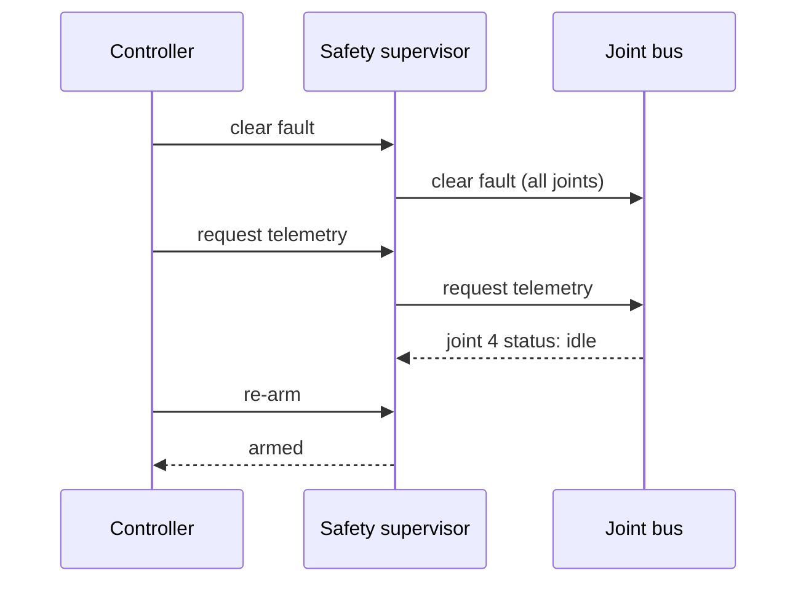

| Field     | Value                    |
|-----------|--------------------------|
| Title     | Safety Supervisor Design |
| Type      | design                   |
| Status    | draft                    |
| Version   | 0.4.0                    |
| Component | safety                   |
| Date      | 2026-11-16               |

> The guard between the arm controller and the joint bus. Behaviour only; diagrams are Mermaid.

---

## Responsibilities

**Is responsible for:**

- Refusing a position setpoint that lies outside a joint's limits or is not finite, and a torque setpoint that is not
  finite.
- Refusing to start or move the joints before every node has a compatible contract.
- Stopping all six joints at once, with an emergency stop, when any joint faults or goes silent.
- Stopping them the same way, while the arm drives the joints, when a joint's measured position leaves its limits
  or its tracking error stays above its window for longer than its time.
- Holding the arm stopped after such a trip until it is re-armed, and re-arming only when no joint is faulted.

**Is NOT responsible for:**

- Detecting faults and silence: the joint bus reports them.
- Clearing a node's fault: the caller clears faults through the supervisor, which passes the command on.
- Limits on speed, acceleration or torque, collision detection beyond the tracking error, and workspace limits:
  planned with the motion and arm model components.
- Choosing the reference: the arm controllers report the reference they track.

---

## Component Details

### Part A — A joint bus that guards the real one

The supervisor offers the same joint bus interface the controller would use, and passes every call to the real
joint bus behind it unless a rule below refuses it. A refused call sends nothing and reports failure. The
supervisor is the real joint bus's only observer and passes its events on to its own observer.

### Part B — Joint limits

Each joint has a lower and an upper position limit in radians, finite, with the lower below the upper. A
setpoint set is sent only if every one of its six positions is finite and within its joint's limits, ends
included; otherwise none of it is sent. A torque setpoint set is sent only if its six torques are finite; the drive
holds the torque within its own current limits. A torque set carries no position, so the joint limits are not
checked on it (open question 2).

### Part C — Contract gate

Selecting a control mode, starting or aligning the joints and sending setpoints are refused unless the contract check of
all six nodes is compatible. Stopping, emergency stop, clearing faults, the contract check and telemetry requests
are always passed on.

### Part D — Trip

A joint that faults or goes silent trips the supervisor:

- an emergency stop is sent to all six joints at once;
- the event that caused it is passed on to the observer, naming the joint;
- while tripped, selecting a mode, starting, aligning and sending setpoints are refused.

A second fault or silence while tripped is passed on but sends no second emergency stop.

### Part E — Re-arming

Re-arming ends a trip. It is refused while any joint's latest reading is in the fault state, so the caller
clears the faults, requests telemetry until the joints report they have left the fault state, and then re-arms.
Re-arming does not start the joints.

### Part F — Supervision while the arm drives the joints

Every control step in which the arm controllers stream setpoints, they hand the supervisor the joint reference they
track. Against the latest reading of each joint the supervisor checks:

- **Position limits.** A measured position outside the joint's limits, ends included as inside, trips at once.
- **Tracking error.** The difference between the reference and the measured position, in joint space, above the
  joint's window counts one step; the steps are consecutive, and once they cover the joint's time the arm trips.
  A step within the window starts the count again.

A step without streaming starts every count again and checks nothing: a joint the arm does not drive is not held
to a reference. A joint whose latest reading is stale, not refreshed in the last control period, is skipped for that
step: its count neither grows nor starts again, since a position the arm has not heard is no measure of tracking, and
a joint that stays unheard is the joint bus's to report as silent. A supervision trip is a trip like a fault's (Part D), and the event passed on names the joint, the
cause (position limit or tracking error) and the value that tripped: the measured position or the tracking error,
in radians.

Each joint's window and time come from the arm profile; a profile that names none gets 0.2 rad for 0.2 s, so the
check is never off by omission. Torque control relies on it: in torque mode the drive has no position reference of
its own, so a joint held back by an obstacle or driven away by a wrong gain is caught here, not by the drive's
following-error supervision.

---

## Interfaces

### Provided

| Interface          | Purpose                                   | Contract                                                          |
|--------------------|-------------------------------------------|-------------------------------------------------------------------|
| Joint bus          | The joint bus, guarded                    | A refused call sends nothing and reports failure                  |
| Joint bus events   | Contract outcome, joint faulted or silent | Passed on unchanged; a fault or silence also trips the supervisor |
| Supervise          | The reference the controllers track       | Once per streaming step; nothing while not streaming              |
| Supervision trip   | Joint, cause and value                    | Sent once, with the trip                                          |
| Trip state, re-arm | Whether the supervisor is tripped; re-arm | Re-arm refused while any joint is faulted                         |

### Required

| Interface | Purpose                         | Contract                                        |
|-----------|---------------------------------|-------------------------------------------------|
| Joint bus | The six joints behind the guard | The supervisor is the joint bus's only observer |

---

## Data Model

| Entity      | Field  | Type / Unit | Range            | Notes                                              |
|-------------|--------|-------------|------------------|----------------------------------------------------|
| Joint limit | lower  | radians     | finite, < upper  | One per joint                                      |
| Joint limit | upper  | radians     | finite, > lower  | One per joint                                      |
| Supervisor  | trip   | flag        | armed or tripped | Armed at start                                     |
| Tracking    | window | radians     | above 0          | One per joint; 0.2 rad when the profile names none |
| Tracking    | time   | duration    | above 0          | One per joint; 0.2 s when the profile names none   |

---

## State Machine

---

## Sequence Diagrams

### Trip on a fault

### Re-arming

---

## Constraints & Limitations

| Constraint      | Value / Description                                                                   |
|-----------------|---------------------------------------------------------------------------------------|
| Single observer | The supervisor observes the joint bus; the controller observes the supervisor         |
| Limits          | Position and tracking error; speed, acceleration and torque come with motion planning |
| Memory          | No heap; all state is fixed-size                                                      |

---

## Open Questions

| # | Question                                            | Options                                                          | Status |
|---|-----------------------------------------------------|------------------------------------------------------------------|--------|
| 1 | Whether a trip also cuts power through a safe relay | Software emergency stop only, hardware relay                     | open   |
| 2 | Keeping a torque-controlled joint within its limits | Decided: trip on a measured position outside the limits (Part F) | closed |
