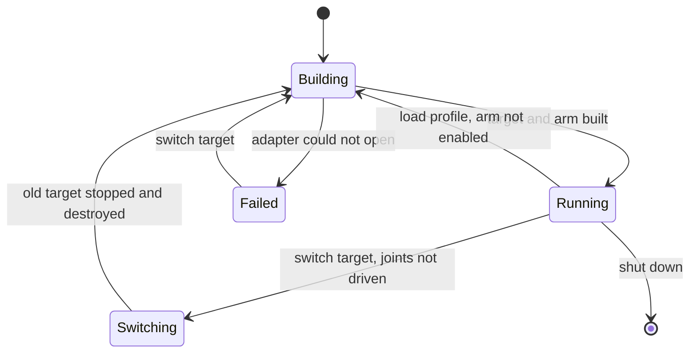
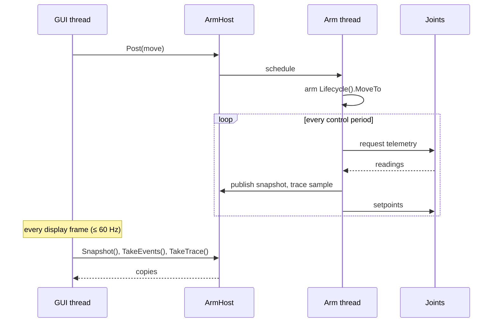
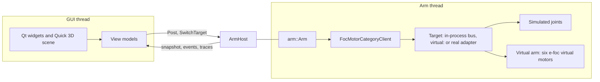

| Field     | Value            |
|-----------|------------------|
| Title     | Simulator Design |
| Type      | design           |
| Status    | draft            |
| Version   | 0.35.1           |
| Component | simulator        |
| Date      | 2026-11-23       |

> The e-robot-arm Simulator's components, threads, targets and data flow (phase 8a,
> [#28](https://github.com/embedded-pro/e-robot-arm/issues/28)). The screen itself — layout, controls, flows,
> look — is in [tool-simulator.md](tool-simulator.md). Behaviour only; diagrams are Mermaid.

---

## Responsibilities

**Is responsible for:**

- Running the arm stack of `core/` (`arm::Arm`: joint bus, safety supervisor, joint motion, lifecycle, control loop) on a PC
  against a selectable target: simulated joints, a `virtual:` CAN bus, or the real arm on a CAN adapter.
- Keeping the arm on its own thread, so neither rendering nor the operator can delay a control period.
- Handing the operator interface a consistent snapshot of the arm, its events and its traces, and taking its
  commands.
- Simulating joints in-process, with a first-order lag and fault injection, for work without hardware.

**Is NOT responsible for:**

- Any arm rule: whether a move is allowed, what trips the arm and when it may be re-armed are decided by `core/`.
  The simulator shows the answer and its reason.
- Motor physics: the in-process joints follow their setpoint through a lag. Motor dynamics come with e-foc virtual
  motors (phase 7, [#23](https://github.com/embedded-pro/e-robot-arm/issues/23)) on the `virtual:` target.
- The arm's geometry and kinematics: phase 8a draws a generic six-joint arm; phase 3
  ([#19](https://github.com/embedded-pro/e-robot-arm/issues/19)) supplies the arm model.

---

## Component Details

### Part A — Libraries

| Library                                                   | Where                          | Qt  | Contents                                                                                                                                                     |
|-----------------------------------------------------------|--------------------------------|-----|--------------------------------------------------------------------------------------------------------------------------------------------------------------|
| `e_robot_arm.tool.simulated_arm`                          | `tools/simulated_arm/`         | no  | `VirtualCanBus`, `SimulatedJoint` (lag, fault, silence), `SimulatedArm` (six joints, one bus)                                                                |
| `e_robot_arm.tool.arm_host`                               | `tools/arm_host/`              | no  | `ArmHost`: the arm and its target on a thread; commands in; snapshot, events, traces out                                                                     |
| `e_robot_arm.tool.simulator.view_models`                  | `tools/simulator/view_models/` | no  | `SimulatorPresenter` (Operate and Move forms on `ui::model`, status, hints, log, pending requests), `ControlRules`, `JointRows`, `EventLog`, `ArmSceneModel` |
| `e_robot_arm.tool.simulator.app`, `e-robot-arm-simulator` | `tools/simulator/app/`         | yes | `SimulatorWindow` on `QtAppShell`, status strip, joint table, scope and log panels, the `Simulator` QML module (`ArmSceneState` and the scene)               |

The integration tests and the console use `simulated_arm` and `arm_host` too, so the simulator, the console and the
scenarios run the same host code. Everything below the Qt glue is tested without Qt.

### Part B — Threads

Two threads, never more for the arm:

1. **Arm thread.** EMIL's event loop (`EventDispatcherThreadAware`, `TimerServiceGeneric`), the CAN adapter or the
   in-process bus, the simulated joints and `arm::Arm`. Every `core/` call happens here.
2. **GUI thread.** Qt's event loop, the view models and the widgets. It never calls into `core/`.

They meet in `ArmHost` only:

- **Commands** go in through `ArmHost::Post`, which schedules a closure on the arm thread's dispatcher (EMIL's
  `Schedule` is safe from any thread). It returns at once.
- **State** comes out through a snapshot that the arm thread publishes after each telemetry phase and the GUI copies
  at display rate, under one mutex held only for the copy.
- **Events and traces** come out through two bounded queues, filled on the arm thread and drained by the GUI each
  frame. A full queue drops its oldest entry and counts the drop; the arm thread never waits.

### Part C — Targets

| Target           | CAN                                                  | Joints                                         | When                                    |
|------------------|------------------------------------------------------|------------------------------------------------|-----------------------------------------|
| Simulated joints | In-process `VirtualCanBus`                           | Six `SimulatedJoint`s on the arm thread        | Default; no hardware, no other process  |
| Virtual bus      | can-lite `virtual:<bus>`, hosting or joining the hub | Whatever joins: e-foc virtual motors (phase 7) | Virtual motors in other processes       |
| Virtual arm      | can-lite `virtual:arm`, hosting the hub              | Six e-foc virtual motors the simulator starts  | Motor dynamics without hardware (8d)    |
| Real arm         | can-lite `socketcan:<if>` or `slcan:<port>`          | The real e-foc nodes                           | Hardware; distinct banner, confirmation |

A target switch builds everything anew; nothing carries over:

1. It is refused while the arm drives its joints (enabling, enabled, moving, disabling or holding after a protective
   stop) with "the arm drives its joints: disable it first": the switch stops every joint, and an arm without brakes
   falls when its joints stop. A tripped, ready or unpowered arm switches. During the switch every command is refused
   with "switching target", except the emergency stop, which still reaches the old target.
2. The control loop stops, every joint of the old target is sent Stop, and the host waits until the transmit queue
   drains or 100 ms pass.
3. The arm, its client and the adapter are destroyed; the new target, client and arm are built.
4. The new arm starts stopped, untripped and with its contracts unchecked.

A target is opened for the node ids of the profile in effect, so simulated joints answer on the profile's nodes.
A target is ready once its adapter has connected: an slcan or `virtual:` adapter finishes its handshake after it is
opened, and a frame sent before then is lost. Until then the arm is not built and every command is refused with
"connecting"; an adapter that has not connected within 2 s fails the target.

**Virtual arm.** The target starts a virtual arm ([virtual-arm.md](virtual-arm.md)) from the profile in effect and
owns it:

1. It hosts the virtual CAN hub on its port. If the port is taken, another virtual arm or bus is running, and the
   target fails with that reason rather than join a bus whose nodes it does not own.
2. It joins the bus as `virtual:arm` and starts the six motors, told to join the hub rather than host it, on a
   thread of their own, since starting takes seconds. The arm thread keeps polling the hub meanwhile, and a target
   switch during the start waits for it to end, polling the hub, at most 10 s.
3. It is ready once its adapter has connected and every motor is up, within 20 s. A motor that does not come up
   fails the target with the virtual arm's reason.
4. Closing the target stops every motor. Each run gets its own working directory, which holds the motors' memory
   and log files, in an `e-robot-arm` folder only the user can open: under `$XDG_RUNTIME_DIR`, else
   `$XDG_CACHE_HOME`, else `~/.cache`, never in a directory every user can write to.

The engine is the `e-foc-virtual-motor` binary the operator names. Loading a profile on this target restarts only
the joints whose motor changed and keeps the others running; a profile with other node ids rebuilds the target. Each
joint's motor process state is in the snapshot (Part F), and one joint can be restarted (Part E).

### Part D — Simulated joints

A `SimulatedJoint` is an e-foc node on the in-process bus (a `FocMotorCategoryServer`), moved from
`integration_tests/support/`. It accepts every command the arm sends, answers telemetry, and:

- **In position mode, follows its setpoint through a first-order lag** with time constant τ. The position advances
  when telemetry is requested, from the time since the last update: `θ ← θ* + (θ − θ*)·e^(−Δt/τ)`, and its speed
  reads `(θ* − θ)/τ`. τ = 0 follows exactly, which is what the scenarios use. The simulator uses τ = 50 ms.
- **In torque mode, moves with the arm's dynamics.** The simulated arm built from an arm configuration integrates the
  six joints together from the arm model's mass matrix, Coriolis and gravity terms (robotics-toolbox's chain
  dynamics over the configuration's geometry and masses): M(q)·q̈ = τ − C(q, q̇)·q̇ − G(q), solved for the driven
  joints with numerical-toolbox's Cholesky decomposition and stepped by semi-implicit Euler every 1 ms. Each joint's
  motor adds its rotor's inertia, times the ratio squared, to the joint's diagonal of M, and its viscous friction,
  times the ratio squared, as a damping torque; both come from the joint's motor in the profile, Teknic's when it
  names none. Each joint running in torque mode contributes its last torque setpoint, converted to the joint
  through its transmission (efficiency 1). Every other joint is held as on a brake:
  its acceleration is zero in the solve, so the driven joints feel its constraint, and it keeps its lag-driven or
  held position.
  The virtual arm drives its motors' shafts with the same solver ([virtual-arm.md](virtual-arm.md) Part C).
  The integration catches up with the time whenever a joint is asked for telemetry or changes state, never by more
  than 100 ms at once, and only while a joint is driven: a stalled host never spends a burst of steps catching up. Positions and speeds are
  reported in motor space through the same transmissions, so the arm reads them as from a real node. A simulated
  arm built from node ids alone has no dynamics: a torque setpoint is accepted and moves nothing.
- **Is always aligned:** it acknowledges an align and stays ready.
- **Treats a quick stop (contract 3.2) as a stop:** it holds where it is and reports *ready*; it never reports
  *stopping*.
- **Takes injected failures:** `Fault(code)` reports a fault in its next telemetry, `Silence()` stops answering and
  `Resume()` answers again. The simulator offers them per joint (Part E, *Disturbances*).
- **Can be pushed:** `SimulatedArm::Push(joint, torque)` adds an external torque on a joint to the dynamics above
  until it is set back to zero, as a hand or an obstacle would. The integration scenarios use it to move a measured
  joint where no command may take it, such as past its position limit.

### Part E — Arm host

`ArmHost` owns the arm thread and, on it, the target and the arm. Its operator-facing surface:

| Operation               | Effect                                                                                                                                                                                                                                                                                                                                                                                                                                                                                                                                                                                                                                                                                                                              |
|-------------------------|-------------------------------------------------------------------------------------------------------------------------------------------------------------------------------------------------------------------------------------------------------------------------------------------------------------------------------------------------------------------------------------------------------------------------------------------------------------------------------------------------------------------------------------------------------------------------------------------------------------------------------------------------------------------------------------------------------------------------------------|
| `Post(command)`         | One of: bring up, enable, disable, check contracts, select a control mode, start, stop, clear faults, align, emergency stop, re-arm, move, move through waypoints, move along a tool line, jog a joint, jog the tool, hold a jog for up to 10 s (refreshed every 5 control periods until then; any other command ends it), step, teach a point, go to a point, select the motion profile, set the impedance stiffness share, reset the adaptation, abort, inject fault, silence joint. Answered by an event. Bring up, enable, disable, re-arm, move, move through waypoints, the tool line, the jog and step go through the arm's lifecycle ([arm-lifecycle.md](arm-lifecycle.md)), so a move is refused unless the arm is enabled |
| `SwitchTarget(target)`  | Part C; its result arrives as an event                                                                                                                                                                                                                                                                                                                                                                                                                                                                                                                                                                                                                                                                                              |
| `LoadProfile(profile)`  | Rebuilds the arm from the profile on the current target, as a target switch does; refused while the arm is enabling, enabled, moving or disabling, or while a target switch runs. Answered `profileLoaded` or `refused` with the reason ([arm-profile.md](arm-profile.md))                                                                                                                                                                                                                                                                                                                                                                                                                                                          |
| `SetCommissioning(on)`  | Turns the commissioning limits on or off (below); answered `accepted` or `refused` with the reason                                                                                                                                                                                                                                                                                                                                                                                                                                                                                                                                                                                                                                  |
| `DetectAdapters(found)` | The CAN adapters can-lite finds on this computer, virtual buses left out; found on the arm thread, where the adapters' timers live, and handed to `found` there, so the caller never waits for them                                                                                                                                                                                                                                                                                                                                                                                                                                                                                                                                 |
| `Snapshot()`            | A copy of the latest snapshot                                                                                                                                                                                                                                                                                                                                                                                                                                                                                                                                                                                                                                                                                                       |
| `TakeEvents()`          | Every event since the last call, in order                                                                                                                                                                                                                                                                                                                                                                                                                                                                                                                                                                                                                                                                                           |
| `TakeTrace()`           | Every trace sample since the last call, in order                                                                                                                                                                                                                                                                                                                                                                                                                                                                                                                                                                                                                                                                                    |

It is built in layers, each tested on its own:

| Layer             | Thread    | Does                                                                                                |
|-------------------|-----------|-----------------------------------------------------------------------------------------------------|
| `ArmRequestQueue` | any       | Holds posted requests in order; an emergency stop goes ahead of everything queued                   |
| `ArmHost`         | owns both | The arm thread with EMIL's event loop and timer service; turns each post into one queued request    |
| `ArmRuntime`      | arm       | Opens the target through a `TargetOpener`, owns the session, switches targets (Part C)              |
| `ArmSession`      | arm       | The FOC motor client and `arm::Arm` on one target link; runs commands; publishes snapshot and trace |
| `ArmMailbox`      | any       | The snapshot under a mutex and the two bounded queues; numbers the snapshots                        |

Every command answers with exactly one event, `accepted` or `refused` with a reason, carrying the id `Post`
returned. Check contracts, select mode, start, stop, clear faults and align are delivered by the joint bus
([joint-bus.md](joint-bus.md) Part B): the session answers `accepted` once all six joints have the command, and
`refused` when the joint bus reports it failed, with the reason "replaced by a newer command", "emergency stop" or
"not delivered to every joint in time". The other commands are answered as soon as they run. A joint command the
lifecycle sends on its own, select mode and start while enabling, is reported the same way when it fails, as a
`refused` event with no command id, so an enable that falls back to *Ready* says which joint command did not get
through.

**Commissioning limits** guard the first runs of a real arm. On the real target the host builds the arm from a copy
of the profile with every joint's speed and acceleration at 25 % of the profile's and its collision limit and
tracking-error window and time at half of them, so a mistake moves slowly and trips early. They are on whenever the
host connects to the real arm, including after a target switch away and back, and they stay as they are when a
profile is loaded on the same connection. `SetCommissioning(false)` is refused unless the target is the real arm
("not the real arm") and while the arm is enabling, enabled, moving or disabling ("the arm is enabled: disable it
first"); otherwise the arm is rebuilt, as a profile load does, and starts again unpowered. Turning them on again
follows the same rules. The snapshot keeps reporting the profile as loaded, never the reduced copy, so saving the
profile never saves commissioning limits; it carries whether they are on.

**Disturbances** are commands as well, each answered `accepted` or `refused`. What a target offers:

| Disturbance      | Simulated joints                   | Virtual arm ([virtual-arm.md](virtual-arm.md) Part D) | Virtual bus, real arm       |
|------------------|------------------------------------|-------------------------------------------------------|-----------------------------|
| Inject fault     | Over-current in the next telemetry | Refused: "not on the virtual arm"                     | Refused: "not a simulation" |
| Silence, resume  | The joint stops or answers again   | The plant port pauses or resumes                      | Refused: "not a simulation" |
| Collision torque | Refused: "not on simulated joints" | Joint-side torque held until set back to 0            | Refused: "not a simulation" |
| Power off motor  | Refused: "not on simulated joints" | The motor's process ends; restart brings it back      | Refused: "not a simulation" |

None depends on the arm's state. The snapshot carries what the target offers and what is applied: each joint
silent or not and its collision torque.

**Restart motor**, posted like the others (virtual arm only), power-cycles one joint's virtual motor with the profile's motor. It is refused
on any other target ("not a virtual arm"), while the arm is enabling, enabled, moving or disabling ("disable the arm
first"), and with the virtual arm's own reason ([virtual-arm.md](virtual-arm.md) Part B). It is answered `accepted`
once the restart has begun; the motor's state in the snapshot follows it from *Starting* to *Up*.

The console runs on `ArmHost` too ([arm-console.md](arm-console.md)): it posts each typed command and waits for its
answer.

### Part F — Snapshot, events and traces

The snapshot is what the screen shows; events are what the log shows; traces are what the scopes plot.

- **Snapshot** — published once per control period, with a sequence number so the GUI can tell a stale copy. On
  the virtual arm it carries each motor's plant and process state (stopped, starting, up, or ended with its exit
  code) and the working directory, also while the target connects. While the arm drives its joints it carries the
  external torque the collision observer estimates on each joint ([collision.md](collision.md)), and none otherwise.
  It carries the arm controllers, each enabled or not and the active one, and the stiffness share of the two impedance controllers.
- **Events** — command accepted or refused (with its id, its name and the reason), contracts resolved, joint fault,
  joint silent, tripped (with the joint and the fault that caused it, once per trip), protective stop (with the joint
  and the rule, as "collision 12.0 N·m"), hardware stop open or closed (a trip by it names no joint and the reason
  "hardware stop open"), move done, move aborted, target ready, target failed, lifecycle state changed; each with the
  arm-thread time. The snapshot carries the lifecycle state as well, and the bus load: the arm's CAN port counts every
  frame it sends and receives, a 29-bit frame of n data bytes as 64 + 8n bits plus 3 of interframe space, and each
  second divides the sum by the target's bitrate (1 Mbit/s unless the adapter is opened at another; the simulated
  joints count at 1 Mbit/s too). It is a lower bound, since bit stuffing is not counted. The snapshot carries the stop
  in effect: its category (protective, category 2, or emergency, category 0), the joint or none, the rule or reason
  and the fault. The first stop sets it, an emergency stop replaces a protective one (a lost hold names its joint and
  "hold lost"), and it clears once the arm is neither holding nor tripped. A view that opens after the stop, or misses
  its event, still names it.
- **Trace samples** — one per control period: the time, the six commanded positions, the six measured positions and,
  while the arm drives its joints, the six commanded torques and the six estimated external torques.
- **Gaps.** A reader that falls behind loses the oldest entries of a full queue (Part B and the Data Model); it is
  told what it lost and where, never left to guess. The queues drop from the front, so every entry lost since the last
  take came just before the first entry this take returns:
  - `TakeEvents()` then starts with an `eventsDropped` event carrying the count, at the time of the first event kept;
  - `TakeTrace()` sets `droppedBefore` on its first sample to the count, so the gap sits between that sample and the
    one before it.

  The simulator logs each gap as a warning with its time and length and counts the lost samples on the scope
  ([tool-simulator.md](tool-simulator.md) Part F); a tuning run counts the samples lost while it records and marks
  them in its CSV ([tuning.md](tuning.md)); the console prints `events lost: <n>`.

The commanded positions are the last setpoint set the active arm controller sent (`ArmControllers::LastSetpoints()`,
empty until the arm has been enabled); nothing else in `core/` changes for the simulator.

### Part G — The Qt application

- **Frame.** A 16 ms `QTimer` on the GUI thread takes the snapshot, the events and the trace from `ArmHost`,
  refreshes the presenter, then the widgets and the scene state. Nothing on the GUI thread waits for the arm thread
  beyond the snapshot copy.
- **Scene.** `ArmScene.qml` places two `ArmModel`s, the measured arm and the ghost, built from `ArmPart` and
  `ArmHousing`, in ui-cpp's `StudioView` (environment, lights, floor, grid, camera, picking), with its `AxisTriad` at
  the tool and its `StatusBadge` for the singularity warning. The scene reads one C++ object, the `ArmSceneState` singleton of
  the `Simulator` QML module, which the window updates once per frame. Qt Quick 3D renders only when something
  changes, so an arm at rest costs no frames.
- **Light probe.** `StudioView`'s `studio.hdr`, generated by ui-cpp's `scripts/generate-studio-probe.py` (two soft
  boxes, an overhead panel, grey horizon, dark floor), so the asset carries no third-party licence.
- **Qt 6.4.** The dev container has Qt 6.4.2:
  - ambient occlusion is on whenever `aoStrength` is above 0 in 6.4; from 6.5 on it also needs `aoEnabled`, which
    6.4 rejects, so the window sets it at run time on the `StudioView`'s environment when it has it;
  - `shadowBias` is a fraction in 6.4 and a distance from 6.5 on, so the scene leaves it at its default;
  - from Qt 6.10 the QML cache of a module on a static library does not reach the executables' link, so the
    module is built with `NO_CACHEGEN` and its three QML files compile at load time;
  - a `QML_SINGLETON` that is default-constructible is created by the engine, which ignores the static `create()`.
    `ArmSceneState` therefore has no default constructor.
- **Window test.** `e_robot_arm.tool.simulator_window_test` opens the window on simulated joints, brings the arm up,
  moves it, captures a frame mid-move (`SIMULATOR_FRAME_CAPTURE=<path>.png` saves it and the whole window), prints
  the frame statistics of a move and a tuning step ([tool-simulator.md](tool-simulator.md) Part O) as `[METRIC]`
  lines, on six e-foc virtual motors when `E_FOC_VIRTUAL_MOTOR` names the engine, and checks that an injected fault
  trips the arm with its source.
  It needs a display: `xvfb-run` with Mesa in CI. It carries the `display` label, which the `host-qt` test preset
  leaves out.

---

## Interfaces

### Provided

| Interface      | Purpose                                 | Contract                                                       |
|----------------|-----------------------------------------|----------------------------------------------------------------|
| `ArmHost`      | The arm on its own thread               | Thread-safe; never blocks the caller beyond one snapshot copy  |
| View models    | Everything the screen shows and enables | GUI thread only; no Qt; tested with ui-cpp's recording backend |
| `SimulatedArm` | Six in-process e-foc joints on one bus  | Arm thread only                                                |

### Required

| Interface                          | Purpose                             | Contract                                                         |
|------------------------------------|-------------------------------------|------------------------------------------------------------------|
| `arm::Arm`                         | The arm stack                       | Unchanged, plus `ArmControllers::LastSetpoints()`                |
| can-lite `PlatformCanAdapter`, hub | Virtual and real targets            | `virtual:`, `socketcan:`, `slcan:`                               |
| ui-cpp (`infra/ui-cpp`)            | Shell, forms, scopes, theme, meshes | Tier 1 always built; Qt and Quick 3D backends with the simulator |
| Qt 6 Widgets, Quick, Quick 3D      | Window, 3-D view                    | Qt ≥ 6.4; 6.5+ features behind version guards                    |

---

## Data Model

| Entity          | Field                 | Type / Unit                         | Range                 | Notes                                                   |
|-----------------|-----------------------|-------------------------------------|-----------------------|---------------------------------------------------------|
| Snapshot        | sequence              | count                               | —                     | Increments per publish                                  |
| Snapshot        | target                | simulated, virtual, real + name     | —                     | Name: bus or adapter                                    |
| Snapshot        | readings              | 6 × (rad, rad/s, state, fault)      | —                     | Empty until the joint first answers                     |
| Snapshot        | commanded             | 6 × rad, optional                   | Joint limits          | Joint motion's last setpoint                            |
| Snapshot        | joint liveness        | 6 × answered, silent                | —                     | From the joint bus                                      |
| Snapshot        | contracts             | unchecked, compatible, incompatible | —                     | Per joint                                               |
| Snapshot        | tripped, moving, loop | bool                                | —                     |                                                         |
| Snapshot        | holding               | bool                                | —                     | A protective stop holds the arm (safety.md Part G)      |
| Snapshot        | hardware stop open    | bool                                | —                     | The stop circuit is open (safety.md Part J)             |
| Snapshot        | torque clamped        | 6 × bool                            | —                     | The last torque sent was clamped (safety.md Part B)     |
| Snapshot        | stop                  | category, joint, rule, fault; opt.  | —                     | The stop in effect; cleared once re-armed (Part F)      |
| Snapshot        | stop's workspace rule | rule, link, other link or zone, m   | —                     | A stop by the workspace check only (safety.md Part H)   |
| Snapshot        | workspace             | box: min and max corner, m          | —                     | The box the supervisor checks, default or profile's     |
| Snapshot        | bus load              | share of the bitrate, optional      | 0–1                   | The last whole second; none before the first one        |
| Snapshot        | profile               | name and arm configuration          | —                     | The profile loaded, never the commissioning copy        |
| Snapshot        | commissioning         | bool                                | —                     | Real arm only; on at every connection                   |
| Snapshot        | tool pose             | m, rad; singularity flags           | —                     | From the measured joints ([arm-model.md](arm-model.md)) |
| Snapshot        | virtual motors        | 6 × (plant, process state), folder  | —                     | Virtual arm only                                        |
| Snapshot        | disturbances          | offered kinds; 6 × (silent, N·m)    | ±200 N·m              | Simulated joints and virtual arm only                   |
| Event queue     | capacity              | events                              | 512                   | Oldest dropped when full; drops counted and reported    |
| Trace queue     | capacity              | samples                             | 1024 (10 s at 100 Hz) | Oldest dropped when full; drops counted and reported    |
| Simulated joint | τ                     | s                                   | ≥ 0                   | 0 follows exactly; simulator 0.05                       |

---

## State Machine

---

## Sequence Diagrams

---

## Block Diagram

---

## Constraints & Limitations

| Constraint | Value / Description                                                                              |
|------------|--------------------------------------------------------------------------------------------------|
| Timing     | Event-loop timers on a desktop OS: periods jitter with scheduling; real-time comes with phase 9  |
| Memory     | Host tools may allocate; `core/` stays heap-free; the queues are bounded                         |
| Bus        | Bus load is an estimate: frames without bit stuffing, over the target's nominal bitrate          |
| Lifecycle  | No arm lifecycle until phase 1; the controls follow the joints' states and the safety supervisor |

---

## Open Questions

| # | Question                                               | Options                                                  | Status            |
|---|--------------------------------------------------------|----------------------------------------------------------|-------------------|
| 1 | Whether the simulated joints should model speed limits | Lag only (8a), virtual motors for dynamics (phase 7)     | decided: lag only |
| 2 | A status-coloured read-only joint table in ui-cpp      | ui-cpp `ui::model` read-out table with a status per cell | open              |
