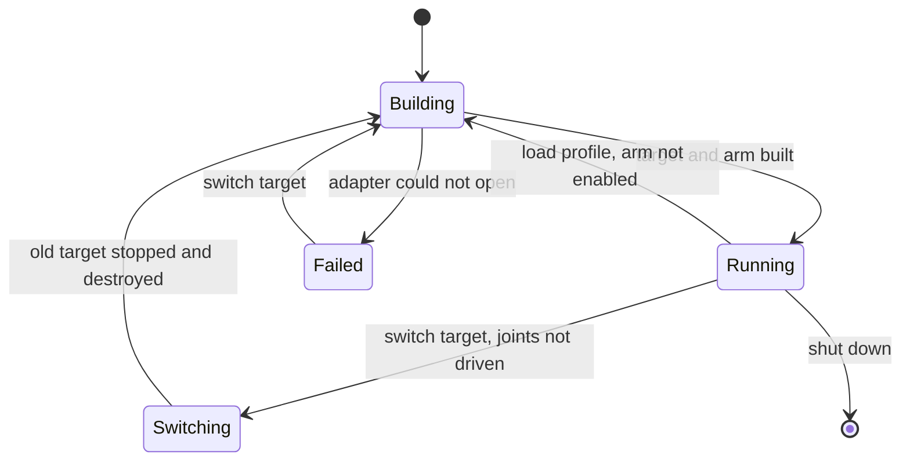
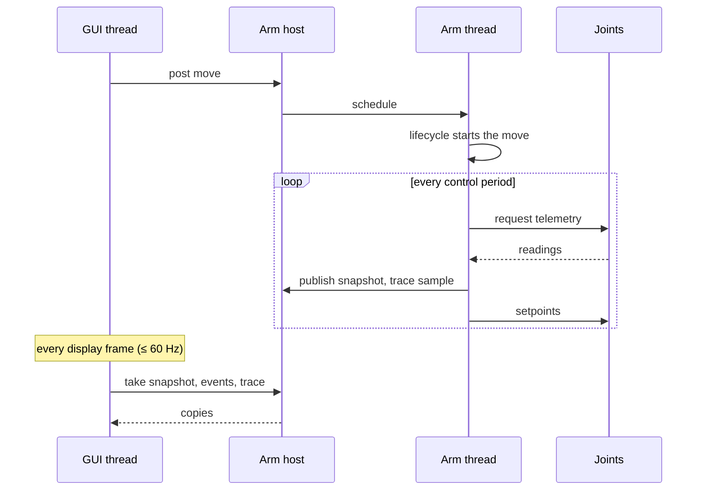
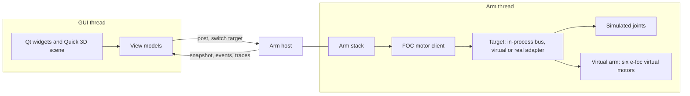

| Field     | Value            |
|-----------|------------------|
| Title     | Simulator Design |
| Type      | design           |
| Status    | draft            |
| Version   | 0.36.1           |
| Component | simulator        |
| Date      | 2026-11-26       |

> The e-robot-arm Simulator's components, threads, targets and data flow (phase 8a,
> [#28](https://github.com/embedded-pro/e-robot-arm/issues/28)). The screen itself — layout, controls, flows,
> look — is in [tool-simulator.md](tool-simulator.md). Behaviour only; diagrams are Mermaid.

---

## Responsibilities

- Running the arm stack (joint bus, safety supervisor, joint motion, lifecycle, control loop) on a PC.
  The target is selectable: simulated joints, a `virtual:` CAN bus, or the real arm on a CAN adapter.
- Keeping the arm on its own thread, so neither rendering nor the operator can delay a control period.
- Handing the operator interface a consistent snapshot of the arm, its events and its traces, and taking its
  commands.
- Simulating joints in-process, with a first-order lag and fault injection, for work without hardware.

---

## Component Details

### Part A — Libraries

| Component             | Qt  | Contents                                                                                        |
|-----------------------|-----|-------------------------------------------------------------------------------------------------|
| Simulated arm         | no  | The in-process CAN bus, the simulated joints (lag, fault, silence), six joints on one bus       |
| Arm host              | no  | The arm and its target on a thread; commands in; snapshot, events, traces out                   |
| Simulator view models | no  | Operate and Move forms, status, hints, log, pending requests, control rules, joint rows, scene  |
| Simulator application | yes | The window on ui-cpp's Qt shell, status strip, joint table, scope and log panels, the 3-D scene |

The integration tests and the console use the simulated arm and the arm host too. So the simulator, the console
and the scenarios run the same host code. Everything below the Qt glue is tested without Qt.

### Part B — Threads

Two threads, never more for the arm:

1. **Arm thread.** EMIL's event loop and timer service, the CAN adapter or the in-process bus, the simulated joints
   and the arm stack. Every call into the arm stack happens here.
2. **GUI thread.** Qt's event loop, the view models and the widgets. It never calls into the arm stack.

They meet in the arm host only:

- **Commands** go in through a post. The post schedules a closure on the arm thread's event loop and returns at
  once. EMIL's scheduling is safe from any thread.
- **State** comes out through a snapshot. The arm thread publishes it after each telemetry phase. The GUI copies it
  at display rate, under one mutex held only for the copy.
- **Events and traces** come out through two bounded queues. The arm thread fills them, and the GUI drains them each
  frame. A full queue drops its oldest entry and counts the drop; the arm thread never waits.

### Part C — Targets

| Target           | CAN                                                  | Joints                                         | When                                    |
|------------------|------------------------------------------------------|------------------------------------------------|-----------------------------------------|
| Simulated joints | In-process CAN bus                                   | Six simulated joints on the arm thread         | Default; no hardware, no other process  |
| Virtual bus      | can-lite `virtual:<bus>`, hosting or joining the hub | Whatever joins: e-foc virtual motors (phase 7) | Virtual motors in other processes       |
| Virtual arm      | can-lite `virtual:arm`, hosting the hub              | Six e-foc virtual motors the simulator starts  | Motor dynamics without hardware (8d)    |
| Real arm         | can-lite `socketcan:<if>` or `slcan:<port>`          | The real e-foc nodes                           | Hardware; distinct banner, confirmation |

A target switch builds everything anew; nothing carries over:

1. The host refuses the switch while the arm drives its joints with "the arm drives its joints: disable it first".
   The arm drives its joints while enabling, enabled, moving, disabling or holding after a protective stop.
   The switch stops every joint, and an arm without brakes falls when its joints stop.
   A tripped, ready or unpowered arm switches.
   During the switch the host refuses every command with "switching target".
   The emergency stop is the exception: it still reaches the old target.
2. The control loop stops, and every joint of the old target gets Stop.
   The host then waits until the transmit queue drains or 100 ms pass.
3. The host destroys the arm, its client and the adapter. It then builds the new target, client and arm.
4. The new arm starts stopped, untripped and with its contracts unchecked.

The host builds the arm with its configuration's simulation flag on for the simulated joints and the virtual arm. The
flag is off for a virtual bus and the real arm. Only with the flag on does the arm offer the passive controllers
`free` and `gravity-float` ([arm-controllers.md](arm-controllers.md) Part E). A virtual bus has the flag off because
the tools cannot tell what joined it.

The host opens a target for the node ids of the profile in effect, so simulated joints answer on the profile's
nodes. A target is ready once its adapter has connected. An slcan or `virtual:` adapter finishes its handshake after
it opens, and a frame sent before then is lost. Until then the arm is not built, and the host refuses every command
with "connecting". An adapter that has not connected within 2 s fails the target.

**Virtual arm.** The target starts a virtual arm ([virtual-arm.md](virtual-arm.md)) from the profile in effect and
owns it:

1. It hosts the virtual CAN hub on its port. If the port is taken, another virtual arm or bus is running.
   The target then fails with that reason, rather than join a bus whose nodes it does not own.
2. It joins the bus as `virtual:arm` and starts the six motors on a thread of their own, since starting takes
   seconds. It tells the motors to join the hub rather than host it.
   The arm thread keeps polling the hub meanwhile.
   A target switch during the start waits for it to end, polling the hub, at most 10 s.
3. It is ready once its adapter has connected and every motor is up, within 20 s.
   A motor that does not come up fails the target with the virtual arm's reason.
4. Closing the target stops every motor. Each run gets its own working directory for the motors' memory and log
   files. The directory is an `e-robot-arm` folder only the user can open.
   It is under `$XDG_RUNTIME_DIR`, else `$XDG_CACHE_HOME`, else `~/.cache`, never in a directory every user can
   write to.

The engine is the `e-foc-virtual-motor` binary the operator names. Loading a profile on this target restarts only
the joints whose motor changed and keeps the others running. A profile with other node ids rebuilds the target.
Each joint's motor process state is in the snapshot (Part F), and one joint can be restarted (Part E).

### Part D — Simulated joints

A simulated joint is an e-foc node on the in-process bus: a FOC motor category server. It comes from the
integration tests' support code. It accepts every command the arm sends, answers telemetry, and:

- **In position mode, follows its setpoint through a first-order lag** with time constant τ. The position advances
  when telemetry is requested, from the time since the last update: `θ ← θ* + (θ − θ*)·e^(−Δt/τ)`.
  Its speed reads `(θ* − θ)/τ`. τ = 0 follows exactly, which is what the scenarios use. The simulator uses τ = 50 ms.
- **In torque mode, moves with the arm's dynamics.** The simulated arm built from an arm configuration integrates
  the six joints together. It uses the arm model's mass matrix, Coriolis and gravity terms.
  These come from robotics-toolbox's chain dynamics over the configuration's geometry and masses.
  It solves M(q)·q̈ = τ − C(q, q̇)·q̇ − G(q) for the driven joints with numerical-toolbox's Cholesky decomposition.
  It steps the solution by semi-implicit Euler every 1 ms.
  Each joint's motor adds its rotor's inertia, times the ratio squared, to the joint's diagonal of M.
  It adds its viscous friction, times the ratio squared, as a damping torque.
  Both come from the joint's motor in the profile, Teknic's when it names none.
  Each joint in torque mode contributes its last torque setpoint, converted to the joint through its transmission
  (efficiency 1). Every other joint is held as on a brake.
  Its acceleration is zero in the solve, so the driven joints feel its constraint.
  It keeps its lag-driven or held position.
  The virtual arm drives its motors' shafts with the same solver ([virtual-arm.md](virtual-arm.md) Part C).
  The integration catches up with the time whenever a joint is asked for telemetry or changes state.
  It never catches up by more than 100 ms at once, and only while a joint is driven.
  So a stalled host never spends a burst of steps catching up.
  The joint reports positions and speeds in motor space through the same transmissions, so the arm reads them as
  from a real node. A simulated arm built from node ids alone has no dynamics.
  It accepts a torque setpoint, and the setpoint moves nothing.
- **Is always aligned:** it acknowledges an align and stays ready.
- **Treats a quick stop (contract 3.2) as a stop:** it holds where it is and reports *ready*; it never reports
  *stopping*.
- **Takes injected failures.** An injected fault shows a fault in its next telemetry. Silence stops its answers,
  and resume makes it answer again. The simulator offers them per joint (Part E, *Disturbances*).
- **Can be pushed.** The simulated arm can add an external torque on a joint to the dynamics above.
  The torque stays until it is set back to zero, as a hand or an obstacle would push.
  The integration scenarios use it to move a measured joint where no command may take it, such as past its
  position limit.

### Part E — Arm host

The arm host owns the arm thread and, on it, the target and the arm. Its operator-facing surface:

| Operation         | Effect                                                                                 |
|-------------------|----------------------------------------------------------------------------------------|
| Post a command    | Runs one command (list below); an event answers it                                     |
| Switch target     | Part C; its result arrives as an event                                                 |
| Load profile      | Rebuilds the arm from a profile on the current target, as a target switch does (below) |
| Set commissioning | Turns the commissioning limits on or off (below); answered *accepted* or *refused*     |
| Detect adapters   | The CAN adapters can-lite finds on this computer, virtual buses left out (below)       |
| Take snapshot     | A copy of the latest snapshot                                                          |
| Take events       | Every event since the last call, in order                                              |
| Take trace        | Every trace sample since the last call, in order                                       |

A posted command is one of these:

- bring up, enable, disable, check contracts, select a control mode, start, stop, clear faults, align;
- emergency stop, re-arm, abort;
- move, move through waypoints, move along a tool line;
- jog a joint, jog the tool, hold a jog, step;
- teach a point, go to a point;
- select the motion profile, set the impedance stiffness share, reset the adaptation;
- inject fault, silence joint.

A held jog lasts up to 10 s. It is refreshed every 5 control periods until then, and any other command ends it.
Bring up, enable, disable, re-arm, the moves, the tool line, the jog and step go through the arm's lifecycle
([arm-lifecycle.md](arm-lifecycle.md)). So the arm refuses a move unless it is enabled.

The host refuses a profile load while the arm is enabling, enabled, moving or disabling, or while a target switch
runs. It answers a profile load with *profile loaded* or *refused* with the reason ([arm-profile.md](arm-profile.md)).
The host finds the adapters on the arm thread, where the adapters' timers live. It hands them to the caller's
callback there, so the caller never waits for them.

It is built in layers, each tested on its own:

| Layer         | Thread    | Does                                                                                      |
|---------------|-----------|-------------------------------------------------------------------------------------------|
| Request queue | any       | Holds posted requests in order; an emergency stop goes ahead of everything queued         |
| Host          | owns both | The arm thread with EMIL's event loop and timer service; turns each post into one request |
| Runtime       | arm       | Opens the target through a target opener, owns the session, switches targets (Part C)     |
| Session       | arm       | The FOC motor client and the arm stack on one target link; runs commands; publishes       |
| Mailbox       | any       | The snapshot under a mutex and the two bounded queues; numbers the snapshots              |

Every command answers with exactly one event, *accepted* or *refused* with a reason. The event carries the id that
the post returned. The joint bus ([joint-bus.md](joint-bus.md) Part B) delivers check contracts, select mode, start,
stop, clear faults and align. The session answers *accepted* once all six joints have the command. It answers
*refused* when the joint bus reports a failure. The reason is "replaced by a newer command", "emergency stop" or
"not delivered to every joint in time". The host answers the other commands as soon as they run.
The lifecycle sends select mode and start on its own while enabling. When such a joint command fails, the host
reports it the same way, as a *refused* event with no command id. So an enable that falls back to *Ready* says which
joint command did not get through.

**Commissioning limits** guard the first runs of a real arm. On the real target the host builds the arm from a copy
of the profile. The copy sets every joint's speed and acceleration at 25 % of the profile's. It sets the collision
limit and the tracking-error window and time at half of the profile's. So a mistake moves slowly and trips early.
The limits are on whenever the host connects to the real arm, also after a target switch away and back.
They stay as they are when a profile is loaded on the same connection.
The host refuses to turn them off unless the target is the real arm ("not the real arm").
It also refuses while the arm is enabling, enabled, moving or disabling ("the arm is enabled: disable it first").
Otherwise it rebuilds the arm, as a profile load does, and the arm starts again unpowered.
Turning them on again follows the same rules. The snapshot keeps reporting the profile as loaded, never the reduced
copy. So saving the profile never saves commissioning limits. The snapshot carries whether they are on.

**Disturbances** are commands as well, each answered *accepted* or *refused*. What a target offers:

| Disturbance      | Simulated joints                           | Virtual arm ([virtual-arm.md](virtual-arm.md) Part D) | Virtual bus, real arm       |
|------------------|--------------------------------------------|-------------------------------------------------------|-----------------------------|
| Inject fault     | Over-current in the next telemetry         | Refused: "not on the virtual arm"                     | Refused: "not a simulation" |
| Silence, resume  | The joint stops or answers again           | The plant port pauses or resumes                      | Refused: "not a simulation" |
| Collision torque | Joint-side torque held until set back to 0 | Joint-side torque held until set back to 0            | Refused: "not a simulation" |
| Power off motor  | Refused: "not on simulated joints"         | The motor's process ends; restart brings it back      | Refused: "not a simulation" |

None depends on the arm's state. The snapshot carries what the target offers and what is applied: each joint
silent or not and its collision torque.

**Restart motor** is posted like the others (virtual arm only). It power-cycles one joint's virtual motor with the
profile's motor. The host refuses it on any other target ("not a virtual arm").
It also refuses it while the arm is enabling, enabled, moving or disabling ("disable the arm first").
It refuses it with the virtual arm's own reason too ([virtual-arm.md](virtual-arm.md) Part B).
The host answers *accepted* once the restart has begun. The motor's state in the snapshot follows it from
*Starting* to *Up*.

The console runs on the arm host too ([arm-console.md](arm-console.md)). It posts each typed command and waits for
its answer.

### Part F — Snapshot, events and traces

The snapshot is what the screen shows; events are what the log shows; traces are what the scopes plot.

- **Snapshot** — published once per control period, with a sequence number so the GUI can tell a stale copy.
  On the virtual arm it carries each motor's plant and process state: stopped, starting, up, or ended with its exit
  code. It also carries the working directory, also while the target connects.
  While the arm drives its joints it carries the external torque that the collision observer estimates on each
  joint ([collision.md](collision.md)). Otherwise it carries none.
  It carries the arm controllers, each enabled or not, and the active one.
  It carries the stiffness share of the two impedance controllers.
- **Events** — command accepted or refused (with its id, its name and the reason), contracts resolved, joint fault.
  Also joint silent, tripped, protective stop, hardware stop open or closed, move done and move aborted.
  Also target ready, target failed and lifecycle state changed. Each event has the arm-thread time.
  A trip names the joint and the fault that caused it, once per trip.
  A protective stop names the joint and the rule, as "collision 12.0 N·m".
  A trip by the hardware stop names no joint and has the reason "hardware stop open".
  The snapshot carries the lifecycle state as well, and the bus load.
  The arm's CAN port counts every frame it sends and receives.
  A 29-bit frame of n data bytes counts as 64 + 8n bits plus 3 of interframe space.
  Each second the port divides the sum by the target's bitrate.
  The bitrate is 1 Mbit/s unless the adapter opens at another; the simulated joints count at 1 Mbit/s too.
  The load is a lower bound, since bit stuffing is not counted.
  The snapshot carries the stop in effect: its category, the joint or none, the rule or reason and the fault.
  The category is protective (category 2) or emergency (category 0).
  The first stop sets it, and an emergency stop replaces a protective one.
  A lost hold names its joint and "hold lost".
  The stop clears once the arm is neither holding nor tripped. A view that opens after the stop, or misses its
  event, still names it.
- **Trace samples** — one per control period: the time, the six commanded positions and the six measured positions.
  While the arm drives its joints, a sample also has the six commanded torques and the six estimated external
  torques.
- **Gaps.** A reader that falls behind loses the oldest entries of a full queue (Part B and the Data Model).
  It is told what it lost and where, never left to guess. The queues drop from the front.
  So every entry lost since the last take came just before the first entry this take returns:
  - the events then start with an *events dropped* event that carries the count, at the time of the first event
    kept;
  - the first trace sample then carries the count of dropped samples, so the gap sits between that sample and the
    one before it.

  The simulator logs each gap as a warning with its time and length.
  It counts the lost samples on the scope ([tool-simulator.md](tool-simulator.md) Part F).
  A tuning run counts the samples lost while it records and marks them in its CSV ([tuning.md](tuning.md)).
  The console prints `events lost: <n>`.

The commanded positions are the last setpoint set that the active arm controller sent. They are empty until the arm
has been enabled. The arm controllers give them through one query, and nothing else in the arm stack changes for
the simulator.

### Part G — The Qt application

- **Frame.** A 16 ms timer on the GUI thread takes the snapshot, the events and the trace from the arm host.
  It refreshes the presenter, then the widgets and the scene state. Nothing on the GUI thread waits for the arm
  thread beyond the snapshot copy.
- **Scene.** The scene places two arm models, the measured arm and the ghost, built from arm parts and housings.
  It places them in ui-cpp's studio view (environment, lights, floor, grid, camera, picking).
  The studio view's axis triad sits at the tool, and its status badge shows the singularity warning.
  The scene reads one C++ object, the scene state of the simulator's QML module.
  The window updates that object once per frame.
  Qt Quick 3D renders only when something changes, so an arm at rest costs no frames.
- **Light probe.** The studio view's light probe comes from a ui-cpp generator script: two soft boxes, an overhead
  panel, a grey horizon and a dark floor. So the asset carries no third-party licence.
- **Qt 6.4.** The dev container has Qt 6.4.2:
  - in 6.4 ambient occlusion is on whenever its strength is above 0. From 6.5 on it also needs an enable flag,
    which 6.4 rejects. The window sets the flag at run time on the studio view's environment when it has it;
  - the shadow bias is a fraction in 6.4 and a distance from 6.5 on, so the scene leaves it at its default;
  - from Qt 6.10 the QML cache of a module in a static library does not reach the executables' link.
    So the module skips the QML cache, and its three QML files compile at load time;
  - the QML engine creates a default-constructible singleton itself and ignores its factory.
    The scene state therefore has no default constructor.
- **Diagnostics.** The Windows build is a GUI-subsystem program with no console, so the log file is the only
  output. Start-up sets the organisation and application names, then opens ui-cpp's issue log before anything else.
  The log is `%LOCALAPPDATA%\embedded-pro\e-robot-arm Simulator\logs\simulator.log` on Windows.
  It is in `~/.local/share/embedded-pro/e-robot-arm Simulator/logs/` on Linux.
  It captures every Qt message, debug included, and installs ui-cpp's crash reporter.
  A crash writes a `FATAL` line and, on Windows, a `simulator-<UTC time>.dmp` beside the log.
  The next start notes a run that did not close normally.
  The log records the start-up milestones: version, OS, Qt, arguments, arm host, scene status, settings restore.
  It also records the last profile, the first frame with its graphics API, the window close and the end of the
  event loop.
  It records the frame statistics each second for 30 s, then each minute.
  Help ▸ Open Log Folder opens the folder; Help ▸ Report Issue attaches the recent lines.
- **Render quality.** After the first frame the window reads the RHI driver info of the 3-D view and logs the
  renderer. A view-model rule without Qt maps the setting and that renderer to High or Low.
  The window then sets the studio view's shadows, ambient occlusion, antialiasing and light probe
  ([tool-simulator.md](tool-simulator.md) Part E).
- **Safe start.** `--safe-start` skips the saved theme, geometry, layout and last profile.
  So a saved state that breaks start-up can be bypassed and then overwritten.
- **Window test.** The window test opens the window on simulated joints, brings the arm up and moves it.
  It captures a frame mid-move. `SIMULATOR_FRAME_CAPTURE=<path>.png` saves that frame and the whole window.
  It prints the frame statistics of a move and a tuning step ([tool-simulator.md](tool-simulator.md) Part O) as
  `[METRIC]` lines. It runs on six e-foc virtual motors when `E_FOC_VIRTUAL_MOTOR` names the engine.
  It checks that an injected fault trips the arm with its source.
  It needs a display: `xvfb-run` with Mesa in CI. It carries the `display` label, which the `host-qt` test preset
  leaves out.

---

## Interfaces

### Provided

| Interface     | Purpose                                 | Contract                                                       |
|---------------|-----------------------------------------|----------------------------------------------------------------|
| Arm host      | The arm on its own thread               | Thread-safe; never blocks the caller beyond one snapshot copy  |
| View models   | Everything the screen shows and enables | GUI thread only; no Qt; tested with ui-cpp's recording backend |
| Simulated arm | Six in-process e-foc joints on one bus  | Arm thread only                                                |

### Required

| Interface                     | Purpose                             | Contract                                                         |
|-------------------------------|-------------------------------------|------------------------------------------------------------------|
| Arm stack                     | The arm and every arm rule          | Unchanged, plus a query for the last setpoints (Part F)          |
| can-lite CAN adapters, hub    | Virtual and real targets            | `virtual:`, `socketcan:`, `slcan:`                               |
| ui-cpp                        | Shell, forms, scopes, theme, meshes | Tier 1 always built; Qt and Quick 3D backends with the simulator |
| Qt 6 Widgets, Quick, Quick 3D | Window, 3-D view                    | Qt ≥ 6.4; 6.5+ features behind version guards                    |

The arm stack decides every arm rule: whether a move is allowed, what trips the arm and when it may be re-armed.
The simulator shows the answer and its reason.

---

## Data Model

| Entity          | Field                 | Type / Unit                         | Range                 | Notes                                                   |
|-----------------|-----------------------|-------------------------------------|-----------------------|---------------------------------------------------------|
| Snapshot        | sequence              | count                               | —                     | Increments per publish                                  |
| Snapshot        | target                | simulated, virtual, real + name     | —                     | Name: bus or adapter                                    |
| Snapshot        | readings              | 6 × (rad, rad/s, state, fault)      | —                     | Empty until the joint first answers                     |
| Snapshot        | commanded             | 6 × rad, optional                   | Joint limits          | Joint motion's last setpoint                            |
| Snapshot        | joint liveness        | 6 × answered, silent                | —                     | From the joint bus                                      |
| Snapshot        | contracts             | unchecked, compatible, incompatible | —                     | Per joint                                               |
| Snapshot        | tripped, moving, loop | bool                                | —                     |                                                         |
| Snapshot        | holding               | bool                                | —                     | A protective stop holds the arm (safety.md Part G)      |
| Snapshot        | hardware stop open    | bool                                | —                     | The stop circuit is open (safety.md Part J)             |
| Snapshot        | torque clamped        | 6 × bool                            | —                     | The last torque sent was clamped (safety.md Part B)     |
| Snapshot        | stop                  | category, joint, rule, fault; opt.  | —                     | The stop in effect; cleared once re-armed (Part F)      |
| Snapshot        | stop's workspace rule | rule, link, other link or zone, m   | —                     | A stop by the workspace check only (safety.md Part H)   |
| Snapshot        | workspace             | box: min and max corner, m          | —                     | The box the supervisor checks, default or profile's     |
| Snapshot        | bus load              | share of the bitrate, optional      | 0–1                   | The last whole second; none before the first one        |
| Snapshot        | profile               | name and arm configuration          | —                     | The profile loaded, never the commissioning copy        |
| Snapshot        | commissioning         | bool                                | —                     | Real arm only; on at every connection                   |
| Snapshot        | tool pose             | m, rad; singularity flags           | —                     | From the measured joints ([arm-model.md](arm-model.md)) |
| Snapshot        | virtual motors        | 6 × (plant, process state), folder  | —                     | Virtual arm only                                        |
| Snapshot        | disturbances          | offered kinds; 6 × (silent, N·m)    | ±200 N·m              | Simulated joints and virtual arm only                   |
| Event queue     | capacity              | events                              | 512                   | Oldest dropped when full; drops counted and reported    |
| Trace queue     | capacity              | samples                             | 1024 (10 s at 100 Hz) | Oldest dropped when full; drops counted and reported    |
| Simulated joint | τ                     | s                                   | ≥ 0                   | 0 follows exactly; simulator 0.05                       |

---

## State Machine

---

## Sequence Diagrams

---

## Block Diagram

---

## Constraints & Limitations

| Constraint | Value / Description                                                                              |
|------------|--------------------------------------------------------------------------------------------------|
| Timing     | Event-loop timers on a desktop OS: periods jitter with scheduling; real-time comes with phase 9  |
| Memory     | Host tools may allocate; the arm stack stays heap-free; the queues are bounded                   |
| Bus        | Bus load is an estimate: frames without bit stuffing, over the target's nominal bitrate          |
| Lifecycle  | No arm lifecycle until phase 1; the controls follow the joints' states and the safety supervisor |
| Physics    | In-process joints follow their setpoint through a lag; motor dynamics need the virtual target    |
| Geometry   | Phase 8a draws a generic six-joint arm; phase 3 supplies the arm model                           |

The simulator models no motor physics in-process. Motor dynamics come with e-foc virtual motors (phase 7,
[#23](https://github.com/embedded-pro/e-robot-arm/issues/23)) on the `virtual:` target. Phase 3
([#19](https://github.com/embedded-pro/e-robot-arm/issues/19)) supplies the arm's geometry and kinematics.

---

## Decisions

| # | Decision                                               | Options                                              | Status            |
|---|--------------------------------------------------------|------------------------------------------------------|-------------------|
| 1 | Whether the simulated joints should model speed limits | Lag only (8a), virtual motors for dynamics (phase 7) | decided: lag only |
| 2 | A status-coloured read-only joint table in ui-cpp      | A ui-cpp model read-out table with a status per cell | open              |
