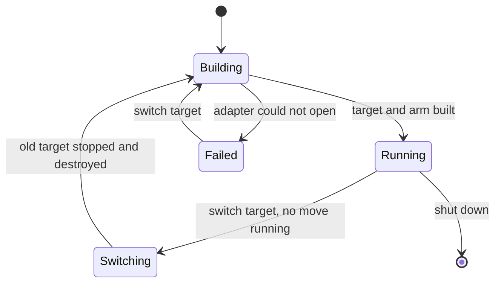
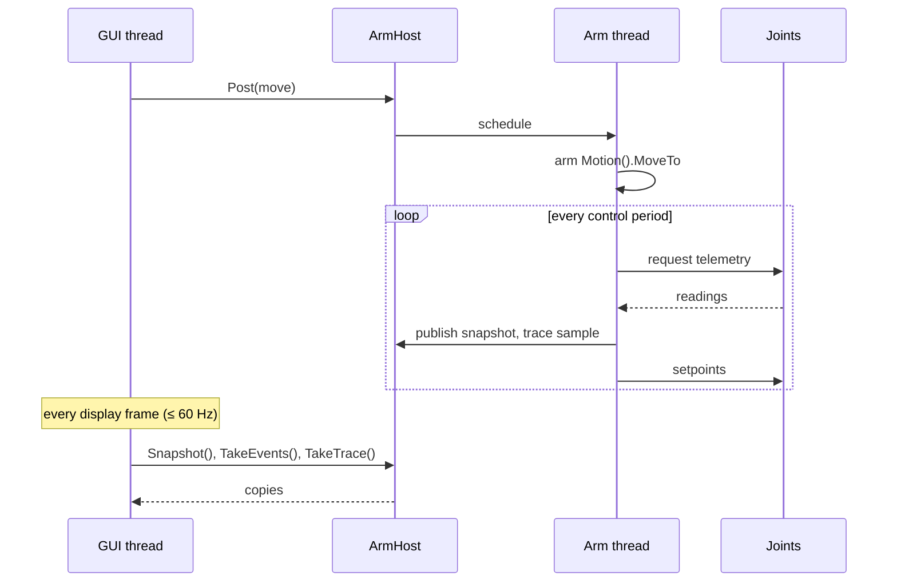
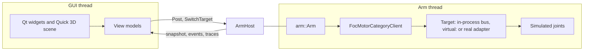

| Field     | Value            |
|-----------|------------------|
| Title     | Simulator Design |
| Type      | design           |
| Status    | draft            |
| Version   | 0.2.0            |
| Component | simulator        |
| Date      | 2026-11-12       |

> The e-robot-arm Simulator's components, threads, targets and data flow (phase 8a,
> [#28](https://github.com/embedded-pro/e-robot-arm/issues/28)). The screen itself — layout, controls, flows,
> look — is in [tool-simulator.md](tool-simulator.md). Behaviour only; diagrams are Mermaid.

---

## Responsibilities

**Is responsible for:**

- Running the arm stack of `core/` (`arm::Arm`: joint bus, safety supervisor, joint motion, control loop) on a PC
  against a selectable target: simulated joints, a `virtual:` CAN bus, or the real arm on a CAN adapter.
- Keeping the arm on its own thread, so neither rendering nor the operator can delay a control period.
- Handing the operator interface a consistent snapshot of the arm, its events and its traces, and taking its
  commands.
- Simulating joints in-process, with a first-order lag and fault injection, for work without hardware.

**Is NOT responsible for:**

- Any arm rule: whether a move is allowed, what trips the arm and when it may be re-armed are decided by `core/`.
  The simulator shows the answer and its reason.
- Motor physics: the in-process joints follow their setpoint through a lag. Motor dynamics come with e-foc virtual
  motors (phase 7, [#23](https://github.com/embedded-pro/e-robot-arm/issues/23)) on the `virtual:` target.
- The arm's geometry and kinematics: phase 8a draws a generic six-joint arm; phase 3
  ([#19](https://github.com/embedded-pro/e-robot-arm/issues/19)) supplies the arm model.

---

## Component Details

### Part A — Libraries

| Library                                                   | Where                          | Qt  | Contents                                                                                                                                                     |
|-----------------------------------------------------------|--------------------------------|-----|--------------------------------------------------------------------------------------------------------------------------------------------------------------|
| `e_robot_arm.tool.simulated_arm`                          | `tools/simulated_arm/`         | no  | `VirtualCanBus`, `SimulatedJoint` (lag, fault, silence), `SimulatedArm` (six joints, one bus)                                                                |
| `e_robot_arm.tool.arm_host`                               | `tools/arm_host/`              | no  | `ArmHost`: the arm and its target on a thread; commands in; snapshot, events, traces out                                                                     |
| `e_robot_arm.tool.simulator.view_models`                  | `tools/simulator/view_models/` | no  | `SimulatorPresenter` (Operate and Move forms on `ui::model`, status, hints, log, pending requests), `ControlRules`, `JointRows`, `EventLog`, `ArmSceneModel` |
| `e_robot_arm.tool.simulator.app`, `e-robot-arm-simulator` | `tools/simulator/app/`         | yes | `SimulatorWindow` on `QtAppShell`, status strip, joint table, scope and log panels, the `Simulator` QML module (`ArmSceneState` and the scene)               |

The integration tests and the console use `simulated_arm` and `arm_host` too, so the simulator, the console and the
scenarios run the same host code. Everything below the Qt glue is tested without Qt.

### Part B — Threads

Two threads, never more for the arm:

1. **Arm thread.** EMIL's event loop (`EventDispatcherThreadAware`, `TimerServiceGeneric`), the CAN adapter or the
   in-process bus, the simulated joints and `arm::Arm`. Every `core/` call happens here.
2. **GUI thread.** Qt's event loop, the view models and the widgets. It never calls into `core/`.

They meet in `ArmHost` only:

- **Commands** go in through `ArmHost::Post`, which schedules a closure on the arm thread's dispatcher (EMIL's
  `Schedule` is safe from any thread). It returns at once.
- **State** comes out through a snapshot that the arm thread publishes after each telemetry phase and the GUI copies
  at display rate, under one mutex held only for the copy.
- **Events and traces** come out through two bounded queues, filled on the arm thread and drained by the GUI each
  frame. A full queue drops its oldest entry and counts the drop; the arm thread never waits.

### Part C — Targets

| Target           | CAN                                                  | Joints                                         | When                                    |
|------------------|------------------------------------------------------|------------------------------------------------|-----------------------------------------|
| Simulated joints | In-process `VirtualCanBus`                           | Six `SimulatedJoint`s on the arm thread        | Default; no hardware, no other process  |
| Virtual bus      | can-lite `virtual:<bus>`, hosting or joining the hub | Whatever joins: e-foc virtual motors (phase 7) | Virtual motors in other processes       |
| Real arm         | can-lite `socketcan:<if>` or `slcan:<port>`          | The real e-foc nodes                           | Hardware; distinct banner, confirmation |

A target switch builds everything anew; nothing carries over:

1. It is refused while a move is running, with that reason.
2. The control loop stops, every joint of the old target is sent Stop, and the host waits until the transmit queue
   drains or 100 ms pass.
3. The arm, its client and the adapter are destroyed; the new target, client and arm are built.
4. The new arm starts stopped, untripped and with its contracts unchecked.

### Part D — Simulated joints

A `SimulatedJoint` is an e-foc node on the in-process bus (a `FocMotorCategoryServer`), moved from
`integration_tests/support/`. It accepts every command the arm sends, answers telemetry, and:

- **Follows its setpoint through a first-order lag** with time constant τ. The position advances when telemetry is
  requested, from the time since the last update: `θ ← θ* + (θ − θ*)·e^(−Δt/τ)`, and its speed reads
  `(θ* − θ)/τ`. τ = 0 follows exactly, which is what the scenarios use. The simulator uses τ = 50 ms.
- **Takes injected failures:** `Fault(code)` reports a fault in its next telemetry, `Silence()` stops answering.
  The simulator offers both per joint, on the simulated target only.

### Part E — Arm host

`ArmHost` owns the arm thread and, on it, the target and the arm. Its operator-facing surface:

| Operation              | Effect                                                                                                                                                                     |
|------------------------|----------------------------------------------------------------------------------------------------------------------------------------------------------------------------|
| `Post(command)`        | One of: check contracts, select position mode, start, stop, clear faults, emergency stop, re-arm, move, abort, inject fault, silence joint. Its result arrives as an event |
| `SwitchTarget(target)` | Part C; its result arrives as an event                                                                                                                                     |
| `Snapshot()`           | A copy of the latest snapshot                                                                                                                                              |
| `TakeEvents()`         | Every event since the last call, in order                                                                                                                                  |
| `TakeTrace()`          | Every trace sample since the last call, in order                                                                                                                           |

It is built in layers, each tested on its own:

| Layer             | Thread    | Does                                                                                                |
|-------------------|-----------|-----------------------------------------------------------------------------------------------------|
| `ArmRequestQueue` | any       | Holds posted requests in order; an emergency stop goes ahead of everything queued                   |
| `ArmHost`         | owns both | The arm thread with EMIL's event loop and timer service; turns each post into one queued request    |
| `ArmRuntime`      | arm       | Opens the target through a `TargetOpener`, owns the session, switches targets (Part C)              |
| `ArmSession`      | arm       | The FOC motor client and `arm::Arm` on one target link; runs commands; publishes snapshot and trace |
| `ArmMailbox`      | any       | The snapshot under a mutex and the two bounded queues; numbers the snapshots                        |

Every command answers with exactly one event, `accepted` or `refused` with a reason, carrying the id `Post`
returned. Until phase 1 makes a command reach all joints or none
([#17](https://github.com/embedded-pro/e-robot-arm/issues/17)), a command posted while the control loop's burst
fills the CAN transmit queue is refused by the joint bus. The session therefore retries a refused bus command every
millisecond for up to 20 attempts before reporting it refused. Only idempotent commands are retried: check
contracts, select mode, start, stop, clear faults and emergency stop. A joint that already received one receives
it again, harmlessly.

The console runs on `ArmHost` too ([arm-console.md](arm-console.md)): it posts each typed command and waits for its
answer.

### Part F — Snapshot, events and traces

The snapshot is what the screen shows; events are what the log shows; traces are what the scopes plot.

- **Snapshot** — published once per control period, with a sequence number so the GUI can tell a stale copy.
- **Events** — command accepted or refused (with its id, its name and the reason), contracts resolved, joint fault,
  joint silent, tripped (with the joint and the fault that caused it, once per trip), move done, move aborted, target
  ready, target failed; each with the arm-thread time.
- **Trace samples** — one per control period: the time, the six commanded positions and the six measured positions.

The commanded positions are joint motion's last sampled setpoint. Joint motion gains a read-only accessor for it
(`JointMotion::Setpoint()`, empty when no move has run); nothing else in `core/` changes for the simulator.

### Part G — The Qt application

- **Frame.** A 16 ms `QTimer` on the GUI thread takes the snapshot, the events and the trace from `ArmHost`,
  refreshes the presenter, then the widgets and the scene state. Nothing on the GUI thread waits for the arm thread
  beyond the snapshot copy.
- **Scene.** `ArmScene.qml` (environment, lights, floor, camera, picking) shows two `ArmModel`s, the measured arm and
  the ghost, built from `ArmPart` and `ArmHousing`. The scene reads one C++ object, the `ArmSceneState` singleton of
  the `Simulator` QML module, which the window updates once per frame. Qt Quick 3D renders only when something
  changes, so an arm at rest costs no frames.
- **Light probe.** `assets/studio.hdr` is generated by `assets/generate-studio-probe.py` (two soft boxes, an
  overhead panel, grey horizon, dark floor), so the asset carries no third-party licence.
- **Qt 6.4.** The dev container has Qt 6.4.2:
  - ambient occlusion is on whenever `aoStrength` is above 0, because `aoEnabled` arrives in 6.5;
  - `shadowBias` is a fraction in 6.4 and a distance from 6.5 on, so the scene leaves it at its default;
  - a `QML_SINGLETON` that is default-constructible is created by the engine, which ignores the static `create()`.
    `ArmSceneState` therefore has no default constructor.
- **Window test.** `e_robot_arm.tool.simulator_window_test` opens the window on simulated joints, brings the arm up,
  moves it, captures a frame mid-move (`SIMULATOR_FRAME_CAPTURE=<path>.png` saves it and the whole window), prints
  the frame rate while moving as `[METRIC]` lines, and checks that an injected fault trips the arm with its source.
  It needs a display: `xvfb-run` with Mesa in CI. It carries the `display` label, which the `host-qt` test preset
  leaves out.

---

## Interfaces

### Provided

| Interface      | Purpose                                 | Contract                                                       |
|----------------|-----------------------------------------|----------------------------------------------------------------|
| `ArmHost`      | The arm on its own thread               | Thread-safe; never blocks the caller beyond one snapshot copy  |
| View models    | Everything the screen shows and enables | GUI thread only; no Qt; tested with ui-cpp's recording backend |
| `SimulatedArm` | Six in-process e-foc joints on one bus  | Arm thread only                                                |

### Required

| Interface                          | Purpose                     | Contract                                           |
|------------------------------------|-----------------------------|----------------------------------------------------|
| `arm::Arm`                         | The arm stack               | Unchanged, plus `JointMotion::Setpoint()`          |
| can-lite `PlatformCanAdapter`, hub | Virtual and real targets    | `virtual:`, `socketcan:`, `slcan:`                 |
| ui-cpp (`infra/ui-cpp`)            | Shell, forms, scopes, theme | Tier 1 always built; Qt backend with the simulator |
| Qt 6 Widgets, Quick, Quick 3D      | Window, 3-D view            | Qt ≥ 6.4; 6.5+ features behind version guards      |

---

## Data Model

| Entity          | Field                 | Type / Unit                         | Range                 | Notes                                   |
|-----------------|-----------------------|-------------------------------------|-----------------------|-----------------------------------------|
| Snapshot        | sequence              | count                               | —                     | Increments per publish                  |
| Snapshot        | target                | simulated, virtual, real + name     | —                     | Name: bus or adapter                    |
| Snapshot        | readings              | 6 × (rad, rad/s, state, fault)      | —                     | Empty until the joint first answers     |
| Snapshot        | commanded             | 6 × rad, optional                   | Joint limits          | Joint motion's last setpoint            |
| Snapshot        | joint liveness        | 6 × answered, silent                | —                     | From the joint bus                      |
| Snapshot        | contracts             | unchecked, compatible, incompatible | —                     | Per joint                               |
| Snapshot        | tripped, moving, loop | bool                                | —                     |                                         |
| Event queue     | capacity              | events                              | 512                   | Oldest dropped when full; drops counted |
| Trace queue     | capacity              | samples                             | 1024 (10 s at 100 Hz) | Oldest dropped when full; drops counted |
| Simulated joint | τ                     | s                                   | ≥ 0                   | 0 follows exactly; simulator 0.05       |

---

## State Machine

---

## Sequence Diagrams

---

## Block Diagram

---

## Constraints & Limitations

| Constraint | Value / Description                                                                              |
|------------|--------------------------------------------------------------------------------------------------|
| Timing     | Event-loop timers on a desktop OS: periods jitter with scheduling; real-time comes with phase 9  |
| Memory     | Host tools may allocate; `core/` stays heap-free; the queues are bounded                         |
| Bus        | Phase 1 adds bus load and overrun counts to the snapshot; until then the status shows "—"        |
| Lifecycle  | No arm lifecycle until phase 1; the controls follow the joints' states and the safety supervisor |

---

## Open Questions

| # | Question                                               | Options                                                  | Status            |
|---|--------------------------------------------------------|----------------------------------------------------------|-------------------|
| 1 | Whether the simulated joints should model speed limits | Lag only (8a), virtual motors for dynamics (phase 7)     | decided: lag only |
| 2 | A status-coloured read-only joint table in ui-cpp      | ui-cpp `ui::model` read-out table with a status per cell | open              |
