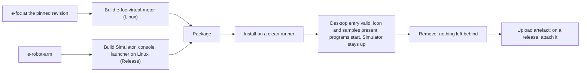

| Field     | Value           |
|-----------|-----------------|
| Title     | Tool Installers |
| Type      | design          |
| Status    | draft           |
| Version   | 0.2.1           |
| Component | tool-installers |
| Date      | 2026-11-23      |

> How the host tools reach a computer that has no build tree: one installer per platform holding the simulator,
> the console and the e-foc virtual motor, built and install-tested on every pull request and attached to every
> release, so the simulator can later find and install its own updates.

---

## Responsibilities

**Is responsible for:**

- one package per platform with every program an operator or control engineer needs on a desk: the e-robot-arm
  Simulator, the console, the virtual arm launcher and the e-foc virtual motor the Virtual arm target starts;
- a desktop entry and icon, so the Simulator starts from the system's menu;
- asset names a release feed can find by suffix alone;
- installing, starting and removing each package on a clean runner before it is published.

**Is NOT responsible for:**

- the update check and its banner in the Simulator ([tool-simulator.md](tool-simulator.md) Part T);
- firmware images, which the release builds and attaches on their own, and only for the applications listed in
  `FIRMWARE_APPLICATIONS` (none yet; [targets/README.md](../../targets/README.md));
- the e-foc virtual motor's own behaviour: it is built unchanged from the e-foc revision the virtual arm scenarios
  pin.

---

## Component Details

### Part A — Contents and names

| Program                   | What it is                                                                                          |
|---------------------------|-----------------------------------------------------------------------------------------------------|
| `e-robot-arm-simulator`   | The e-robot-arm Simulator ([tool-simulator.md](tool-simulator.md)), with its desktop entry and icon |
| `e-robot-arm-console`     | The text console ([arm-console.md](arm-console.md))                                                 |
| `e-robot-arm-virtual-arm` | Starts six e-foc virtual motors from a profile ([virtual-arm.md](virtual-arm.md))                   |
| `e-foc-virtual-motor`     | e-foc's headless virtual motor, which the Virtual arm target and the launcher start, one per joint  |

The launcher and the virtual motor are in the Linux package only (Part C).

Both installers also hold the sample meshed arm ([tool-simulator.md](tool-simulator.md) Part E): a profile and seven
glTF meshes in `share/e-robot-arm/samples/meshed-arm/` on Linux and `samples\meshed-arm\` on Windows.

The package is called `e-robot-arm` and installs every program in the same directory, on the system path on Linux,
so the Simulator's default engine, `e-foc-virtual-motor`, resolves without asking. Release assets are named
`e_robot_arm-tools-<tag>-linux-x86_64.deb` and `e_robot_arm-tools-<tag>-windows-x86_64-setup.exe`; a release
carries exactly one of each, which is how an update check picks its installer.

### Part B — Linux package

A Debian package built on the runner's Ubuntu, so its library dependencies are the ones that system resolves. The
Simulator loads Qt Quick 3D's QML modules at run time, which no linker sees, so the package depends on them by name
beside the shared libraries the build finds, accepting either of the names Ubuntu has given them
(`qml6-module-qtquick3d` and the older `qml6-module-quick3d`). It installs the programs under the system binaries,
the desktop entry under the applications directory and the icon in the scalable and 256 × 256 hicolor themes.

### Part C — Windows setup

A per-machine NSIS setup, built with MSVC and Qt from the Qt online installer, holding the Simulator and the console
with the Qt runtime, the Qt Quick 3D QML modules the scene imports and the Visual C++ runtime deployed beside them; a
Start menu and desktop shortcut for the Simulator; and an uninstaller. The Simulator is a GUI-subsystem program, so
it opens no console window, and its icon is a resource in the executable. It leaves out the virtual arm launcher and the
e-foc virtual motor: the launcher starts motor processes and opens their plant ports with POSIX calls, so the Virtual
arm target exists on Linux only ([virtual-arm.md](virtual-arm.md)). On Windows the Simulator drives simulated joints,
a `virtual:` bus another program hosts, or the real arm through a PCAN, Kvaser, gs_usb or slcan adapter.

### Part D — Build and install test

The same workflow runs on every pull request and on a release, so a release never publishes a package the pull
requests did not build and install. On Linux the Simulator is started under a virtual display with software
rendering; on Windows it starts on the runner's desktop; on both it must still be running after ten seconds, and the
console must report the six joints. On Windows the Simulator then closes through its window, so it saves its settings,
and starts a second time with the sample meshed arm as its last profile: a crash that only a saved state causes fails
the run. Each Windows run prints the Simulator's log, and a failed run uploads the log folder with any crash dump.

A release attaches whatever its build jobs produced even when one of them fails, so a broken host package or
firmware build never holds back the installers; the failed job still marks the release run red.

---

## Interfaces

### Provided

| Interface             | Purpose                      | Contract                                                                          |
|-----------------------|------------------------------|-----------------------------------------------------------------------------------|
| Linux release asset   | Install or update on Ubuntu  | Name ends `-linux-x86_64.deb`; installs and removes cleanly; the Simulator starts |
| Windows release asset | Install or update on Windows | Name ends `-windows-x86_64-setup.exe`; silent install and uninstall work          |

### Required

| Interface             | Purpose                      | Contract                                                            |
|-----------------------|------------------------------|---------------------------------------------------------------------|
| e-foc source          | Builds `e-foc-virtual-motor` | The revision the virtual arm scenarios pin, so both test one engine |
| Qt 6 with Qt Quick 3D | The Simulator's runtime      | From the distribution on Linux; deployed into the setup on Windows  |

---

## Constraints & Limitations

- The package version is the project's version, which release-please sets; pull-request builds carry it too.
- The engine is e-foc's, rebuilt here: a change to the pinned revision changes what the package ships.
- Unsigned on both platforms until a signing certificate exists.
