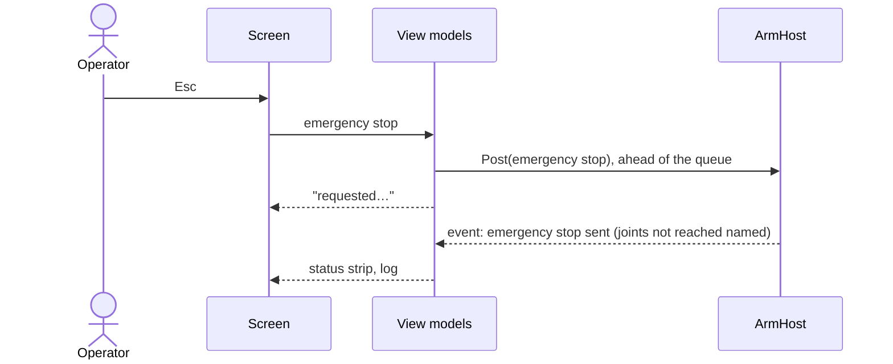

| Field     | Value                   |
|-----------|-------------------------|
| Title     | Simulator Screen Design |
| Type      | design                  |
| Status    | draft                   |
| Version   | 0.13.0                  |
| Component | tool-simulator          |
| Date      | 2026-11-12              |

> What the e-robot-arm Simulator shows, what each control does and when, and how it looks (phase 8a,
> [#28](https://github.com/embedded-pro/e-robot-arm/issues/28)). Components and threads are in
> [simulator.md](simulator.md). Written to the `ux-ui-expert` and `qt-3d-gui` skills.

---

## Responsibilities

**Is responsible for:**

- Showing, without the operator moving: the target, the connection, each joint's state, trips with their source,
  the arm in 3-D with its commanded ghost, and the emergency stop.
- Offering each arm operation only when `core/` would accept it, and saying why when it would not.
- Plotting commanded against measured position, and keeping a log that can be saved.

**Is NOT responsible for:**

- Deciding any arm rule. The enable rules below mirror `core/`'s preconditions so a control can say why it is
  disabled; `core/` still decides, and a refusal is reported in the log and the status area.
- Configuration of controllers, motor controllers and motors: phase 8b
  ([#29](https://github.com/embedded-pro/e-robot-arm/issues/29)).
- Jogging and real geometry: phase 8c ([#30](https://github.com/embedded-pro/e-robot-arm/issues/30)).

---

## Component Details

### Part A — Layout

Default layout at 1600 × 900, instrument (dark) theme. Every panel is a dock and can be moved; **View → Reset
Layout** restores this one.

```text
┌ e-robot-arm Simulator — Simulated joints ────────────────────────────────────────────────────────────┐
│ File  Arm  Simulation  View  Help                                                                     │
├───────────────────────────────────────────────────────────────────────────────────────────────────────┤
│ Target [Simulated joints ▾]  ● Enabled   Contracts: compatible   Trip: —          ┌────────────────┐ │
│                                                                                    │ EMERGENCY STOP │ │
│                                                                                    │      Esc       │ │
├──────────────────────────────────────────────────────────────┬─────────────────────┴────────────────┤
│ ⚠ Near wrist singularity                                     │ Joints                                │
│                                                              │  #  Position  Speed  Gravity  State … │
│                                                              │  1  0.000 rad 0.00 rad/s 0.00 N·m Run │
│                    3-D arm view                              │     ▕────●───────────▏ limit bar      │
│     measured arm, commanded ghost, floor with shadows        │  …  (joints 2–6)                      │
│                                                              ├──────────────────────────────────────┤
│                                                              │ Tool                                  │
│                                                              │  Position  x 0.020 y 0.000 z 0.710 m  │
│                                                              │  Rotation  roll 0.000 pitch 0.000 yaw │
│                                                              │  Manipulability 1.23e-03  Singular: — │
│                                                              ├──────────────────────────────────────┤
│                                                              │ Operate                               │
│   [Front] [Side] [Top] [Iso] [Frame]       camera presets    │  [Bring Up] [Enable] [Disable]        │
│                                                              │  [Clear Faults]          [Re-arm…]    │
│                                                              │                                       │
│                                                              ├──────────────────────────────────────┤
│                                                              │ Move                                  │
│                                                              │  J1 [  0.000] rad  …  J6 [ 0.000] rad │
│                                                              │  [Move]                     [Abort]   │
├──────────────────────────────────────────────────────────────┴──────────────────────────────────────┤
│ Scope  Joint [1 ▾]  ─ commanded ─ measured ─ error  [Run/Hold] Trigger: on trip   │ Event log [filter]│
└───────────────────────────────────────────────────────────────────────────────────────────────────────┘
```

- **Status strip** (top, not a dock, cannot be hidden): target selector, connection, the arm's state, contracts,
  the last trip with its source, the overrun count, and the emergency stop at the far right, apart from every other button.
  - **Connection** reads Connected, Disconnected, or **No data from the arm** (`Warning`) when the snapshot has not
    changed for 30 frames (half a second): a stalled arm thread is never shown as live.
  - **Arm state** is the lifecycle's state ([arm-lifecycle.md](arm-lifecycle.md)) as the snapshot reports it:
    Disconnected and Unpowered (`Neutral`), Checking contracts…, Contracts incompatible (`Fault`), **Waiting for
    calibration: J2, J5** (`Warning`, naming every joint not yet ready), Ready, Enabling…, Enabled (`Ok`), Moving
    (`Ok`), Disabling…, Tripped (`Fault`).
  - **Overruns** shows the control loop's count of late phases ([control-loop.md](control-loop.md) Part C):
    `Neutral` at 0, `Warning` from the first one, with a tooltip saying what it counts.
- **Silent joints:** a joint that stopped answering shows **Silent** at `Fault` level, with position and speed as
  "—", until it answers again; its last values are never shown as live.
- **Real-arm banner:** on the real target a full-width strip under the menu reads **REAL ARM — `<adapter>`** in the
  theme's `Warning` colour with an icon, and the window title gains the same text. It cannot be hidden.
- **Centre:** the 3-D view (Part E).
- **Right:** one scrollable **Arm** dock with four groups: Joints (the table and a limit bar per joint), Tool
  (Part K), Operate and Move.
- **Bottom:** scope and event log, side by side.

### Part B — Controls and their states

Every disabled control carries its reason: in a hint under its group, one line per disabled control, and as a
tooltip on the status strip's controls. "Connected" means
the target is built and at least one joint has answered. Joints are numbered 1–6, base first.

| Control          | Enabled when                                                                     | Disabled reason shown                                                                                                                                                                                      | Action                                                                   |
|------------------|----------------------------------------------------------------------------------|------------------------------------------------------------------------------------------------------------------------------------------------------------------------------------------------------------|--------------------------------------------------------------------------|
| Emergency stop   | A target is built                                                                | "No target"                                                                                                                                                                                                | Emergency stop to all joints, ahead of all else                          |
| Bring Up         | Connected; the arm is Unpowered, Misconfigured or its contracts are incompatible | "Not connected", "Checking contracts", "Tripped: re-arm first", "Already brought up"                                                                                                                       | Lifecycle: check the contracts, wait for calibration                     |
| Enable           | The arm is Ready                                                                 | "Bring the arm up first", "Checking contracts", "Waiting for calibration", "Configuring motor controllers", "Misconfigured: bring the arm up again", "Enabling", "Already enabled", "Disabling", "Tripped" | Lifecycle: select position mode, start the joints                        |
| Disable          | The arm is Enabled                                                               | "Moving: abort first", "Not enabled"                                                                                                                                                                       | Lifecycle: stop the joints                                               |
| Clear Faults     | Any joint in fault                                                               | "No joint in fault"                                                                                                                                                                                        | Clear faults on all joints                                               |
| Re-arm…          | The arm is Tripped, no joint in fault                                            | "Not tripped", "Joint N in fault: clear it first"                                                                                                                                                          | Confirmation naming the trip's source, then re-arm through the lifecycle |
| Move target J1–6 | Always editable                                                                  | —                                                                                                                                                                                                          | Validated as typed against the joint limits                              |
| Move             | The arm is Enabled, all targets valid                                            | "Not connected", "Tripped", "Moving", "Enable the arm first", "J N outside limits"                                                                                                                         | Move to the six targets through the lifecycle                            |
| Abort            | A move running                                                                   | "No move running"                                                                                                                                                                                          | Abort the move                                                           |
| Target selector  | No move running                                                                  | "Moving"                                                                                                                                                                                                   | Part C                                                                   |

- **Arm → Single Step** holds the joints' own commands for debugging: Check Contracts (connected, no move
  running), Position Mode and Start (contracts compatible, not tripped), Stop (any joint running). A disabled item
  shows its reason in the status bar when hovered. The lifecycle follows where they leave the arm.
- A clicked action shows "requested…" in the status strip within 100 ms and is replaced by the result event.
- Spin boxes have keyboard tracking off; Enter in a target field does not move — only **Move** or Ctrl+Enter does.
- Nothing is enabled by a past click: every rule reads the latest snapshot.

### Part C — Flows

**Launch.** The last target, layout, camera and theme are restored. The simulated target never auto-starts the
joints. A remembered real target is not reconnected on launch: the simulator opens on simulated joints and the
selector shows the real adapter as the last used.

**Choose a target.** The selector lists *Simulated joints*, *Virtual bus…* (asks for the bus name) and *Real arm…*
(asks for the adapter, `socketcan:<interface>` or `slcan:<port>`; the last one used is offered). The switch shows
"Switch to … requested…" and then "done" or "failed: <reason>" in the status bar. Choosing *Real arm*
opens a confirmation: "Connect to the real arm on `<adapter>`? Joints start stopped." with **Connect** and
**Cancel** (default). A failed adapter is logged as a fault with its reason, and the arm returns to the previous
target.

**Bring up and move.** Bring Up → the arm waits for calibration, naming the joints not ready (calibration is done on
the node) → Configuring motor controllers, when the arm's configuration names any → Ready → Enable → Enabled → set
targets → Move. A motor controller that cannot be applied or reads back different shows **Misconfigured: `<joint>`
`<reason>`** in `Fault`, and Bring Up starts again. The ghost shows the commanded arm while moving; the scope
shows the selected joint. Disable stops the joints and returns the arm to Ready.

**Trip and recover.** On a trip the status strip shows **Tripped — `<source>`** in `Fault`, the joint table marks
the joint, the log records it, and the scope triggers. Clear Faults, then Re-arm…, whose confirmation names the
source. Re-arm returns the arm to Waiting for calibration, then (configuring the joints again) Ready; Enable starts it
again.

**Inject a failure** (simulated target only). **Simulation → Inject Fault → Joint N** or **Silence Joint N**.

### Part D — Keyboard

| Key           | Action                                                                                                                                             |
|---------------|----------------------------------------------------------------------------------------------------------------------------------------------------|
| Esc           | Emergency stop from every window, modal dialogs included: an application event filter sees the key before any dialog, and the dialog still cancels |
| Ctrl+Enter    | Move                                                                                                                                               |
| Ctrl+.        | Abort                                                                                                                                              |
| 1 / 2 / 3 / 4 | Camera front, side, top, iso (3-D view focused)                                                                                                    |
| F             | Frame the arm (3-D view focused)                                                                                                                   |
| Ctrl+S        | Save the event log                                                                                                                                 |
| Ctrl+Shift+R  | Reset layout                                                                                                                                       |

### Part E — 3-D view: look

Qt Quick 3D in a `QQuickWidget`, scene in QML, following the `qt-3d-gui` skill:

- **Environment:** theme background colour; image-based lighting from a small studio HDR probe
  (`probeExposure` 0.8); filmic tone mapping; MSAA High; specular antialiasing; ambient occlusion (strength 55,
  distance 5 cm, softness 40).
- **Lights:** key directional light at 50° elevation, 35° left of the camera, casting shadows at very high
  shadow-map quality, shadow factor 70, soft filter; fill at 0.3 from the right, low; rim at 0.5 from behind, high.
- **Floor:** 3 m × 3 m matte light grey (roughness 0.9) receiving shadows, with a faint 10 cm grid.
- **Arm** (phase 8c): built from the profile's geometry ([arm-model.md](arm-model.md) Part A), so the arm on
  screen is the arm the model computes. The arm model gives each link's frame at the measured (or commanded)
  joints, base mount included ([arm-model.md](arm-model.md) Part B); each link is drawn in its frame from
  primitives sized by the OPW lengths, with a thickness $R$ of 15 % of the longer of c2 and c3, between 1.5 and
  8 cm:

  | Link           | Parts, in the link's frame                                           | Material                               |
  |----------------|----------------------------------------------------------------------|----------------------------------------|
  | Base (fixed)   | Pedestal, Ø 2.8R, from the floor to a quarter of c1                  | Cast: #3c4043, metal 0.6, rough 0.55   |
  | 1, turret      | Housing on J1; column Ø 2R up to c1; arm (a1, b) across to J2        | Painted: theme accent, rough 0.4       |
  | 2, upper arm   | Housing across J2; beam 1.2R square from J2 to J3 (c2)               | Anodised housing, painted beam         |
  | 3, forearm     | Housing across J3; beam 1.1R square over a2, then up c3 to the wrist | Anodised housing, painted beam         |
  | 4, wrist roll  | Cylinder Ø 1.1R along J4, ending at the wrist centre                 | Anodised: #9aa0a6, metal 1, rough 0.35 |
  | 5, wrist pitch | Housing Ø 1R across J5 at the wrist centre                           | Anodised                               |
  | 6, flange      | Stem Ø 0.6R from the wrist centre to the flange (c4), disc Ø 1.2R    | Rubber cap #1d1f21                     |

  Joint axes follow the model: J1, J4 and J6 along z of their links, J2, J3 and J5 along y. Every pose is
  converted once from the model's frame (Z-up, metres) to the scene's (Y-up, centimetres):
  $(x, y, z) \mapsto 100\,(x, z, -y)$. The parts are rebuilt only when the geometry changes (a profile is loaded);
  each frame moves the seven link nodes.
- **Ghost arm:** the same nodes, accent colour, opacity 0.3, blended, no depth write; visible only while a move
  runs or the commanded and measured arms differ by more than 0.5°.
- **Link meshes** (phase 8c): a link whose profile names a mesh ([arm-profile.md](arm-profile.md) Part A) draws
  that glTF file instead of its generated parts, loaded at run time with its own materials.
  - **Frame:** the mesh is in its link's frame, as the arm model defines it: Z up, metres, origin at the joint
    (export from CAD with +Z up). The base mesh is in the base frame.
  - **Budget:** at most 50 000 triangles per mesh, counted from the file's index (or position) accessors before
    loading. A larger mesh is not loaded: decimate it.
  - **Fallback:** a file that is missing, unreadable, over budget or fails to load leaves the link's generated
    parts in place, and the event log names the link and the reason, once per profile load.
  - **Selection and faults** stay visible on a meshed link: its joint housing is drawn over the mesh, translucent,
    while the joint is selected or faulted.
  - The ghost arm keeps the generated parts.
- **Tool triad** (phase 8c): three thin bars at the tool centre point along the tool frame's axes, x red, y green,
  z blue (the usual robotics convention, unlit so they read in both themes), each 12 % of the arm's height long. It
  follows the measured arm; the ghost has none.
- **Tool trail** (phase 8c): a line through the tool centre point's recent positions, in the accent colour. A
  point is added when the tool has moved 2 mm from the last one, and the trail keeps the newest 500 points, so its
  memory and drawing cost are bounded. It is a one-pixel line strip: Qt 6.4 has no line width. It is cleared when a profile changes the geometry and while the arm is not
  live (no target, or a joint silent), so it never joins positions of two different arms.
- **Selection:** clicking a part selects its joint (in the table too, both ways); its housing's emissive rises in
  the accent colour. A faulted joint's housing pulses in the `Fault` colour, and the table says it in text.
- **Camera:** perspective, 40° field of view, framed on the arm's height (the sum of its OPW lengths); orbit, pan,
  zoom; presets animate over 250 ms with ease-out.

### Part F — Scope and log

- **Scope** (`ui::scope::ScopeCore`, three channels): the selected joint's commanded and measured position and their
  difference, in rad, at the control period. Run and hold; trigger on a trip (normal mode, pre-trigger 1 s).
- **Log:** time, level (`Info`, `Warning`, `Fault`), joint (or "arm"), message. At most 10 000 lines, oldest dropped.
  Filter by level and joint; **File → Save Log…** writes plain text.

### Part G — Theme and type

ui-cpp's `Instrument` theme by default and `Light` from **View → Theme**; the 3-D background, floor and accent come
from the same theme roles. The platform UI font; tabular digits in every numeric cell; fixed precision per unit
(rad 3 decimals, rad/s 2). A 4 px grid: 8 px within a group, 16 px between groups. Status colours follow
`StatusLevel`; disconnected is `Neutral`; every colour has a text or icon alongside it.

### Part H — Motor Controller panel (phase 8b)

A **Motor Controller** dock, tabbed with the Arm dock, shows one joint's e-foc motor controller and applies it
through the joint configurator ([joint-configurator.md](joint-configurator.md)).

```text
┌ Motor Controller ─────────────────────────────────────┐
│ Joint [J3 ▾]          Mode (reported)  position       │
│ Current loop  [Sliding mode ▾]                        │
│   Bandwidth          [ 6283.19] rad/s                  │
│   Switching gain     [    0.20] A                      │
│   Boundary layer     [    0.50] A                      │
│ Speed loop    [LQI ▾]                                 │
│   Bandwidth          [  188.50] rad/s                  │
│   Error weight       [    1.00]                        │
│   Integral weight    [    0.10]                        │
│ Position loop [PID ▾]                                 │
│   Bandwidth          [   18.85] rad/s                  │
│ State: Verified                                       │
│ [Read] [Apply] [Verify] [Apply to All Joints]         │
└───────────────────────────────────────────────────────┘
```

- **Joint** follows the selection: picking a joint in the 3-D view or the joint table selects it here, and
  choosing it here selects it there. Joints are J1–J6.
- **Algorithms** are the contract's, one choice per loop. A loop shows only the gains its algorithm uses
  (joint-configurator.md Part A); the others keep their values and are still applied.
- **Gains** carry the contract's units and ranges; a value outside its range is refused as typed.
- **Mode** is reported by the joint and not editable: Enable selects one mode for all joints.

| Action              | Enabled when                           | Disabled reason shown          | Does                                                    |
|---------------------|----------------------------------------|--------------------------------|---------------------------------------------------------|
| Read                | The arm is Ready, no operation running | "Not ready: <state>", "Busy"   | Reads the joint's settings into the form                |
| Apply               | As Read                                | As Read                        | Applies the form to the joint                           |
| Verify              | As Read, and the form was applied      | As Read, "Nothing applied yet" | Reads the joint back and compares with what was applied |
| Apply to All Joints | As Read                                | As Read                        | Applies the form to J1 to J6, one after the other       |

The form's **state** is shown under the gains: **Read** (as the joint reported it), **Edited** (changed since),
**Applying…**, **Applied**, **Verified** (`Ok`, the joint reports exactly what was applied), **Differs** (`Fault`,
with every differing item listed in the hint, for example "Speed bandwidth: applied 150, joint reports 120"), or
**Failed** (`Fault`, with the reason). Selecting another joint reads it while the panel's tab is showing; a panel
behind another tab reads its joint when its tab is brought forward, so two panels never ask the joint configurator
at once.

### Part I — Profile panel and files (phase 8b)

A **Profile** dock, tabbed with the Arm and Motor Controller docks, shows the arm profile in effect
([arm-profile.md](arm-profile.md)) as the snapshot reports it. It is read-only: a profile is edited as a file and
loaded, so the file stays the single description of the arm.

```text
┌ Profile ─────────────────────────────────────────────────────────────────────────────┐
│ generic six-joint                                    /home/me/arms/bench.json        │
│ Control period 10 ms · Enable mode position · Silent after 3 · Command timeout 3      │
│ Joint Node Ratio Dir  Offset rad  Lower rad  Upper rad  Speed rad/s  Accel rad/s²  Motor controller │
│ J1      11  50.0  +      0.000     -3.142     3.142       1.000        2.000    PID / PID / LQR       │
│ J2      12   1.0  −      0.000     -1.571     1.571       1.000        2.000    node's own            │
│ …                                                                                     │
└──────────────────────────────────────────────────────────────────────────────────────┘
```

| Menu item            | Shortcut     | Enabled when      | Does                                                         |
|----------------------|--------------|-------------------|--------------------------------------------------------------|
| File → Open Profile… | Ctrl+O       | A target is built | Reads a profile file and loads it into the arm host          |
| File → Save Profile… | Ctrl+Shift+S | A target is built | Writes the profile in effect, under the name and path chosen |

**Open** reads the file first. A file that cannot be read or that the profile reader refuses shows one dialog with
the reader's message, which names the item (a broken profile blocks the task, so it is modal); nothing is loaded.
On the real arm a confirmation names the profile and the adapter and says that the arm is rebuilt and must be
brought up again. Loading rebuilds the arm on the same target ([simulator.md](simulator.md) Part E): it is refused
while the arm is enabling, enabled, moving or disabling, with that reason in the status bar and the log, and
otherwise the arm starts again unpowered and Bring Up configures the motor controllers the profile names. The Move
form's ranges follow the loaded limits. The path of the last profile opened or saved is kept and the profile is
loaded again on launch.

### Part J — Motor panel (phase 8b)

A **Motor** dock, tabbed with the others, shows one joint's motor ([joint-configurator.md](joint-configurator.md)
Part D) and applies it like the Motor Controller panel (Part H): same joint selection, same actions and enablement
(Read, Apply, Verify, Apply to All Joints, while the arm is Ready), same states.

```text
┌ Motor ───────────────────────────────────────────────┐
│ Joint [J3 ▾]     Preset [Teknic M-2310P-LN-04K ▾]    │
│ Motor model                                          │
│   Resistance          [   0.360] Ω                   │
│   Inductance          [   0.200] mH                  │
│   Pole pairs          [       4]                     │
│   Flux linkage        [   6.400] mWb                 │
│   Rotor inertia       [  70.600] g·cm²               │
│   Viscous friction    [  15.000] µN·m·s/rad          │
│   Coulomb friction    [   3.700] mN·m                │
│ Drive limits                                         │
│   Continuous current  [   7.100] A                   │
│   Peak current        [  20.000] A                   │
│   Peak-current time   [   1.000] s                   │
│   Overspeed limit     [ 754.000] rad/s               │
│ State: Verified · Custom: differs from Teknic in R   │
│ [Read] [Apply] [Verify] [Apply to All Joints]        │
└──────────────────────────────────────────────────────┘
```

- **Preset** lists e-foc's reference motors and **Custom**. Choosing a preset fills the eleven fields; editing a
  field turns the choice to Custom, and the hint names the preset it came from and every field that differs from it.
- **Fields** carry the display units of Part D and the contract's ranges; pole pairs is a whole number.
- Applying replaces what the node holds, its own identification included; the confirmation is the read-back
  (Verify).

### Part K — Tool read-outs and singularity warning (phase 8c)

The arm model's view of the measured arm ([arm-model.md](arm-model.md) Parts B and F), from each snapshot:

- **Joints table, Gravity column:** the torque each joint holds against gravity at the measured joints, `N·m`,
  two decimals.
- **Tool group** in the Arm dock, fixed-width digits:
  - **Position** x, y, z in `m`, three decimals, in the world frame (base mount included);
  - **Rotation** roll, pitch, yaw in `rad`, three decimals;
  - **Manipulability** |det J|, three significant digits in scientific notation, so its magnitude reads at a
    glance as the arm nears a singularity;
  - **Singularity:** "—", or the singularities the arm is near (wrist, elbow, shoulder) at `Warning` level.
- **Singularity warning** over the 3-D view, top left: "Near wrist singularity" (or elbow, shoulder, several
  joined by commas) on a `Warning` badge, hidden when the arm is near none. The text carries the meaning, not only
  the colour.
- Without a target, or while any joint is silent, every read-out shows "—" and the warning hides: the model of a
  stale arm is not shown as live.

---

## Interfaces

### Provided

| Interface  | Purpose         | Contract                                      |
|------------|-----------------|-----------------------------------------------|
| The screen | Operate the arm | Part B rules; emergency stop always reachable |

### Required

| Interface   | Purpose                              | Contract                            |
|-------------|--------------------------------------|-------------------------------------|
| View models | State, enable rules, reasons, values | [simulator.md](simulator.md) Part A |

---

## Data Model

| Entity       | Field                         | Type / Unit | Range            | Notes                                |
|--------------|-------------------------------|-------------|------------------|--------------------------------------|
| Move targets | J1–J6                         | rad         | The joint limits | Defaults ±π until the profile exists |
| Scope        | channels                      | rad         | —                | Commanded, measured, difference      |
| Log          | lines                         | count       | ≤ 10 000         | Oldest dropped                       |
| Settings     | target, layout, camera, theme | —           | —                | `QSettings`                          |

---

## State Machine

The Operate group follows the arm's lifecycle ([arm-lifecycle.md](arm-lifecycle.md)) as the snapshot reports it;
the screen keeps no state of its own. The lifecycle state decides which of its controls are enabled:

| Lifecycle state                                | Enabled in Operate and Move                              |
|------------------------------------------------|----------------------------------------------------------|
| Unpowered, Contracts incompatible              | Bring Up                                                 |
| Checking, Waiting for calibration, Configuring | —                                                        |
| Misconfigured                                  | Bring Up                                                 |
| Ready                                          | Enable                                                   |
| Enabling, Disabling                            | —                                                        |
| Enabled                                        | Disable, Move                                            |
| Moving                                         | Abort                                                    |
| Tripped                                        | Clear Faults (a joint in fault), Re-arm… (none in fault) |

The emergency stop is enabled in every state while a target is built.

---

## Sequence Diagrams



---

## Constraints & Limitations

| Constraint   | Value / Description                                                                                                                                                                            |
|--------------|------------------------------------------------------------------------------------------------------------------------------------------------------------------------------------------------|
| Frame rate   | 60 fps target at 1080p on an integrated GPU with the loop at 100 Hz; never below 30 fps                                                                                                        |
| Measured     | Mesa llvmpipe (software, 4 cores), Qt 6.4.2, 1600 × 900, MSAA High, shadows, AO, loop at 100 Hz: 9–11 fps while the arm moves, no frames while it rests. A GPU desktop is still to be measured |
| Qt           | 6.4.2 in the dev container; `ExtendedSceneEnvironment`, `InfiniteGrid`, `DebugView` only on 6.5+, guarded                                                                                      |
| Minimum size | 1280 × 720 at 100 %; no clipped text at 150 %                                                                                                                                                  |

---

## Open Questions

| # | Question                                                                                     | Options                                               | Status                                                             |
|---|----------------------------------------------------------------------------------------------|-------------------------------------------------------|--------------------------------------------------------------------|
| 1 | Esc as the emergency-stop key                                                                | Esc, a function key, a dedicated USB button too       | open                                                               |
| 2 | Joint-limit defaults before the arm profile exists                                           | ±π for every joint, per-joint guesses                 | decided: ±π                                                        |
| 3 | Default-role buttons (Check Contracts, Position Mode) draw flat in ui-cpp's Instrument theme | Give `ButtonRole::Default` a raised surface in ui-cpp | resolved: ui-cpp#24 gives Default buttons a raised fill and border |
| 4 | Naming every joint an emergency stop did not reach                                           | Per-joint delivery reports from the joint bus         | phase 1a (#17)                                                     |
| 5 | Bus load and period overruns in the status strip                                             | Control-loop overrun count, bus-load estimate         | overruns shown (phase 1d); bus load open                           |
| 6 | Marking a differing gain on its field rather than in the hint                                | A per-field status in ui-cpp forms                    | open: needs a ui-cpp primitive                                     |
| 7 | Editing a profile in the simulator                                                           | A profile editor form, a file edited outside          | decided: edited as a file, shown read-only                         |
