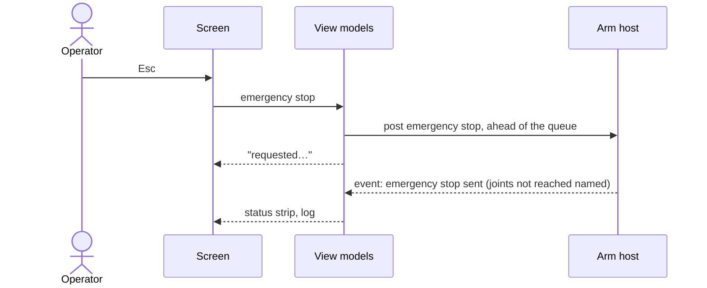

| Field     | Value                   |
|-----------|-------------------------|
| Title     | Simulator Screen Design |
| Type      | design                  |
| Status    | draft                   |
| Version   | 0.43.1                  |
| Component | tool-simulator          |
| Date      | 2026-11-26              |

> What the e-robot-arm Simulator shows, what each control does and when, and how it looks (phase 8a,
> [#28](https://github.com/embedded-pro/e-robot-arm/issues/28)). Components and threads are in
> [simulator.md](simulator.md). Written to the `ux-ui-expert` and `qt-3d-gui` skills.

---

## Responsibilities

- Showing, without the operator moving: the target, the connection, each joint's state and trips with their source.
  Also the arm in 3-D with its commanded ghost, and the emergency stop.
- Offering each arm operation only when the arm stack would accept it, and saying why when it would not.
- Plotting commanded against measured position, and keeping a log that can be saved.

---

## Component Details

### Part A — Layout

Default layout at 1600 × 900, instrument (dark) theme, Qt Fusion style on every platform. Every panel is a dock
and can be moved; **View → Reset Layout** restores this one.

```text
┌ e-robot-arm Simulator — Simulated joints ────────────────────────────────────────────────────────────┐
│ File  Arm  Simulation  View  Help                                                                     │
├───────────────────────────────────────────────────────────────────────────────────────────────────────┤
│ Target [Simulated joints ▾]  ● Enabled   Contracts: compatible   Stop: —          ┌────────────────┐ │
│                                                                                    │ EMERGENCY STOP │ │
│                                                                                    │      Esc       │ │
├──────────────────────────────────────────────────────────────┬─────────────────────┴────────────────┤
│ ⚠ Near wrist singularity                                     │ Joints                                │
│                                                              │  #  Position  Speed  Gravity  State … │
│                                                              │  1  0.000 rad 0.00 rad/s 0.00 N·m Run │
│                    3-D arm view                              │     ▕────●───────────▏ limit bar      │
│     measured arm, commanded ghost, floor with shadows        │  …  (joints 2–6)                      │
│                                                              ├──────────────────────────────────────┤
│                                                              │ Tool                                  │
│                                                              │  Position  x 0.020 y 0.000 z 0.710 m  │
│                                                              │  Rotation  roll 0.000 pitch 0.000 yaw │
│                                                              │  Manipulability 1.23e-03  Singular: — │
│                                                              ├──────────────────────────────────────┤
│                                                              │ Operate                               │
│   [Front] [Side] [Top] [Iso] [Frame]       camera presets    │  [Bring Up] [Enable] [Disable]        │
│                                                              │  [Clear Faults]          [Re-arm…]    │
│                                                              │                                       │
│                                                              ├──────────────────────────────────────┤
│                                                              │ Move                                  │
│                                                              │  J1 [  0.000] rad  …  J6 [ 0.000] rad │
│                                                              │  [Move]                     [Abort]   │
├──────────────────────────────────────────────────────────────┴──────────────────────────────────────┤
│ Scope  Joint [1 ▾]  ─ commanded ─ measured ─ error  [Run/Hold] Trigger: on trip   │ Event log [filter]│
└───────────────────────────────────────────────────────────────────────────────────────────────────────┘
```

- **Status strip** (top, not a dock, cannot be hidden): target selector, connection, the arm's state, contracts.
  Then the stop in effect with its category and source, the torque-limited joints and the overrun count.
  On the real arm it shows the limits in effect (Part P).
  The emergency stop sits at the far right, apart from every other button.
  - **Connection** reads Connected, Disconnected, or **No data from the arm** (`Warning`) when the snapshot has not
    changed for 30 frames (half a second). The strip never shows a stalled arm thread as live.
  - **Arm state** is the lifecycle's state ([arm-lifecycle.md](arm-lifecycle.md)) as the snapshot reports it:
    - Disconnected and Unpowered (`Neutral`), Checking contracts…, Contracts incompatible (`Fault`);
    - **Waiting for calibration: J2, J5** (`Warning`, naming every joint not yet ready);
    - Ready, Enabling…, Enabled (`Ok`), Moving (`Ok`), Disabling…, Tripped (`Fault`).
  - **Stop** names the stop in effect, from the snapshot ([simulator.md](simulator.md) Part F), with its category:
    - **Protective stop (category 2) — `<source>`: re-arm or disable** at `Warning` while the arm holds;
    - **Emergency stop (category 0) — `<source>`** at `Fault` once tripped;
    - **Stop: —** (`Neutral`) otherwise.
    - Its tooltip says what the category means.
      The joints stay powered and hold the pose, or every drive's power stage is off.
  - **Torque limited: J2, J3** (`Warning`) names the joints whose last torque was clamped to its limit
    ([safety.md](safety.md) Part B). The label stays for half a second after the last clamped period.
    So a clamp that comes and goes does not flicker. Otherwise the label is hidden.
  - **Overruns** shows the control loop's count of late phases ([control-loop.md](control-loop.md) Part C).
    It is `Neutral` at 0 and `Warning` from the first one, with a tooltip that says what it counts.
  - **Bus** shows the CAN bus load of the last second from the snapshot ([simulator.md](simulator.md) Part F).
    It reads **Bus: 43 %**: `Neutral` below 70 % and `Warning` from 70 %.
    It reads **Bus: —** until a first second has been measured.
    Its tooltip says what it counts: the frames the arm sent and received over the bitrate, without bit stuffing.
    So the real load is somewhat higher.
- **Torque-limited joints:** a joint whose torque is clamped reads **Running · torque limit** at `Warning`.
  The joint table shows it for as long as the status strip names the joint.
- **Silent joints:** a joint that stopped answering shows **Silent** at `Fault` level until it answers again.
  Its position and speed show "—": its last values are never shown as live.
- **Real-arm banner:** on the real target a full-width strip under the menu reads **REAL ARM — `<adapter>`**.
  It has the theme's `Warning` colour and an icon, and the window title gains the same text. It cannot be hidden.
- **Centre:** the 3-D view (Part E).
- **Right:** one scrollable **Arm** dock with four groups: Joints (the table and a limit bar per joint), Tool
  (Part K), Operate and Move.
- **Bottom:** scope and event log, side by side.

### Part B — Controls and their states

Every disabled control carries its reason. A hint under its group has one line per disabled control.
The status strip's controls show it as a tooltip. "Connected" means
the target is built and at least one joint has answered. Joints are numbered 1–6, base first.

| Control              | Enabled when                                                                           | Disabled reason shown                                                                                                                                                                                      | Action                                                                   |
|----------------------|----------------------------------------------------------------------------------------|------------------------------------------------------------------------------------------------------------------------------------------------------------------------------------------------------------|--------------------------------------------------------------------------|
| Emergency stop       | A target is built                                                                      | "No target"                                                                                                                                                                                                | Emergency stop to all joints, ahead of all else                          |
| Bring Up             | Connected; the arm is Unpowered, Misconfigured or its contracts are incompatible       | "Not connected", "Checking contracts", "Tripped: re-arm first", "Already brought up"                                                                                                                       | Lifecycle: check the contracts, wait for calibration                     |
| Enable               | The arm is Ready                                                                       | "Bring the arm up first", "Checking contracts", "Waiting for calibration", "Configuring motor controllers", "Misconfigured: bring the arm up again", "Enabling", "Already enabled", "Disabling", "Tripped" | Lifecycle: select torque mode, start the joints                          |
| Disable              | The arm is Enabled                                                                     | "Moving: abort first", "Not enabled"                                                                                                                                                                       | Lifecycle: stop the joints                                               |
| Clear Faults         | Any joint in fault                                                                     | "No joint in fault"                                                                                                                                                                                        | Clear faults on all joints                                               |
| Re-arm…              | The arm is Tripped or Holding, no joint in fault, hardware stop closed                 | "Not tripped or holding", "Joint N in fault: clear it first", "Hardware stop open: close it first"                                                                                                         | Confirmation naming the trip's source, then re-arm through the lifecycle |
| Move target J1–6     | Always editable                                                                        | —                                                                                                                                                                                                          | Validated as typed against the joint limits                              |
| Move                 | The arm is Enabled or Moving, all targets valid                                        | "Not connected", "Tripped", "Enable the arm first", "J N outside limits"                                                                                                                                   | Move to the six targets through the lifecycle; replaces a running move   |
| Abort                | A move running                                                                         | "No move running"                                                                                                                                                                                          | Abort the move                                                           |
| Target selector      | The arm does not drive its joints: not enabling, enabled, moving, disabling or holding | "Disable the arm first"                                                                                                                                                                                    | Part C                                                                   |
| Restart (motor)      | Virtual arm, arm not enabling, enabled, moving or disabling, motor not starting        | "Disable the arm first", "Starting"                                                                                                                                                                        | Restart that joint's virtual motor (Part L)                              |
| Commissioning Limits | Real arm, arm not enabling, enabled, moving or disabling                               | "Not the real arm", "Disable the arm first"                                                                                                                                                                | Arm menu toggle; off asks first (Part P)                                 |

- **Arm → Single Step** holds the joints' own commands for debugging:
  - Check Contracts (connected, no move running);
  - Torque Mode and Start (contracts compatible, not tripped);
  - Stop (any joint running).

  A disabled item shows its reason in the status bar when hovered. The lifecycle follows where they leave the arm.
- A clicked action shows "requested…" in the status strip within 100 ms and is replaced by the result event.
- Spin boxes have keyboard tracking off; Enter in a target field does not move — only **Move** or Ctrl+Enter does.
- Nothing is enabled by a past click: every rule reads the latest snapshot.

### Part C — Flows

**Launch.** The last target, layout, camera and theme are restored. The simulated target never auto-starts the
joints. The simulator does not reconnect a remembered real target on launch.
It opens on simulated joints, and the selector shows the real adapter as the last used.

**Choose a target.** The selector lists these targets:

- *Simulated joints*;
- *Virtual arm…*, which asks for the e-foc virtual motor binary (Part L);
- *Virtual bus…*, which asks for the bus name;
- *Real arm…*.

*Real arm…* opens the **Real Arm** dialog at once and meanwhile searches for the CAN adapters on this computer.
So the window never waits for the search. The arm host runs the search on the arm thread and hands the result back
([simulator.md](simulator.md) Part E). The dialog lists SocketCAN interfaces by name (`can0`).
It lists serial adapters as `slcan:<port>` (`slcan:/dev/ttyACM0`), never a virtual bus.
The last one used is selected, and it stays in the list when it is not detected now.
The field is editable for an adapter that is not listed.
Its label keeps the search's three outcomes apart, so a slow search never reads as an empty computer:

| Search             | Label                                                                                   | Search Again |
|--------------------|-----------------------------------------------------------------------------------------|--------------|
| Running            | Searching for CAN adapters on this computer… (the last adapter used is already offered) | Disabled     |
| Found adapters     | CAN adapter (detected on this computer, or type another):                               | Enabled      |
| Found none         | No CAN adapter detected: type one, for example can0 or slcan:/dev/ttyACM0               | Enabled      |
| Not done after 3 s | The adapter search did not finish in 3 s: type an adapter, or Search Again              | Enabled      |

A result that comes after the 3 s still fills the list. Cancel closes the dialog at any time, and a result that
comes after it is dropped. **Connect…** goes on to the confirmation below. The switch shows
"Switch to … requested…" and then "done" or "failed: <reason>" in the status bar. Choosing *Real arm*
opens a confirmation: "Connect to the real arm on `<adapter>`? Joints start stopped." with **Connect** and
**Cancel** (default). A failed adapter is logged as a fault with its reason, and the arm returns to the previous
target.

**Bring up and move.** The sequence is:

1. Bring Up. The arm waits for calibration and names the joints not ready. The node does the calibration.
2. Configuring motor controllers: every drive's watchdog, then the motors and motor controllers the configuration
   names.
3. Ready → Enable → Enabled → set targets → Move.

A drive watchdog, motor or motor controller can fail to apply or read back different.
It then shows **Misconfigured: `<joint>` `<reason>`** in `Fault`, for example "drive watchdog reads back different".
Bring Up then starts again. The ghost shows the commanded arm while moving; the scope
shows the selected joint. Disable stops the joints and returns the arm to Ready.

**Trip and recover.** On a trip the status strip shows **Emergency stop (category 0) — `<source>`** in `Fault`.
The source is the joint and its fault, silence, or the supervisor's reason.
An example is **Joint 2 (tracking error 0.214 rad)** ([safety.md](safety.md) Part F). The joint table marks the joint, the log records it, and the scope triggers. Clear
Faults, then Re-arm…, whose confirmation names the source. Re-arm returns the arm to Waiting for calibration, then
(configuring the joints again) Ready; Enable starts it again.

**Protective stop and recover.** A supervision rule ([safety.md](safety.md) Parts F and G) does not trip the arm.
The joints stay powered and hold the pose the arm had when it stopped. The stage reads **Holding**.
The status strip reads **Protective stop (category 2) — `<source>`: re-arm or disable** in `Warning`.
An example source is **Joint 2 (collision 12.0 N·m)**, or the link and the zone for a workspace rule.
The log records it and the scope triggers. Moves, Enable and
Bring Up are disabled with "Holding: re-arm first". Re-arm… asks "Re-arm after the protective stop by `<source>`? The
arm resumes from the held pose." and returns the arm to Enabled. Disable is offered too, behind a warning: "Disabling
stops the joints: an arm without brakes falls", with Cancel the default. A hold that drifts out of its tracking window
becomes a trip ("hold lost").

**Inject a failure** (simulated joints and virtual arm only). The Disturbances dock (Part M), or **Simulation →
Inject Fault → Joint N** and **Silence Joint N**.

**Change a virtual joint's motor.** Edit the joint's motor in the profile file and open it (Part I).
On the virtual arm only the joints whose motor changed restart.
The Virtual Motors dock shows them go from Starting to Up (Part L). Bring Up applies the new motor model to the node.

### Part D — Keyboard

| Key           | Action                                                                                                                                             |
|---------------|----------------------------------------------------------------------------------------------------------------------------------------------------|
| Esc           | Emergency stop from every window, modal dialogs included: an application event filter sees the key before any dialog, and the dialog still cancels |
| Ctrl+Enter    | Move                                                                                                                                               |
| Ctrl+.        | Abort                                                                                                                                              |
| 1 / 2 / 3 / 4 | Camera front, side, top, iso (3-D view focused)                                                                                                    |
| F             | Frame the arm (3-D view focused)                                                                                                                   |
| O             | Orthographic or perspective camera (3-D view focused)                                                                                              |
| J             | Focus the camera on the selected joint (3-D view focused)                                                                                          |
| Ctrl+S        | Save the event log                                                                                                                                 |
| Ctrl+Shift+R  | Reset layout                                                                                                                                       |
| 1–6           | Choose the jog axis (Jog dock focused, Part R)                                                                                                     |
| ← / →         | Jog the chosen axis negative / positive while held (Jog dock focused); release stops                                                               |

### Part E — 3-D view: look

Qt Quick 3D in a Qt Quick widget, scene in QML, following the `qt-3d-gui` skill. Environment, lights, floor and
camera are ui-cpp's studio view with its defaults and the theme's colours:

- **Environment:** theme background colour; image-based lighting from a small studio HDR probe (exposure 1.4).
  Filmic tone mapping; MSAA High; specular antialiasing.
  Ambient occlusion: strength 55, distance 5 cm, softness 40.
- **Lights:**
  - key: directional light at 50° elevation, 35° left of the camera, brightness 1.6;
  - the key casts shadows at very high shadow-map quality, shadow factor 70, soft filter;
  - fill: 0.6 from the right, low;
  - rim: 0.9 from behind, high, to outline the arm against the background.
- **Floor:** 3 m × 3 m matte (roughness 0.9) receiving shadows, with a 10 cm grid at half opacity.
  It is mid grey in the dark theme and the theme's scene surface in the light one.
- **Arm** (phase 8c): built from the profile's geometry ([arm-model.md](arm-model.md) Part A), so the arm on
  screen is the arm the model computes. The arm model gives each link's frame at the measured (or commanded)
  joints, base mount included ([arm-model.md](arm-model.md) Part B).
  Each link is drawn in its frame as a desktop arm that the mesh kit generates from the OPW lengths.
  The size unit $R$ is 15 % of the longer of c2 and c3, between 1.5 and 8 cm:

| Link           | Generated parts, in the link's frame                                                   |
|----------------|----------------------------------------------------------------------------------------|
| Base (fixed)   | Chamfered foot plate Ø 4.6R with six bolts, turned aluminium column to a quarter of c1 |
| 1, turret      | Turntable ring, column, yoke and two fork plates up to J2; J2 gearbox and motor        |
| 2, upper arm   | Hub on J2, two stadium plates over c2 with steel standoffs; J3 gearbox and motor       |
| 3, forearm     | Hub on J3, rounded aluminium tube over a2 and c3 to the wrist; J4 motor along the tube |
| 4, wrist roll  | Roll housing, accent ring, fork plates around J5; J5 gearbox and motor                 |
| 5, wrist pitch | Hub on J5 and a block towards the flange                                               |
| 6, flange      | Collar and a steel tool flange at c4 with four bolts                                   |

  Each link is one mesh per finish, all physically based:

| Finish    | Colour        | Metalness | Roughness | Where                                       |
|-----------|---------------|-----------|-----------|---------------------------------------------|
| Aluminium | #f2f4f7       | 0.45      | 0.28      | Plates, tubes, columns                      |
| Anodised  | #8a96a5       | 0.5       | 0.4       | Gearboxes, housings, foot plate             |
| Motor     | #3a3f46       | 0.2       | 0.5       | Motor bodies                                |
| Steel     | #fafbfc       | 0.7       | 0.2       | Bolts, standoffs, motor end plates, flange  |
| Hub       | signal orange | 0.2       | 0.35      | Joint hubs and rings; carries the highlight |
| Rubber    | #4a4f56       | 0.0       | 0.75      | Motor caps                                  |

  The hubs are signal orange (#f28c28) whatever the theme's accent, so the joints stand out; the ghost keeps the
  theme's accent. In the dark theme the scene is a bright studio of its own, lighter than the panels around it.
  It has a slate background (#434b56) and a mid-grey floor (#656a72) with a lighter grid at half opacity.
  So the arm, its dark motors and its shadow all read against it.

  A selected or faulted joint lights its link's hubs. The meshes are rebuilt only when the OPW lengths
  change; each frame moves the seven link nodes.

  Joint axes follow the model: J1, J4 and J6 along z of their links, J2, J3 and J5 along y. Every pose is
  converted once from the model's frame (Z-up, metres) to the scene's (Y-up, centimetres):
  $(x, y, z) \mapsto 100\,(x, z, -y)$.
- **Mesh kit:** the simulator builds its shapes, in metres, with ui-cpp's stage primitives.
  A *lathe* turns a profile of (radius, height) points about an axis (hubs, housings, gearboxes, flanges, discs).
  An *extrusion* sweeps a convex outline along an axis (plates, tubes, motor bodies, bolt heads).
  Outlines: rounded rectangle, stadium, regular polygon. A frame (origin and axis) places each part.
  The kit appends each part to one mesh per material per link.
  The kit's shading step then gives each corner a normal, smooth within 35° and hard beyond it.
  Smooth covers the turn of a lathe and a rounded corner, so machined edges stay crisp.
  The app hands the shaded meshes to Qt Quick 3D through ui-cpp's Quick 3D module.
  The module keeps a mesh catalog keyed by node and finish, and gives one shaded mesh geometry per part.
- **Ghost arm:** the same nodes, accent colour, opacity 0.3, blended, no depth write.
  It is visible only while a move runs or the commanded and measured arms differ by more than 0.5°.
- **Link meshes** (phase 8c): a link whose profile names a mesh ([arm-profile.md](arm-profile.md) Part A) draws
  that glTF file instead of its generated parts. The file loads at run time with its own materials.
  - **Frame:** the mesh is in its link's frame, as the arm model defines it: Z up, metres, origin at the joint.
    Export it from CAD with +Z up. The base mesh is in the base frame.
  - **Budget:** at most 50 000 triangles per mesh, counted from the file's index (or position) accessors before
    loading (ui-cpp's glTF check). A larger mesh is not loaded: decimate it.
  - **Fallback:** a file that is missing, unreadable, over budget or fails to load leaves the link's generated
    parts in place. The event log names the link and the reason, once per profile load.
  - **Selection and faults** stay visible on a meshed link: its accent hub is drawn over the mesh, translucent,
    while the joint is selected or faulted.
  - The ghost arm keeps the generated parts.
- **Sample meshes:** the meshed-arm sample holds a profile on the reference geometry and a glTF mesh
  for the base and each link. It shows the mesh path without CAD.
  - **Look:** a cast industrial arm, unlike the generated arm. The materials are glTF metallic-roughness:

    | Material | Colour  | Metalness | Roughness | Parts                       |
    |----------|---------|-----------|-----------|-----------------------------|
    | painted  | #f28c28 | 0         | 0.4       | Shells and housings         |
    | cast     | #3c4043 | 0.6       | 0.55      | Base and wrist-roll housing |
    | anodised | #9aa0a6 | 1         | 0.35      | Hubs and turntable          |
    | rubber   | #1d1f21 | 0         | 0.8       | Motor caps                  |
    | steel    | #c8ccd0 | 1         | 0.25      | Bolts and flange            |

  - **Made, not drawn:** the developer tool `e-robot-arm-sample-meshes <directory>` writes the files. It builds each
    node from ui-cpp's lathe and extrusion primitives in its link's frame. Each `.gltf` holds one primitive per
    material and an embedded buffer.
  - **Kept in step:** a unit test writes the files again and compares them with the committed files, byte for byte.
    It runs on Linux only, because other C libraries can round `sin`, `cos` and `pow` differently. The test also
    counts each node's triangles against the budget.
  - **Checked in the window:** the window test opens the sample profile. It expects seven loaded meshes and no mesh
    event. Its frame capture is a CI artifact.
  - **Shipped:** both installers hold the sample ([tool-installers.md](tool-installers.md) Part A). **Profile → Open**
    reads it like any other profile.
  - **Lighting:** the sample does not change the scene's lights. Its materials were tuned against the frame capture.
- **Tool triad** (phase 8c): three thin bars at the tool centre point along the tool frame's axes.
  They are x red, y green, z blue: the usual robotics convention, unlit so they read in both themes.
  Each is 12 % of the arm's height long. It follows the measured arm; the ghost has none.
- **Tool trail** (phase 8c): a line through the tool centre point's recent positions, in the accent colour.
  A point is added when the tool has moved 2 mm from the last one. The trail keeps the newest 500 points.
  So its memory and drawing cost are bounded.
  It is a one-pixel line strip (ui-cpp's polyline geometry): Qt 6.4 has no line width.
  It is drawn in the theme's scene-trail colour: cyan in the instrument theme, purple in the light one.
  So it is never mistaken for the commanded arm (accent) or the selection.
  It is cleared when a profile changes the geometry and while the arm is not live (no target, or a joint silent).
  So it never joins positions of two different arms.
- **Target pose** (phase 8c): a smaller triad, at 60 % of the tool triad's length, marks a tool pose.
  It is the pose that the Move form's six targets would reach, from the arm model at those joints.
  It shows while the targets are within their limits and the target pose is more than 2 mm from the measured tool.
  So the operator sees where **Move** will take the tool before pressing it.
  It hides with an invalid target and without a live arm.
- **Joint-limit arc** (phase 8c): while a joint is selected, a line in the selection colour sweeps its range.
  The arc runs from the lower to the upper limit of the profile, in the plane the joint turns in.
  It lies around the joint's axis at a radius of 8 % of the arm's height.
  It has 33 points, each the joint frame's x axis at that angle with every other joint where it is measured.
  The arm's own link shows where in the range the joint is now. No joint selected, no arc.
- **Selected joint:** besides its lit hubs, the selected joint gets a closed ring around its axis.
  The ring is at 4.5 % of the arm's height. It has 49 points: the joint frame's x axis turned a full turn from where
  it is measured. A label next to it reads `J2 · measured 0.35 rad`, with `· commanded 0.50 rad` added while the ghost
  shows. The ring and the arc share the theme's scene-selection colour.
  It is gold in the instrument theme, and darkened in the light one so it reads on a light floor.
  The label is a 2-D item placed where the joint projects, kept inside the view.
  It is monospaced so its digits do not jitter.
  It is not interactive: a click through it still picks the part under it. With colour gone (a
  greyscale capture), the label still names the joint and the ghost still reads as a translucent second arm.
- **Legend:** a compact key in the bottom-left corner names what is drawn:
  - measured arm, commanded arm (ghost), tool trail;
  - selected joint and its limits, tool and target frames;
  - the grid spacing in physical units (`Grid 10 cm`, plus `· orthographic` in that mode).

  Each row has its colour as a swatch or a line. A row disappears with its overlay.
- **Overlays** (View → Overlays): each of these has a checkable action, all on by default and remembered across
  launches in the settings:
  - the commanded arm, the tool trail, the tool and target frames;
  - the joint limits, the workspace and zones, and the legend.

  Hiding an overlay never hides a fault. A box the workspace rule stopped on stays drawn in the `Fault` colour.
  The status strip names the link and the zone either way. The selection ring and label follow the selection, not a
  switch.
- **Render quality** (View → Render Quality: Automatic, High, Low; remembered).
  High keeps shadows, ambient occlusion, MSAA, specular antialiasing and the light probe; Low turns all five off.
  Automatic picks Low when the renderer is a software one, otherwise High.
  A software renderer is one where Qt RHI reports a CPU device.
  It is also one named WARP's "Microsoft Basic Render Driver", llvmpipe, softpipe or SwiftShader.
  On such a renderer one High frame can take
  tens of seconds, which freezes the window. The switch is announced once, in the event log and the status bar:
  `Software renderer <name>: 3-D view at low quality (View → Render Quality changes it)`. Safe start uses
  Automatic. On Qt before 6.6, or where Qt's RHI header is not installed, the renderer is not
  known, and Automatic keeps High.
- **Workspace and zones** (phase 6): the view draws the workspace box the safety supervisor checks
  ([safety.md](safety.md) Part H). The box is the profile's, or the default one around the arm's reach.
  The view draws it as its twelve edges in the grid colour.
  Each forbidden zone is a translucent box with its edges in the `Warning` colour.
  The zone box has opacity 0.18, is blended, writes no depth, casts and receives no shadow and is not pickable.
  While a protective stop by the workspace rule is in effect, the workspace box turns to the `Fault` colour.
  For a stop by a zone, that zone does, filled at opacity 0.35. The status strip names
  the link and the zone in text, so colour is never the only signal. A self-collision stop draws no box: the strip names
  the two links. The boxes come from the snapshot, converted like every pose ($(x, y, z) \mapsto 100\,(x, z, -y)$).
  They are rebuilt only when the workspace, the zones or the stop change.
- **Selection:** clicking a part selects its joint (in the table too, both ways); its housing's emissive rises in
  the accent colour. A faulted joint's housing pulses in the `Fault` colour, and the table says it in text.
- **Camera:** perspective, 40° field of view; orbit, pan, zoom.
  Presets animate over 250 ms with ease-out, and the pivot moves with them.
  ui-cpp's studio view does the camera work (ui-cpp's 3-D scene document):
  - **Frame Arm** (F, double click, View → Camera) and every preset fit the **posed** arm.
    The scene model gives the box around each link's generated parts at the measured pose.
    The box also holds the tool frame's reach: 12 % of the arm's height around the tool centre point.
    The view fits that box's eight corners with an 8 % margin on every side, using the view's aspect.
    It looks at the preset's direction. A folded and a stretched arm both fill the view.
  - The view frames itself on first launch, as soon as it has a size, and when a profile changes the arm's
    geometry. Telemetry never moves the camera: a framing the operator chose stays while the arm moves.
  - **Orthographic** (O, View → Camera): an orthographic camera on the same pivot.
    Its scale matches the perspective camera's distance, for checking alignment against the grid.
  - **Focus Selected Joint** (J, View → Camera, enabled while a joint is selected).
    The pivot moves to the selected joint and keeps the distance, so orbiting turns about that joint.
    **Frame Arm** recovers the view.
  - **Orientation gizmo:** the base frame's X, Y and Z (red, green, blue) in the bottom-right corner.
    It shows them as seen from the camera. Clicking either end of an axis looks along it.
    The labels are the base frame's, converted like every pose ($(x, y, z) \mapsto (x, z, -y)$ in scene axes).
    So from Top a learner sees where base +X points and which way a base-frame jog will go.

### Part F — Scope and log

- **Scope** (ui-cpp's scope, three channels): the selected joint's commanded and measured position and their
  difference, in rad, at the control period. Run and hold; trigger on a trip (normal mode, pre-trigger 1 s).
  The display can fall behind the arm and lose trace samples ([simulator.md](simulator.md) Part F).
  The scope then joins the samples on either side of the gap.
  Its header shows **N samples lost** in `Warning`, with a tooltip that says so, until another joint is chosen.
- **Log:** time, level (`Info`, `Warning`, `Fault`), joint (or "arm"), message. At most 10 000 lines, oldest dropped.
  A trace gap is a warning at the time of the sample after it.
  It reads **Trace gap: 40 samples (about 400 ms) lost before this time; the scope and tuning skip them**.
  Lost events read **12 events lost before this line: the log fell behind the arm**.
  Filter by level and joint; **File → Save Log…** writes plain text.

### Part G — Theme and type

ui-cpp's `Instrument` theme by default and `Light` from **View → Theme**; the 3-D background, floor and accent come
from the same theme roles. The platform UI font; tabular digits in every numeric cell; fixed precision per unit
(rad 3 decimals, rad/s 2). A 4 px grid: 8 px within a group, 16 px between groups. Status colours follow
ui-cpp's status levels; disconnected is `Neutral`; every colour has a text or icon alongside it.

### Part H — Motor Controller panel (phase 8b)

A **Motor Controller** dock, tabbed with the Arm dock, shows one joint's e-foc motor controller and applies it
through the joint configurator ([joint-configurator.md](joint-configurator.md)).

```text
┌ Motor Controller ─────────────────────────────────────┐
│ Joint [J3 ▾]          Mode (reported)  position       │
│ Current loop  [Sliding mode ▾]                        │
│   Bandwidth          [ 6283.19] rad/s                  │
│   Switching gain     [    0.20] A                      │
│   Boundary layer     [    0.50] A                      │
│ Speed loop    [LQI ▾]                                 │
│   Bandwidth          [  188.50] rad/s                  │
│   Error weight       [    1.00]                        │
│   Integral weight    [    0.10]                        │
│ Position loop [PID ▾]                                 │
│   Bandwidth          [   18.85] rad/s                  │
│ State: Verified                                       │
│ [Read] [Apply] [Verify] [Apply to All Joints]         │
└───────────────────────────────────────────────────────┘
```

- **Joint** follows the selection: picking a joint in the 3-D view or the joint table selects it here, and
  choosing it here selects it there. Joints are J1–J6.
- **Algorithms** are the contract's, one choice per loop. A loop shows only the gains its algorithm uses
  (joint-configurator.md Part A); the others keep their values and are still applied.
- **Gains** carry the contract's units and ranges; a value outside its range is refused as typed.
- **Mode** is reported by the joint and not editable: Enable selects one mode for all joints.

| Action              | Enabled when                           | Disabled reason shown          | Does                                                    |
|---------------------|----------------------------------------|--------------------------------|---------------------------------------------------------|
| Read                | The arm is Ready, no operation running | "Not ready: <state>", "Busy"   | Reads the joint's settings into the form                |
| Apply               | As Read                                | As Read                        | Applies the form to the joint                           |
| Verify              | As Read, and the form was applied      | As Read, "Nothing applied yet" | Reads the joint back and compares with what was applied |
| Apply to All Joints | As Read                                | As Read                        | Applies the form to J1 to J6, one after the other       |

The form's **state** is shown under the gains:

- **Read**: as the joint reported it;
- **Edited**: changed since;
- **Applying…** and **Applied**;
- **Verified** (`Ok`): the joint reports exactly what was applied;
- **Differs** (`Fault`): the hint lists every differing item, for example "Speed bandwidth: applied 150, joint
  reports 120". Each differing algorithm or gain is also marked `Fault` on its own field.
  Its note reads "applied 150, joint reports 120";
- **Failed** (`Fault`), with the reason.

The field marks stay until the form is edited, applied or read again.
Selecting another joint reads it while the panel's tab is showing.
A panel behind another tab reads its joint when its tab is brought forward.
So two panels never ask the joint configurator at once.

### Part I — Profile panel and files (phase 8b)

A **Profile** dock, tabbed with the Arm and Motor Controller docks, shows the arm profile in effect
([arm-profile.md](arm-profile.md)) as the snapshot reports it. It is read-only: a profile is edited as a file and
loaded, so the file stays the single description of the arm.

```text
┌ Profile ─────────────────────────────────────────────────────────────────────────────┐
│ generic six-joint                                    /home/me/arms/bench.json        │
│ Control period 10 ms · gravity-pd 30 rad/s, ζ 0.7 · Silent after 3 · Command timeout 3│
│ Joint Node Ratio Dir  Offset rad  Lower rad  Upper rad  Speed rad/s  Accel rad/s²  Motor controller │
│ J1      11  50.0  +      0.000     -3.142     3.142       1.000        2.000    PID / PID / LQR       │
│ J2      12   1.0  −      0.000     -1.571     1.571       1.000        2.000    node's own            │
│ …                                                                                     │
└──────────────────────────────────────────────────────────────────────────────────────┘
```

| Menu item            | Shortcut     | Enabled when      | Does                                                         |
|----------------------|--------------|-------------------|--------------------------------------------------------------|
| File → Open Profile… | Ctrl+O       | A target is built | Reads a profile file and loads it into the arm host          |
| File → Open Recent   | —            | A target is built | The five profiles last opened or saved, newest first         |
| File → Save Profile… | Ctrl+Shift+S | A target is built | Writes the profile in effect, under the name and path chosen |

**Open** reads the file first. A file that cannot be read or that the profile reader refuses shows one dialog.
The dialog has the reader's message, which names the item. It is modal, because a broken profile blocks the task.
Nothing is loaded.
On the real arm a confirmation names the profile and the adapter and says that the arm is rebuilt and must be
brought up again. Loading rebuilds the arm on the same target ([simulator.md](simulator.md) Part E).
The arm host refuses it while the arm is enabling, enabled, moving or disabling.
The status bar and the log then show that reason.
Otherwise the arm starts again unpowered, and Bring Up configures the motor controllers the profile names. The Move
form's ranges follow the loaded limits. The path of the last profile opened or saved is kept and the profile is
loaded again on launch.

**Open Recent** lists the five profiles last opened or saved, newest first.
Each shows its file name, with the full path as its tooltip.
Opening or saving one moves it to the top, and a path appears once.
A file that no longer exists stays in the list, disabled, with "File not found" as its tooltip.
It stays until a newer one pushes it out. **Clear Recent** empties the list. The window title names the profile in effect after the product and before the
target: **e-robot-arm Simulator — `<profile>` — `<target>`**. The simulator never edits a profile, so there is no
plain Save and no modified mark: what it shows is always the file as loaded.

### Part J — Motor panel (phase 8b)

A **Motor** dock, tabbed with the others, shows one joint's motor ([joint-configurator.md](joint-configurator.md)
Part D). It applies the motor like the Motor Controller panel (Part H).
It has the same joint selection, the same states, and the same actions and enablement.
The actions are Read, Apply, Verify and Apply to All Joints, while the arm is Ready.

```text
┌ Motor ───────────────────────────────────────────────┐
│ Joint [J3 ▾]     Preset [Teknic M-2310P-LN-04K ▾]    │
│ Motor model                                          │
│   Resistance          [   0.360] Ω                   │
│   Inductance          [   0.200] mH                  │
│   Pole pairs          [       4]                     │
│   Flux linkage        [   6.400] mWb                 │
│   Rotor inertia       [  70.600] g·cm²               │
│   Viscous friction    [  15.000] µN·m·s/rad          │
│   Coulomb friction    [   3.700] mN·m                │
│ Drive limits                                         │
│   Continuous current  [   7.100] A                   │
│   Peak current        [  20.000] A                   │
│   Peak-current time   [   1.000] s                   │
│   Overspeed limit     [ 754.000] rad/s               │
│   Following-error window [ 0.000] rad                │
│   Following-error time   [ 0.100] s                  │
│ State: Verified · Custom: differs from Teknic in R   │
│ [Read] [Apply] [Verify] [Apply to All Joints]        │
└──────────────────────────────────────────────────────┘
```

- **Preset** lists e-foc's reference motors and **Custom**. Choosing a preset fills the thirteen fields.
  Editing a field turns the choice to Custom.
  The hint then names the preset it came from and every field that differs from it.
  Each of those fields is also marked `Warning`, with the preset's value as its note ("Teknic M-2310P-LN-04K: 0.36 Ω").
- **Verify** marks every parameter the joint reports differently `Fault` on its field.
  The note reads "applied 20 A, joint reports 15 A".
  The marks give way to the preset marks once the form is edited, applied or read again.
- **Fields** carry the display units of Part D and the contract's ranges; pole pairs is a whole number.
- Applying replaces what the node holds, its own identification included; the confirmation is the read-back
  (Verify).

### Part K — Tool read-outs and singularity warning (phase 8c)

The arm model's view of the measured arm ([arm-model.md](arm-model.md) Parts B and F), from each snapshot:

- **Joints table, Gravity column:** the torque each joint holds against gravity at the measured joints, `N·m`,
  two decimals.
- **Tool group** in the Arm dock, fixed-width digits:
  - **Position** x, y, z in `m`, three decimals, in the world frame (base mount included);
  - **Rotation** roll, pitch, yaw in `rad`, three decimals;
  - **Manipulability** |det J|, three significant digits in scientific notation, so its magnitude reads at a
    glance as the arm nears a singularity;
  - **Singularity:** "—", or the singularities the arm is near (wrist, elbow, shoulder) at `Warning` level.
- **Singularity warning** over the 3-D view, top left, on a `Warning` badge: "Near wrist singularity".
  It can also name the elbow or the shoulder, or several joined by commas. It hides when the arm is near none. The text carries the meaning, not only
  the colour.
- Without a target, or while any joint is silent, every read-out shows "—" and the warning hides.
  The model of a stale arm is not shown as live.

### Part L — Virtual arm target and Virtual Motors dock (phase 8d)

**Choosing it.** *Virtual arm…* asks for the e-foc virtual motor binary, offering the last one used, else the
`E_FOC_VIRTUAL_MOTOR` environment variable, else `e-foc-virtual-motor` on the path. The target starts six virtual
motors from the profile in effect, one per joint, each with the joint's motor ([simulator.md](simulator.md) Part C).
Starting takes seconds. Until the target is ready, the status strip's connection reads **Starting virtual motors:
`n` of 6 up** (`Neutral`). A failure names its reason in the status bar and the log.
Examples are "joint 3 has node 300: …" and "the virtual CAN hub port 29536 is in use …". The window title and the target selector read **Virtual
arm**. Closing the window or switching target stops every motor.

**Virtual Motors dock**, tabbed with the Profile dock, shown while the target is the virtual arm and hidden
otherwise:

```text
┌ Virtual Motors ─────────────────────────────────── Simulation only ┐
│ Joint  Motor     Process                                           │
│ J1     teknic    Up                                     [Restart]  │
│ J2     anaheim   Starting…                              [Restart]  │
│ J3     teknic    Ended: exit code 3 (see joint3.log)    [Restart]  │
│ …                                                                  │
│ Logs and memory: /run/user/1000/e-robot-arm/virtual-arm-4711-1      │
│ Restart: disable the arm first                                     │
└────────────────────────────────────────────────────────────────────┘
```

- **Simulation only** sits in the dock's title row in the `Warning` colour, so the dock can never be mistaken for a
  control of real hardware.
- **Process** reads Stopped (`Neutral`), Starting… (`Neutral`), Up (`Ok`) or **Ended: exit code `n` (see
  `joint<n>.log`)** (`Fault`). Until the target first publishes its motors, every row reads "—".
- **Restart** power-cycles that joint's virtual motor with the profile's motor. It is enabled while the target is
  the virtual arm, the arm is not enabling, enabled, moving or disabling, and that motor is not starting. The
  reasons shown are "Disable the arm first" and "Starting". The arm sees the joint go silent and come back; Bring Up
  again afterwards.

### Part M — Disturbances dock (phase 8d)

A **Disturbances** dock, tabbed with the Profile dock, injects failures into a simulation. It is shown on the
simulated joints and the virtual arm. It is hidden on a virtual bus and on the real arm.
There the arm host refuses every disturbance ("not a simulation").
So no disturbance control ever sits on a screen that drives hardware.

```text
┌ Disturbances ───────────────────────────────── Simulation only ┐
│ Joint            [J2 ▾]                                        │
│ Collision torque [  30.00] N·m                                 │
│ [Inject Fault] [Silence] [Resume] [Apply Torque] [Clear Torque] │
│ [Power Off]                                                    │
│ Active: J2 silent · J3 30.00 N·m                               │
│ Inject Fault: not on the virtual arm                           │
└────────────────────────────────────────────────────────────────┘
```

| Action       | Simulated joints                         | Virtual arm                                                 | Enabled when (otherwise the reason)                |
|--------------|------------------------------------------|-------------------------------------------------------------|----------------------------------------------------|
| Inject Fault | Over-current fault in the next telemetry | — "not on the virtual arm"                                  | Offered on the target                              |
| Silence      | The joint stops answering                | The motor's plant port pauses; the node stops answering     | Offered, the joint not silent ("J N is silent")    |
| Resume       | The joint answers again                  | The plant port resumes                                      | The joint silent ("J N is answering")              |
| Apply Torque | — "not on simulated joints"              | Joint-side torque added to the coupling, held until cleared | Offered, the value finite and within ±200 N·m      |
| Clear Torque | —                                        | Torque back to 0                                            | A torque applied on the joint ("No torque on J N") |
| Power Off    | —                                        | The motor's process ends; Restart (Part L) brings it back   | Offered, the motor up ("J N's motor is not up")    |

- **Simulation only** sits in the title row in the `Warning` colour, as in the Virtual Motors dock.
- **Active** lists what the target reports as applied, from the snapshot, never from the last click.
  It lists silent joints and torques per joint, and reads "Active: —" when nothing is applied. A disturbance shows "requested…" in the status bar until the
  answer arrives, like every command.
- The torque field has keyboard tracking off; changing it never applies a torque, only **Apply Torque** does.
- A disturbance is allowed whatever the arm's state: tripping the arm is what it is for.
- **Simulation → Inject Fault** and **Silence Joint** stay as keyboard paths; they are enabled on the targets that
  offer them.

### Part N — Tuning dock (phase 8d)

A **Tuning** dock, tabbed with the Scope, runs a step or out-and-back test on one joint through the tuning runner
([tuning.md](tuning.md)). It plots the test and shows its metrics.
It keeps one earlier run beside it for comparison: two arm controllers, or two motors, on the same test.

```text
┌ Tuning ──────────────────┬───────────────────────────────────────────────┬──────────────────────────────────┐
│ Joint      [J3        ▾] │ Position     ── Cmd ── Meas ── Ref meas       │ Metric        This run  Reference│
│ Test       [Step      ▾] │                                               │ Rise time     0.070 s   0.060 s  │
│ Amplitude  [ 0.050] rad  │ Tracking error ── Err ── Ref err              │ Overshoot     51.4 %    5.5 %    │
│ [Run]                    │                                               │ …                                │
│ [Keep as Reference]      │ Torque       ── Torque ── Ref torque          │                                  │
│ [Clear Reference]        │                                               │                                  │
│ Run: <why disabled>      │ 0.00 ──────────── time (s) ─────────── 2.00   │                                  │
│ Done: gravity-pid · …    │                                               │                                  │
│ [Export CSV…]            │                                               │                                  │
└──────────────────────────┴───────────────────────────────────────────────┴──────────────────────────────────┘
```

The three columns sit in a splitter: the controls keep their width, the plot takes the rest.

| Control           | Does                                                                                     | Enabled when (otherwise the reason, on the hint line)                           |
|-------------------|------------------------------------------------------------------------------------------|---------------------------------------------------------------------------------|
| Run               | Starts the test on the selected joint; the field values are read only when it is pressed | Connected, the arm enabled and not moving, no test running, the amplitude valid |
| Keep as Reference | Keeps the last finished run as the reference the plot and the table compare against      | A finished run that is not already the reference                                |
| Clear Reference   | Drops the reference                                                                      | A reference                                                                     |
| Export CSV…       | Writes the last finished run's samples ([tuning.md](tuning.md) Part D)                   | A finished run                                                                  |

- **Run is an explicit action:** a test moves the arm, so it starts only on the button, never when a field changes.
  The amplitude field has keyboard tracking off. The amplitude's rules are the runner's.
  A step is not 0 and at most 0.2 rad either way. An out-and-back test is not 0.
  The joint limits are the arm's. The arm refuses a target outside them, with the reason on the hint line. The emergency stop and **Move → Abort** stop a test like any move;
  the run then fails and says why.
- **State from the arm:** the status line reads **Running step on J3…** from the moment the step is accepted.
  It then reads **Done: `<controller>` · `<test>` · `<joint>`** or **Failed: `<reason>`**.
  A failure is a refusal, an aborted move or a trip, with its source. The label names the arm controller that was active when the run started, so two runs are told
  apart by what changed.
- **Plot** (ui-cpp's chart, time axis in s): three panels, position (commanded and measured), tracking
  error and commanded torque. Each panel overlays the reference run's measured position, error or torque.
  The overlays use the theme's next series colours. The cursor read-out shows the values under the pointer.
- **Metrics** (read-only table) for this run and the reference, with units and fixed precision:
  - rise time, overshoot, settling time and steady-state error for a step;
  - RMS and peak tracking error for both tests.

  A metric that does not apply or was not reached shows "—".
- A new run replaces the last one; the reference stays until it is cleared or replaced. Neither survives a target
  switch, since the arm they ran on is gone.


### Part O — Frame statistics (phase 8d)

The frame budget is measured where the simulator runs, not only in CI: a container renders in software and says
little about a desktop GPU. The status bar's right end always shows one line, updated once a second:

```text
… Ready                                         3-D 58 fps · render 6.1 ms · GUI 1.9 ms (max 4.2 ms)
```

| Figure  | What it measures                                                                                                                                                                                     |
|---------|------------------------------------------------------------------------------------------------------------------------------------------------------------------------------------------------------|
| 3-D fps | Frames the 3-D view presented in the last second, with one decimal below 10; "3-D idle" when it drew none, since a still arm draws none                                                              |
| render  | The mean time the 3-D view took to produce one of those frames on the GUI thread: the scene's synchronisation, its 3-D passes and, where the window has no GPU surface, the read-back of the picture |
| GUI     | The mean and the largest time of one GUI frame: reading the arm host and updating every panel, scope and plot                                                                                        |

- The line is `Neutral`. It turns `Warning` at either limit of the budget (Constraints).
  One limit is a 3-D view that drew fewer than 30 frames a second.
  The other is a GUI frame that took longer than a 60 fps frame (16.7 ms).
- Debug builds also write the line to standard error once a second, so a run can be read back without
  filling the event log.
- The control loop's overruns stay in the status strip (Part B): the arm runs on its own thread and is never
  timed here.


### Part P — Commissioning limits on the real arm (phase 8d)

The first runs of a real arm happen under commissioning limits ([simulator.md](simulator.md) Part E).
Speed and acceleration are at 25 % of the profile's. Collision limits and the tracking-error trip are at half. They are on at every
connection to the real arm.

- **Status strip:** on the real arm a label reads **Limits: commissioning (25 % speed, ½ trips)** at `Warning`.
  Once the limits are off it reads **Limits: profile** at `Fault`. So running a real arm at full limits is never quiet. The label
  is absent on every other target.
- **Arm → Commissioning Limits** is a checked item. It is enabled on the real arm while the arm is not enabling,
  enabled, moving or disabling. Otherwise its reason shows in the status bar when hovered (Part B).
- **Turning them off** asks first: "Run the real arm on `<adapter>` at the profile's full speed and trip limits? The
  arm is rebuilt and must be brought up again." with **Use Profile Limits** and **Cancel** (default). Turning them
  on again needs no confirmation. Either way the item shows "requested…" until the arm host answers, and a refusal
  goes to the status bar and the log with its reason.
- The Profile panel and **File → Save Profile…** show and write the profile as loaded, never the reduced copy.

### Part Q — Arm Controllers dock (phase 8b)

An **Arm Controllers** dock, tabbed with the Motor Controller and Motor docks, shows the arm's controller registry
([arm-controllers.md](arm-controllers.md) Part B) from the snapshot.
It enables, disables and selects the controllers through the arm host. The arm host decides, and the dock only shows
the answer.

```text
┌ Arm Controllers ────────────────────────────────────────────────┐
│ Controller           State      Parameters                      │
│ gravity-pd           ● Active   ω 30.0 rad/s, ζ 0.70            │
│ computed-torque        Enabled  ω 30.0 rad/s, ζ 0.70            │
│ gravity-pid            Enabled  ω 20.0 rad/s, ζ 0.70            │
│ joint-impedance        Enabled  K at 10 rad/s, ζ 0.70           │
│ cartesian-impedance    Enabled  K 50 N/m, 0.07 N·m/rad, ζ 0.70  │
│ operational-space      Enabled  ω 30.0 rad/s, ζ 0.70, σ 0.01    │
│ [Select] [Enable] [Disable]                                     │
│ Disable is unavailable: disable the arm first                   │
│ Parameters come from the profile (File → Open Profile…)         │
└─────────────────────────────────────────────────────────────────┘
```

- **Rows** are the registry in its order: the name, **Active** (`Ok`), **Enabled** (`Neutral`) or **Disabled**
  (`Neutral`), and the tuning the profile gives that controller ([arm-controllers.md](arm-controllers.md)). The
  parameters are read-only: they change with the profile.

  | Controller                               | Parameters                                                                      |
  |------------------------------------------|---------------------------------------------------------------------------------|
  | gravity-pd, computed-torque, gravity-pid | `ω 30.0 rad/s, ζ 0.70`: bandwidth and damping ratio                             |
  | joint-impedance                          | `K at 10 rad/s, ζ 0.70` for the default stiffness, else `K 120, 80, … N·m/rad`  |
  | cartesian-impedance                      | `K 50 N/m, 0.07 N·m/rad, ζ 0.70`: translational, rotational stiffness           |
  | operational-space                        | `ω 30.0 rad/s, ζ 0.70, σ 0.01`: bandwidth, damping ratio, singularity damping   |
  | slotine-li                               | `λ 10.0 1/s, ω 20.0 rad/s, γ 10.0`: sliding gain, damping bandwidth, adaptation |

- **Selection:** clicking a row selects it; the buttons act on the selected row. With no row selected every button
  is disabled with "Choose a controller".

| Action  | Enabled when                                                           | Disabled reason shown                       | Does                                   |
|---------|------------------------------------------------------------------------|---------------------------------------------|----------------------------------------|
| Select  | The row is enabled and not active                                      | "Enable it first", "Already active"         | Selects it; a refused switch says why  |
| Enable  | The row is disabled                                                    | "Already enabled"                           | Enables it                             |
| Disable | The row is enabled, and not the active one while the arm drives joints | "Already disabled", "Disable the arm first" | Disables it; the active one asks first |

- **Disabling the active controller** while the arm does not drive its joints asks first: "Disable `<name>`? The arm
  then has no controller and cannot be enabled until another one is selected." with **Disable** and **Cancel**
  (default).
- **Feedback:** each click shows "requested…" in the status strip until the arm host answers.
  A refusal goes to the status strip and the log with its reason.
  An example is a switch to a controller that cannot take over a running move without a step. The log records every change of the active controller (Part F).

### Part R — Jog dock (phase 8c)

A **Jog** dock, tabbed with the Arm dock, moves the arm while a button or key is held.
It jogs in joint space, or along the tool's axes in the base or the tool frame ([joint-motion.md](joint-motion.md)
Part I). The arm host decides; the dock
holds the dead-man.

```text
┌ Jog ──────────────────────────────────────────────────────────┐
│ Space ( Joints ) ( Base ) ( Tool )      Speed [■■■■□□□□□□] 40 % │
│ J1   [ − ]  [ + ]   0.40 rad/s          X   [ − ] [ + ] 0.100 m/s │
│ …    (J2–J6, or X Y Z Rx Ry Rz in the Base and Tool spaces)    │
│ Hold a button, or ← / → with an axis chosen by 1–6, to move.   │
│ Jogging J1 −0.40 rad/s                                         │
└────────────────────────────────────────────────────────────────┘
```

- **Hold-to-move.** Pressing a **−** or **+** button starts a jog of that axis at the scaled speed.
  While the button stays down, the dock sends the jog again every half of the arm's dead-man time.
  That time is the profile's dead-man periods, 100 ms at 10 ms.
  Release sends a jog of zero speed on the same axis, so the arm comes to rest within its acceleration limits.
  The window losing focus, the dock being hidden, or the arm leaving Enabled and Moving release it the same way.
  A frozen window stops being refreshed, and the arm's own dead-man stops the jog.
- **Speed** is a share from 1 to 100 % (10 % by default, remembered).
  In joint space it is a share of each joint's speed limit.
  Along X, Y, Z or about Rx, Ry, Rz it is a share of the tool's linear or angular speed limit
  ([arm-profile.md](arm-profile.md) tool limits). Each row shows the speed it would jog at, with its unit. A change applies at the next refresh.
- **State:** the line under the rows reads **Jogging `<axis>` `<speed>`** while held.
  Otherwise it shows the jog's refusal from the arm host. The status strip and the log carry it too.

| Control | Enabled when                                                    | Disabled reason shown                                                                                | Does                            |
|---------|-----------------------------------------------------------------|------------------------------------------------------------------------------------------------------|---------------------------------|
| − / +   | Connected; the arm Enabled, or Moving under this dock's own jog | "Not connected", "Tripped", "Holding: re-arm first", "Enable the arm first", "Moving: wait or abort" | Jog while held; stop on release |
| Space   | No jog held                                                     | "Release the jog first"                                                                              | Joint, base or tool frame       |
| Speed   | Always                                                          | —                                                                                                    | Scales the jog speed, 1–100 %   |

- **Keys** (Jog dock focused only, Part D): **1**–**6** choose the axis, shown highlighted.
  Holding **←** or **→** jogs it negative or positive, and release stops it. Auto-repeat of a held key is ignored, so it neither restarts nor
  stops the jog.

### Part S — Teach Points dock (phase 8c)

A **Teach Points** dock, tabbed with the Jog dock, lists the profile's teach points ([joint-motion.md](joint-motion.md)
Part J). It teaches the current pose under a name. It moves to a chosen point through the arm host.

```text
┌ Teach Points ──────────────────────────────────────────────────┐
│ Name   J1 rad  J2 rad  J3 rad  J4 rad  J5 rad  J6 rad            │
│ home    0.000   0.000   0.000   0.000   0.000   0.000            │
│ pick    0.300   0.500   0.600   0.200   0.900  −0.200            │
│ Name [pick        ]  [Teach]  [Go To]                            │
│ Teach replaces "pick"                                            │
│ Saved with the profile (File → Save Profile)                     │
└──────────────────────────────────────────────────────────────────┘
```

- **Rows** are the profile's points in their order, positions with three decimals; choosing a row fills the name.
- **Teach** saves where the joints are now under the name, 1 to 16 characters. It holds at most 16 points.
  It replaces a point of the same name, and the hint says so before the click. The arm host's profile holds them, so **Save Profile** keeps
  them.
- **Go To** moves to the chosen point through the lifecycle, like **Move** (Part B), replacing a running move.

| Control | Enabled when                                                     | Disabled reason shown                                                                                   | Does                     |
|---------|------------------------------------------------------------------|---------------------------------------------------------------------------------------------------------|--------------------------|
| Teach   | Connected, no move running, a name of 1–16 characters, room left | "Not connected", "Moving: wait or abort", "Name it (1–16 characters)", "16 points already: replace one" | Teaches the current pose |
| Go To   | A point chosen; the arm Enabled or Moving                        | "Choose a point", "Not connected", "Tripped", "Holding: re-arm first", "Enable the arm first"           | Moves to the point       |

---

### Part T — Updates and issue reports

The Simulator updates itself from the e-robot-arm releases ([tool-installers.md](tool-installers.md)) and opens a
prefilled issue, through ui-cpp's update widgets, as the e-foc tools do.

```text
┌ e-robot-arm Simulator 0.3.0 is available — you have 0.2.0. [Install Update…] [Release Notes] [Skip This Version] [Later] ┐
│                                  3-D arm view                                                                            │
```

- **Banner** above the 3-D view, hidden while no update is offered.
  It shows the offer, the download with its progress, the verified download, the install and a failure with its
  reason. A portable or unsupported installation offers the
  installer download instead of installing.
- **Installing closes the Simulator**, so it waits while the arm drives its joints.
  The arm drives its joints while enabling, enabled, moving or disabling.
  The banner then says "Disable the arm to install it", and Install and Restart is disabled until then. The
  confirmation before downloading says the same.
- **Help menu:**
  - *Check for Updates…* answers in a dialog: up to date, or why the check failed;
  - *Check for Updates Automatically* is checked by default, checks once at start and then daily, and is remembered;
  - *Report Issue…* and *About*.
- **Skip This Version** stops automatic checks from offering that release again; a check from the menu still does.
- **Log:** every check, offer, download, install and failure is a line in the event log.
  It is also a line in a log file kept for issue reports.
  The file is simulator.log in the logs folder under the application data, rotated at 1 MB, three files kept.
- **Report Issue…** opens the e-robot-arm new-issue page.
  The page has the Simulator's version, the operating system, Qt and the last lines of that log.
  The Simulator names the log file to attach. Without a browser it says where to report instead.

## Interfaces

### Provided

| Interface  | Purpose         | Contract                                      |
|------------|-----------------|-----------------------------------------------|
| The screen | Operate the arm | Part B rules; emergency stop always reachable |

### Required

| Interface   | Purpose                              | Contract                            |
|-------------|--------------------------------------|-------------------------------------|
| View models | State, enable rules, reasons, values | [simulator.md](simulator.md) Part A |

The arm stack decides every arm rule. The enable rules in Part B mirror its preconditions, so a control can say why
it is disabled. The arm stack still decides, and the log and the status area report a refusal.

---

## Data Model

| Entity       | Field                         | Type / Unit | Range            | Notes                                |
|--------------|-------------------------------|-------------|------------------|--------------------------------------|
| Move targets | J1–J6                         | rad         | The joint limits | Defaults ±π until the profile exists |
| Scope        | channels                      | rad         | —                | Commanded, measured, difference      |
| Log          | lines                         | count       | ≤ 10 000         | Oldest dropped                       |
| Settings     | target, layout, camera, theme | —           | —                | Qt settings                          |

---

## State Machine

The Operate group follows the arm's lifecycle ([arm-lifecycle.md](arm-lifecycle.md)) as the snapshot reports it;
the screen keeps no state of its own. The lifecycle state decides which of its controls are enabled:

| Lifecycle state                                | Enabled in Operate and Move                              |
|------------------------------------------------|----------------------------------------------------------|
| Unpowered, Contracts incompatible              | Bring Up                                                 |
| Checking, Waiting for calibration, Configuring | —                                                        |
| Misconfigured                                  | Bring Up                                                 |
| Ready                                          | Enable                                                   |
| Enabling, Disabling                            | —                                                        |
| Enabled                                        | Disable, Move                                            |
| Moving                                         | Abort                                                    |
| Holding                                        | Re-arm…, Disable (behind a warning)                      |
| Tripped                                        | Clear Faults (a joint in fault), Re-arm… (none in fault) |

The emergency stop is enabled in every state while a target is built.

---

## Sequence Diagrams



---

## Constraints & Limitations

| Constraint            | Value / Description                                                                                                                                                                                                                                                               |
|-----------------------|-----------------------------------------------------------------------------------------------------------------------------------------------------------------------------------------------------------------------------------------------------------------------------------|
| Frame rate            | 60 fps target at 1080p on an integrated GPU with the loop at 100 Hz; never below 30 fps                                                                                                                                                                                           |
| Measured, setup       | Mesa llvmpipe (software, 4 cores, no GPU), Qt 6.4.2, Debug build, 1600 × 900, MSAA High, shadows, AO, loop at 100 Hz, the Scope (three channels) and the Tuning plot; Part O's statistics while the arm moves and a tuning step records (the window test) |
| Measured, simulated   | 3-D 8–9 fps, render 92–99 ms, GUI 2.4–3.7 ms (largest 6.8 ms); 96–104 control-loop overruns in 18 s                                                                                                                                                                               |
| Measured, virtual arm | Six e-foc virtual motors: 3-D 6.2–6.8 fps, render 115–130 ms, GUI 1.9–8.8 ms (largest 24.8 ms); 119 overruns in 20 s                                                                                                                                                              |
| Reading               | The GUI work fits a 60 fps frame; the 3-D view does not without a GPU, and llvmpipe's four render threads most likely take the cores the control loop needs, hence the overruns. A GPU desktop is read from Part O's status line                                                  |
| First frame           | Without a GPU the first 3-D frame compiles the scene's shaders for about 14 s, with the GUI frozen; the arm is not enabled yet at that point                                                                                                                                      |
| Qt                    | 6.4.2 in the dev container; the extended scene environment, infinite grid and debug view only on 6.5+, guarded                                                                                                                                                                         |
| Minimum size          | 1280 × 720 at 100 %; no clipped text at 150 %                                                                                                                                                                                                                                     |

Phase 8b ([#29](https://github.com/embedded-pro/e-robot-arm/issues/29)) brings the configuration of controllers,
motor controllers and motors. Phase 8c ([#30](https://github.com/embedded-pro/e-robot-arm/issues/30)) brings jogging
and the real geometry.

---

## Decisions

| # | Decision                                                                                     | Options                                               | Status                                                             |
|---|----------------------------------------------------------------------------------------------|-------------------------------------------------------|--------------------------------------------------------------------|
| 1 | Esc as the emergency-stop key                                                                | Esc, a function key, a dedicated USB button too       | open                                                               |
| 2 | Joint-limit defaults before the arm profile exists                                           | ±π for every joint, per-joint guesses                 | decided: ±π                                                        |
| 3 | Default-role buttons (Check Contracts, Position Mode) draw flat in ui-cpp's Instrument theme | Give the default button role a raised surface in ui-cpp | resolved: ui-cpp#24 gives Default buttons a raised fill and border |
| 4 | Naming every joint an emergency stop did not reach                                           | Per-joint delivery reports from the joint bus         | phase 1a (#17)                                                     |
| 5 | Bus load and period overruns in the status strip                                             | Control-loop overrun count, bus-load estimate         | decided: both shown (Part A)                                       |
| 6 | Marking a differing gain on its field rather than in the hint                                | A per-field status in ui-cpp forms                    | resolved: ui-cpp#30 per-field form status (Parts H and J)     |
| 7 | Editing a profile in the simulator                                                           | A profile editor form, a file edited outside          | decided: edited as a file, shown read-only                         |
