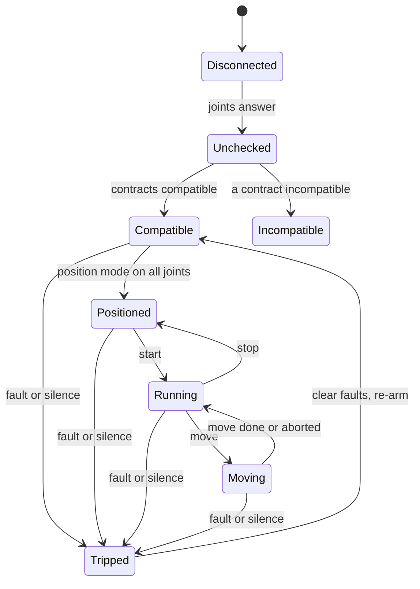
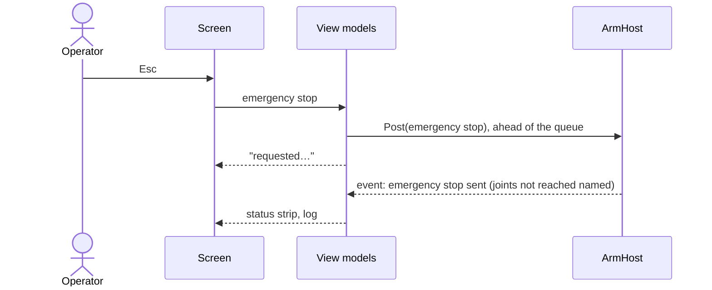

| Field     | Value                   |
|-----------|-------------------------|
| Title     | Simulator Screen Design |
| Type      | design                  |
| Status    | draft                   |
| Version   | 0.1.0                   |
| Component | tool-simulator          |
| Date      | 2026-11-12              |

> What the e-robot-arm Simulator shows, what each control does and when, and how it looks (phase 8a,
> [#28](https://github.com/embedded-pro/e-robot-arm/issues/28)). Components and threads are in
> [simulator.md](simulator.md). Written to the `ux-ui-expert` and `qt-3d-gui` skills.

---

## Responsibilities

**Is responsible for:**

- Showing, without the operator moving: the target, the connection, each joint's state, trips with their source,
  the arm in 3-D with its commanded ghost, and the emergency stop.
- Offering each arm operation only when `core/` would accept it, and saying why when it would not.
- Plotting commanded against measured position, and keeping a log that can be saved.

**Is NOT responsible for:**

- Deciding any arm rule. The enable rules below mirror `core/`'s preconditions so a control can say why it is
  disabled; `core/` still decides, and a refusal is reported in the log and the status area.
- Configuration of controllers, motor controllers and motors: phase 8b
  ([#29](https://github.com/embedded-pro/e-robot-arm/issues/29)).
- Jogging and real geometry: phase 8c ([#30](https://github.com/embedded-pro/e-robot-arm/issues/30)).

---

## Component Details

### Part A — Layout

Default layout at 1600 × 900, instrument (dark) theme. Every panel is a dock and can be moved; **View → Reset
Layout** restores this one.

```text
┌ e-robot-arm Simulator — Simulated joints ────────────────────────────────────────────────────────────┐
│ File  Arm  Simulation  View  Help                                                                     │
├───────────────────────────────────────────────────────────────────────────────────────────────────────┤
│ Target [Simulated joints ▾]  ● Running   Contracts: compatible   Trip: —          ┌────────────────┐ │
│                                                                                    │ EMERGENCY STOP │ │
│                                                                                    │      Esc       │ │
├──────────────────────────────────────────────────────────────┬─────────────────────┴────────────────┤
│                                                              │ Joints                                │
│                                                              │  #  Position   Speed     State  Fault │
│                                                              │  1  0.000 rad  0.00 rad/s Run   —     │
│                    3-D arm view                              │     ▕────●───────────▏ limit bar      │
│     measured arm, commanded ghost, floor with shadows        │  …  (joints 2–6)                      │
│                                                              ├──────────────────────────────────────┤
│                                                              │ Operate                               │
│   [Front] [Side] [Top] [Iso] [Frame]       camera presets    │  [Check Contracts] [Position Mode]    │
│                                                              │  [Start] [Stop] [Clear Faults]        │
│                                                              │  [Re-arm…]                            │
│                                                              ├──────────────────────────────────────┤
│                                                              │ Move                                  │
│                                                              │  J1 [  0.000] rad  …  J6 [ 0.000] rad │
│                                                              │  [Move]                     [Abort]   │
├──────────────────────────────────────────────────────────────┴──────────────────────────────────────┤
│ Scope  Joint [1 ▾]  ─ commanded ─ measured ─ error  [Run/Hold] Trigger: on trip   │ Event log [filter]│
└───────────────────────────────────────────────────────────────────────────────────────────────────────┘
```

- **Status strip** (top, not a dock, cannot be hidden): target selector, connection, contracts, the last trip with
  its source, and the emergency stop at the far right, apart from every other button.
- **Real-arm banner:** on the real target a full-width strip under the menu reads **REAL ARM — `<adapter>`** in the
  theme's `Warning` colour with an icon, and the window title gains the same text. It cannot be hidden.
- **Centre:** the 3-D view (Part E).
- **Right:** joint table, Operate, Move.
- **Bottom:** scope and event log, side by side.

### Part B — Controls and their states

Every disabled control carries its reason as a tooltip and in a one-line hint under its group. "Connected" means
the target is built and at least one joint has answered. Joints are numbered 1–6, base first.

| Control          | Enabled when                                                         | Disabled reason shown                                                  | Action                                             |
|------------------|----------------------------------------------------------------------|------------------------------------------------------------------------|----------------------------------------------------|
| Emergency stop   | A target is built                                                    | "No target"                                                            | Emergency stop to all joints, ahead of all else    |
| Check Contracts  | Connected, no move running                                           | "Not connected", "Moving"                                              | Query every joint's contract                       |
| Position Mode    | Contracts compatible, not tripped, no move running                   | "Contracts not checked", "Contracts incompatible", "Tripped", "Moving" | Select position mode on all joints                 |
| Start            | Contracts compatible, not tripped, every joint in position mode      | as above, "Joint N not in position mode"                               | Start all joints                                   |
| Stop             | Any joint running                                                    | "No joint running"                                                     | Stop all joints                                    |
| Clear Faults     | Any joint in fault                                                   | "No joint in fault"                                                    | Clear faults on all joints                         |
| Re-arm…          | Tripped, no joint in fault                                           | "Not tripped", "Joint N in fault: clear it first"                      | Confirmation naming the trip's source, then re-arm |
| Move target J1–6 | Always editable                                                      | —                                                                      | Validated as typed against the joint limits        |
| Move             | Every joint running, not tripped, no move running, all targets valid | "Joint N not running", "Tripped", "Moving", "J N outside limits"       | Move to the six targets                            |
| Abort            | A move running                                                       | "No move running"                                                      | Abort the move                                     |
| Target selector  | No move running                                                      | "Moving"                                                               | Part C                                             |

- A clicked action shows "requested…" in the status strip within 100 ms and is replaced by the result event.
- Spin boxes have keyboard tracking off; Enter in a target field does not move — only **Move** or Ctrl+Enter does.
- Nothing is enabled by a past click: every rule reads the latest snapshot.

### Part C — Flows

**Launch.** The last target, layout, camera and theme are restored. The simulated target never auto-starts the
joints. A remembered real target is not reconnected on launch: the simulator opens on simulated joints and the
selector shows the real adapter as the last used.

**Choose a target.** The selector lists *Simulated joints*, *Virtual bus…* (asks for the bus name) and *Real arm…*
(lists the adapters). Choosing *Real arm* opens a confirmation: "Connect to the real arm on `<adapter>`? Joints
start stopped." with **Connect** and **Cancel** (default). A failed adapter shows a banner with the reason and the
selector returns to the previous target.

**Bring up and move.** Check Contracts → Position Mode → Start → set targets → Move. The ghost shows the commanded
arm while moving; the scope shows the selected joint.

**Trip and recover.** On a trip the status strip shows **Tripped — `<source>`** in `Fault`, the joint table marks
the joint, the log records it, and the scope triggers. Clear Faults, then Re-arm…, whose confirmation names the
source.

**Inject a failure** (simulated target only). **Simulation → Inject Fault → Joint N** or **Silence Joint N**.

### Part D — Keyboard

| Key           | Action                                                                          |
|---------------|---------------------------------------------------------------------------------|
| Esc           | Emergency stop (application-wide; it pre-empts a dialog's cancel, deliberately) |
| Ctrl+Enter    | Move                                                                            |
| Ctrl+.        | Abort                                                                           |
| 1 / 2 / 3 / 4 | Camera front, side, top, iso (3-D view focused)                                 |
| F             | Frame the arm (3-D view focused)                                                |
| Ctrl+S        | Save the event log                                                              |
| Ctrl+Shift+R  | Reset layout                                                                    |

### Part E — 3-D view: look

Qt Quick 3D in a `QQuickWidget`, scene in QML, following the `qt-3d-gui` skill:

- **Environment:** theme background colour; image-based lighting from a small studio HDR probe
  (`probeExposure` 0.8); filmic tone mapping; MSAA High; specular antialiasing; ambient occlusion (strength 55,
  distance 5 cm, softness 40).
- **Lights:** key directional light at 50° elevation, 35° left of the camera, casting shadows at very high
  shadow-map quality, shadow factor 70, soft filter; fill at 0.3 from the right, low; rim at 0.5 from behind, high.
- **Floor:** 3 m × 3 m matte light grey (roughness 0.9) receiving shadows, with a faint 10 cm grid.
- **Arm** (generic, phase 8a): primitives in centimetres, Z-up model converted once to Qt's Y-up at the scene root.

  | Part                 | Shape                    | Size (cm)         | Material                               |
  |----------------------|--------------------------|-------------------|----------------------------------------|
  | Base                 | Cylinder                 | Ø 24 × 12         | Cast: #3c4043, metal 0.6, rough 0.55   |
  | Joint housings       | Cylinder across the axis | Ø 12–16 × 14      | Anodised: #9aa0a6, metal 1, rough 0.35 |
  | Shoulder column (J1) | Box                      | 14 × 14 × 28      | Painted: theme accent, rough 0.4       |
  | Upper arm (J2–J3)    | Box                      | 10 × 10 × 45      | Painted                                |
  | Forearm (J3–J5)      | Box                      | 9 × 9 × 40        | Painted                                |
  | Wrist and flange     | Cylinder                 | Ø 8 × 10, Ø 6 × 3 | Anodised, rubber cap #1d1f21           |

  Joint axes: J1 vertical; J2, J3 and J5 horizontal and parallel; J4 and J6 along the forearm and flange.
- **Ghost arm:** the same nodes, accent colour, opacity 0.3, blended, no depth write; visible only while a move
  runs or the commanded and measured arms differ by more than 0.5°.
- **Selection:** clicking a part selects its joint (in the table too, both ways); its housing's emissive rises in
  the accent colour. A faulted joint's housing pulses in the `Fault` colour, and the table says it in text.
- **Camera:** perspective, 40° field of view; orbit, pan, zoom; presets animate over 250 ms with ease-out.

### Part F — Scope and log

- **Scope** (`ui::scope::ScopeCore`, three channels): the selected joint's commanded and measured position and their
  difference, in rad, at the control period. Run and hold; trigger on a trip (normal mode, pre-trigger 1 s).
- **Log:** time, level (`Info`, `Warning`, `Fault`), joint (or "arm"), message. At most 10 000 lines, oldest dropped.
  Filter by level and joint; **File → Save Log…** writes plain text.

### Part G — Theme and type

ui-cpp's `Instrument` theme by default and `Light` from **View → Theme**; the 3-D background, floor and accent come
from the same theme roles. The platform UI font; tabular digits in every numeric cell; fixed precision per unit
(rad 3 decimals, rad/s 2). A 4 px grid: 8 px within a group, 16 px between groups. Status colours follow
`StatusLevel`; disconnected is `Neutral`; every colour has a text or icon alongside it.

---

## Interfaces

### Provided

| Interface  | Purpose         | Contract                                      |
|------------|-----------------|-----------------------------------------------|
| The screen | Operate the arm | Part B rules; emergency stop always reachable |

### Required

| Interface   | Purpose                              | Contract                            |
|-------------|--------------------------------------|-------------------------------------|
| View models | State, enable rules, reasons, values | [simulator.md](simulator.md) Part A |

---

## Data Model

| Entity       | Field                         | Type / Unit | Range            | Notes                                |
|--------------|-------------------------------|-------------|------------------|--------------------------------------|
| Move targets | J1–J6                         | rad         | The joint limits | Defaults ±π until the profile exists |
| Scope        | channels                      | rad         | —                | Commanded, measured, difference      |
| Log          | lines                         | count       | ≤ 10 000         | Oldest dropped                       |
| Settings     | target, layout, camera, theme | —           | —                | `QSettings`                          |

---

## State Machine

The Operate group follows the arm's state as the snapshot reports it:



---

## Sequence Diagrams



---

## Constraints & Limitations

| Constraint   | Value / Description                                                                                       |
|--------------|-----------------------------------------------------------------------------------------------------------|
| Frame rate   | 60 fps target at 1080p on an integrated GPU with the loop at 100 Hz; never below 30 fps                   |
| Measured     | To be filled in by the 8a implementation: frame time with the loop running, GPU and Qt version            |
| Qt           | 6.4.2 in the dev container; `ExtendedSceneEnvironment`, `InfiniteGrid`, `DebugView` only on 6.5+, guarded |
| Minimum size | 1280 × 720 at 100 %; no clipped text at 150 %                                                             |

---

## Open Questions

| # | Question                                           | Options                                         | Status      |
|---|----------------------------------------------------|-------------------------------------------------|-------------|
| 1 | Esc as the emergency-stop key                      | Esc, a function key, a dedicated USB button too | open        |
| 2 | Joint-limit defaults before the arm profile exists | ±π for every joint, per-joint guesses           | decided: ±π |
