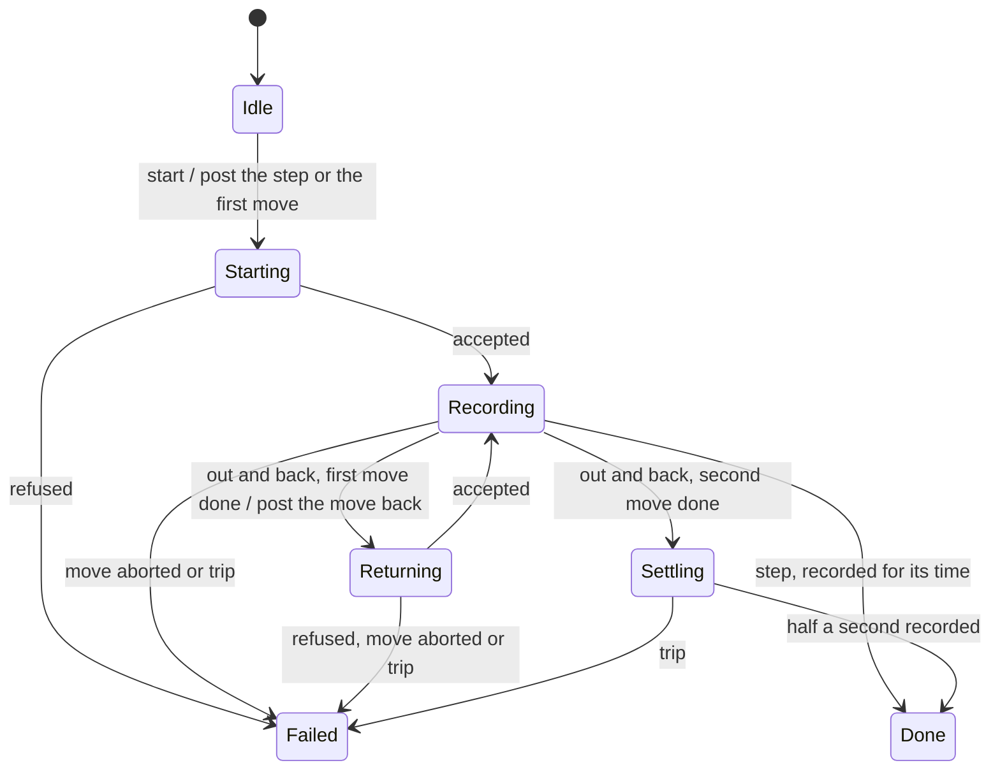

| Field     | Value              |
|-----------|--------------------|
| Title     | Tuning Runs Design |
| Type      | design             |
| Status    | draft              |
| Version   | 0.3.2              |
| Component | tuning             |
| Date      | 2026-11-27         |

> Runs a step or an out-and-back test on one joint through the arm host, records its response and computes the
> metrics a control engineer tunes an arm controller by. Host tool; behaviour only; diagrams are Mermaid.

---

## Responsibilities

- Running one test on one joint of an enabled arm: a reference step, or a move out by an amplitude and back.
- Recording, once per control period, the joint's commanded and measured position and its commanded torque.
- Computing the test's metrics: rise time, overshoot, settling time and steady-state error for a step; RMS and peak
  tracking error for both.
- Writing the recorded run as CSV.

---

## Component Details

### Part A — Tests

A test names a joint, its kind and an amplitude in radians:

- **Step.** The joint's reference jumps by the amplitude at once ([joint-motion.md](joint-motion.md) Part C). The
  other joints keep their reference. The amplitude is at most 0.2 rad either way. The run records for a set time,
  two seconds by default, from the first trace sample after the arm host accepts the step.
- **Out and back.** The joint moves by the amplitude and back to where it started. Each is a move through joint
  motion with the profile's speed and acceleration limits. The other joints keep their reference. The run records
  from the first move's acceptance until half a second after the second move is done.

A test starts only while the arm is enabled and not moving. It starts from each joint's commanded position, or its
measured position when nothing is commanded yet. A test the arm host refuses, a move aborted and a trip end the run as
failed, with the reason.

### Part B — Samples

While the run records, each trace sample of the arm host ([simulator.md](simulator.md) Part F) gives one sample of
the tested joint. The sample holds:

- the time since the first recorded sample;
- the joint's commanded and measured position, and their difference;
- the joint's commanded torque (zero when the arm host traced none).

 A sample that follows a gap in the trace
([simulator.md](simulator.md) Part F) carries how many samples were lost before it. The run counts the samples lost
while it records (a gap before its first sample does not count). It reports them with its metrics. The console
prints `tune warning: <n> samples lost during the run; the metrics may be off`. The Tuning dock's status says the
same at `Warning`.

### Part C — Metrics

For a step the response is normalised: the measured position minus the position before the step, over the
amplitude. Thus a perfect step goes from 0 to 1. On it numerical-toolbox's step-response metrics give:

| Metric              | Definition                                                                        |
|---------------------|-----------------------------------------------------------------------------------|
| Rise time           | From 10 % to 90 % of the step; none when the response never reaches 90 %          |
| Overshoot           | The peak above 1, in percent of the step                                          |
| Settling time       | Until the response stays within 2 % of the step; none when the last sample is out |
| Steady-state error  | How far the response ends below 1, back in radians                                |
| RMS tracking error  | Of the commanded minus the measured position over the whole run                   |
| Peak tracking error | The largest such difference                                                       |

An out-and-back test reports the two tracking errors only.

### Part D — CSV

The run writes comma-separated values with one row per sample, so a run can be compared outside the simulator.
The header row is `time_s`, `commanded_rad`, `measured_rad`, `tracking_error_rad`, `torque_nm`, `dropped_before`.
The last column is 0 except on a sample that follows a gap, where it is the number of samples lost.

### Part E — Benchmark (phase 8e B)

A benchmark runs the same path once per chosen controller, so the controllers are compared on equal terms.

1. **Path.** The profile's teach points in their order, then back to where the benchmark started.
   With fewer than two points, four fixed poses within the joint limits and back. Each leg is a move through joint
   motion.
2. **Per controller, in the order chosen:** select it; hold 1 s so every run starts at rest; run the path. Record
   until 1 s after the last move is done.
3. **Failure.** A refusal, a trip or a protective stop fails that controller's run with the reason. It ends the
   benchmark: the arm must be re-armed before the next one.
4. **At the end** the controller that was active before is selected again.

**Abort** stops the running move, fails the run with "aborted" and selects the controller that was active before. A
run that passes 6000 samples stops its move the same way and fails.

| Metric      | Definition                                                                |
|-------------|---------------------------------------------------------------------------|
| RMS error   | Of the tracking-error norm over all six joints, over the whole run, rad   |
| Peak error  | The largest single-joint tracking error, rad                              |
| Peak torque | The largest single-joint commanded torque, N·m                            |
| Energy      | `∑ ∫ τ·q̇ dt` over joints where positive (work done by the drives), J     |
| Settle time | From the end of the last move until every joint stays within 0.005 rad, s |

At most eight controllers per benchmark. The CSV has one row per controller with these metrics and the gains it ran
with, then the samples of each run.

---

## Interfaces

### Provided

| Interface | Purpose                                 | Contract                                                   |
|-----------|-----------------------------------------|------------------------------------------------------------|
| Start     | Start a test                            | Refused with the reason unless the arm is enabled and idle |
| Event     | An arm host event                       | Every event, in order; others than the run's are ignored   |
| Trace     | An arm host trace sample                | Every sample, in order                                     |
| Result    | State, failure reason, samples, metrics | Metrics once done                                          |
| CSV       | The samples as CSV                      | Any time; empty but for the header before recording        |

### Required

| Interface    | Purpose                                           | Contract                                    |
|--------------|---------------------------------------------------|---------------------------------------------|
| Arm commands | Post a step or a move; the snapshot to start from | The arm host ([simulator.md](simulator.md)) |

Every motion is a command to the arm host ([simulator.md](simulator.md) Part D). Thus the lifecycle and the safety
supervisor apply as they do to any move.

---

## Data Model

| Entity | Field     | Type / Unit        | Range                                                    | Notes                           |
|--------|-----------|--------------------|----------------------------------------------------------|---------------------------------|
| Test   | joint     | 1 to 6             |                                                          | Shown from 1, stored from 0     |
| Test   | kind      | step, out and back |                                                          |                                 |
| Test   | amplitude | rad                | step: not 0, at most 0.2 either way; out and back: not 0 | Signed                          |
| Test   | record    | duration           | above 0                                                  | Step only; 2 s by default       |
| Sample | time      | s                  | from 0                                                   | Since the first recorded sample |

---

## Constraints & Limitations

- A run holds at most 2000 samples, 20 s at a 10 ms period; a longer run stops recording and fails.
- A benchmark run holds at most 6000 samples, 60 s at a 10 ms period, and a benchmark at most eight controllers.
- A benchmark has no time-out: a lost move-done report leaves it running until the operator aborts it.
- The metrics are those of the joint position the drives report. Thus they include the gear and the encoder. On a
  real arm the encoder sits on the motor side.
- The run does not choose gains. It measures the arm controller that is active; the operator tunes it through the
  profile.
- The run does not plot or overlay runs. The simulator's Tuning dock does ([tool-simulator.md](tool-simulator.md)
  Part N).

---

## Decisions

| # | Decision                                    | Options                        | Status      |
|---|---------------------------------------------|--------------------------------|-------------|
| 1 | Whether a run also records the other joints | The tested joint only, all six | open (#196) |
