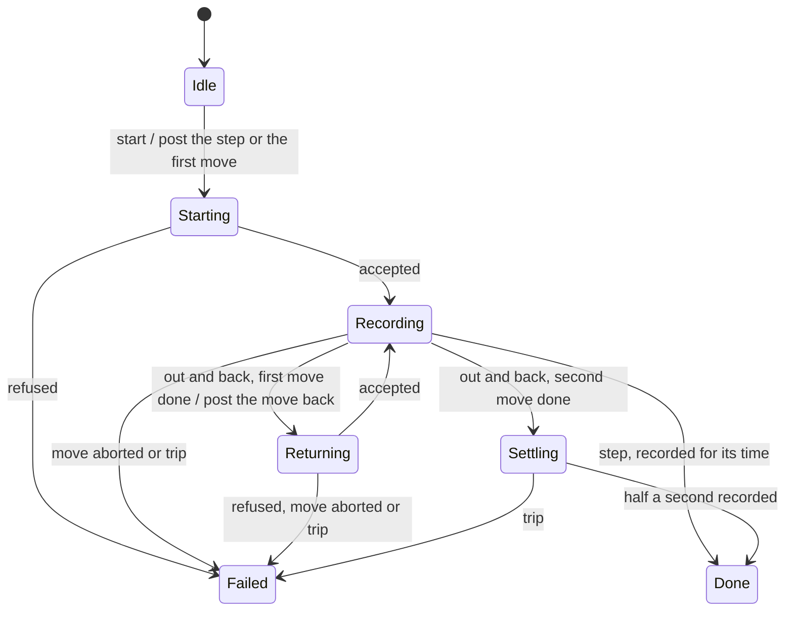

| Field     | Value              |
|-----------|--------------------|
| Title     | Tuning Runs Design |
| Type      | design             |
| Status    | draft              |
| Version   | 0.1.0              |
| Component | tuning             |
| Date      | 2026-11-17         |

> Runs a step or an out-and-back test on one joint through the arm host, records its response and computes the
> metrics a control engineer tunes an arm controller by. Host tool; behaviour only; diagrams are Mermaid.

---

## Responsibilities

**Is responsible for:**

- Running one test on one joint of an enabled arm: a reference step, or a move out by an amplitude and back.
- Recording, once per control period, the joint's commanded and measured position and its commanded torque.
- Computing the test's metrics: rise time, overshoot, settling time and steady-state error for a step; RMS and peak
  tracking error for both.
- Writing the recorded run as CSV.

**Is NOT responsible for:**

- Moving the arm by itself: every motion is a command to the arm host ([simulator.md](simulator.md) Part D), so the
  lifecycle and the safety supervisor apply as they do to any move.
- Choosing gains: it measures the arm controller that is active; the operator tunes it through the profile.
- Plotting or overlaying runs: the simulator's Tuning dock does ([tool-simulator.md](tool-simulator.md) Part N).

---

## Component Details

### Part A — Tests

A test names a joint, its kind and an amplitude in radians:

- **Step.** The joint's reference jumps by the amplitude at once ([joint-motion.md](joint-motion.md) Part C); the
  other joints keep their reference. The amplitude is at most 0.2 rad either way. The run records for a set time,
  two seconds by default, from the first trace sample after the step is accepted.
- **Out and back.** The joint moves by the amplitude and back to where it started, each a move through joint
  motion with the profile's speed and acceleration limits; the other joints keep their reference. The run records
  from the first move's acceptance until half a second after the second move is done.

A test starts only while the arm is enabled and not moving, from each joint's commanded position, or its measured
position when nothing is commanded yet. A test the arm host refuses, a move aborted and a trip end the run as
failed, with the reason.

### Part B — Samples

Each trace sample of the arm host ([simulator.md](simulator.md) Part F) while the run records gives one sample of
the tested joint: the time since the first recorded sample, its commanded and measured position, their difference,
and its commanded torque (zero when the arm host traced none).

### Part C — Metrics

For a step the response is normalised: the measured position minus the position before the step, over the
amplitude, so a perfect step goes from 0 to 1. On it numerical-toolbox's step-response metrics give:

| Metric              | Definition                                                                        |
|---------------------|-----------------------------------------------------------------------------------|
| Rise time           | From 10 % to 90 % of the step; none when the response never reaches 90 %          |
| Overshoot           | The peak above 1, in percent of the step                                          |
| Settling time       | Until the response stays within 2 % of the step; none when the last sample is out |
| Steady-state error  | How far the response ends below 1, back in radians                                |
| RMS tracking error  | Of the commanded minus the measured position over the whole run                   |
| Peak tracking error | The largest such difference                                                       |

An out-and-back test reports the two tracking errors only.

### Part D — CSV

A run is written as comma-separated values with a header row: `time_s`, `commanded_rad`, `measured_rad`,
`tracking_error_rad`, `torque_nm`, one row per sample, so a run can be compared outside the simulator.

---

## Interfaces

### Provided

| Interface | Purpose                                 | Contract                                                   |
|-----------|-----------------------------------------|------------------------------------------------------------|
| Start     | Start a test                            | Refused with the reason unless the arm is enabled and idle |
| Event     | An arm host event                       | Every event, in order; others than the run's are ignored   |
| Trace     | An arm host trace sample                | Every sample, in order                                     |
| Result    | State, failure reason, samples, metrics | Metrics once done                                          |
| CSV       | The samples as CSV                      | Any time; empty but for the header before recording        |

### Required

| Interface    | Purpose                                           | Contract                                    |
|--------------|---------------------------------------------------|---------------------------------------------|
| Arm commands | Post a step or a move; the snapshot to start from | The arm host ([simulator.md](simulator.md)) |

---

## Data Model

| Entity | Field     | Type / Unit        | Range                                                    | Notes                           |
|--------|-----------|--------------------|----------------------------------------------------------|---------------------------------|
| Test   | joint     | 1 to 6             |                                                          | Shown from 1, stored from 0     |
| Test   | kind      | step, out and back |                                                          |                                 |
| Test   | amplitude | rad                | step: not 0, at most 0.2 either way; out and back: not 0 | Signed                          |
| Test   | record    | duration           | above 0                                                  | Step only; 2 s by default       |
| Sample | time      | s                  | from 0                                                   | Since the first recorded sample |

---

## Constraints & Limitations

- A run holds at most 2000 samples, 20 s at a 10 ms period; a longer run stops recording and fails.
- The metrics are those of the joint position the drives report, so they include the gear and the encoder; on a
  real arm the encoder sits on the motor side.

---

## Open Questions

| # | Question                                    | Options                        | Status |
|---|---------------------------------------------|--------------------------------|--------|
| 1 | Whether a run also records the other joints | The tested joint only, all six | open   |
