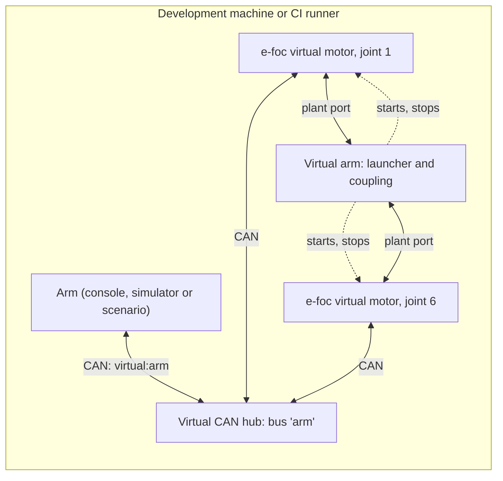
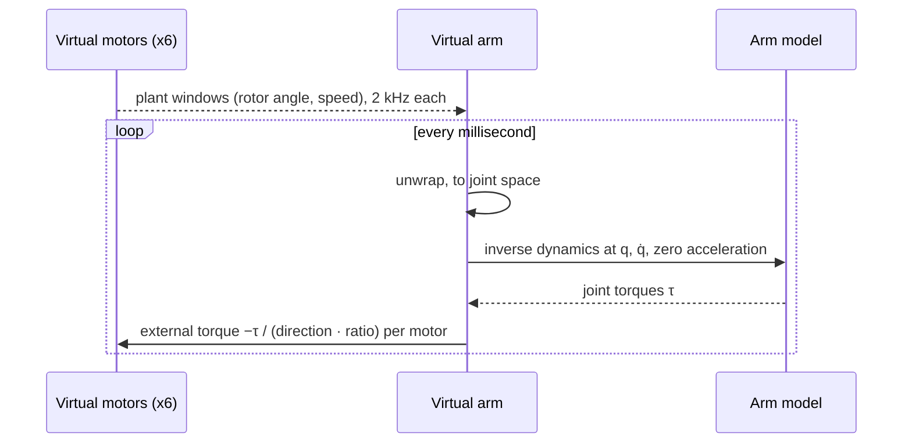
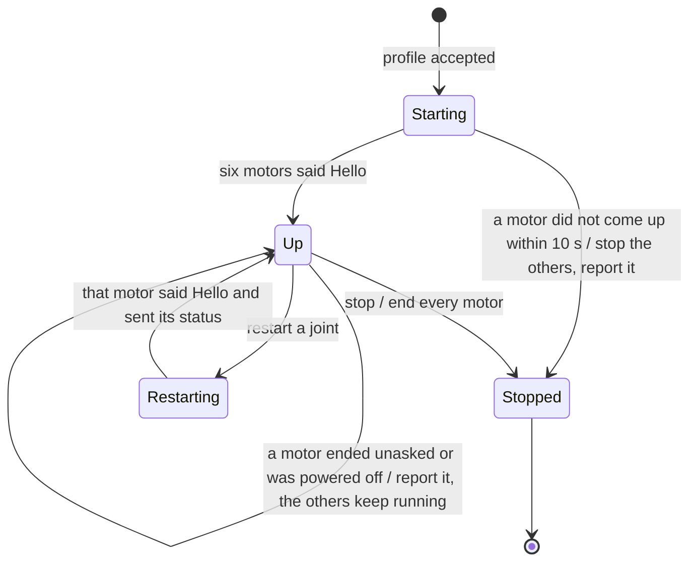

| Field     | Value              |
|-----------|--------------------|
| Title     | Virtual Arm Design |
| Type      | design             |
| Status    | draft              |
| Version   | 0.8.0              |
| Component | virtual-arm        |
| Date      | 2026-11-16         |

> The arm run against six real e-foc firmware instances instead of ideal simulated joints: e-foc's headless
> virtual motor, one process per joint, on one virtual CAN bus, each loaded by what its link and the links beyond
> it put on its shaft (phase 7, [#23](https://github.com/embedded-pro/e-robot-arm/issues/23)). Behaviour only;
> diagrams are Mermaid. The virtual motor itself is e-foc's `virtual-motor.md`.

---

## Responsibilities

**Is responsible for:**

- Starting six e-foc virtual motors from an arm profile, one per joint, each with the motor the profile names, on
  one virtual CAN bus at the profile's node ids, and stopping them.
- Coupling each motor to the arm's dynamics: the torque its link and the links beyond it apply, through its
  transmission, fed to the motor's plant as external shaft torque while the arm moves.
- Faults on demand: a silent joint, a collision torque on a joint, a joint powered off.
- Running headless, so the console, the simulator, the scenarios and CI start the same virtual arm.

**Is NOT responsible for:**

- Controlling the arm: the arm reaches the virtual motors through `virtual:<bus>` like any other CAN bus, and
  nothing in `core/` knows the motors are virtual.
- Simulating a motor: each virtual motor runs e-foc's shipping application on e-foc's plant; the virtual arm only
  chooses the plant and pushes torque on its shaft.
- Verifying e-foc: a virtual motor is a bench, not a test oracle (`virtual-motor.md` Part I).

---

## Component Details

### Part A — Process layout

The virtual arm is a host-only tool, `e-robot-arm-virtual-arm` (`tools/virtual_arm/`). It reads an arm profile,
opens a plant-port listener on a loopback port, and starts six `e-foc-virtual-motor` processes, each told to
connect to it. The first motor hosts the virtual CAN hub for the bus; the arm joins the same bus as
`virtual:<bus>`.

Each motor is started with:

| Start option | Value                                                                                            |
|--------------|--------------------------------------------------------------------------------------------------|
| Bus          | The virtual arm's bus name, `arm` unless told otherwise                                          |
| Node         | The joint's node id minus 1: a virtual motor's node is its configured base, 1, plus its board ID |
| Plant        | The joint's motor (Part B)                                                                       |
| Memory       | `joint<n>.mem` in the virtual arm's working directory                                            |
| Start from   | Calibrated, so every joint reaches *Ready* without an identification run                         |
| Seed         | The joint number, so a run replays exactly                                                       |
| Host the bus | The first motor only                                                                             |
| Hub port     | The virtual hub's loopback port, 29536 unless the virtual arm is given another                   |
| Plant port   | The virtual arm's listener                                                                       |

A node id outside 1 to 256 cannot be reached this way and the virtual arm refuses the profile. The working
directory is one per virtual arm run, so two runs never share memory files.

**The bus's hub.** By default the motor of joint 1 hosts the virtual CAN hub. A virtual arm can instead join a hub
that is already listening, as the simulator's does: the simulator's own `virtual:` adapter hosts it
([simulator.md](simulator.md) Part C). Then no motor hosts the bus, all six start at once, the virtual arm refuses to
start unless a hub answers on the hub port, and any joint can be restarted on its own (Part B).

**Start.** The hub port must be free or held by a running hub first: a hub that closed less than a
minute ago leaves it held by closed connections, and the virtual arm waits up to 70 s for it before it refuses to
start. The motor that hosts the bus starts first, and the others only once its hub listens: an e-foc virtual motor joins
the bus when it starts and does not try again, so one started before the hub would stay off the bus. It is up once all
six motors have connected to the plant port, introduced themselves (Hello, protocol version
2) and sent their first status, which a motor does once it has joined the bus, within 10 s; otherwise it stops the
ones it started and reports which joint did not come up. Each motor's output goes to `joint<n>.log` in the working
directory. **Stop.** It ends every motor it started, the first motor last so that the hub closes after its members,
which leaves the bus silent as a powered-off arm; a motor that ends without being asked is reported with the last
lines of its debug log; the others keep running, so the arm sees that joint silent. Each motor runs in a process group of its
own, so Ctrl-C reaches only the virtual arm, which then stops the motors; a motor whose virtual arm dies is ended
with it, since an e-foc virtual motor otherwise outlives its plant port. Linux ties that to the thread that started
the motor, not the process, so the virtual arm is started from a thread that outlives it: the simulator's target
keeps the thread that started it waiting until the target closes.

**Motor states.** The virtual arm reports, for each joint, its motor's plant and its process's state:

| State    | Means                                                                               |
|----------|-------------------------------------------------------------------------------------|
| Stopped  | Not started, stopped by the virtual arm, or powered off (Part D)                    |
| Starting | The process runs and has not yet introduced itself and sent its first status        |
| Up       | Introduced, streaming its plant and coupled to the arm                              |
| Ended    | The process ended without being asked, with its exit code; `joint<n>.log` tells why |

### Part B — Motor per joint

A virtual motor's motor is its plant, fixed when it starts (`virtual-motor.md` Part E). The profile's motor per
joint ([arm-profile.md](arm-profile.md)) chooses it:

| Profile motor                           | Plant                                                          |
|-----------------------------------------|----------------------------------------------------------------|
| None                                    | `teknic`, e-foc's nominal motor                                |
| A reference motor (`teknic`, `anaheim`) | The e-foc plant preset of the same name                        |
| Custom values                           | Refused: e-foc reads custom plants only in its own binary form |

Changing a joint's motor in the profile and restarting that joint is enough: the virtual arm stops the motor, and
starts it again with the new plant and a fresh calibrated memory. Restarting it with the same plant keeps its memory
file, as a power cycle does. While a joint restarts the coupling holds every motor's last torque, since it needs all
six joints' states. A restart is refused, with the reason, when:

- the virtual arm is not up;
- the joint's motor hosts the bus: its hub would close under the other five, so the whole virtual arm restarts
  instead;
- the new motor has custom values.

A new profile with the same node ids is adopted while the virtual arm runs: the coupling takes the new geometry,
mass and transmissions, and only the joints whose motor changed restart, under the same refusals. A profile with
other node ids needs the whole virtual arm restarted.

Custom values wait for e-foc to read a plant description as text (open question 1).

### Part C — Coupling to the arm's dynamics

Each motor's plant has its own rotor; nothing on its shaft but what the plant port pushes. The virtual arm closes
that loop with the arm model ([arm-model.md](arm-model.md) Part F):

1. Each motor streams its plant signals through the plant port (`virtual-motor.md` Part F), a window every 10
   control periods (2 kHz). From each window the virtual arm takes the last period's true rotor angle and speed,
   unwraps the angle across turns, and converts both to joint space through the joint's transmission
   ([joint-bus.md](joint-bus.md) Part F).
2. Every millisecond it computes, at the latest joint positions q and speeds q̇ of all six joints, the torque each
   joint must supply to hold the links against gravity and their speed-dependent coupling: the arm model's inverse
   dynamics at zero acceleration, τ = M(q)·0 + C(q, q̇)·q̇ + G(q).
3. The links push back with −τ. Each joint's share goes to its motor's shaft through the transmission,
   motor torque = −τ / (direction · ratio), as a constant external torque (`virtual-motor.md` Part E), which the
   motor applies from its next control period.

**What the coupling captures, and what it leaves out.** Gravity, the full load of the links and the payload on
every joint, and the centrifugal and Coriolis torques between joints, all from the measured state of all six.
It leaves out the links' inertia: a motor accelerates only its own rotor, so a joint driven hard accelerates
faster than the real arm would and the coupling between one joint's acceleration and another's torque is absent.
Feeding the inertia through measured accelerations would close an algebraic loop one window late; the faithful
way is to add each link's reflected inertia to its motor's plant, which needs custom plants (open question 2).
The torque reaches a motor at most 1 ms plus one window late; at the arm's speeds that lag is below what the
scenarios measure.

### Part D — Faults on demand

| Fault             | How                                                                                                                                                                 | What the arm sees                                      |
|-------------------|---------------------------------------------------------------------------------------------------------------------------------------------------------------------|--------------------------------------------------------|
| Silent joint      | Pause the motor through its plant port; resume to bring it back                                                                                                     | The node stops answering (`virtual-motor.md` Part C)   |
| Collision torque  | An extra external torque on a joint, added to the coupling, as a step held until cleared                                                                            | Following error, then the node's own fault if it lasts |
| Joint powered off | End the motor's process; restarting it with the same motor brings the joint back calibrated from its memory file (Part B); refused for the motor that hosts the bus | The node goes silent and comes back unpowered          |

A scenario or the console asks the virtual arm for them; the arm only sees their effect on the bus.

### Part E — Who starts it

| User                | How                                                                                             |
|---------------------|-------------------------------------------------------------------------------------------------|
| Console             | `--virtual-arm <profile>` starts the virtual arm, then the console's own arm on `virtual:<bus>` |
| Simulator           | The *Virtual arm* target, which hosts the hub itself ([simulator.md](simulator.md) Part C)      |
| Scenarios           | The `@virtual` fixture starts it before a scenario and stops it after (Part G)                  |
| By hand or a script | `e-robot-arm-virtual-arm --profile <file> [--bus <name>]`, ended with Ctrl-C                    |

It finds `e-foc-virtual-motor` on the path, or where `--engine <path>` says; a relative path is taken from the
directory it was started in, not from the motors' working directory.

### Part F — The e-foc virtual motor, built from e-foc

e-robot-arm does not vendor e-foc. CI checks out e-foc at a pinned revision (`E_FOC_REVISION` in `ci.yml`), builds
only `e_foc.tool.virtual_motor` in Release in the same dev container, cached by ccache, and hands the binary to the
scenarios. The revision is a commit until an e-foc release carries what the arm needs (contract 4.0 and can-lite's
virtual hub fixes); then it is that release's tag. A developer builds e-foc the same way and names the binary with
`--engine` or `E_FOC_VIRTUAL_MOTOR`.

| Option                                    | For                                                   | Against                                                                    |
|-------------------------------------------|-------------------------------------------------------|----------------------------------------------------------------------------|
| Build e-foc at a pinned revision (chosen) | Any e-foc revision; the dev container's own C library | Minutes of build per run, less with ccache                                 |
| Download e-foc's release                  | Seconds in CI; the binary e-foc's users run           | Built against a newer C library than the dev container's; follows releases |

The Release build turns warnings-as-errors off: GCC 13 at `-O3` reports a false `stringop-overflow` in
embedded-infra-lib's upgrade staging writer, which the engine links but never runs.

The plant port is a small framed protocol on a loopback socket. The virtual arm implements the part it uses
(Hello, Status, Changes, Refused, Log line and Window from the motor; Pause, Resume, External torque, Clear all
and Stream to it) from `virtual-motor.md` Part F, and refuses a motor that does not speak version 2.

### Part G — Scenarios

`@virtual` scenarios run the arm on the virtual arm in real time, so they have a binary of their own,
`e_robot_arm.integration_tests.virtual` (`integration_tests/virtual/`), that ctest does not run. Each scenario starts
the virtual arm from `integration_tests/virtual/virtual-arm.json`, the reference arm geared 50:1 that allows fifty missed
telemetry periods and waits fifty periods for an acknowledgement (500 ms each). Six motors paced on the wall clock share
the host's cores: a CI runner has descheduled one for a hundred milliseconds, and its pacer drops the time it missed, so
the arm saw ten requests go unanswered and called a live motor silent, or gave up on an acknowledgement after three
periods. A node on its own microcontroller does not stall, so a real arm keeps short windows. Its motors are the Teknic preset with the
drive's following-error supervision on: a window of 3 rad on the motor's side for 0.1 s. It then brings the arm up through the
arm host on `virtual:arm` as the console does: contract check, align, bring-up and enable. The motors start
calibrated but not aligned.

| Scenario               | Checks                                                                                                                                                                                                                         |
|------------------------|--------------------------------------------------------------------------------------------------------------------------------------------------------------------------------------------------------------------------------|
| Tracking under gravity | The largest difference between commanded and measured position while the shoulder lifts, as a `[METRIC]` line held to a limit pinned from it                                                                                   |
| Collision              | A 30 N·m torque against the shoulder while it moves, about the drive's peak torque through the gear, trips the arm on that joint's following error (REQ-ARM-004); without the supervision the drive holds on and nothing trips |
| Silent joint           | A paused motor trips the arm as a silent joint (REQ-ARM-005)                                                                                                                                                                   |

CI runs them in a job of its own after building the engine (Part F). A torque well beyond the drive's peak is no
collision to detect: it drives the joint backwards until the drive's overspeed protection trips. Tracking error with
gravity compensation waits for phase 5's controller, and a start-up through calibration waits for the lifecycle to
drive one (open question 3).

---

## Interfaces

### Provided

| Interface        | Purpose                                           | Contract                                       |
|------------------|---------------------------------------------------|------------------------------------------------|
| Virtual arm tool | Six virtual motors from a profile, on one bus     | Up within 10 s or stopped and reported; Part A |
| Coupling         | Arm-dynamics torque on every motor's shaft        | Every millisecond while up; Part C             |
| Faults           | Silent joint, collision torque, joint powered off | Part D; each reversible                        |
| Motor states     | Each joint's plant and process state              | Part A; safe to read from any thread           |
| Restart a joint  | Same plant: power cycle; another: fresh memory    | Part B; refused with the reason                |

### Required

| Interface                   | Purpose                                      | Contract                                                                                 |
|-----------------------------|----------------------------------------------|------------------------------------------------------------------------------------------|
| `e-foc-virtual-motor`       | One joint's drive                            | e-foc's release; start options and plant port per `virtual-motor.md`, protocol version 2 |
| Arm profile                 | Nodes, transmissions, motors, geometry, mass | [arm-profile.md](arm-profile.md)                                                         |
| Arm model                   | Inverse dynamics                             | [arm-model.md](arm-model.md)                                                             |
| can-lite `virtual:` adapter | The arm's side of the bus                    | Unchanged                                                                                |

---

## Data Model

| Entity      | Field       | Type / Unit | Range                     | Notes                                              |
|-------------|-------------|-------------|---------------------------|----------------------------------------------------|
| Virtual arm | bus         | name        | letters, digits, `-`, `_` | `arm` by default                                   |
| Virtual arm | plant port  | TCP port    | loopback                  | Chosen by the system unless given                  |
| Joint       | node        | integer     | 1–256                     | From the profile; the motor's board ID is node − 1 |
| Joint       | plant       | preset name | `teknic`, `anaheim`       | From the profile's motor (Part B)                  |
| Coupling    | period      | duration    | 1 ms                      | Torques computed from the latest windows           |
| Coupling    | joint state | rad, rad/s  | unwrapped                 | From each motor's true rotor angle and speed       |
| Collision   | torque      | N·m         | finite                    | Joint-side; added to the coupling until cleared    |

---

## State Machine

---

## Constraints & Limitations

| Constraint | Value / Description                                                                                                                                                                                                                                                                    |
|------------|----------------------------------------------------------------------------------------------------------------------------------------------------------------------------------------------------------------------------------------------------------------------------------------|
| Coupling   | Gravity, payload and speed-dependent terms; not the links' inertia (Part C)                                                                                                                                                                                                            |
| Motors     | e-foc's plant presets only until e-foc reads text plant descriptions                                                                                                                                                                                                                   |
| Time       | Real time: virtual motors run on the wall clock                                                                                                                                                                                                                                        |
| Platform   | Linux first, as CI; Windows when e-foc's Windows archive is wired the same way                                                                                                                                                                                                         |
| Network    | Loopback only                                                                                                                                                                                                                                                                          |
| Bus load   | One telemetry request and two answers per joint per period: 1800 frames/s at 100 Hz. can-lite's hub must deliver every frame whose transmission time has passed at once; one per pass of its host's event loop (about 500 frames/s in an e-foc virtual motor) leaves the joints silent |

---

## Open Questions

| # | Question                         | Options                                                                     | Status |
|---|----------------------------------|-----------------------------------------------------------------------------|--------|
| 1 | Custom motors on a virtual joint | e-foc reads a text plant description; e-robot-arm writes e-foc's binary one | open   |
| 2 | The links' inertia               | Reflected inertia added to each plant (needs 1); measured accelerations     | open   |
| 3 | A start-up through calibration   | The lifecycle drives calibration; start factory-fresh and calibrate by hand | open   |
| 4 | Where the plant-port codec lives | In e-robot-arm (chosen for now); a library e-foc publishes                  | open   |
