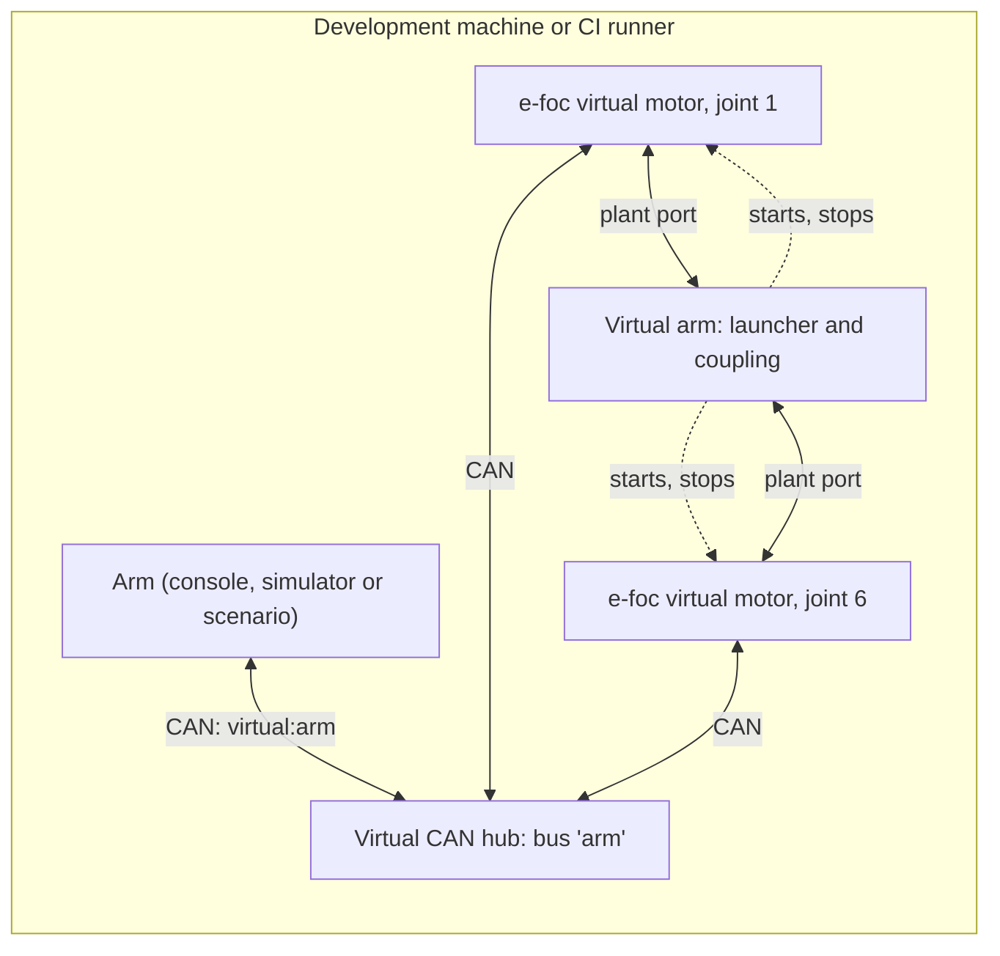
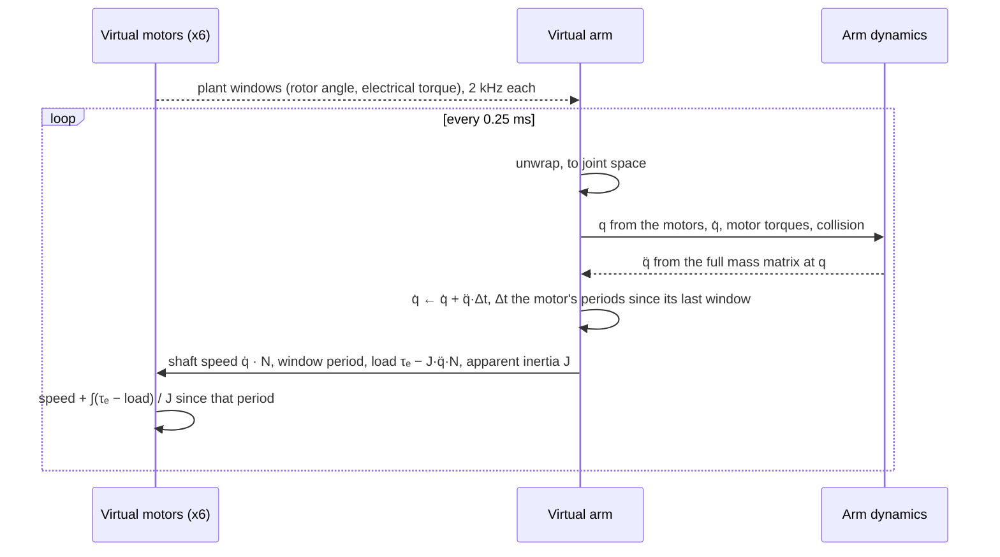
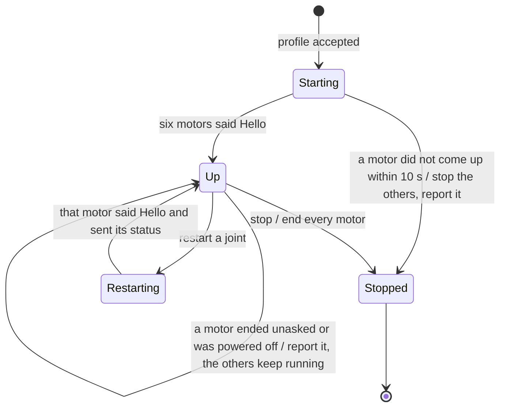

| Field     | Value              |
|-----------|--------------------|
| Title     | Virtual Arm Design |
| Type      | design             |
| Status    | draft              |
| Version   | 0.21.1             |
| Component | virtual-arm        |
| Date      | 2026-11-26         |

> The arm run against six real e-foc firmware instances instead of ideal simulated joints: e-foc's headless
> virtual motor, one process per joint, on one virtual CAN bus, each loaded by what its link and the links beyond
> it put on its shaft (phase 7, [#23](https://github.com/embedded-pro/e-robot-arm/issues/23)). Behaviour only;
> diagrams are Mermaid. The virtual motor itself is e-foc's `virtual-motor.md`.

---

## Responsibilities

- Starting six e-foc virtual motors from an arm profile, one per joint, each with the motor that the profile names.
- Putting the motors on one virtual CAN bus at the profile's node ids, and stopping them.
- Coupling each motor to the arm's dynamics while the arm moves.
- Feeding each motor's plant, as external shaft torque, the torque that its link and the links beyond it apply
  through its transmission.
- Faults on demand: a silent joint, a collision torque on a joint, a joint powered off.
- Running headless, so the console, the simulator, the scenarios and CI start the same virtual arm.

---

## Component Details

### Part A — Process layout

The virtual arm is a host-only tool, `e-robot-arm-virtual-arm`. It reads an arm profile and opens a plant-port
listener on a loopback port. Then it starts six `e-foc-virtual-motor` processes and tells each to connect to the
listener. The first motor hosts the virtual CAN hub for the bus. The arm joins the same bus as `virtual:<bus>`.

Each motor is started with:

| Start option | Value                                                                                            |
|--------------|--------------------------------------------------------------------------------------------------|
| Bus          | The virtual arm's bus name, `arm` unless told otherwise                                          |
| Node         | The joint's node id minus 1: a virtual motor's node is its configured base, 1, plus its board ID |
| Plant        | The joint's motor (Part B)                                                                       |
| Memory       | `joint<n>.mem` in the virtual arm's working directory                                            |
| Start from   | Calibrated, so every joint reaches *Ready* without an identification run                         |
| Seed         | The joint number, so a run replays exactly                                                       |
| Host the bus | The first motor only                                                                             |
| Hub port     | The virtual hub's loopback port, 29536 unless the virtual arm is given another                   |
| Plant port   | The virtual arm's listener                                                                       |

A node id outside 1 to 256 cannot be reached this way and the virtual arm refuses the profile. The working
directory is one per virtual arm run, so two runs never share memory files.

**The bus's hub.** By default, the motor of joint 1 hosts the virtual CAN hub. A virtual arm can instead join a hub
that already listens, as the simulator's does. There the simulator's own `virtual:` adapter hosts the hub
([simulator.md](simulator.md) Part C). Then no motor hosts the bus, and all six start at once. The virtual arm refuses
to start unless a hub answers on the hub port. Any joint can then restart on its own (Part B).

**Start.** The hub port must first be free or held by a running hub. A hub that closed less than a minute ago leaves
the port held by closed connections. The virtual arm waits up to 70 s for the port before it refuses to start. The
motor that hosts the bus starts first. The others start only once its hub listens. An e-foc virtual motor joins the
bus when it starts and does not try again. So a motor started before the hub would stay off the bus.

The virtual arm is up once all six motors have done these three things within 10 s:

- Connected to the plant port.
- Introduced themselves (Hello, protocol version 2).
- Sent their first status, which a motor does once it has joined the bus.

Otherwise the virtual arm stops the motors it started and reports which joint did not come up. Each motor's output
goes to `joint<n>.log` in the working directory.

**Stop.** The virtual arm ends every motor it started, the first motor last, so that the hub closes after its
members. This leaves the bus silent, as a powered-off arm. The virtual arm reports a motor that ends without being
asked, with the last lines of its debug log. The others keep running, so the arm sees that joint silent.

Each motor runs in a process group of its own, so Ctrl-C reaches only the virtual arm. The virtual arm then stops the
motors. A motor whose virtual arm dies ends with it, since an e-foc virtual motor otherwise outlives its plant port.
Linux ties that to the thread that started the motor, not to the process. So a thread that outlives the virtual arm
starts it. The simulator's target keeps the thread that started it waiting until the target closes.

**Motor states.** The virtual arm reports, for each joint, its motor's plant and its process's state:

| State    | Means                                                                               |
|----------|-------------------------------------------------------------------------------------|
| Stopped  | Not started, stopped by the virtual arm, or powered off (Part D)                    |
| Starting | The process runs and has not yet introduced itself and sent its first status        |
| Up       | Introduced, streaming its plant and coupled to the arm                              |
| Ended    | The process ended without being asked, with its exit code; `joint<n>.log` tells why |

### Part B — Motor per joint

A virtual motor's motor is its plant, fixed when it starts (`virtual-motor.md` Part E). The virtual arm writes each
joint's plant as an e-foc text plant description (`virtual-motor.md` Part A). The file is `jointN.plant` in its
folder, and the virtual arm starts the motor with it. The profile's motor per joint ([arm-profile.md](arm-profile.md))
chooses the description:

| Profile motor                           | Plant                                                                   | Shown as |
|-----------------------------------------|-------------------------------------------------------------------------|----------|
| None                                    | `teknic`, e-foc's nominal motor                                         | `teknic` |
| A reference motor (`teknic`, `anaheim`) | The e-foc preset of the same name, with every value the profile changed | its name |
| Custom values                           | The `teknic` preset with every value that differs from it               | `custom` |

The values in a description are the motor model's: resistance, inductance, flux linkage, pole pairs and rotor
inertia. They also hold viscous and Coulomb friction, and the peak current as the most the motor supports. Every
description also carries the joint's links as load inertia (Part C).

To change a joint's motor, change it in the profile and restart that joint. The virtual arm stops the motor and
starts it again with the new plant and a fresh calibrated memory. A restart with the same plant keeps its memory file,
as a power cycle does. While a joint restarts, the coupling holds it still (Part C). The virtual arm refuses a
restart, with the reason, in these cases:

- The virtual arm is not up.
- The joint's motor hosts the bus. Its hub would close under the other five, so the whole virtual arm restarts
  instead.

The virtual arm adopts a new profile with the same node ids while it runs. The coupling takes the new geometry, mass
and transmissions. Only the joints whose plant description changed restart, under the same refusals. A new mass or
geometry changes the load inertia, so the joints it reaches restart. A profile with other node ids needs a restart of
the whole virtual arm.

### Part C — Coupling to the arm's dynamics

Each motor's plant has its own rotor and nothing else. The virtual arm puts the links on all six together. It
integrates the arm's dynamics itself and drives every motor's shaft at the speed it computes (`virtual-motor.md`
Part E, *Shaft drive*). Each motor still runs its own electrical model, its current control and its encoder. It
reports the torque it produces.

1. Each motor streams its plant signals through the plant port (`virtual-motor.md` Part F), a window every 10
   control periods (2 kHz). From each window, the virtual arm takes the last period's true rotor angle and electrical
   torque. It unwraps the angle across turns. It converts the angle to joint space through the joint's transmission
   ([joint-bus.md](joint-bus.md) Part F).
2. Every quarter of a millisecond, it solves the arm's dynamics for the joint accelerations. It uses the same solver
   as the simulated arm ([simulator.md](simulator.md) Part D):
   `(M(q) + diag(Jᵣ·N²))·q̈ = N·τₑ − b·N²·q̇ − c·N·sign(q̇) − C(q, q̇)·q̇ − G(q) + τ꜀`.
   Here q is the joint positions that the motors report, and q̇ the joint speeds that the virtual arm integrates.
   Each motor's electrical torque is τₑ, and N is its transmission (direction · ratio). Jᵣ, b and c are its rotor
   inertia and viscous and Coulomb friction. They come from the joint's motor in the profile, or from the `teknic`
   preset when it names none. The injected collision torque is τ꜀ (Part D). Coulomb friction never reverses a joint:
   a joint whose speed would change sign stops.
3. It advances each joint's speed by q̈ over the time that joint's motor ran since the last window it used. That
   time is the control periods between the two windows, at the rate the motor gave in its Hello (at most 20 ms). A
   joint whose motor sent no new window does not advance. A motor's pacer drops the time it was descheduled, so the
   virtual arm does not step on the wall clock. Otherwise a joint that it advanced while its motor stood still would
   reach the motor with a speed the motor never lived through.
4. It sends each motor three values with the control period of the window it used. The first is the new shaft speed,
   q̇ · N. The second is the shaft's apparent inertia, J = 1 / (M + diag(Jᵣ·N²))⁻¹ᵢᵢ / N². That is what the joint
   weighs against a torque of its own while the others move freely. The third is the load torque on the shaft: the
   motor's torque less what accelerates that inertia, τₑ − J · q̈ · N. The motor integrates its angle from that speed.
   So the positions stay the motors' own and never drift from what the encoders read.
5. The motor drives its shaft at that speed plus a correction (`virtual-motor.md` Part E, *Shaft drive*). The
   correction is what its own torque did beyond the load since the period the arm used, over that inertia. So its
   fast local reactions see no lag, the alignment's electrical spring among them. Between two speeds, the shaft keeps
   the acceleration that the arm computed. Sending the motor's torque in place of the load would stop the shaft's
   acceleration at the speed the arm sent. On a runner busy enough to delay the next speed, the gap then reaches the
   alignment's stiff spring as a kick. With that design, the alignment failed on a third of the scenarios run with
   every core busy. The arm's next speed replaces the estimate with the full dynamics.

**Engaging.** The virtual arm drives no shaft until all six motors stream. It then starts every joint at rest. Until
then, each motor's plant moves its rotor alone, with the joint's links as load inertia at the home position,
M(0)ᵢᵢ / N². So a motor that runs before the others are up does not spin freely.

**A joint without its motor.** The coupling holds a joint whose motor is silenced, powered off or restarting, as on
a brake. Its speed is zero and its acceleration is zero in the solve, so the other joints feel it as a constraint.
The coupling drives the shaft of a motor that is still connected, silenced for instance, at zero until the joint
comes back.

**What the coupling captures.** It captures these effects, all at the measured positions:

- Gravity and the payload.
- The full pose-dependent mass matrix, with every off-diagonal term.
- The centrifugal and Coriolis torques.
- The motors' rotors and friction.

**Why the motor compensates, and a quarter of a millisecond.** The coupling sits inside each motor's fastest
mechanical loop. The alignment holds the rotor on a stiff electrical spring, and the drive waits for the rotor to rest
before it enables. A motor's torque reaches the solve a window (0.5 ms) late at most. The motor reads the plant port
once a millisecond, and every step adds its own period. Uncompensated, that lag outweighed the motor's friction and
left the rotors ringing after alignment. The ringing lasted long enough for an alignment to fail, or for the joints
that enabled first to time out waiting for setpoints. The motor's own correction removes the lag for what the joint
does alone. The quarter-millisecond step keeps the coupling between joints close behind.

### Part D — Faults on demand

| Fault             | How                                                                                                                                                                 | What the arm sees                                      |
|-------------------|---------------------------------------------------------------------------------------------------------------------------------------------------------------------|--------------------------------------------------------|
| Silent joint      | Pause the motor through its plant port; resume to bring it back                                                                                                     | The node stops answering (`virtual-motor.md` Part C)   |
| Collision torque  | An extra external torque on a joint, added to the coupling, as a step held until cleared                                                                            | Following error, then the node's own fault if it lasts |
| Joint powered off | End the motor's process; restarting it with the same motor brings the joint back calibrated from its memory file (Part B); refused for the motor that hosts the bus | The node goes silent and comes back unpowered          |

A scenario or the console asks the virtual arm for them; the arm only sees their effect on the bus.

### Part E — Who starts it

| User                | How                                                                                             |
|---------------------|-------------------------------------------------------------------------------------------------|
| Console             | `--virtual-arm <profile>` starts the virtual arm, then the console's own arm on `virtual:<bus>` |
| Simulator           | The *Virtual arm* target, which hosts the hub itself ([simulator.md](simulator.md) Part C)      |
| Scenarios           | The `@virtual` fixture starts it before a scenario and stops it after (Part G)                  |
| By hand or a script | `e-robot-arm-virtual-arm --profile <file> [--bus <name>]`, ended with Ctrl-C                    |

It finds `e-foc-virtual-motor` on the path, or where `--engine <path>` says. It takes a relative path from the
directory it was started in, not from the motors' working directory.

### Part F — The e-foc virtual motor, built from e-foc

The e-robot-arm repository does not vendor e-foc. CI checks out e-foc at a pinned revision, which the CI workflow
names. It builds only e-foc's virtual motor tool in Release, in the same dev container, cached by ccache. Then it
hands the binary to the scenarios. The revision is a commit until an e-foc release carries what the arm needs:
contract 4.0 and can-lite's virtual hub fixes. Then it is that release's tag. A developer builds e-foc the same way
and names the binary with `--engine` or `E_FOC_VIRTUAL_MOTOR`.

| Option                                    | For                                                   | Against                                                                    |
|-------------------------------------------|-------------------------------------------------------|----------------------------------------------------------------------------|
| Build e-foc at a pinned revision (chosen) | Any e-foc revision; the dev container's own C library | Minutes of build per run, less with ccache                                 |
| Download e-foc's release                  | Seconds in CI; the binary e-foc's users run           | Built against a newer C library than the dev container's; follows releases |

The Release build turns warnings-as-errors off. GCC 13 at `-O3` reports a false `stringop-overflow` in
embedded-infra-lib's upgrade staging writer. The engine links that writer but never runs it.

The plant port is a small framed protocol on a loopback socket. The virtual arm implements the part it uses, from
`virtual-motor.md` Part F. From the motor: Hello, Status, Changes, Refused, Log line and Window. To the motor: Pause,
Resume, External torque, Clear all and Stream. It refuses a motor that does not speak version 2.

### Part G — Scenarios

The `@virtual` scenarios run the arm on the virtual arm in real time. So they have a test binary of their own, which
ctest does not run. Each scenario starts the virtual arm from the virtual scenarios' own arm profile. That profile is
the reference arm geared 50:1. It allows fifty missed telemetry periods and waits fifty periods for an
acknowledgement. It also gives each drive's watchdog fifty periods (500 ms each).

Six motors paced on the wall clock share the host's cores. A CI runner has descheduled one for a hundred
milliseconds, and its pacer drops the time it missed. Then the arm saw ten requests go unanswered and called a live
motor silent. Or it gave up on an acknowledgement after three periods. A node on its own microcontroller does not
stall, so a real arm keeps short windows.

The profile's motors are the `teknic` preset with the drive's following-error supervision off. The arm's own
tracking-error supervision watches every joint instead ([safety.md](safety.md) Part F, 0.1 rad for 0.1 s in this
profile). Beside it runs the collision supervision ([collision.md](collision.md)): 10 N·m on the first three joints
and 2 N·m on the wrist. That is more than twice the largest external torque that the observer estimates through the
reference move. The `Held back` scenario is a feature of its own, the tracking supervision feature. It starts with
every collision and speed limit out of reach.

Every rule stops the arm protectively, and the gains that hold it are the tracking gains. So on this light arm, a
push of the size that the scenarios use swings the forearm out of the 0.1 rad window. A push that ends does so too.
Then the hold is lost. So the scenarios check the stop and its escalation. The arm host's tests check the hold itself
and its re-arm on the simulated joints.

The drives run in torque mode, and the arm closes position with `gravity-pd` at the profile's default bandwidth
([arm-controllers.md](arm-controllers.md) Part A). Without integral action, the joints settle short of the target by
the drives' Coulomb friction over the controller's stiffness. That is about 0.04 rad on the elbow. So the settling
check is pinned at 0.06 rad for `gravity-pd` and `computed-torque`. Under `gravity-pid`, the integral closes most of
that gap within the two seconds that the check allows. There the check is 0.015 rad.

The profile runs `gravity-pid` at 15 rad/s, not its default 20. Under CI load, a reading arrives a period late. This
brings the delay close to the 24 ms that the default tolerates ([arm-controllers.md](arm-controllers.md) Part A). The
step test then rang until the collision observer stopped the arm.

The fixture then brings the arm up through the arm host on `virtual:arm`, as the console does: contract check, align,
bring-up and enable. The motors start calibrated but not aligned. Each scenario runs its motors in a working directory
of its own (`scenario<n>` under the fixture's directory). So the logs that CI uploads keep every scenario. A failed
step prints each motor's real-time factor and overrun count from its last status report.

| Scenario               | Checks                                                                                                                                                                                                                                                                                                                                                                                                                                                                                                  |
|------------------------|---------------------------------------------------------------------------------------------------------------------------------------------------------------------------------------------------------------------------------------------------------------------------------------------------------------------------------------------------------------------------------------------------------------------------------------------------------------------------------------------------------|
| Tracking under gravity | The largest difference between commanded and measured position while the shoulder lifts, and the largest external torque the collision observer estimates on any joint, each as a `[METRIC]` line held to a limit pinned from it                                                                                                                                                                                                                                                                        |
| Computed torque        | The same move under `computed-torque`, with the reference speed and acceleration: a tighter tracking limit, pinned from its own `[METRIC]` line                                                                                                                                                                                                                                                                                                                                                         |
| PID with gravity       | The same move under `gravity-pid`: every joint settles within 0.015 rad despite the drives' friction, and a tracking limit pinned from its `[METRIC]` line                                                                                                                                                                                                                                                                                                                                              |
| Step test              | A 0.05 rad reference step on the elbow under `gravity-pid` through the tuning runner ([tuning.md](tuning.md)): rise time and overshoot as `[METRIC]` lines held to limits pinned from them                                                                                                                                                                                                                                                                                                              |
| Collision              | With every joint's speed limit out of reach and its collision limit at 10 N·m, a 30 N·m torque against the shoulder while it moves, about the drive's peak torque through the gear, stops the arm protectively on that joint's collision within 300 ms (REQ-ARM-016); the push goes on, the hold cannot resist it, and the arm trips on the lost hold within 2 s (REQ-SAF-002). With the speed rule in reach the shoulder, which the elbow no longer outweighs (Part C), can pass its speed limit first |
| Held back              | The same collision with every joint's collision limit at 1000 N·m and speed limit at 100 rad/s, out of reach, stops the arm protectively on a joint's tracking error instead (REQ-ARM-014); without either supervision the drive holds on and nothing stops                                                                                                                                                                                                                                             |
| Silent joint           | A paused motor trips the arm as a silent joint (REQ-ARM-005)                                                                                                                                                                                                                                                                                                                                                                                                                                            |

CI runs them in a job of its own after building the engine (Part F). A torque well beyond the drive's peak is no
collision to detect. It drives the joint backwards until the drive's overspeed protection trips. Tracking error with
gravity compensation waits for phase 5's controller. A start-up through calibration waits for the lifecycle to drive
one (decision 3).

---

## Interfaces

### Provided

| Interface        | Purpose                                           | Contract                                       |
|------------------|---------------------------------------------------|------------------------------------------------|
| Virtual arm tool | Six virtual motors from a profile, on one bus     | Up within 10 s or stopped and reported; Part A |
| Coupling         | Arm-dynamics speed on every motor's shaft         | Every 0.25 ms while up; Part C                 |
| Faults           | Silent joint, collision torque, joint powered off | Part D; each reversible                        |
| Motor states     | Each joint's plant and process state              | Part A; safe to read from any thread           |
| Restart a joint  | Same plant: power cycle; another: fresh memory    | Part B; refused with the reason                |

### Required

| Interface                   | Purpose                                      | Contract                                                                                 |
|-----------------------------|----------------------------------------------|------------------------------------------------------------------------------------------|
| `e-foc-virtual-motor`       | One joint's drive                            | e-foc's release; start options and plant port per `virtual-motor.md`, protocol version 3 |
| Arm profile                 | Nodes, transmissions, motors, geometry, mass | [arm-profile.md](arm-profile.md)                                                         |
| Arm model                   | Mass matrix, Coriolis and gravity terms      | [arm-model.md](arm-model.md)                                                             |
| can-lite `virtual:` adapter | The arm's side of the bus                    | Unchanged                                                                                |
| Arm                         | Controlling the arm                          | Reaches the motors through `virtual:<bus>` like any other CAN bus; nothing in the arm core knows the motors are virtual |
| e-foc virtual motor         | Simulating a motor                           | Runs e-foc's shipping application on e-foc's plant; the virtual arm only chooses the plant and pushes torque on its shaft |

---

## Data Model

| Entity      | Field      | Type / Unit | Range                     | Notes                                              |
|-------------|------------|-------------|---------------------------|----------------------------------------------------|
| Virtual arm | bus        | name        | letters, digits, `-`, `_` | `arm` by default                                   |
| Virtual arm | plant port | TCP port    | loopback                  | Chosen by the system unless given                  |
| Joint       | node       | integer     | 1–256                     | From the profile; the motor's board ID is node − 1 |
| Joint       | plant      | text file   | `jointN.plant`            | From the profile's motor and mass (Parts B, C)     |
| Coupling    | period     | duration    | 0.25 ms                   | Speeds computed from the latest windows            |
| Coupling    | position   | rad         | unwrapped                 | From each motor's true rotor angle                 |
| Coupling    | speed      | rad/s       | finite                    | Integrated by the virtual arm; zero when held      |
| Collision   | torque     | N·m         | finite                    | Joint-side; added to the coupling until cleared    |

---

## State Machine

---

## Constraints & Limitations

| Constraint | Value / Description                                                                                                                                                                                                                                                                    |
|------------|----------------------------------------------------------------------------------------------------------------------------------------------------------------------------------------------------------------------------------------------------------------------------------------|
| Coupling   | The arm's full dynamics, integrated by the virtual arm; each motor's shaft driven at its joint's speed (Part C)                                                                                                                                                                        |
| Motors     | The motor model's values; e-foc's other plant values (encoder, noise, supply limits) are the preset's                                                                                                                                                                                  |
| Time       | Real time: virtual motors run on the wall clock; the arm steps each joint by its own motor's control periods                                                                                                                                                                           |
| Platform   | Linux first, as CI; Windows when e-foc's Windows archive is wired the same way                                                                                                                                                                                                         |
| Verification | A virtual motor is a bench, not a test oracle (`virtual-motor.md` Part I) |
| Network    | Loopback only                                                                                                                                                                                                                                                                          |
| Bus load   | One telemetry request and two answers per joint per period: 1800 frames/s at 100 Hz. can-lite's hub must deliver every frame whose transmission time has passed at once; one per pass of its host's event loop (about 500 frames/s in an e-foc virtual motor) leaves the joints silent |

---

## Decisions

| # | Decision                         | Options                                                                     | Status |
|---|----------------------------------|-----------------------------------------------------------------------------|--------|
| 1 | Custom motors on a virtual joint | Decided: e-foc reads a text plant description                               | closed |
| 2 | The links' inertia               | Decided: the virtual arm integrates the full dynamics and drives the shafts | closed |
| 3 | A start-up through calibration   | The lifecycle drives calibration; start factory-fresh and calibrate by hand | open   |
| 4 | Where the plant-port codec lives | In e-robot-arm (chosen for now); a library e-foc publishes                  | open   |
