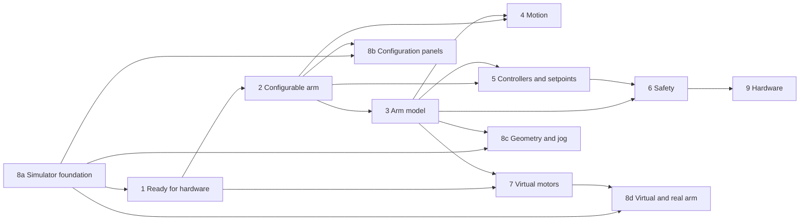

# Roadmap

The phases that take e-robot-arm from today's joint stack to a configurable arm with a simulator and real hardware.
Each phase is a GitHub issue with its detailed steps. This page is the summary, and it changes in the same pull
request as the work it describes. The tracking issue is
[#16](https://github.com/embedded-pro/e-robot-arm/issues/16).

## Where the arm stands

| Component          | Where                      | Design                                                |
|--------------------|----------------------------|-------------------------------------------------------|
| Joint bus          | `core/joint_bus/`          | [joint-bus.md](design/joint-bus.md)                   |
| Safety supervisor  | `core/safety/`             | [safety.md](design/safety.md)                         |
| Workspace check    | `core/workspace/`          | [safety.md](design/safety.md) Part H                  |
| Joint motion       | `core/motion/`             | [joint-motion.md](design/joint-motion.md)             |
| Control loop       | `core/control_loop/`       | [control-loop.md](design/control-loop.md)             |
| Arm lifecycle      | `core/lifecycle/`          | [arm-lifecycle.md](design/arm-lifecycle.md)           |
| Joint configurator | `core/joint_configurator/` | [joint-configurator.md](design/joint-configurator.md) |
| Arm profile        | `core/arm_profile/`        | [arm-profile.md](design/arm-profile.md)               |
| Arm model          | `core/arm_model/`          | [arm-model.md](design/arm-model.md)                   |
| Arm controllers    | `core/arm_controllers/`    | [arm-controllers.md](design/arm-controllers.md)       |
| Arm composition    | `core/arm/`                | [arm-console.md](design/arm-console.md)               |
| Console            | `tools/arm_console/`       | [arm-console.md](design/arm-console.md)               |
| Simulated arm      | `tools/simulated_arm/`     | [simulator.md](design/simulator.md)                   |
| Arm host           | `tools/arm_host/`          | [simulator.md](design/simulator.md)                   |
| Virtual arm        | `tools/virtual_arm/`       | [virtual-arm.md](design/virtual-arm.md)               |
| Simulator          | `tools/simulator/`         | [tool-simulator.md](design/tool-simulator.md)         |
| Arm scenarios      | `integration_tests/`       | [requirements](requirements/arm/arm.yaml)             |

## Order of work

The simulator comes first: phase 8a starts the roadmap, and every later phase brings its own simulator panel.

| Step | Issues                                                                                                                     | Phase  | Scope                                                                                                               |
|------|----------------------------------------------------------------------------------------------------------------------------|--------|---------------------------------------------------------------------------------------------------------------------|
| 1    | [#28](https://github.com/embedded-pro/e-robot-arm/issues/28)                                                               | 8a     | Simulator foundation: professional Qt shell, lit and shadowed 3-D arm, joint table, status, safety controls, scopes |
| 2    | [#17](https://github.com/embedded-pro/e-robot-arm/issues/17)                                                               | 1      | Ready for hardware                                                                                                  |
| 3    | [#18](https://github.com/embedded-pro/e-robot-arm/issues/18), [#29](https://github.com/embedded-pro/e-robot-arm/issues/29) | 2 + 8b | Configurable arm and its panels                                                                                     |
| 4    | [#19](https://github.com/embedded-pro/e-robot-arm/issues/19), [#30](https://github.com/embedded-pro/e-robot-arm/issues/30) | 3 + 8c | Arm model and real geometry in the 3-D view                                                                         |
| 5    | [#23](https://github.com/embedded-pro/e-robot-arm/issues/23), [#31](https://github.com/embedded-pro/e-robot-arm/issues/31) | 7 + 8d | Virtual e-foc motors with per-joint motors, tuning views, real arm in the simulator                                 |
| 6    | [#20](https://github.com/embedded-pro/e-robot-arm/issues/20)                                                               | 4      | Motion                                                                                                              |
| 7    | [#21](https://github.com/embedded-pro/e-robot-arm/issues/21)                                                               | 5      | Arm controllers and the setpoint contract                                                                           |
| 8    | [#22](https://github.com/embedded-pro/e-robot-arm/issues/22)                                                               | 6      | Safety                                                                                                              |
| 9    | [#25](https://github.com/embedded-pro/e-robot-arm/issues/25)                                                               | 9      | Hardware and deployment                                                                                             |

## Phases

| Phase | Issue                                                        | Scope                                                                                                                                                                                                                                                                                                                                                                       | Depends on                          |
|-------|--------------------------------------------------------------|-----------------------------------------------------------------------------------------------------------------------------------------------------------------------------------------------------------------------------------------------------------------------------------------------------------------------------------------------------------------------------|-------------------------------------|
| 1     | [#17](https://github.com/embedded-pro/e-robot-arm/issues/17) | Done. Ready for hardware: a command reaches every joint or is reported failed, joint ↔ motor transmission, start-up lifecycle, stale telemetry and overruns, scaffold clean-up                                                                                                                                                                                              | —                                   |
| 2     | [#18](https://github.com/embedded-pro/e-robot-arm/issues/18) | Done. Configurable arm: arm profile, motor controller and motor per joint applied over CAN, arm-controller registry with enable, disable and switch                                                                                                                                                                                                                         | 1                                   |
| 3     | [#19](https://github.com/embedded-pro/e-robot-arm/issues/19) | Done. Arm model: OPW geometry, forward and inverse kinematics, Jacobian, gravity torque, inverse dynamics and mass matrix from robotics-toolbox; numerical inverse kinematics waits for an arm outside the OPW family                                                                                                                                                       | 2                                   |
| 4     | [#20](https://github.com/embedded-pro/e-robot-arm/issues/20) | Motion: S-curve, replacing a running move, waypoint paths, Cartesian moves, jogging, teach points                                                                                                                                                                                                                                                                           | 2, 3                                |
| 5     | [#21](https://github.com/embedded-pro/e-robot-arm/issues/21) | Arm controllers and the setpoint contract: combined setpoints in e-foc-protocol and e-foc, controller catalogue from robotics-toolbox                                                                                                                                                                                                                                       | 2, 3                                |
| 6     | [#22](https://github.com/embedded-pro/e-robot-arm/issues/22) | Done. Safety: speed, acceleration and torque limits, following error, collision detection, workspace, watchdog, hardware stop (its circuit in phase 9)                                                                                                                                                                                                                      | 3, 5                                |
| 7     | [#23](https://github.com/embedded-pro/e-robot-arm/issues/23) | Done. Simulation with e-foc virtual motors: selectable motor characteristics per joint, coupling to arm dynamics, `@virtual` scenarios (tracking under gravity, a collision caught by the arm's tracking-error supervision, a silent joint) in a CI job of their own                                                                                                        | 1, 2, 3                             |
| 8     | [#24](https://github.com/embedded-pro/e-robot-arm/issues/24) | Qt simulator: 8a foundation ([#28](https://github.com/embedded-pro/e-robot-arm/issues/28)), 8b configuration panels ([#29](https://github.com/embedded-pro/e-robot-arm/issues/29)), 8c real geometry and jog ([#30](https://github.com/embedded-pro/e-robot-arm/issues/30)), 8d virtual and real arm, tuning ([#31](https://github.com/embedded-pro/e-robot-arm/issues/31)) | 8a: none; 8b: 2; 8c: 3, 4; 8d: 7, 9 |
| 9     | [#25](https://github.com/embedded-pro/e-robot-arm/issues/25) | Hardware and deployment: bring-up and homing, real-time on the PC, MCU port                                                                                                                                                                                                                                                                                                 | 1, 2, 6                             |

## Configurability

The simulator and the platform choose at run time, from the arm profile, never at compile time:

- **Arm controllers**: which ones are enabled, which one is active, and their parameters. Switching is bumpless or
  happens at rest (phases 2 and 5).
- **Motion generators**: trapezoid, S-curve, waypoints, Cartesian, jog (phase 4).
- **Motor controller per joint**: the e-foc control mode, the algorithm per loop and its gains, applied and verified
  over CAN (phase 2):
  - current loop: PID, decoupled PID, deadbeat or sliding mode;
  - speed loop: PID, LQI, ADRC or two-DOF;
  - position loop: PID, cascade P, LQR, LQI or two-DOF.

**The arm controls torque.** The drives run in torque mode; position, speed and gravity are closed by the arm
controllers on the host (the PC now, a microcontroller later), built from robotics-toolbox and numerical-toolbox.
The move there, in phase 8d ([#31](https://github.com/embedded-pro/e-robot-arm/issues/31)):

1. Done: torque setpoints and `gravity-pd` (robotics-toolbox `PdGravityCompensation`), beside the position path.
2. Done: simulated joints driven by the arm model's dynamics in torque mode, so the in-process target answers torque.
3. Done: e-foc's virtual motor reads a text plant description; the virtual arm gives each motor its links' inertia
   and runs custom motors.
4. Done, before step 5 so the collision scenario never loses its trip: the supervisor trips on a measured position
   outside the limits and on a tracking error held too long, replacing the drive's following-error supervision.
5. Done: `gravity-pd` gains from a bandwidth and the arm's inertia matrix, the virtual arm's scenarios in torque
   mode, then the position path removed: torque is the only enable mode, `pass-through` and `smoothed` are gone, and
   the controller that drives the joints cannot be disabled while the arm is enabled.
6. Done: computed torque (robotics-toolbox `ComputedTorqueControl`, with the reference speed and acceleration from
   joint motion), a per-joint PID with gravity feed-forward (`gravity-pid`, numerical-toolbox `PidIncremental`), and
   collision detection: robotics-toolbox's momentum observer estimates each joint's external torque and the safety
   supervisor trips on one above the joint's collision limit ([collision.md](design/collision.md)).
7. Tuning views, in three steps: a reference step of at most 0.2 rad through joint motion and the commanded torque
   in the arm host's trace (done); a tuning runner with step and out-and-back tests per joint, their metrics from
   numerical-toolbox and a CSV export, from the console (done: [tuning.md](design/tuning.md)); then the simulator's
   Tuning dock, plotting a run against a kept reference (done: [tool-simulator.md](design/tool-simulator.md) Part N).
- **Motor characteristics per joint**: a preset or custom resistance, inductance, pole pairs, flux, inertia,
  friction and limits. Real nodes get these as motor-model parameters; virtual motors get them as their plant
  (phases 2 and 7).

The architecture is described in [system.md](architecture/system.md#configurability).

## Phase 4 — Motion

The order of work for [#20](https://github.com/embedded-pro/e-robot-arm/issues/20), each step a pull request,
designed in [joint-motion.md](design/joint-motion.md) 0.9.0:

1. Design: motion generators, S-curve point-to-point and replacing a running move, waypoint paths, tool lines,
   jogging and teach points.
2. Done: S-curve point-to-point: per-joint jerk limits and the profile choice in the arm profile, switchable at rest
   (console `motion`).
3. Done: replacing a running point-to-point move from its latest sample.
4. Waypoint paths: cubic spline through up to 8 joint waypoints, timed by the time-optimal parameterisation.
5. Tool lines: straight line and slerp, checked in full before they start; tool limits and the manipulability
   threshold in the profile.
6. Jogging: joint and tool jog with the dead-man; console `jog`.
7. Teach points in the profile; console `teach` and `goto`; console `movej` with waypoints and `movel`.
8. Scenarios per generator on the simulated arm, requirements REQ-MOT-001 to 003, and the teach-two-points-and-line
   run the issue asks for.

## Phase 6 — Safety

The order of work for [#22](https://github.com/embedded-pro/e-robot-arm/issues/22), each step a pull request,
designed in [safety.md](design/safety.md) 0.6.0:

1. Design: stop categories, torque and speed limits, the reference rule, workspace and self-collision, the drive
   watchdog and the hardware stop input; requirements REQ-SAF-001 to 010.
2. Done: protective stop: a supervision rule holds the measured pose (category 2) instead of an emergency stop; the
   lifecycle's Holding state; a lost hold emergency-stops.
3. Done: torque limits (clamp, reported) and the speed rule; the reference rule.
4. Done: drive watchdog: e-foc's command timeout written and verified on every node while configuring.
5. Done: workspace and self-collision: the workspace check over the arm model, move targets and paths refused, every
   step supervised; robotics-toolbox's `ConvexCollision` already measures a capsule against a box.
6. Done: hardware stop input: interface, mock, trip and re-arm rules; the circuit itself waits for phase 9.
7. Done: simulator and console, in three pull requests:
   - Done: the stop in effect, with its category and rule, in the snapshot, the status strip and the console's
     `status`; the torque-limited joints in the status strip, the joint table and `status`;
   - Done: the workspace and zones drawn in the 3-D view, the one that stopped the arm in the fault colour;
   - Done: a scenario per rule (the speed rule with the hold and its re-arm, the torque clamp, the reference rule),
     listed with the earlier ones in [safety.md](design/safety.md) Part K.

## Decisions waiting for input

| Decision                                                      | Phase | Recommendation                                                                                       |
|---------------------------------------------------------------|-------|------------------------------------------------------------------------------------------------------|
| The arm's geometry, gear ratios and mass properties           | 1, 3  | A generic six-joint arm with a spherical wrist until real numbers exist                              |
| Profile file format                                           | 2     | A format already in the dev container's libraries                                                    |
| Combined and unacknowledged setpoints in e-foc-protocol       | 5     | Decided: torque setpoints only, the arm closes the loops; drop acknowledgements if the bus needs it  |
| Hardware stop: relay or safe-torque-off, and how it is read   | 6     | Decided with the bring-up hardware                                                                   |
| Position range of geared joints: e-foc stops at ±2π motor rad | 7     | Decided: multi-turn position in e-foc and e-foc-protocol                                             |
| 3-D rendering of the simulator                                | 8a    | Decided: Qt Quick 3D (PBR, image-based lighting, soft shadows, SSAO); ui-cpp for the rest of the GUI |
