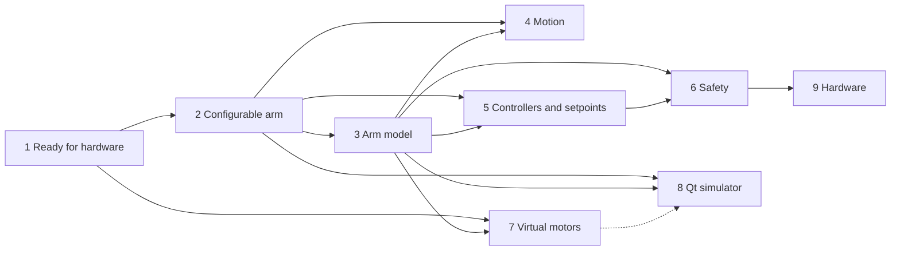

# Roadmap

The phases that take e-robot-arm from today's joint stack to a configurable arm with a simulator and real hardware.
Each phase is a GitHub issue with its detailed steps. This page is the summary, and it changes in the same pull
request as the work it describes. The tracking issue is
[#16](https://github.com/embedded-pro/e-robot-arm/issues/16).

## Where the arm stands

| Component         | Where                | Design                                    |
|-------------------|----------------------|-------------------------------------------|
| Joint bus         | `core/joint_bus/`    | [joint-bus.md](design/joint-bus.md)       |
| Safety supervisor | `core/safety/`       | [safety.md](design/safety.md)             |
| Joint motion      | `core/motion/`       | [joint-motion.md](design/joint-motion.md) |
| Control loop      | `core/control_loop/` | [control-loop.md](design/control-loop.md) |
| Arm composition   | `core/arm/`          | [arm-console.md](design/arm-console.md)   |
| Console           | `tools/arm_console/` | [arm-console.md](design/arm-console.md)   |
| Arm scenarios     | `integration_tests/` | [requirements](requirements/arm/arm.yaml) |

## Phases

| Phase | Issue                                                        | Scope                                                                                                                                                     | Depends on |
|-------|--------------------------------------------------------------|-----------------------------------------------------------------------------------------------------------------------------------------------------------|------------|
| 1     | [#17](https://github.com/embedded-pro/e-robot-arm/issues/17) | Ready for hardware: a command reaches all joints or none, joint ↔ motor transmission, start-up lifecycle, stale telemetry and overruns, scaffold clean-up | —          |
| 2     | [#18](https://github.com/embedded-pro/e-robot-arm/issues/18) | Configurable arm: arm profile, motor controller and motor per joint applied over CAN, arm-controller registry with enable, disable and switch             | 1          |
| 3     | [#19](https://github.com/embedded-pro/e-robot-arm/issues/19) | Arm model: geometry, forward and inverse kinematics, Jacobian, dynamics from robotics-toolbox                                                             | 2          |
| 4     | [#20](https://github.com/embedded-pro/e-robot-arm/issues/20) | Motion: S-curve, replacing a running move, waypoint paths, Cartesian moves, jogging, teach points                                                         | 2, 3       |
| 5     | [#21](https://github.com/embedded-pro/e-robot-arm/issues/21) | Arm controllers and the setpoint contract: combined setpoints in e-foc-protocol and e-foc, controller catalogue from robotics-toolbox                     | 2, 3       |
| 6     | [#22](https://github.com/embedded-pro/e-robot-arm/issues/22) | Safety: speed, acceleration and torque limits, following error, collision detection, workspace, watchdog, hardware stop                                   | 3, 5       |
| 7     | [#23](https://github.com/embedded-pro/e-robot-arm/issues/23) | Simulation with e-foc virtual motors: selectable motor characteristics per joint, coupling to arm dynamics, CI job                                        | 1, 2, 3    |
| 8     | [#24](https://github.com/embedded-pro/e-robot-arm/issues/24) | Qt simulator on ui-cpp: 3-D arm, scopes, forms to choose arm controllers, motor controllers and motors                                                    | 2, 3, (7)  |
| 9     | [#25](https://github.com/embedded-pro/e-robot-arm/issues/25) | Hardware and deployment: bring-up and homing, real-time on the PC, MCU port                                                                               | 1, 2, 6    |

## Configurability

The simulator and the platform choose at run time, from the arm profile, never at compile time:

- **Arm controllers**: which ones are enabled, which one is active, and their parameters. Switching is bumpless or
  happens at rest (phases 2 and 5).
- **Motion generators**: trapezoid, S-curve, waypoints, Cartesian, jog (phase 4).
- **Motor controller per joint**: the e-foc control mode, the algorithm per loop and its gains, applied and verified
  over CAN (phase 2):
  - current loop: PID, decoupled PID, deadbeat or sliding mode;
  - speed loop: PID, LQI, ADRC or two-DOF;
  - position loop: PID, cascade P, LQR, LQI or two-DOF.
- **Motor characteristics per joint**: a preset or custom resistance, inductance, pole pairs, flux, inertia,
  friction and limits. Real nodes get these as motor-model parameters; virtual motors get them as their plant
  (phases 2 and 7).

The architecture is described in [system.md](architecture/system.md#configurability).

## Decisions waiting for input

| Decision                                                    | Phase | Recommendation                                                          |
|-------------------------------------------------------------|-------|-------------------------------------------------------------------------|
| How a command is kept from reaching only some joints        | 1     | The joint bus holds one pending command until the burst drains          |
| The arm's geometry, gear ratios and mass properties         | 1, 3  | A generic six-joint arm with a spherical wrist until real numbers exist |
| Profile file format                                         | 2     | A format already in the dev container's libraries                       |
| Combined and unacknowledged setpoints in e-foc-protocol     | 5     | Combined setpoint first; drop acknowledgements if the bus needs it      |
| Hardware stop: relay or safe-torque-off, and how it is read | 6     | Decided with the bring-up hardware                                      |
