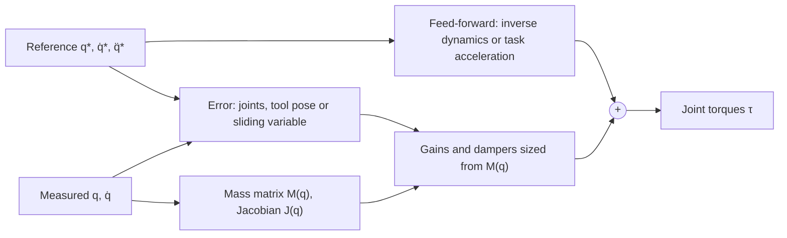

| Field     | Value            |
|-----------|------------------|
| Title     | Arm Control Laws |
| Type      | theory           |
| Status    | draft            |
| Version   | 0.1.0            |
| Component | arm_controllers  |
| Date      | 2026-11-20       |

> The laws that turn a joint reference into joint torques on a six-joint arm whose joints take torque setpoints:
> gravity-compensated PD and PID, computed torque, joint and Cartesian impedance, operational space and Slotine–Li
> adaptive control; how each one's gains are placed, and what a sampled loop with a light, direct-drive wrist allows.

---

## Overview

Every law here closes the arm's position loop on the host, one torque set per control period, around the reference
$q^*, \dot q^*, \ddot q^*$ that joint motion produces. They differ in how much of the arm's dynamics they cancel and in
which space they shape the error: the joints, the tool, or the parameters of the model itself. The choice of law and
its gains is the design of [arm-controllers.md](../design/arm-controllers.md); this note records the mathematics and
the limits that design was measured against.

---

## Prerequisites

- The rigid-body model $M(q)\ddot q + C(q,\dot q)\dot q + G(q) = \tau$ and its terms, from
  [arm-dynamics.md](arm-dynamics.md); every law adds each joint's reflected rotor inertia to the diagonal of $M$.
- The tool Jacobian $J(q)$ (linear rows first, base frame) and the pose error $e$ of a desired tool pose against the
  measured one, from [arm-kinematics.md](arm-kinematics.md).
- Second-order closed loops: a pair of poles at natural frequency $\omega$ with damping ratio $\zeta$.

---

## Mathematical Foundation

### Model / Setup

The arm is sampled every $T$ (10 ms on the reference arm) and its torque is held for the period; the readings it
acts on are half a period old or more. A loop whose fastest mode has natural frequency $\omega$ and per-period
damping $d$ (rad/s) stays well inside its stability margin while $\omega T \lesssim 0.3$ and $d\,T$ stays well below
2. The reference arm's wrist is direct drive and light: joint 6 moves about $3\cdot10^{-5}$ kg·m² and joint 5 about
$5\cdot10^{-4}$, while joint 2 moves about 0.3.

### Derivation

**Gravity-compensated PD and PID.** With gains proportional to the mass matrix at the measured pose,

$$\tau = M(q)\left[\omega^2 (q^* - q) - 2\zeta\omega\,\dot q\right] + G(q),$$

the closed loop near rest is $M(\ddot e + 2\zeta\omega\dot e + \omega^2 e) \approx 0$ with $e = q^* - q$: every mode sits
at $\omega$ with damping $\zeta$, whatever its inertia. The PID adds an integral on the position error and places a
real pole at $\omega$ as well: $K_p = (2\zeta + 1)\omega^2$, $K_i = \omega^3$, $K_d = (2\zeta + 1)\omega$, all multiplied
by $M(q)$. Gains taken from the mass matrix at one pose instead detune every other pose by the ratio of the inertias.

**Computed torque** cancels the whole model: $\tau = M(q)\,a + C\dot q + G$ with
$a = \ddot q^* + K_d(\dot q^* - \dot q) + K_p(q^* - q)$, $K_p = \omega^2 I$, $K_d = 2\zeta\omega I$.

**Impedance around the reference.** Joint impedance renders a spring $K$ per joint and a damper $D$ about the
reference, with the reference's inverse dynamics fed forward:

$$\tau = M(q)\ddot q^* + C(q,\dot q^*)\dot q^* + G(q) + K(q^* - q) + D(\dot q^* - \dot q).$$

The feed-forward makes the arm follow the reference on its own; $K$ and $D$ answer only a push or the model's error,
so the arm is as stiff to a push as $K$ says. Cartesian impedance puts the spring on the tool,
$\tau_{\text{spring}} = J^\top K_x e$, with $K_x = \mathrm{diag}(k_t, k_t, k_t, k_r, k_r, k_r)$; its joint-space image is
$K_q = J^\top K_x J$.

**A damper that matches each joint.** For a diagonal stiffness $K_i$ on a coupled mass matrix, the damper

$$D = 2\zeta\, W M W, \qquad W = \mathrm{diag}\left(\sqrt{\omega_i}\right), \quad \omega_i = \sqrt{K_i / M_{ii}}$$

has the diagonal $2\zeta\sqrt{K_i M_{ii}}$, keeps the couplings of $M$, is positive definite with $M$, and reduces to
$2\zeta\omega M$ when every $\omega_i$ is equal. Sized per joint without the couplings, the light wrist joints' fastest
coupled mode is left under-damped; sized per task axis from the tool's effective mass $1/(J M^{-1} J^\top)_{jj}$, the
heavy joints' mass reaches the light wrist joints through $J$, and their damping exceeds what a sampled loop holds.

**Operational space.** With the task inertia $\Lambda = (J M^{-1} J^\top + \sigma^2 I)^{-1}$,

$$\tau = J^\top \Lambda\left(\ddot x^* + K_d \dot e + K_p e - \dot J \dot q\right) + C\dot q + G$$

gives the tool $\ddot x = \ddot x^* + K_d\dot e + K_p e$: a decoupled second-order system in task space.

**Slotine–Li.** With $s = \dot q - \dot q_r$, $\dot q_r = \dot q^* - \Lambda (q - q^*)$ and the regressor $Y$, linear in the
inertial parameters $\theta$,

$$\tau = Y(q, \dot q, \dot q_r, \ddot q_r)\,\hat\theta - K_d s, \qquad \dot{\hat\theta} = -\Gamma\, Y^\top s,$$

and $V = \tfrac12 s^\top M s + \tfrac12 \tilde\theta^\top \Gamma^{-1} \tilde\theta$ decreases along the closed loop, so $s \to 0$
and the tracking error with it, whether or not $\hat\theta$ reaches the true parameters.

### Key Results

| Result                                                 | Condition                                           |
|--------------------------------------------------------|-----------------------------------------------------|
| Every mode at $\omega$, damping $\zeta$                | Gains $\propto M(q)$ at the measured pose           |
| Tracking without lag $2\zeta/\omega \cdot \dot q^*$    | Reference dynamics fed forward                      |
| Stiffness to a push equals $K$                         | Impedance laws, feed-forward or not                 |
| Tool follows $\ddot x^* + K_d \dot e + K_p e$          | Operational space away from a singularity           |
| $s \to 0$ with bounded $\hat\theta$                    | Slotine–Li, persistently bounded reference          |
| Adaptation rate in proportion to each parameter's size | $\Gamma_{kk} = \gamma(\theta^0_k{}^2 + \epsilon^2)$ |

---

## Block Diagrams

---

## Numerical Properties

| Property   | Value / Condition                                                                                                                       |
|------------|-----------------------------------------------------------------------------------------------------------------------------------------|
| Complexity | One mass matrix per period, plus a Jacobian (tool laws), a 6×6 solve (operational space, free inertia) or a 6×60 regressor (Slotine–Li) |
| Precision  | Single precision; the task-inertia inverse is regularised by $\sigma$                                                                   |
| Stability  | Fastest mode $\omega T \lesssim 0.3$ with the measurement delay of about half a period                                                  |
| Range      | Joint-space laws everywhere; task-space laws need $J$ well conditioned (see Limitations)                                                |

The light wrist is the most sensitive part: a rotational stiffness $k_r$ lands on joint 6 alone, so
$\omega_6 \approx \sqrt{k_r / I_6}$, and the eigenvalues of $J M^{-1} J^\top$ span about four decades, translational near 1
and rotational near $10^4$, so a single $\sigma$ cannot regularise both.

---

## Worked Example

On the reference arm, $I_6 \approx 2.7\cdot10^{-5}$ kg·m² at $T = 10$ ms. A rotational stiffness $k_r = 0.07$ N·m/rad
gives $\omega_6 \approx \sqrt{0.07 / 2.7\cdot10^{-5}} \approx 51$ rad/s before the coupling with joint 4 lowers it; the
simulated arm held it, while $k_r = 0.2$ ($\omega_6 \approx 86$ rad/s, $\omega_6 T \approx 0.9$) diverged near home.

---

## Limitations & Assumptions

- **Assumes**: a rigid-body model whose mass properties are close to the arm's (Slotine–Li learns the gap); joints
  that apply the commanded torque within a period.
- **Assumes**: a reference with bounded acceleration; a step reference drives the light wrist hard under the tool
  laws, since a tool force accelerates the lightest joints first.
- **Does not handle**: singular poses in the tool laws on their own: Cartesian impedance cannot push along a lost
  direction, and operational space hands over to joint-space computed torque below a manipulability minimum.
- **Does not handle**: unmodelled friction in the adaptation, which can drift the estimated parameters.

## References

1. O. Khatib, "A unified approach for motion and force control of robot manipulators: the operational space
   formulation", IEEE Journal on Robotics and Automation, 1987.
2. J.-J. E. Slotine and W. Li, "On the adaptive control of robot manipulators", International Journal of Robotics
   Research, 1987.
3. N. Hogan, "Impedance control: an approach to manipulation", Journal of Dynamic Systems, Measurement and Control,
   1985.
4. B. Siciliano, L. Sciavicco, L. Villani and G. Oriolo, *Robotics: Modelling, Planning and Control*, Springer, 2009.
