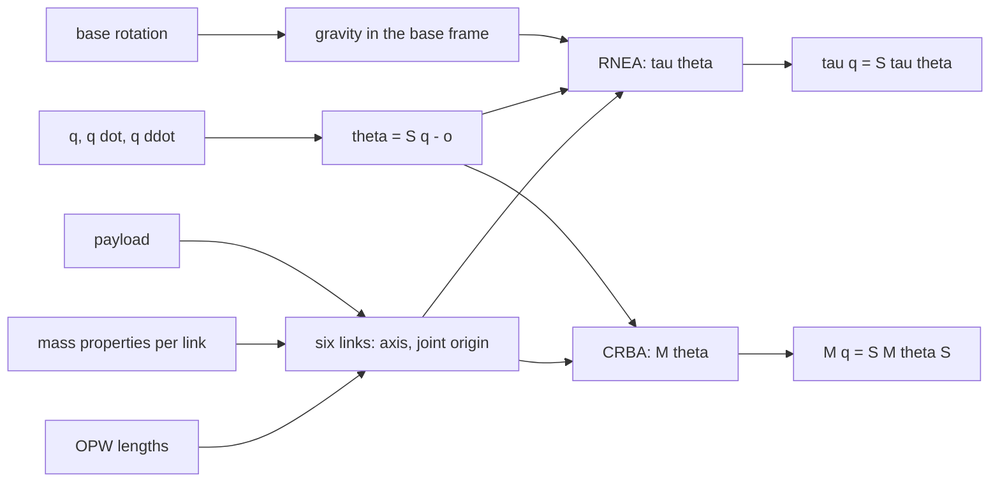

| Field     | Value        |
|-----------|--------------|
| Title     | Arm Dynamics |
| Type      | theory       |
| Status    | draft        |
| Component | arm_model    |
| Version   | 0.1.0        |
| Date      | 2026-11-13   |

> The rigid-body dynamics of the six-joint OPW arm: the link chain built from the OPW lengths, the gravity torque,
> the inverse dynamics and the mass matrix, and how they move between model angles and joint space
> ([arm-model.md](../design/arm-model.md)).

---

## Overview

The torque each joint needs is $\boldsymbol{\tau} = M(q)\,\ddot q + C(q, \dot q)\,\dot q + G(q)$: the mass matrix, the
Coriolis and centrifugal terms and the gravity torque. The arm model describes the arm as a chain of six rigid links
from its OPW lengths and the links' mass properties, and leaves the algorithms to robotics-toolbox: the recursive
Newton–Euler algorithm for the inverse dynamics and the gravity torque, the composite rigid body algorithm for the mass
matrix. Both are fixed-cost, heap-free and linear in the number of links.

---

## Prerequisites

| Concept                                  | Where                                                            |
|------------------------------------------|------------------------------------------------------------------|
| The OPW parameters, model angles θ       | [arm-kinematics.md](arm-kinematics.md)                           |
| Inertia tensor, parallel-axis theorem    | Any rigid-body mechanics text                                    |
| Recursive Newton–Euler, composite bodies | Featherstone, *Rigid Body Dynamics Algorithms*; robotics-toolbox |

---

## Mathematical Foundation

### Model / Setup

Each link carries a frame at its joint, which rotates the link about the joint's axis. At zero every link frame is
parallel to the base frame (z up, x forward). Link $i$'s joint sits at a fixed offset in link $i-1$'s frame:

| Link | Joint axis         | Joint origin in the previous link | Body                               |
|------|--------------------|-----------------------------------|------------------------------------|
| 1    | $\hat{\mathbf{z}}$ | $(0, 0, 0)$                       | Turret, up to the shoulder         |
| 2    | $\hat{\mathbf{y}}$ | $(a_1, b, c_1)$                   | Upper arm, shoulder to elbow       |
| 3    | $\hat{\mathbf{y}}$ | $(0, 0, c_2)$                     | Forearm, elbow to wrist centre     |
| 4    | $\hat{\mathbf{z}}$ | $(a_2, 0, c_3)$                   | Wrist roll                         |
| 5    | $\hat{\mathbf{y}}$ | $(0, 0, 0)$                       | Wrist pitch                        |
| 6    | $\hat{\mathbf{z}}$ | $(0, 0, 0)$                       | Flange, at $(0, 0, c_4)$ in link 6 |

Composing the six rotations gives $R_z(\theta_1)R_y(\theta_2)R_y(\theta_3)R_z(\theta_4)R_y(\theta_5)R_z(\theta_6)$ and
puts the flange where the OPW forward kinematics does, so the chain and the kinematics describe one arm.

Each link has a mass $m$, a centre of mass $\mathbf{r}$ in its own frame, and an inertia tensor $I$ about the centre of
mass, in its own frame:

$$
I = \begin{pmatrix} I_{xx} & I_{xy} & I_{xz} \\ I_{xy} & I_{yy} & I_{yz} \\ I_{xz} & I_{yz} & I_{zz} \end{pmatrix}
$$

with the products written as tensor elements, as URDF does ($I_{xy} = -\int xy\,dm$).

### Derivation

**Payload.** A payload, mass $m_p$ at $\mathbf{r}_p$ relative to the flange, is merged into link 6 before the chain is
built: with $\mathbf{p} = (0, 0, c_4) + \mathbf{r}_p$ in link 6's frame,

$$
m = m_6 + m_p, \qquad \mathbf{r} = \frac{m_6\,\mathbf{r}_6 + m_p\,\mathbf{p}}{m}, \qquad
I = I_6 + m_6\,S(\mathbf{r}_6 - \mathbf{r}) + I_p + m_p\,S(\mathbf{p} - \mathbf{r}),
$$

where $S(\mathbf{d}) = (\mathbf{d}\cdot\mathbf{d})\,\mathbb{1} - \mathbf{d}\,\mathbf{d}^{\mathsf T}$ is the
parallel-axis term. With no mass at all the link keeps its own centre.

**Gravity.** Gravity is $\mathbf{g} = (0, 0, -9.81)$ m/s² in the world. The chain is expressed in the arm's base frame,
so it sees $\mathbf{g}_b = B_R^{\mathsf T}\,\mathbf{g}$, with $B_R$ the base mount's rotation: an arm mounted on a
wall or upside down gets the right gravity torque.

**Joint space.** The chain works in model angles $\theta = S q - o$ with $S = \operatorname{diag}(s_i)$, so
$\dot\theta = S\dot q$ and $\ddot\theta = S\ddot q$. Power is the same in both, $\boldsymbol\tau_q^{\mathsf T}\dot q =
\boldsymbol\tau_\theta^{\mathsf T}\dot\theta$, hence

$$
\boldsymbol\tau_q = S\,\boldsymbol\tau_\theta, \qquad M_q = S\,M_\theta\,S, \qquad G_q = S\,G_\theta.
$$

### Key Results

- **Gravity torque** $G(q)$: the torque each joint holds at rest, $\boldsymbol\tau(q, 0, 0)$.
- **Inverse dynamics** $\boldsymbol\tau(q, \dot q, \ddot q)$: the joint torques of a motion, gravity included.
- **Mass matrix** $M(q)$: symmetric and positive definite; the kinetic energy is $\tfrac12\dot q^{\mathsf T}M\dot q$.
- **Checks that hold for any arm.** For a point mass $m$ at the tool centre point with no other mass,
  $G = J_v^{\mathsf T}(0, 0, m\,9.81)$ and $M = m\,J_v^{\mathsf T}J_v$, with $J_v$ the linear rows of the Jacobian;
  $\boldsymbol\tau(q, 0, \ddot q) - G = M\ddot q$; and the Coriolis power is half the rate of change of the
  mass matrix, $\dot q^{\mathsf T}(\boldsymbol\tau(q, \dot q, 0) - G) = \tfrac12\dot q^{\mathsf T}\dot M\dot q$.

---

## Block Diagrams

---

## Numerical Properties

| Property    | Value                                                                     |
|-------------|---------------------------------------------------------------------------|
| Type        | float                                                                     |
| Algorithms  | Recursive Newton–Euler (one forward, one backward pass), composite bodies |
| Cost        | Fixed: no iteration, no branch on the joint values                        |
| Mass matrix | Symmetric by construction; positive definite while every link has inertia |

---

## Worked Example

The reference desktop arm's mass properties are those of [arm-model.md](../design/arm-model.md) Part F. Upright, every
centre of mass of links 2 to 6 lies on the vertical line through the shoulder axis, so the shoulder and the elbow hold
no torque. With the upper arm horizontal ($q_2 = \pi/2$, the rest at zero), the shoulder holds about
$9.81\,(1.0 \cdot 0.11 + 0.8 \cdot 0.35 + 0.3 \cdot 0.47 + 0.25 \cdot 0.52 + 0.1 \cdot 0.55) \approx 7.0$ N·m.

---

## Limitations & Assumptions

- Rigid links and joints: no gear elasticity, no backlash.
- No friction and no rotor inertia: the motor's friction and the reflected rotor inertia (rotor inertia times the
  square of the gear ratio) belong to each joint's drive, not to the arm model.
- The reference mass properties are invented, aluminium tubes and small motors, until the real arm is weighed.

---

## References

1. R. Featherstone, *Rigid Body Dynamics Algorithms*, Springer, 2008.
2. J. J. Craig, *Introduction to Robotics: Mechanics and Control*, chapter 6.
3. robotics-toolbox `robotics/dynamics/ChainDynamicsModel.hpp`, `RecursiveNewtonEuler.hpp`,
   `CompositeRigidBodyAlgorithm.hpp`.
