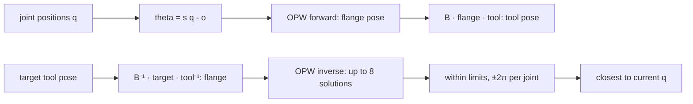

| Field     | Value          |
|-----------|----------------|
| Title     | Arm Kinematics |
| Type      | theory         |
| Status    | draft          |
| Component | arm_model      |
| Version   | 0.1.0          |
| Date      | 2026-11-13     |

> The forward and inverse kinematics, Jacobian and singularities of a six-joint arm with a spherical wrist, in the
> OPW parameterisation the arm model uses ([arm-model.md](../design/arm-model.md)).

---

## Overview

Most six-axis arms share one shape: a vertical base joint, two parallel shoulder and elbow joints, and a wrist whose
three axes meet in one point. Seven lengths describe every arm of that shape, the **OPW parameters** ("ortho-parallel
basis with a spherical wrist", Brandstötter, Angerer and Hofbaur, 2014). One set of parameters gives the forward
kinematics and a closed-form inverse with all eight branches, so the two can never disagree, which a separate DH
table and a numerical inverse cannot promise.

---

## Prerequisites

| Concept                                   | Where                                                         |
|-------------------------------------------|---------------------------------------------------------------|
| Rotation matrices, homogeneous transforms | Any robotics text; robotics-toolbox `math::SE3Transform`      |
| Geometric Jacobian                        | robotics-toolbox `kinematics::GeometricJacobian`              |
| Joint positions in joint space            | [joint-bus.md](../design/joint-bus.md), the transmission part |

---

## Mathematical Foundation

### Model / Setup

The base frame has z up and x forward. At zero the arm stands upright. The seven parameters, all in metres:

| Parameter | Meaning                                                |
|-----------|--------------------------------------------------------|
| c1        | Height of the shoulder axis above the base             |
| a1        | Forward offset of the shoulder axis from the base axis |
| b         | Sideways offset of the arm from the base axis          |
| c2        | Upper arm: shoulder axis to elbow axis                 |
| a2        | Elbow offset, perpendicular to the forearm             |
| c3        | Forearm: elbow axis to the wrist centre                |
| c4        | Wrist centre to the flange                             |

Each joint position $q_i$ (joint space, radians) maps to the model angle $\theta_i = s_i q_i - o_i$, with a sign
$s_i = \pm 1$ and an offset $o_i$ per joint, so the arm's zero and direction need not match the model's.

### Derivation

With $k = \sqrt{a_2^2 + c_3^2}$ and $\psi = \operatorname{atan2}(a_2, c_3)$, the wrist centre is

$$
\mathbf{c} = R_z(\theta_1)
\begin{pmatrix} a_1 + c_2 \sin\theta_2 + k \sin(\theta_2 + \theta_3 + \psi) \\ b \\ c_2 \cos\theta_2 + k \cos(\theta_2 + \theta_3 + \psi) \end{pmatrix}
+ \begin{pmatrix} 0 \\ 0 \\ c_1 \end{pmatrix}
$$

and the flange orientation and position are

$$
R = R_z(\theta_1)\,R_y(\theta_2 + \theta_3)\,R_z(\theta_4)\,R_y(\theta_5)\,R_z(\theta_6), \qquad
\mathbf{p}_f = \mathbf{c} + c_4\,R\,\hat{\mathbf{z}}.
$$

The tool pose is $T = B \cdot F(q) \cdot T_t$: the base mount $B$, the flange pose $F$ and the tool transform $T_t$.

**Inverse.** The wrist centre follows from the target: $\mathbf{c} = \mathbf{p}_f - c_4 R\hat{\mathbf{z}}$. Its
horizontal angle gives $\theta_1$ (front and back shoulder); the triangle shoulder–elbow–wrist gives $\theta_2$ and
$\theta_3$ (elbow up and down); the remaining rotation $(R_z(\theta_1)R_y(\theta_2+\theta_3))^{\mathsf T}R$ gives the
wrist angles, two ways (wrist flip). That is up to eight solutions; a target out of reach has none.

**Jacobian.** The geometric Jacobian needs each joint's axis and a point on it, in the base frame:

| Joint | Axis                                                               | Point on the axis                                                  |
|-------|--------------------------------------------------------------------|--------------------------------------------------------------------|
| 1     | $\hat{\mathbf{z}}$                                                 | origin                                                             |
| 2     | $R_z(\theta_1)\hat{\mathbf{y}}$                                    | $R_z(\theta_1)(a_1, 0, c_1)$                                       |
| 3     | $R_z(\theta_1)\hat{\mathbf{y}}$                                    | $R_z(\theta_1)(a_1 + c_2\sin\theta_2,\ 0,\ c_1 + c_2\cos\theta_2)$ |
| 4     | $R_z(\theta_1)R_y(\theta_2+\theta_3)\hat{\mathbf{z}}$              | $\mathbf{c}$                                                       |
| 5     | $R_z(\theta_1)R_y(\theta_2+\theta_3)R_z(\theta_4)\hat{\mathbf{y}}$ | $\mathbf{c}$                                                       |
| 6     | $R\hat{\mathbf{z}}$                                                | $\mathbf{c}$                                                       |

Column $i$ is $s_i\,[\mathbf{z}_i \times (\mathbf{p} - \mathbf{o}_i);\ \mathbf{z}_i]$, the sign because
$\partial\theta_i/\partial q_i = s_i$; all are rotated by the base mount.

### Key Results

- **Branch choice.** Of the solutions, the arm keeps those whose six joints lie within the joint limits, trying each
  joint also at $\pm 2\pi$, and returns the one closest to the current joints (least sum of squared differences). No
  solution: the target is out of reach. Solutions, none within the limits: the target is outside the joint limits.
- **Singularities.** The arm reports which of the three it is near:
  - wrist: $|\sin\theta_5| < 0.01$, joints 4 and 6 aligned;
  - elbow: $|\sin(\theta_3 + \psi)| < 0.01$, the arm stretched or folded;
  - shoulder: the wrist centre within 5 mm of the base axis.
- **Manipulability** $w = |\det J|$ for the square $6\times6$ Jacobian; it falls to zero at every singularity.

---

## Block Diagrams

---

## Numerical Properties

| Property                | Value                                                                                     |
|-------------------------|-------------------------------------------------------------------------------------------|
| Type                    | float                                                                                     |
| Round trip FK → IK → FK | Position within 10⁻⁴ m and orientation within 10⁻³ rad over the reference arm's workspace |
| Acos argument           | Clamped to [−1, 1] within 100 ε, so a target on the reach boundary still solves           |
| Cost                    | Closed form: a fixed number of trigonometric calls, no iteration                          |

---

## Worked Example

The reference desktop arm: c1 = 0.15, a1 = 0.02, b = 0, c2 = 0.25, a2 = 0, c3 = 0.25, c4 = 0.06, all signs +1 and
offsets 0. At zero the wrist centre is at (0.02, 0, 0.65) and the flange at (0.02, 0, 0.71), pointing up; the elbow is
stretched, so the arm reports an elbow singularity there, and a wrist singularity since θ5 = 0. With θ2 = π/2 the upper
arm lies forward and the flange is at (0.58, 0, 0.15).

---

## Limitations & Assumptions

- Only arms of the OPW shape: six revolute joints, joints 2 and 3 parallel, a spherical wrist. Any other arm needs a
  DH or product-of-exponentials description and a numerical inverse, a later addition.
- The thresholds of the singularity flags are fixed fractions, not tuned to a particular arm.
- The reference arm is invented; its numbers stand until the real arm's are known.

---

## References

1. M. Brandstötter, A. Angerer, M. Hofbaur, "An Analytical Solution of the Inverse Kinematics Problem of Industrial
   Serial Manipulators with an Ortho-parallel Basis and a Spherical Wrist", Austrian Robotics Workshop, 2014.
2. robotics-toolbox `robotics/kinematics/AnalyticalIkOpw.hpp`, `GeometricJacobian.hpp`.
