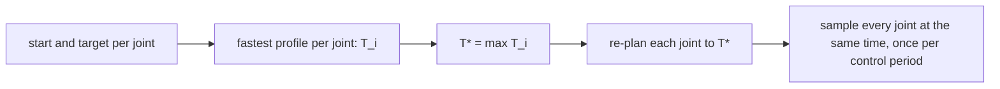

| Field     | Value                          |
|-----------|--------------------------------|
| Title     | Synchronised Trapezoidal Moves |
| Type      | theory                         |
| Status    | draft                          |
| Component | motion                         |
| Version   | 0.1.0                          |
| Date      | 2026-11-13                     |

> The mathematics behind joint motion's point-to-point moves ([joint-motion.md](../design/joint-motion.md)):
> one trapezoidal velocity profile per joint, stretched so that all six joints start and stop together.

---

## Overview

A point-to-point move takes each joint from rest at its start to rest at its target. Each joint is limited in speed
and acceleration. Moving every joint as fast as it can would make the joints arrive at different times, and the arm
would trace a path that depends on which joint finishes first. Joint motion therefore plans every joint, finds the
slowest one, and re-plans every other joint to take exactly as long, at its own acceleration limit and a lower
cruise speed. The arm then starts and stops as one.

---

## Prerequisites

| Symbol          | Meaning                                              | Unit   |
|-----------------|------------------------------------------------------|--------|
| $q_0$, $q_f$    | Start and target position of a joint                 | rad    |
| $d$             | Distance to travel, $\lvert q_f - q_0 \rvert$        | rad    |
| $v_{max}$       | Joint speed limit                                    | rad/s  |
| $a_{max}$       | Joint acceleration limit                             | rad/s² |
| $v$             | Cruise (peak) speed of the profile                   | rad/s  |
| $t_a$           | Duration of the acceleration and of the deceleration | s      |
| $t_c$           | Duration of the cruise                               | s      |
| $T_i$           | Fastest duration of joint $i$ on its own             | s      |
| $T^\ast$        | Common duration of the move                          | s      |

---

## Mathematical Foundation

### Model / Setup

Each joint follows a velocity profile with three phases: constant acceleration $a_{max}$ for $t_a$, constant speed
$v$ for $t_c$, and constant deceleration $a_{max}$ for $t_a$, with $t_a = v / a_{max}$. The distance travelled is the
area under the velocity profile:

$$
d = v \, (t_a + t_c) = v \, (T - t_a), \qquad T = 2 t_a + t_c
$$

### Derivation

**Fastest move of one joint.** The joint reaches $v_{max}$ only when the distance allows a full acceleration and
deceleration, $d \ge v_{max}^2 / a_{max}$:

$$
T_i = \frac{d}{v_{max}} + \frac{v_{max}}{a_{max}} \quad \text{(trapezoid)}, \qquad
T_i = 2 \sqrt{\frac{d}{a_{max}}} \quad \text{(triangle, } d < v_{max}^2 / a_{max} \text{)}
$$

**Common duration.** The slowest joint sets the move's duration, $T^\ast = \max_i T_i$.

**Stretching a joint to $T^\ast$.** Keep the acceleration at $a_{max}$ and solve the distance equation for the
cruise speed. With $t_a = v / a_{max}$:

$$
d = v \left( T^\ast - \frac{v}{a_{max}} \right)
\quad\Longleftrightarrow\quad
v^2 - a_{max} T^\ast v + a_{max} d = 0
$$

The smaller root is the one with $t_a \le T^\ast / 2$:

$$
v = \frac{a_{max} T^\ast - \sqrt{a_{max}^2 T^{\ast 2} - 4 a_{max} d}}{2}
  = \frac{2 a_{max} d}{a_{max} T^\ast + \sqrt{a_{max}^2 T^{\ast 2} - 4 a_{max} d}}
$$

### Key Results

- The discriminant is non-negative exactly when $T^\ast \ge 2 \sqrt{d / a_{max}}$, the joint's shortest possible move
  at unlimited speed. Since $T^\ast \ge T_i \ge 2 \sqrt{d / a_{max}}$, every joint can always be stretched.
- The stretched cruise speed never exceeds $v_{max}$: a longer duration for the same distance needs a lower speed.
- Every joint is at rest at $t = 0$ and at $t = T^\ast$ and moves monotonically in between, so a target within the
  joint's position limits keeps the whole move within them.
- A joint with $d = 0$ stays where it is; its profile is identically zero.

---

## Block Diagrams

---

## Numerical Properties

| Property   | Value / Condition                                                                                   |
|------------|-----------------------------------------------------------------------------------------------------|
| Complexity | O(1) per joint to plan and to sample; six joints per move                                            |
| Precision  | Single-precision floats; the second form of $v$ avoids the cancellation of the first when $4 a_{max} d \ll a_{max}^2 T^{\ast 2}$ |
| Stability  | No iteration and no accumulated state: each sample is computed from the time since the start       |
| Range      | Any finite distance; a non-positive acceleration or duration, or a negative discriminant, has no profile |

The samples are taken once per control period, so the last sample at or after $T^\ast$ is the target itself and is
sent exactly once.

---

## Worked Example

Two joints, both with $v_{max} = 1$ rad/s and $a_{max} = 2$ rad/s².

| Joint | $d$ (rad) | Shape     | $T_i$ (s)                         |
|-------|-----------|-----------|-----------------------------------|
| 1     | 0.5       | trapezoid | $0.5 / 1 + 1 / 2 = 1.000$         |
| 2     | 0.2       | triangle  | $2 \sqrt{0.2 / 2} = 0.632$        |

The common duration is $T^\ast = 1.000$ s. Joint 2 is stretched:

$$
v = \frac{2 \cdot 2 \cdot 0.2}{2 \cdot 1 + \sqrt{4 - 1.6}} = \frac{0.8}{3.549} = 0.225 \text{ rad/s}, \qquad
t_a = 0.113 \text{ s}, \quad t_c = 0.775 \text{ s}
$$

Check: $v (T^\ast - t_a) = 0.225 \cdot 0.887 = 0.200$ rad.

---

## Limitations & Assumptions

- **Assumes**: every joint starts and ends at rest; limits are symmetric (the same for acceleration and
  deceleration); the six joints are independent, so joint-space synchronisation is enough.
- **Does not handle**: jerk limits (an S-curve is open question 1 of joint-motion.md), moves that start while the
  arm is moving, Cartesian paths, or torque and power limits that depend on the arm's dynamics (phase 3).

---

## References

1. L. Biagiotti and C. Melchiorri, *Trajectory Planning for Automatic Machines and Robots*, Springer, 2008, chapter 3
   (trapezoidal velocity profiles and their synchronisation).
2. B. Siciliano, L. Sciavicco, L. Villani and G. Oriolo, *Robotics: Modelling, Planning and Control*, Springer,
   2009, section 4.2 (joint-space trajectories).
